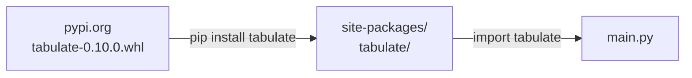
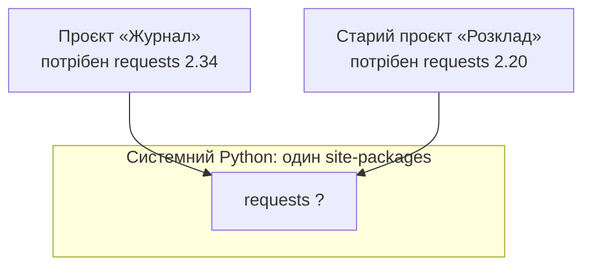
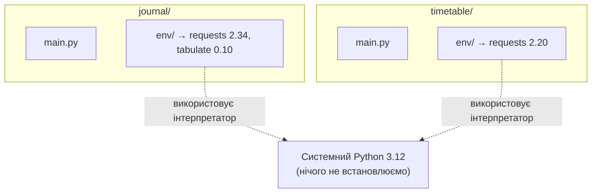
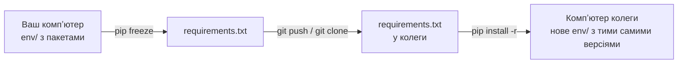

# 31. (Л) Робота з зовнішніми бібліотеками. pip, venv, встановлення та підключення пакетів

## Зміст лекції

1. Навіщо сторонні пакети, якщо є стандартна бібліотека
2. PyPI — каталог пакетів Python
3. Проблема: один Python на всі проєкти
4. Віртуальне оточення `venv`
5. Як влаштоване віртуальне оточення
6. `pip`: встановлення і видалення пакетів
7. Версії пакетів
8. `requirements.txt`: список залежностей проєкту
9. Підключення пакета в коді
10. Як обрати пакет
11. Приклад: журнал оцінок з `tabulate`
12. Інші інструменти: `pipx`, `uv`, `pyproject.toml`
13. Типові помилки

## Навіщо сторонні пакети, якщо є стандартна бібліотека

У лекції 29 ми працювали з модулями **стандартної бібліотеки**: `math`, `random`, `datetime`, `os`, `sys`. Вони встановлюються разом з Python, тому достатньо написати `import`.

Але стандартна бібліотека не може містити все. Немає в ній, наприклад, зручного виводу таблиць, побудови графіків, роботи з Excel чи вебфреймворку. Такі задачі розвʼязують **сторонні пакети** (third-party packages): код, який написали інші розробники й опублікували для загального користування.

| | Стандартна бібліотека | Сторонні пакети |
|---|---|---|
| Звідки береться | разом з Python | завантажується з інтернету |
| Як підключити | одразу `import` | спочатку встановити, потім `import` |
| Хто підтримує | розробники Python | автори пакета (окремі люди, компанії, спільноти) |
| Де лежить | `/usr/lib/python3.12/` | каталог `site-packages` (лекція 27) |
| Приклади | `math`, `json`, `pathlib`, `logging` | `requests`, `tabulate`, `numpy`, `django` |

Ось як виглядає той самий запит до вебсервера стандартними засобами і через сторонній пакет `requests`:

```python
# Program: an HTTP request with the standard library only (urllib)
import json
import urllib.request

with urllib.request.urlopen("https://api.github.com/repos/python/cpython", timeout=10) as response:
    data = json.loads(response.read().decode("utf-8"))

print("stars:", data["stargazers_count"])
```

```python
# Program: the same request with the third-party package requests
# Потрібно встановити: python3 -m pip install requests
import requests

data = requests.get("https://api.github.com/repos/python/cpython", timeout=10).json()

print("stars:", data["stargazers_count"])
```

```text
stars: 77673
```

Результат однаковий, але другий варіант коротший і зрозуміліший. Саме тому `requests` — один з найпопулярніших пакетів Python.

## PyPI — каталог пакетів Python

**PyPI** (Python Package Index, [pypi.org](https://pypi.org/)) — офіційне сховище пакетів Python. На ньому опубліковано понад півмільйона проєктів. Програма **pip** (Package Installer for Python) завантажує пакети з PyPI і встановлює їх у ваш Python.



Шлях пакета завжди однаковий: **PyPI → pip → site-packages → import**.

На сторінці кожного пакета на PyPI є команда для встановлення, номер останньої версії, опис, посилання на документацію і вихідний код.

### Імʼя для `pip` і імʼя для `import`

Імʼя, під яким пакет опубліковано на PyPI (**назва дистрибутива**), і імʼя модуля, який ви імпортуєте, часто збігаються — але не завжди:

| `pip install ...` | `import ...` |
|---|---|
| `requests` | `requests` |
| `tabulate` | `tabulate` |
| `python-dateutil` | `dateutil` |
| `beautifulsoup4` | `bs4` |
| `Pillow` | `PIL` |
| `PyYAML` | `yaml` |
| `scikit-learn` | `sklearn` |

Правильне імʼя для `import` завжди написане в документації пакета, у розділі «Quickstart» або «Usage».

## Проблема: один Python на всі проєкти

Без додаткових налаштувань є **один** каталог `site-packages` на весь системний Python. Уявіть два проєкти на одному компʼютері:



Одночасно може бути встановлена лише **одна** версія пакета. Оновили `requests` для журналу — може зламатися розклад. Повернули стару версію — ламається журнал.

Друга проблема — системний Python належить операційній системі. Linux сам використовує Python для своїх утиліт і встановлює для них пакети через `apt`. Якщо `pip` перезапише системний пакет іншою версією, можна зламати системні програми.

Тому сучасні Debian, Ubuntu і Homebrew на macOS **забороняють** встановлювати пакети в системний Python (PEP 668):

```bash
pip install tabulate
```

```text
error: externally-managed-environment

× This environment is externally managed
╰─> To install Python packages system-wide, try apt install
    python3-xyz, where xyz is the package you are trying to
    install.

    If you wish to install a non-Debian-packaged Python package,
    create a virtual environment using python3 -m venv path/to/venv.
    Then use path/to/venv/bin/python3 and path/to/venv/bin/pip.
    ...
```

Повідомлення саме підказує розвʼязок: **віртуальне оточення**.

!!! danger "Не використовуйте `sudo pip install` і `--break-system-packages`"
    В інтернеті часто радять «просто додати `sudo`» або прапорець `--break-system-packages`. Так ви обходите захист і записуєте пакети прямо в системні каталоги. Наслідки — зламані системні утиліти, які важко полагодити. Для своїх проєктів завжди використовуйте віртуальне оточення.

## Віртуальне оточення `venv`

**Віртуальне оточення** (virtual environment) — це окремий каталог з власним `site-packages` для одного проєкту. Кожен проєкт має свій набір пакетів потрібних версій і не заважає іншим.



Модуль `venv` входить до стандартної бібліотеки. На Debian/Ubuntu його треба один раз доставити (лекція 02): `sudo apt install python3-venv`.

### Створення

Перейдіть у каталог проєкту і виконайте:

```bash
cd ~/projects/journal
python3 -m venv env
```

Тут `-m venv` запускає модуль `venv` (лекція 27), а `env` — назва каталогу, який буде створено. Назва може бути будь-якою; найчастіше використовують `env`, `.venv` або `venv`. У цьому курсі — `env`.

### Активація

```bash
source env/bin/activate
```

```text
(env) student@laptop:~/projects/journal$
```

На початку рядка запрошення зʼявилося `(env)` — це ознака, що оточення активне. Тепер команди `python3` і `pip` у **цьому терміналі** працюють з Python з каталогу `env/`:

```bash
which python3
which pip
```

```text
/home/student/projects/journal/env/bin/python3
/home/student/projects/journal/env/bin/pip
```

### Деактивація

```bash
deactivate
```

Префікс `(env)` зникає, і `python3` знову вказує на системний інтерпретатор.

!!! note "Активація діє лише в одному терміналі"
    Відкрили новий термінал або вкладку — оточення там **не активне**, треба знову виконати `source env/bin/activate`. Більшість редакторів (VS Code, PyCharm) вміють активувати оточення автоматично, якщо вибрати інтерпретатор `env/bin/python3` у налаштуваннях проєкту.

### Як перевірити, яке оточення активне

Зручно мати під рукою маленький скрипт, який показує, яким інтерпретатором його запустили:

```python
# File: which_env.py
import sys

print("python:", sys.executable)
print("prefix:", sys.prefix)

# У віртуальному оточенні prefix вказує на env/, а base_prefix — на системний Python
if sys.prefix != sys.base_prefix:
    print("inside a virtual environment")
else:
    print("system Python, no virtual environment")
```

```bash
python3 which_env.py
source env/bin/activate
python3 which_env.py
```

```text
python: /usr/bin/python3
prefix: /usr
system Python, no virtual environment
python: /home/student/projects/journal/env/bin/python3
prefix: /home/student/projects/journal/env
inside a virtual environment
```

## Як влаштоване віртуальне оточення

Віртуальне оточення — це просто каталог. Подивимося, що в ньому:

```text
env/
├── bin/
│   ├── activate          # скрипт активації для bash/zsh
│   ├── pip
│   ├── python -> python3
│   └── python3 -> /usr/bin/python3
├── include/
├── lib/
│   └── python3.12/
│       └── site-packages/   # сюди pip встановлює пакети
└── pyvenv.cfg
```

- `bin/python3` — не копія інтерпретатора, а **посилання** на системний Python. Тому оточення займає мало місця і створюється за секунди.
- `lib/python3.12/site-packages/` — **власний** каталог пакетів. Саме він відрізняє одне оточення від іншого.
- `pyvenv.cfg` — короткий файл налаштувань:

```text
home = /usr/bin
include-system-site-packages = false
version = 3.12.11
```

Рядок `include-system-site-packages = false` означає: пакети, встановлені в системний Python, в оточенні **не видно**. Оточення стартує «чистим».

### Що насправді робить `activate`

Активація не робить нічого магічного. Скрипт `activate` змінює змінну оточення `PATH` (лекція 29): додає `env/bin` **на початок** списку каталогів, де shell шукає програми.

```bash
echo $PATH
source env/bin/activate
echo $PATH
```

```text
/usr/local/bin:/usr/bin:/bin
/home/student/projects/journal/env/bin:/usr/local/bin:/usr/bin:/bin
```

Коли ви пишете `python3`, shell знаходить його першим у `env/bin`. Звідси корисний висновок: оточення можна використовувати **без активації**, якщо явно вказати шлях до інтерпретатора:

```bash
env/bin/python3 main.py
env/bin/python3 -m pip install tabulate
```

Так зазвичай запускають програми в скриптах, у cron і на серверах, де ніхто не вводить `source` вручну.

### Оточення не комітять і не переносять

Каталог `env/` містить сотні файлів, абсолютні шляхи вашого компʼютера і посилання на ваш системний Python. На іншому компʼютері він не працюватиме. Тому:

- `env/` додають у `.gitignore` (лекція 12);
- на новому компʼютері оточення **створюють заново**, а пакети встановлюють за списком з `requirements.txt` (про нього далі).

```text
# File: .gitignore
env/
__pycache__/
```

Оточення — «одноразове»: якщо з ним щось не так, його можна просто видалити (`rm -rf env`) і створити знову.

## `pip`: встановлення і видалення пакетів

Далі всі команди виконуються в **активованому** оточенні.

### `pip` чи `python3 -m pip`

Ці дві команди роблять те саме:

```bash
pip install tabulate
python3 -m pip install tabulate
```

Друга форма надійніша: вона гарантує, що пакет буде встановлено саме для того Python, яким ви потім запускатимете програму. Команда `pip` може належати іншому інтерпретатору, якщо в системі їх кілька або оточення не активоване. Якщо сумніваєтеся — пишіть `python3 -m pip`.

### Встановлення

```bash
python3 -m pip install tabulate
```

```text
Collecting tabulate
  Downloading tabulate-0.10.0-py3-none-any.whl (39 kB)
Installing collected packages: tabulate
Successfully installed tabulate-0.10.0
```

Файл `.whl` (**wheel**) — це архів з готовим до встановлення пакетом. `pip` завантажує його і розпаковує в `site-packages`.

Кілька пакетів можна встановити однією командою:

```bash
python3 -m pip install tabulate requests
```

### Залежності встановлюються автоматично

Пакети теж використовують інші пакети. `requests` потребує ще чотири:

```bash
python3 -m pip install requests
```

```text
Collecting requests
Collecting charset-normalizer<4,>=2 (from requests)
Collecting idna<4,>=2.5 (from requests)
Collecting urllib3<3,>=1.21.1 (from requests)
Collecting certifi>=2017.4.17 (from requests)
Installing collected packages: urllib3, idna, charset-normalizer, certifi, requests
Successfully installed certifi-2026.7.22 charset-normalizer-3.5.2 idna-3.20 requests-2.34.2 urllib3-2.8.0
```

Ви просили один пакет, а встановлено пʼять. `pip` сам знайшов **залежності** (dependencies) і підібрав версії, які задовольняють обмеження на кшталт `idna<4,>=2.5`.

### Перегляд встановленого

```bash
python3 -m pip list
```

```text
Package            Version
------------------ ---------
certifi            2026.7.22
charset-normalizer 3.5.2
idna               3.20
pip                25.0.1
requests           2.34.2
tabulate           0.10.0
urllib3            2.8.0
```

Детальна інформація про один пакет:

```bash
python3 -m pip show requests
```

```text
Name: requests
Version: 2.34.2
Summary: Python HTTP for Humans.
License: Apache-2.0
Location: /home/student/projects/journal/env/lib/python3.12/site-packages
Requires: certifi, charset_normalizer, idna, urllib3
Required-by:
```

- `Location` — куди встановлено. Шлях веде в `env/`, отже ми в правильному оточенні.
- `Requires` — від чого залежить цей пакет.
- `Required-by` — які пакети залежать від нього.

### Оновлення і видалення

```bash
python3 -m pip install --upgrade tabulate
python3 -m pip uninstall tabulate
```

`uninstall` попросить підтвердження (`Proceed (Y/n)?`); прапорець `-y` відповідає «так» автоматично.

!!! warning "`uninstall` не видаляє залежності"
    `pip uninstall requests` видалить лише сам `requests`, а `urllib3`, `idna` та інші залишаться. Найпростіший спосіб повністю «прибрати» оточення — видалити каталог `env/` і створити його заново.

### Шпаргалка команд

| Команда | Що робить |
|---|---|
| `python3 -m venv env` | створити оточення в каталозі `env/` |
| `source env/bin/activate` | активувати оточення в цьому терміналі |
| `deactivate` | вийти з оточення |
| `python3 -m pip install pkg` | встановити останню версію пакета |
| `python3 -m pip install pkg==1.2.3` | встановити конкретну версію |
| `python3 -m pip install --upgrade pkg` | оновити пакет |
| `python3 -m pip uninstall pkg` | видалити пакет |
| `python3 -m pip list` | список встановлених пакетів |
| `python3 -m pip show pkg` | інформація про пакет |
| `python3 -m pip freeze > requirements.txt` | зберегти точні версії у файл |
| `python3 -m pip install -r requirements.txt` | встановити пакети за списком |

## Версії пакетів

Більшість пакетів нумерують версії за схемою **семантичного версіонування** (semantic versioning): `MAJOR.MINOR.PATCH`, наприклад `2.34.2`.

| Частина | Коли збільшується | Чи зламається ваш код |
|---|---|---|
| `PATCH` (2.34.**2**) | виправлення помилок | не повинен |
| `MINOR` (2.**34**.0) | нові можливості, старе працює як раніше | не повинен |
| `MAJOR` (**3**.0.0) | несумісні зміни: перейменування, видалення функцій | може |

Під час встановлення можна вказати, яка версія потрібна. Такий запис називають **специфікатором версії**:

| Запис | Значення |
|---|---|
| `requests` | будь-яка, зазвичай остання |
| `requests==2.34.2` | рівно ця версія |
| `requests>=2.30` | 2.30 або новіша |
| `requests>=2.30,<3` | від 2.30 до 3.0, не включно |
| `requests~=2.34.0` | «сумісна»: `>=2.34.0` і `<2.35` |
| `requests!=2.33.0` | будь-яка, крім цієї |

```bash
python3 -m pip install "tabulate==0.9.0"
python3 -m pip install "requests>=2.30,<3"
```

Лапки потрібні, бо символи `<` і `>` у shell означають перенаправлення вводу і виводу (лекція 29).

Навіщо фіксувати версію? Програма, яка сьогодні працює з `tabulate 0.10.0`, через рік може зламатися, якщо `pip` встановить `tabulate 1.0.0` з іншим API. Точна версія гарантує, що код працюватиме однаково **сьогодні, через рік і на компʼютері колеги**.

## `requirements.txt`: список залежностей проєкту

Оточення не переносять, але треба якось передати, **які** пакети потрібні проєкту. Для цього є файл `requirements.txt` у корені проєкту: по одному пакету в рядку, зазвичай з точною версією.

### Створення: `pip freeze`

```bash
python3 -m pip freeze
```

```text
certifi==2026.7.22
charset-normalizer==3.5.2
idna==3.20
requests==2.34.2
tabulate==0.10.0
urllib3==2.8.0
```

`freeze` виводить усі пакети оточення з точними версіями — у форматі, який розуміє `pip install -r`. Зберігаємо у файл:

```bash
python3 -m pip freeze > requirements.txt
```

Файл `requirements.txt` комітять у git разом з кодом. Подивіться на репозиторій цього курсу — у корені є саме такий файл зі списком пакетів для MkDocs:

```text
# File: requirements.txt (фрагмент з репозиторію курсу)
click==8.3.1
Jinja2==3.1.6
Markdown==3.10
mkdocs==1.6.1
mkdocs-material==9.5.50
PyYAML==6.0.3
```

### Встановлення за списком: `pip install -r`

Колега клонує ваш проєкт. Щоб запустити його, достатньо пʼяти команд:

```bash
git clone https://github.com/student/journal.git
cd journal
python3 -m venv env
source env/bin/activate
python3 -m pip install -r requirements.txt
```



У git потрапляє лише короткий текстовий файл, а не сотні файлів оточення. Оточення в кожного своє, але пакети в ньому — ті самі.

!!! warning "Робіть `freeze` лише в активованому оточенні"
    Якщо виконати `pip freeze` у системному Python, у файл потраплять десятки системних пакетів, які до вашого проєкту не мають жодного стосунку. Перед `freeze` перевірте, що в рядку запрошення є `(env)`.

## Підключення пакета в коді

Після встановлення пакет імпортується так само, як модуль стандартної бібліотеки (лекція 27).

### `tabulate`: таблиці в терміналі

Пакет `tabulate` перетворює список рядків на гарно вирівняну таблицю:

```bash
python3 -m pip install tabulate
```

```python
# Program: print the gradebook as a table with tabulate
from tabulate import tabulate

grades = [
    ["Olena", 92, 88, 95],
    ["Taras", 75, 81, 69],
    ["Iryna", 98, 99, 95],
]
headers = ["name", "math", "python", "english"]

print(tabulate(grades, headers=headers))
print()
print(tabulate(grades, headers=headers, tablefmt="grid"))
```

```text
name      math    python    english
------  ------  --------  ---------
Olena       92        88         95
Taras       75        81         69
Iryna       98        99         95

+--------+--------+----------+-----------+
| name   |   math |   python |   english |
+========+========+==========+===========+
| Olena  |     92 |       88 |        95 |
+--------+--------+----------+-----------+
| Taras  |     75 |       81 |        69 |
+--------+--------+----------+-----------+
| Iryna  |     98 |       99 |        95 |
+--------+--------+----------+-----------+
```

Зверніть увагу: `tabulate` сам вирівняв текст ліворуч, а числа праворуч. Порівняйте з ручним `ljust` у прикладі з лекції 29. Параметр `tablefmt` задає стиль: `"grid"`, `"github"` (таблиця Markdown), `"simple"` та інші — їх перелічено в документації пакета.

### `requests`: запити до вебсерверів

```bash
python3 -m pip install requests
```

```python
# Program: ask the GitHub API about a repository
import requests

response = requests.get("https://api.github.com/repos/python/cpython", timeout=10)
# Якщо сервер відповів помилкою (404, 500), тут буде виняток HTTPError
response.raise_for_status()

data = response.json()
print("status:", response.status_code)
print("name:", data["full_name"])
print("language:", data["language"])
print("stars:", data["stargazers_count"])
```

```text
status: 200
name: python/cpython
language: Python
stars: 77673
```

- `requests.get(url, timeout=10)` надсилає запит і чекає відповідь не довше 10 секунд. Без `timeout` програма може «зависнути» назавжди, якщо сервер не відповідає.
- `response.json()` перетворює відповідь у формат JSON на словник Python.

### Якщо пакет не встановлено

Якщо запустити програму в оточенні, де пакета немає, `import` кидає `ModuleNotFoundError`. Запустимо приклад з `tabulate` системним Python, без активації оточення:

```python
# File: main.py
from tabulate import tabulate

print(tabulate([["Olena", 92]], headers=["name", "grade"]))
```

```bash
deactivate
python3 main.py
```

```text
Traceback (most recent call last):
  File "/home/student/projects/journal/main.py", line 2, in <module>
    from tabulate import tabulate
ModuleNotFoundError: No module named 'tabulate'
```

Майже завжди це означає одне з двох: пакет не встановлено, або програму запущено **іншим** інтерпретатором (оточення не активоване). Перевірте `which python3` і `python3 -m pip list`.

Якщо програмою користуватимуться інші люди, можна перехопити помилку і підказати, що робити:

```python
# Program: a friendly message when a package is missing
import sys

try:
    from tabulate import tabulate
except ModuleNotFoundError:
    sys.exit("error: package 'tabulate' is missing, run: python3 -m pip install -r requirements.txt")

print(tabulate([["Olena", 92]], headers=["name", "grade"]))
```

```text
name      grade
------  -------
Olena        92
```

### Порядок імпортів

Як ми домовилися в лекції 27, імпорти групують у три блоки, розділені порожнім рядком:

```python
# Program: imports grouped as stdlib, third-party, own modules
# 1. Стандартна бібліотека
import random
import statistics

# 2. Сторонні пакети
from tabulate import tabulate

# 3. Модулі вашого проєкту (тут їх немає, тому приклад працює в одному файлі)

random.seed(1)
scores = [random.randint(60, 100) for _ in range(5)]
print(tabulate([[scores, statistics.mean(scores)]], headers=["scores", "mean"]))
```

```text
scores                  mean
--------------------  ------
[68, 96, 64, 76, 67]    74.2
```

Так одразу видно, які пакети треба встановити, щоб програма запрацювала: усе з другого блоку.

## Як обрати пакет

Для однієї задачі на PyPI часто є десятки пакетів. Перш ніж встановлювати, подивіться на сторінку пакета на PyPI і в репозиторії:

- **Остання версія і дата релізу.** Якщо пакет не оновлювався 5 років, він може не працювати з новими версіями Python.
- **Документація.** Чи є приклади використання, зрозумілий опис API.
- **Популярність.** Зірки на GitHub, кількість завантажень, згадки в статтях і відповідях на Stack Overflow.
- **Ліцензія.** MIT, BSD, Apache — можна вільно використовувати навіть у комерційних проєктах.
- **Залежності.** Пакет, який тягне за собою 30 інших заради однієї функції, варто замінити простішим.

!!! danger "Перевіряйте назву пакета перед встановленням"
    На PyPI будь-хто може опублікувати пакет. Зловмисники реєструють назви з одруківками: `reqeusts` замість `requests`, `python-dateutils` замість `python-dateutil`. Такий пакет може під час встановлення вкрасти паролі чи ключі доступу. Копіюйте команду встановлення з офіційної документації або сторінки пакета на PyPI, а не набирайте з памʼяті.

## Приклад: журнал оцінок з `tabulate`

Зберемо все разом: невеликий проєкт з власним оточенням, списком залежностей і програмою, яка виводить журнал оцінок таблицею.

Структура проєкту:

```text
journal/
├── env/               # віртуальне оточення (не в git)
├── .gitignore
├── requirements.txt
└── journal.py
```

Файл `journal.py`:

```python
# File: journal.py
import random
import statistics
import sys

try:
    from tabulate import tabulate
except ModuleNotFoundError:
    sys.exit("error: run 'python3 -m pip install -r requirements.txt' first")

STUDENTS = ["Olena", "Taras", "Iryna", "Andrii", "Marta"]
SUBJECTS = ["math", "python", "english"]


def make_grades(seed: int) -> dict[str, list[int]]:
    """Generate random grades for every student and subject."""
    random.seed(seed)
    return {name: [random.randint(60, 100) for _ in SUBJECTS] for name in STUDENTS}


def build_rows(grades: dict[str, list[int]]) -> list[list]:
    """Turn grades into table rows with the average in the last column."""
    rows = []
    for name, scores in grades.items():
        rows.append([name, *scores, round(statistics.mean(scores), 1)])
    # Найкращий середній бал — угорі таблиці
    rows.sort(key=lambda row: row[-1], reverse=True)
    return rows


def main() -> None:
    grades = make_grades(seed=2026)
    rows = build_rows(grades)
    print(tabulate(rows, headers=["name", *SUBJECTS, "avg"], tablefmt="github"))

    all_scores = [s for scores in grades.values() for s in scores]
    print()
    print(f"group mean: {statistics.mean(all_scores):.1f}")
    print(f"group median: {statistics.median(all_scores)}")


if __name__ == "__main__":
    main()
```

Файл `.gitignore`:

```text
env/
__pycache__/
```

Послідовність команд від порожнього каталогу до результату:

```bash
mkdir journal
cd journal
python3 -m venv env
source env/bin/activate
python3 -m pip install tabulate
python3 -m pip freeze > requirements.txt
cat requirements.txt
python3 journal.py
```

```text
tabulate==0.10.0
| name   |   math |   python |   english |   avg |
|--------|--------|----------|-----------|-------|
| Iryna  |     98 |       99 |        95 |  97.3 |
| Andrii |     86 |       96 |        95 |  92.3 |
| Marta  |     91 |       97 |        88 |  92   |
| Olena  |     67 |       80 |        92 |  79.7 |
| Taras  |     92 |       66 |        74 |  77.3 |

group mean: 87.7
group median: 92
```

Формат `tablefmt="github"` дає таблицю Markdown: її можна вставити прямо в `README.md` на GitHub, і вона там відобразиться як справжня таблиця.

Тепер проєкт готовий до публікації: у git потрапляють `journal.py`, `requirements.txt` і `.gitignore`. Будь-хто відтворить оточення командою `python3 -m pip install -r requirements.txt`.

## Інші інструменти: `pipx`, `uv`, `pyproject.toml`

`venv` і `pip` — базові інструменти, які є всюди. У реальних проєктах ви зустрінете й інші; знати про них корисно, але в цьому курсі вони не обовʼязкові.

!!! note "Короткий огляд"
    - **`pipx`** встановлює **програми** на Python (наприклад, `black`, `mypy`, `httpie`), кожну в окреме приховане оточення, і робить їх доступними як звичайні команди терміналу. Підходить для інструментів, які потрібні в усіх проєктах, а не в одному.
    - **`uv`** — новий, дуже швидкий інструмент, який поєднує `venv` і `pip`: `uv venv`, `uv pip install -r requirements.txt`. Команди майже ті самі, але встановлення відбувається в десятки разів швидше. Саме `uv` використовується в dev-контейнері цього курсу.
    - **`pyproject.toml`** — сучасний файл опису проєкту: назва, версія, залежності, налаштування інструментів. У великих проєктах і бібліотеках він замінює `requirements.txt`.

## Типові помилки

| Помилка | Чому погано | Як правильно |
|---|---|---|
| `pip install pkg` без оточення | `externally-managed-environment` або пакети змішуються між проєктами | `python3 -m venv env`, `source env/bin/activate` |
| `sudo pip install` або `--break-system-packages` | пакети записуються в системний Python, можна зламати ОС | віртуальне оточення |
| Встановили в `env`, запускаєте в новому терміналі без активації | `ModuleNotFoundError` | `source env/bin/activate` або `env/bin/python3 main.py` |
| `pip` і `python3` з різних оточень | пакет «встановлено», але `import` його не бачить | `python3 -m pip install ...` |
| `import beautifulsoup4`, `import Pillow` | `ModuleNotFoundError`: імʼя для імпорту інше | `import bs4`, `import PIL` — дивіться документацію |
| `env/` закомічено в git | сотні файлів у репозиторії, у колеги не працює | `env/` у `.gitignore`, ділитися `requirements.txt` |
| `pip freeze > requirements.txt` поза оточенням | у файлі десятки зайвих системних пакетів | `freeze` лише з `(env)` у запрошенні |
| `pip install requests>=2.30` без лапок | shell створює файл `=2.30`, встановлюється будь-яка версія | `pip install "requests>=2.30"` |
| Файл `requests.py` або `tabulate.py` у проєкті | затінює встановлений пакет (лекція 27) | інше імʼя файлу |
| `requests.get(url)` без `timeout` | програма може зависнути назавжди | `requests.get(url, timeout=10)` |
| Встановлення пакета з одруківкою в назві | можна отримати шкідливий пакет | копіювати команду з офіційної документації |

## Підсумок

- **Сторонні пакети** публікуються на **PyPI** і встановлюються програмою **pip**: PyPI → pip → `site-packages` → `import`. Імʼя для `pip install` і для `import` може відрізнятися.
- **Віртуальне оточення** — окремий каталог з власним `site-packages` для одного проєкту: `python3 -m venv env`, `source env/bin/activate`, `deactivate`. Активація лише додає `env/bin` на початок `PATH`; без активації — `env/bin/python3`.
- У системний Python пакети **не встановлюють** (PEP 668); `sudo pip` — ніколи.
- **pip**: `install`, `install pkg==X.Y.Z`, `install --upgrade`, `uninstall`, `list`, `show`, `freeze`. Надійна форма — `python3 -m pip`. Залежності встановлюються автоматично.
- **Версії** `MAJOR.MINOR.PATCH`: зміна `MAJOR` може зламати код, тому версії фіксують.
- **`requirements.txt`** (`pip freeze > requirements.txt`, `pip install -r requirements.txt`) комітять у git; `env/` — у `.gitignore`, оточення перестворюють.
- `ModuleNotFoundError` для встановленого пакета майже завжди означає «не те оточення»: перевірте `which python3`.

## Корисні посилання

- [PyPI — каталог пакетів Python](https://pypi.org/)
- [Модуль `venv` — довідник](https://docs.python.org/3/library/venv.html)
- [Installing packages using pip and virtual environments — офіційний посібник](https://packaging.python.org/en/latest/guides/installing-using-pip-and-virtual-environments/)
- [Документація pip](https://pip.pypa.io/en/stable/)
- [Requirements File Format — формат `requirements.txt`](https://pip.pypa.io/en/stable/reference/requirements-file-format/)
- [PEP 668 — чому системний Python «externally managed»](https://peps.python.org/pep-0668/)
- [Semantic Versioning — схема MAJOR.MINOR.PATCH](https://semver.org/)
- [`tabulate` на PyPI — формати таблиць і параметри](https://pypi.org/project/tabulate/)
- [Документація `requests` — Quickstart і приклади](https://requests.readthedocs.io/)
