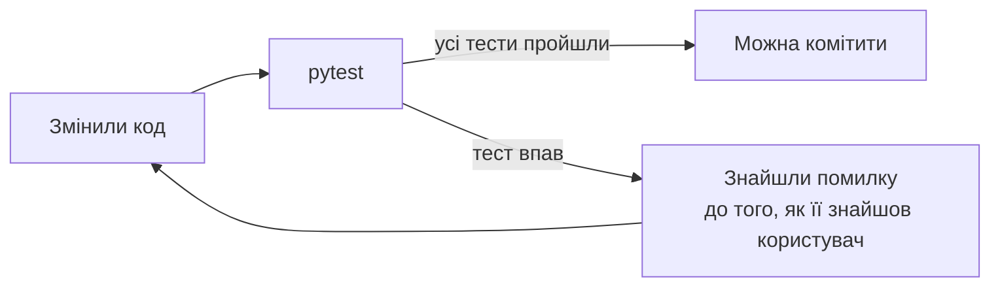

# 33. (Л) Основи тестування у Python. Unit-тести, assert, pytest

## Зміст лекції

1. Навіщо тестувати код автоматично
2. Інструкція `assert`
3. Unit-тест: що саме перевіряємо
4. Модуль `unittest` зі стандартної бібліотеки
5. `pytest`: встановлення і перший тест
6. Як pytest знаходить тести
7. Читаємо звіт pytest
8. Перевірка винятків: `pytest.raises`
9. Параметризація: один тест — багато прикладів
10. Фікстури і тимчасові файли `tmp_path`
11. Що і як тестувати: граничні випадки
12. Приклад: тести для модуля оцінок
13. Типові помилки

## Навіщо тестувати код автоматично

Досі ми перевіряли програми вручну: запускали, вводили дані, дивилися на вивід. Для маленької програми цього достатньо. Але щойно в проєкті зʼявляється десяток функцій, ручна перевірка стає повільною і ненадійною:

- після кожної зміни треба повторювати **всі** перевірки, а ми зазвичай перевіряємо лише те, що щойно змінили;
- легко забути граничний випадок: порожній список, нуль, відʼємне число;
- результат перевірки залишається лише у вашій голові — колега не знає, що саме ви перевірили.

**Автоматичний тест** — це код, який викликає вашу функцію з відомими вхідними даними і порівнює результат з очікуваним. Тести запускаються однією командою за секунди, скільки завгодно разів.



Тести не доводять, що помилок немає. Вони гарантують, що **перевірені сценарії** працюють — і що вони не зламаються непомітно після наступної зміни.

## Інструкція `assert`

`assert` перевіряє умову. Якщо умова істинна — нічого не відбувається. Якщо хибна — генерується виняток `AssertionError`:

```python
# Program: assert does nothing when the condition is true
def average(grades):
    return sum(grades) / len(grades)


assert average([10, 12, 8]) == 10
assert average([5]) == 5
print("all checks passed")
```

```text
all checks passed
```

Після умови можна додати повідомлення, яке зʼявиться в разі помилки:

```python
# Program: assert with a message
def average(grades):
    return sum(grades) / len(grades)


result = average([10, 11])
assert result == 10, f"expected 10, got {result}"
```

```text
Traceback (most recent call last):
  File "/home/student/check.py", line 7, in <module>
    assert result == 10, f"expected 10, got {result}"
           ^^^^^^^^^^^^
AssertionError: expected 10, got 10.5
```

!!! warning "`assert` — не для перевірки вхідних даних програми"
    Python, запущений з параметром `-O` (оптимізація), **пропускає** всі `assert`. Тому `assert` використовують у тестах і для внутрішніх перевірок розробника, а не для перевірки того, що ввів користувач. Для вхідних даних — `if` і `raise ValueError` (лекція 23).

## Unit-тест: що саме перевіряємо

**Unit-тест** (модульний тест) перевіряє одну невелику частину програми — зазвичай одну функцію — окремо від решти. Добрий unit-тест:

| Властивість | Що означає |
|---|---|
| швидкий | виконується за мілісекунди, тому тести можна запускати постійно |
| незалежний | не залежить від інших тестів і порядку їх запуску |
| повторюваний | дає той самий результат при кожному запуску |
| зрозумілий | з назви видно, що саме перевіряється |

Тест складається з трьох кроків, які часто називають **Arrange — Act — Assert**:

```python
# Program: the three steps of a test
def apply_discount(price, percent):
    return round(price * (100 - percent) / 100, 2)


def test_apply_discount():
    # Arrange: готуємо вхідні дані
    price, percent = 250.0, 20
    # Act: викликаємо функцію
    result = apply_discount(price, percent)
    # Assert: перевіряємо результат
    assert result == 200.0


test_apply_discount()
print("ok")
```

```text
ok
```

Тестувати найлегше функції, які **повертають** результат, а не друкують його. Це ще одна причина, чому в лекції 10 ми домовилися: функції повертають значення, а `print` залишається в головній частині програми.

## Модуль `unittest` зі стандартної бібліотеки

У стандартній бібліотеці є модуль `unittest`. Тести в ньому — це методи класу, що наслідує `unittest.TestCase`, а перевірки — методи `assertEqual`, `assertTrue`, `assertRaises`:

```python
# Program: tests with the standard unittest module
import unittest


def average(grades):
    if not grades:
        raise ValueError("empty list")
    return sum(grades) / len(grades)


class TestAverage(unittest.TestCase):
    def test_simple(self):
        self.assertEqual(average([10, 12, 8]), 10)

    def test_empty_list(self):
        with self.assertRaises(ValueError):
            average([])


if __name__ == "__main__":
    unittest.main()
```

```text
..
----------------------------------------------------------------------
Ran 2 tests in 0.000s

OK
```

Кожна крапка — успішний тест. `unittest` працює всюди, де є Python, але вимагає класів і спеціальних методів. Тому більшість проєктів використовують **pytest**: він запускає і тести `unittest`, і простіші тести-функції зі звичайним `assert`.

## `pytest`: встановлення і перший тест

`pytest` — сторонній пакет, тому встановлюємо його у віртуальне оточення (лекція 31):

```bash
python3 -m venv env
source env/bin/activate
python3 -m pip install pytest
```

Код і тести тримають в окремих файлах. Файл з функцією:

```python
# File: grades.py
def average(grades):
    """Return the average of a non-empty list of grades."""
    if not grades:
        raise ValueError("empty list of grades")
    return sum(grades) / len(grades)


def letter(score):
    """Convert a 0-100 score to an ECTS letter."""
    if not 0 <= score <= 100:
        raise ValueError(f"score out of range: {score}")
    if score >= 90:
        return "A"
    if score >= 82:
        return "B"
    if score >= 74:
        return "C"
    if score >= 64:
        return "D"
    if score >= 60:
        return "E"
    return "F"
```

Файл з тестами — звичайні функції з `assert`:

```python
# File: test_grades.py
from grades import average, letter


def test_average_of_three():
    assert average([10, 12, 8]) == 10


def test_letter_a():
    assert letter(95) == "A"


def test_letter_f():
    assert letter(30) == "F"
```

Запуск:

```bash
pytest
```

```text
============================= test session starts ==============================
collected 3 items

test_grades.py ...                                                       [100%]

============================== 3 passed in 0.01s ===============================
```

## Як pytest знаходить тести

pytest сам шукає тести за домовленостями про імена — нічого реєструвати не потрібно:

| Що | Правило |
|---|---|
| файли | `test_*.py` або `*_test.py` |
| функції | назва починається з `test` |
| класи | назва починається з `Test`, без `__init__` |
| каталоги | від поточного каталогу вглиб, зокрема `tests/` |

Типова структура невеликого проєкту:

```text
project/
├── grades.py
└── tests/
    └── test_grades.py
```

!!! note "Якщо тести в каталозі `tests/`"
    Щоб `from grades import average` спрацював із каталогу `tests/`, запускайте pytest з кореня проєкту командою `python3 -m pytest`: так поточний каталог потрапляє в `sys.path` (лекція 27).

Корисні параметри запуску:

| Команда | Що робить |
|---|---|
| `pytest -v` | докладний звіт: кожен тест окремим рядком |
| `pytest test_grades.py` | лише тести одного файлу |
| `pytest -k letter` | лише тести, у назві яких є `letter` |
| `pytest -x` | зупинитися на першому тесті, що впав |
| `pytest --lf` | запустити лише тести, що впали минулого разу |

## Читаємо звіт pytest

Зламаємо функцію навмисно: у `letter` замінимо `score >= 90` на `score > 90` і запустимо тест для межі:

```python
# File: test_grades.py (фрагмент)
from grades import letter


def test_letter_a_boundary():
    assert letter(90) == "A"
```

```text
___________________________ test_letter_a_boundary ____________________________

    def test_letter_a_boundary():
>       assert letter(90) == "A"
E       AssertionError: assert 'B' == 'A'
E         - A
E         + B

test_grades.py:5: AssertionError
=========================== short test summary info ============================
FAILED test_grades.py::test_letter_a_boundary - AssertionError: assert 'B' == 'A'
============================== 1 failed in 0.02s ===============================
```

pytest показує рядок, де впав тест (`>`), і **обидва значення**: що повернула функція (`'B'`) і що очікувалося (`'A'`). Не треба додавати `print` — звичайного `assert` достатньо, pytest сам розкладає вираз.

!!! tip "Побачте тест червоним"
    Новий тест варто хоча б раз побачити таким, що падає: зламайте функцію і переконайтеся, що тест це помітив. Тест, який не може впасти, нічого не перевіряє.

## Перевірка винятків: `pytest.raises`

Іноді правильна поведінка функції — згенерувати виняток. Це теж треба перевіряти:

```python
# File: test_errors.py
import pytest

from grades import average, letter


def test_average_empty_list():
    with pytest.raises(ValueError):
        average([])


def test_letter_out_of_range_message():
    with pytest.raises(ValueError, match="out of range"):
        letter(120)
```

Тест проходить, якщо всередині блоку `with` виникає саме `ValueError` (параметр `match` додатково перевіряє текст повідомлення). Якщо винятку немає, тест падає з повідомленням `DID NOT RAISE`.

## Параметризація: один тест — багато прикладів

Перевіряти кожну межу окремим тестом довго. Декоратор `@pytest.mark.parametrize` запускає той самий тест з різними даними:

```python
# File: test_letters.py
import pytest

from grades import letter


@pytest.mark.parametrize(
    ("score", "expected"),
    [
        (100, "A"),
        (90, "A"),
        (89, "B"),
        (82, "B"),
        (74, "C"),
        (64, "D"),
        (60, "E"),
        (59, "F"),
        (0, "F"),
    ],
)
def test_letter(score, expected):
    assert letter(score) == expected
```

```bash
pytest -v test_letters.py
```

```text
test_letters.py::test_letter[100-A] PASSED                               [ 11%]
test_letters.py::test_letter[90-A] PASSED                                [ 22%]
test_letters.py::test_letter[89-B] PASSED                                [ 33%]
...
test_letters.py::test_letter[0-F] PASSED                                 [100%]
============================== 9 passed in 0.02s ===============================
```

Кожен набір параметрів — окремий тест зі своєю назвою. Якщо впаде один, інші все одно виконаються, і у звіті буде видно, на яких саме даних помилка.

## Фікстури і тимчасові файли `tmp_path`

**Фікстура** (fixture) — функція, що готує дані або ресурс для тесту. Тест отримує фікстуру, просто вказавши її назву параметром. pytest має вбудовані фікстури; найкорисніша для нас — `tmp_path`: унікальний тимчасовий каталог для кожного тесту.

Функція, що читає оцінки з файлу:

```python
# File: storage.py
from pathlib import Path


def load_grades(path: Path) -> list[int]:
    """Read one grade per line, skipping empty lines and comments."""
    grades = []
    for line in path.read_text(encoding="utf-8").splitlines():
        line = line.strip()
        if line and not line.startswith("#"):
            grades.append(int(line))
    return grades
```

Тест створює файл у тимчасовому каталозі — робочі файли проєкту не зачіпаються:

```python
# File: test_storage.py
from storage import load_grades


def test_load_grades_skips_comments(tmp_path):
    path = tmp_path / "grades.txt"
    path.write_text("# my grades\n10\n\n12\n", encoding="utf-8")
    assert load_grades(path) == [10, 12]
```

Власну фікстуру оголошують декоратором `@pytest.fixture`. Якщо фікстура потрібна кільком файлам, її кладуть у файл `conftest.py` — pytest знаходить його автоматично:

```python
# File: conftest.py
import pytest


@pytest.fixture
def group_grades():
    # Однакові дані для кількох тестів
    return {"Olena": [10, 12, 11], "Taras": [7, 8, 6]}
```

```python
# File: test_group.py
from grades import average


def test_best_student(group_grades):
    best = max(group_grades, key=lambda name: average(group_grades[name]))
    assert best == "Olena"
```

## Що і як тестувати: граничні випадки

Більшість помилок ховається не в «звичайних» даних, а на краях. Для кожної функції корисно пройтися таким списком:

| Що перевірити | Приклад для `average` і `letter` |
|---|---|
| звичайний випадок | `average([10, 12, 8])` |
| один елемент | `average([5])` |
| порожні дані | `average([])` → `ValueError` |
| межі інтервалів | `letter(90)`, `letter(89)`, `letter(60)`, `letter(59)` |
| крайні допустимі значення | `letter(0)`, `letter(100)` |
| недопустимі значення | `letter(-1)`, `letter(101)` |
| дробові результати | `average([10, 11]) == 10.5` |

!!! warning "Дробові числа порівнюють через `pytest.approx`"
    `0.1 + 0.2 == 0.3` — `False` (лекція 29). У тестах для дробових результатів пишіть `assert result == pytest.approx(0.3)`: так порівняння допускає крихітну похибку обчислень.

## Приклад: тести для модуля оцінок

Зберемо все разом. Модуль `gradebook.py` рахує статистику групи:

```python
# File: gradebook.py
def average(grades: list[int]) -> float:
    """Return the average of a non-empty list of grades."""
    if not grades:
        raise ValueError("empty list of grades")
    return sum(grades) / len(grades)


def best_student(group: dict[str, list[int]]) -> str:
    """Return the name of the student with the highest average."""
    if not group:
        raise ValueError("empty group")
    return max(group, key=lambda name: average(group[name]))


def failed(group: dict[str, list[int]], threshold: float = 4) -> list[str]:
    """Return sorted names of students whose average is below threshold."""
    return sorted(name for name, grades in group.items() if average(grades) < threshold)
```

Тести:

```python
# File: test_gradebook.py
import pytest

from gradebook import average, best_student, failed


@pytest.fixture
def group():
    return {"Olena": [10, 12, 11], "Taras": [3, 4, 2], "Iryna": [9, 9, 10]}


def test_average_fraction():
    assert average([10, 11]) == pytest.approx(10.5)


def test_average_empty():
    with pytest.raises(ValueError):
        average([])


def test_best_student(group):
    assert best_student(group) == "Olena"


def test_best_student_empty_group():
    with pytest.raises(ValueError, match="empty group"):
        best_student({})


@pytest.mark.parametrize(("threshold", "expected"), [(4, ["Taras"]), (10, ["Iryna", "Taras"]), (1, [])])
def test_failed(group, threshold, expected):
    assert failed(group, threshold) == expected
```

```bash
pytest -v test_gradebook.py
```

```text
test_gradebook.py::test_average_fraction PASSED                          [ 14%]
test_gradebook.py::test_average_empty PASSED                             [ 28%]
test_gradebook.py::test_best_student PASSED                              [ 42%]
test_gradebook.py::test_best_student_empty_group PASSED                  [ 57%]
test_gradebook.py::test_failed[4-expected0] PASSED                       [ 71%]
test_gradebook.py::test_failed[10-expected1] PASSED                      [ 85%]
test_gradebook.py::test_failed[1-expected2] PASSED                       [100%]
============================== 7 passed in 0.02s ===============================
```

Тепер будь-яку зміну в `gradebook.py` можна перевірити за секунду командою `pytest`.

## Типові помилки

| Помилка | Чому погано | Як правильно |
|---|---|---|
| Файл тестів названо `tests_grades.py` або `grades_tests.py` | pytest його не знаходить | `test_grades.py` |
| Функція тесту без префікса `test` | тест не запускається, але й не падає | `def test_...` |
| Тестується функція, що друкує результат | нічого порівнювати | функція повертає значення, `print` — окремо |
| `assert x == 0.3` для дробових чисел | тест падає через похибку обчислень | `pytest.approx(0.3)` |
| Тести залежать один від одного (один створює файл, інший читає) | порядок запуску змінюється — тести падають | кожен тест готує свої дані, `tmp_path` |
| Тест працює з робочими файлами проєкту | тест псує ваші дані | тимчасові файли `tmp_path` |
| `assert` для перевірки введення користувача | з `python -O` перевірки зникають | `if ...: raise ValueError` |
| Тест жодного разу не падав | можливо, він нічого не перевіряє | зламайте код і переконайтеся, що тест червоний |
| Файл `pytest.py` або `test.py` у проєкті | затінює модулі (лекція 27) | інше імʼя файлу |

## Підсумок

- **Автоматичний тест** викликає функцію з відомими даними й порівнює результат з очікуваним; тести запускаються однією командою.
- `assert умова, "повідомлення"` генерує `AssertionError`, якщо умова хибна. У тестах — так, для вводу користувача — ні.
- **Unit-тест** перевіряє одну функцію: швидко, незалежно, повторювано. Схема Arrange — Act — Assert.
- `unittest` — стандартна бібліотека, класи `TestCase`; **pytest** — простіші тести-функції зі звичайним `assert` і детальним звітом.
- pytest знаходить файли `test_*.py` і функції `test_*`; корисні параметри `-v`, `-k`, `-x`.
- `pytest.raises` перевіряє винятки, `@pytest.mark.parametrize` — багато наборів даних, фікстури (`tmp_path`, власні в `conftest.py`) готують дані.
- Найважливіші тести — на **граничні випадки**: порожні дані, межі інтервалів, недопустимі значення.

## Корисні посилання

- [pytest — Get Started](https://docs.pytest.org/en/stable/getting-started.html)
- [pytest — How to use fixtures](https://docs.pytest.org/en/stable/how-to/fixtures.html)
- [pytest — Parametrizing tests](https://docs.pytest.org/en/stable/how-to/parametrize.html)
- [Модуль `unittest` — довідник](https://docs.python.org/3/library/unittest.html)
- [Harvard CS50 Python — Lecture 5: Unit Tests](https://cs50.harvard.edu/python/)
