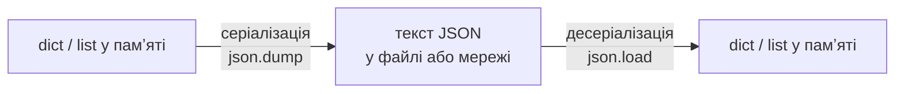

# 35. (Л) Робота з JSON та серіалізація даних

## Зміст лекції

1. Що таке серіалізація
2. Формат JSON
3. Типи JSON і типи Python
4. `json.dumps` і `json.loads`: рядок
5. `json.dump` і `json.load`: файл
6. Читабельний вивід: `indent`, `ensure_ascii`, `sort_keys`
7. Помилки формату: `json.JSONDecodeError`
8. Типи, яких JSON не знає
9. Файл налаштувань програми
10. JSON чи CSV
11. Приклад: журнал оцінок у JSON
12. Типові помилки

## Що таке серіалізація

Поки програма працює, дані живуть у памʼяті як обʼєкти Python: словники, списки, числа. Щойно програма завершується, памʼять звільняється, і дані зникають. Щоб зберегти їх у файл або передати іншій програмі через мережу, обʼєкти треба перетворити на послідовність символів або байтів.

- **Серіалізація** (serialization) — перетворення обʼєкта на текст або байти.
- **Десеріалізація** (deserialization) — зворотне перетворення: з тексту знову обʼєкт.



У лекції 21 ми вже робили це вручну: записували рядки `date;category;amount` і розбирали їх через `split`. Це працює для простої таблиці, але не для вкладених даних: списку оцінок у кожного студента, налаштувань з кількома рівнями. Для таких даних є стандартний формат **JSON**.

## Формат JSON

**JSON** (JavaScript Object Notation) — текстовий формат обміну даними. Його розуміють практично всі мови програмування, браузери, бази даних і вебсервіси. Саме в JSON відповідають API державних сервісів, банків, погодних служб.

```json
{
  "name": "Olena Koval",
  "group": "PZ-11",
  "grades": [10, 12, 11],
  "scholarship": true,
  "phone": null,
  "address": {"city": "Lutsk", "street": "Volia Ave"}
}
```

Правила JSON суворіші, ніж запис словника в Python:

| Правило | Правильно | Помилка |
|---|---|---|
| рядки — лише в подвійних лапках | `"name"` | `'name'` |
| ключі обʼєкта — завжди рядки | `{"1": "a"}` | `{1: "a"}` |
| логічні значення з малої літери | `true`, `false` | `True`, `False` |
| відсутнє значення | `null` | `None` |
| без коми після останнього елемента | `[1, 2]` | `[1, 2,]` |
| коментарів немає | — | `// comment` |

## Типи JSON і типи Python

Модуль `json` зі стандартної бібліотеки автоматично перетворює типи:

| Python | JSON | Назад у Python |
|---|---|---|
| `dict` | object `{...}` | `dict` |
| `list`, `tuple` | array `[...]` | `list` |
| `str` | string | `str` |
| `int`, `float` | number | `int`, `float` |
| `True`, `False` | `true`, `false` | `True`, `False` |
| `None` | `null` | `None` |

Зверніть увагу на два наслідки:

- кортеж після запису й читання стає **списком** — JSON не розрізняє їх;
- ключі словника стають **рядками**: `{1: "a"}` після запису й читання — `{"1": "a"}`.

## `json.dumps` і `json.loads`: рядок

`dumps` (dump string) перетворює обʼєкт на рядок JSON, `loads` (load string) — рядок на обʼєкт:

```python
# Program: dumps and loads work with strings
import json

student = {"name": "Olena", "grades": (10, 12), "active": True, "phone": None, 1: "first"}

text = json.dumps(student)
print(type(text), text)

restored = json.loads(text)
print(type(restored), restored)
```

```text
<class 'str'> {"name": "Olena", "grades": [10, 12], "active": true, "phone": null, "1": "first"}
<class 'dict'> {'name': 'Olena', 'grades': [10, 12], 'active': True, 'phone': None, '1': 'first'}
```

Кортеж став списком, `True` — `true`, `None` — `null`, а ключ `1` — рядком `"1"`. Рядки JSON потрібні, коли дані передаються мережею (лекція 37) або зберігаються в базі даних.

## `json.dump` і `json.load`: файл

Без літери `s` функції працюють одразу з **файлом**:

```python
# Program: save a list of students to a file and read it back
import json
from pathlib import Path

students = [
    {"name": "Olena", "grades": [10, 12, 11]},
    {"name": "Taras", "grades": [7, 8, 9]},
]
path = Path("students.json")

with path.open("w", encoding="utf-8") as file:
    json.dump(students, file)

with path.open(encoding="utf-8") as file:
    loaded = json.load(file)

print(loaded == students)
print(loaded[1]["grades"])
```

```text
True
[7, 8, 9]
```

| Функція | Звідки / куди | Повертає |
|---|---|---|
| `json.dumps(obj)` | обʼєкт → рядок | `str` |
| `json.loads(text)` | рядок → обʼєкт | `dict`, `list`, ... |
| `json.dump(obj, file)` | обʼєкт → файл | `None` |
| `json.load(file)` | файл → обʼєкт | `dict`, `list`, ... |

Файл відкриваємо з `encoding="utf-8"`, як і будь-який текстовий файл (лекція 21): стандарт JSON вимагає саме UTF-8.

## Читабельний вивід: `indent`, `ensure_ascii`, `sort_keys`

За замовчуванням `json.dump` пише все в один рядок, а всі не-ASCII символи (кирилицю, символ `ʼ`) замінює кодами `\u...`. Для файлів, які читатиме людина, корисні три параметри:

```python
# Program: readable JSON output
import json

# Назва з літерою ü — не-ASCII символ для демонстрації ensure_ascii
city = {"name": "Zürich", "population": 436000, "country": "Switzerland"}

print(json.dumps(city))
print(json.dumps(city, ensure_ascii=False))
print(json.dumps(city, ensure_ascii=False, indent=2, sort_keys=True))
```

```text
{"name": "Z\u00fcrich", "population": 436000, "country": "Switzerland"}
{"name": "Zürich", "population": 436000, "country": "Switzerland"}
{
  "country": "Switzerland",
  "name": "Zürich",
  "population": 436000
}
```

| Параметр | Що робить |
|---|---|
| `indent=2` | кожен елемент з нового рядка, відступ 2 пробіли |
| `ensure_ascii=False` | не-ASCII символи (кирилиця, `ü`) записуються як є, а не кодами `\u...` |
| `sort_keys=True` | ключі за алфавітом: зручно порівнювати дві версії файлу в git |

Для перевірки й гарного виводу будь-якого JSON-файлу є готова команда:

```bash
python3 -m json.tool students.json
```

## Помилки формату: `json.JSONDecodeError`

Файл міг бути пошкоджений або відредагований вручну з помилкою. Тоді `json.load` генерує `json.JSONDecodeError` — нащадка `ValueError` — з номером рядка й стовпця:

```python
# Program: report where a JSON file is broken
import json
import sys

text = '{\n  "name": "Olena",\n  "grades": [10, 12,]\n}'

try:
    data = json.loads(text)
except json.JSONDecodeError as error:
    print(f"error: invalid JSON at line {error.lineno}, column {error.colno}: {error.msg}", file=sys.stderr)
    sys.exit(1)
```

```text
error: invalid JSON at line 3, column 21: Expecting value
```

Зайва кома після `12` — найпоширеніша помилка ручного редагування. Повідомлення одразу показує, куди дивитися.

!!! warning "Не перезаписуйте пошкоджений файл мовчки"
    Якщо програма не змогла прочитати файл і «на всяк випадок» записала замість нього порожній, дані користувача втрачено назавжди. Правильно — повідомити про помилку і завершитися, залишивши файл без змін (лекція 23).

## Типи, яких JSON не знає

Дати, множини, власні обʼєкти JSON не підтримує:

```python
# Program: json can not serialize a date
import json
from datetime import date

json.dumps({"date": date(2026, 9, 1)})
```

```text
Traceback (most recent call last):
  ...
TypeError: Object of type date is not JSON serializable
```

Розвʼязків два. Перший — параметр `default`: функція, яку `json` викликає для кожного незнайомого обʼєкта:

```python
# Program: serialize dates through the default parameter
import json
from datetime import date


def to_json(value):
    if isinstance(value, date):
        return value.isoformat()
    raise TypeError(f"can not serialize {type(value).__name__}")


lesson = {"topic": "JSON", "date": date(2026, 9, 1), "rooms": {101, 102}}
print(json.dumps(lesson, default=lambda v: sorted(v) if isinstance(v, set) else to_json(v)))
```

```text
{"topic": "JSON", "date": "2026-09-01", "rooms": [101, 102]}
```

Другий — явно перетворювати дані перед записом і після читання. Після `json.load` дата знову лише рядок `"2026-09-01"`; щоб отримати обʼєкт `date`, його треба розібрати: `date.fromisoformat(text)`. Формат ISO `YYYY-MM-DD` — найкращий вибір для дат у JSON: його однаково розуміють усі мови й він правильно сортується як рядок.

## Файл налаштувань програми

JSON зручний для налаштувань: людина може відкрити файл і змінити значення, а програма легко його прочитає. Типова схема — значення за замовчуванням у коді плюс файл, що їх перевизначає:

```python
# Program: load settings with defaults
import json
import sys
from pathlib import Path

DEFAULTS = {"currency": "UAH", "monthly_limit": 6000, "categories": ["food", "transport"]}
SETTINGS = Path(__file__).with_name("settings.json")


def load_settings() -> dict:
    if not SETTINGS.exists():
        SETTINGS.write_text(json.dumps(DEFAULTS, indent=2), encoding="utf-8")
        print("settings.json created with defaults")
        return dict(DEFAULTS)
    try:
        user = json.loads(SETTINGS.read_text(encoding="utf-8"))
    except json.JSONDecodeError as error:
        sys.exit(f"error: settings.json line {error.lineno}: {error.msg}")
    # Значення з файлу перекривають значення за замовчуванням
    return {**DEFAULTS, **user}


settings = load_settings()
print(settings["currency"], settings["monthly_limit"])
```

```text
settings.json created with defaults
UAH 6000
```

Запис `{**DEFAULTS, **user}` (лекція 16) створює новий словник: спочатку всі значення за замовчуванням, потім значення з файлу поверх них. Якщо користувач видалив з файлу якийсь ключ, програма все одно отримає його значення за замовчуванням.

## JSON чи CSV

| | CSV | JSON |
|---|---|---|
| структура | плоска таблиця: рядки й стовпці | будь-яка вкладеність |
| типи | усе — рядки, числа треба перетворювати | числа, логічні, `null` розрізняються |
| розмір | компактний | більший (повторюються ключі) |
| відкривається в Excel | так | ні (потрібне перетворення) |
| типове використання | таблиці, звіти, вивантаження з бази | налаштування, обмін даними з API, вкладені структури |

Для журналу витрат з лекції 21 CSV цілком годиться. Для налаштувань програми чи відповіді вебсервісу — JSON.

## Приклад: журнал оцінок у JSON

Програма зберігає журнал оцінок групи у JSON-файлі: додає оцінку і показує середні бали.

```python
# File: gradebook_json.py
import json
import sys
from pathlib import Path

DATA = Path(__file__).with_name("gradebook.json")


def load() -> dict[str, list[int]]:
    if not DATA.exists():
        return {}
    try:
        return json.loads(DATA.read_text(encoding="utf-8"))
    except json.JSONDecodeError as error:
        sys.exit(f"error: {DATA.name} is broken (line {error.lineno}), fix it manually")


def save(book: dict[str, list[int]]) -> None:
    DATA.write_text(json.dumps(book, indent=2, sort_keys=True), encoding="utf-8")


def main(args: list[str]) -> None:
    book = load()
    if len(args) == 3 and args[0] == "add":
        name, grade = args[1], int(args[2])
        book.setdefault(name, []).append(grade)
        save(book)
        print(f"added {grade} for {name}")
    elif args == ["report"]:
        for name, grades in sorted(book.items()):
            print(f"{name:<8} {grades} avg {sum(grades) / len(grades):.1f}")
    else:
        sys.exit("usage: python3 gradebook_json.py add <name> <grade> | report")


if __name__ == "__main__":
    main(sys.argv[1:])
```

```bash
python3 gradebook_json.py add Olena 10
python3 gradebook_json.py add Olena 12
python3 gradebook_json.py add Taras 8
python3 gradebook_json.py report
cat gradebook.json
```

```text
added 10 for Olena
added 12 for Olena
added 8 for Taras
Olena    [10, 12] avg 11.0
Taras    [8] avg 8.0
{
  "Olena": [
    10,
    12
  ],
  "Taras": [
    8
  ]
}
```

Метод `setdefault(name, [])` повертає список оцінок студента, а якщо його ще немає — спочатку створює порожній. Дані зберігаються між запусками, файл можна відкрити й перевірити вручну.

## Типові помилки

| Помилка | Чому погано | Як правильно |
|---|---|---|
| `json.dump(data)` без файлу | `TypeError`: потрібен другий аргумент | `json.dump(data, file)` або `json.dumps(data)` |
| `json.load("data.json")` | функція чекає файловий обʼєкт, а не шлях | `with open(...) as f: json.load(f)` |
| Одинарні лапки або `True` у файлі JSON | `JSONDecodeError` | подвійні лапки, `true`, `null` |
| Кома після останнього елемента | `JSONDecodeError: Expecting value` | без коми; перевірка `python3 -m json.tool` |
| Кирилиця перетворилася на `А...` | файл важко читати | `ensure_ascii=False` |
| Очікували кортеж або ключ-число після читання | JSON їх не зберігає | перетворювати після `load` |
| `date` або `set` у даних | `TypeError: not JSON serializable` | `default=` або перетворення на рядок/список |
| Пошкоджений файл перезаписано порожнім | дані втрачено | повідомити про помилку і завершитися |

## Підсумок

- **Серіалізація** перетворює обʼєкти на текст для збереження чи передачі; **десеріалізація** — назад.
- **JSON** — текстовий формат: обʼєкти `{}`, масиви `[]`, рядки в подвійних лапках, `true`/`false`/`null`.
- `dumps`/`loads` працюють з рядками, `dump`/`load` — з файлами (UTF-8).
- Кортеж стає списком, ключі — рядками; `date`, `set` і власні обʼєкти потребують `default=` або перетворення.
- `indent`, `ensure_ascii=False`, `sort_keys` роблять файл читабельним.
- Пошкоджений JSON дає `json.JSONDecodeError` з номером рядка; такий файл не перезаписують.
- JSON — для налаштувань і вкладених даних, CSV — для плоских таблиць.

## Корисні посилання

- [Модуль `json` — довідник](https://docs.python.org/3/library/json.html)
- [Офіційний опис формату JSON](https://www.json.org/json-uk.html)
- [Модуль `json.tool` — перевірка й форматування з командного рядка](https://docs.python.org/3/library/json.html#module-json.tool)
- [Єдиний державний вебпортал відкритих даних](https://data.gov.ua)
