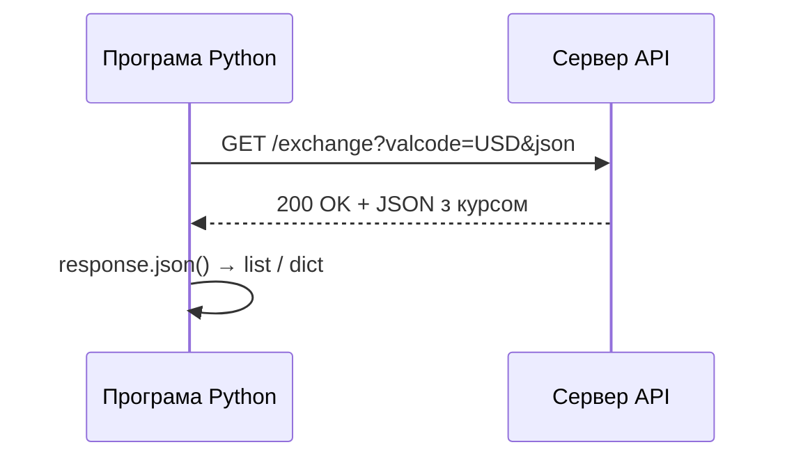
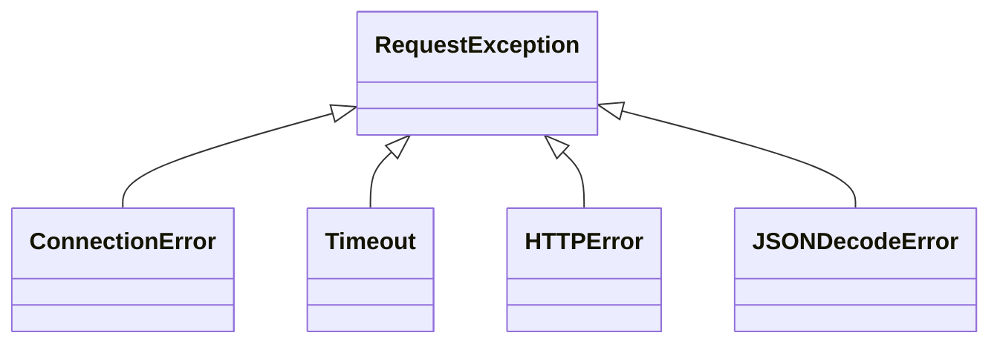

# 37. (Л) Отримання даних з інтернету. HTTP-запити у Python (модуль requests)

## Зміст лекції

1. Як програма отримує дані з інтернету
2. HTTP: запит і відповідь
3. URL та параметри запиту
4. Перший запит з `requests`
5. Коди стану відповіді
6. Заголовки
7. JSON у відповіді
8. Параметри запиту через `params`
9. Таймаути
10. Обробка помилок мережі
11. Надсилання даних: `POST`
12. Відкриті API: НБУ та Open-Meteo
13. Приклад: курс валют і ваші витрати
14. Типові помилки

## Як програма отримує дані з інтернету

Браузер, відкриваючи сторінку, надсилає серверу **запит** і отримує **відповідь** — HTML-сторінку, картинку чи файл. Програма на Python може робити те саме, але отримувати не сторінки для людей, а дані для програм: курс валют, прогноз погоди, розклад.

Сервіс, що віддає дані у зручному для програм вигляді, називають **API** (Application Programming Interface). Більшість вебAPI відповідають у форматі JSON (лекція 35).



## HTTP: запит і відповідь

**HTTP** (HyperText Transfer Protocol) — протокол, за яким спілкуються клієнт і вебсервер. Запит складається з методу, адреси, заголовків і (необовʼязково) тіла:

```text
GET /NBUStatService/v1/statdirectory/exchange?valcode=USD&json HTTP/1.1
Host: bank.gov.ua
User-Agent: python-requests/2.34.2
Accept: */*
```

Відповідь — з коду стану, заголовків і тіла:

```text
HTTP/1.1 200 OK
Content-Type: application/json; charset=utf-8

[{"r030":840,"txt":"...","rate":41.2,"cc":"USD","exchangedate":"20.10.2026"}]
```

Найуживаніші **методи** HTTP:

| Метод | Призначення | Приклад |
|---|---|---|
| `GET` | отримати дані | курс валют, список задач |
| `POST` | створити ресурс, надіслати дані | нова задача, вхід у систему |
| `PUT` / `PATCH` | змінити ресурс повністю / частково | оновити задачу |
| `DELETE` | видалити ресурс | видалити задачу |

У цій лекції ми переважно отримуємо дані методом `GET`. Детально про проєктування API — у 6 семестрі.

## URL та параметри запиту

Адреса ресурсу — **URL** — складається з частин:

```text
https://api.open-meteo.com/v1/forecast?latitude=50.75&longitude=25.34&current=temperature_2m
└─┬─┘   └───────┬────────┘└────┬─────┘ └──────────────────────┬──────────────────────────┘
схема          хост           шлях                   рядок запиту (query string)
```

Рядок запиту починається після `?` і містить пари `ключ=значення`, розділені `&`. Через нього передають параметри: місто, дату, валюту.

## Перший запит з `requests`

У стандартній бібліотеці є `urllib.request`, але майже всі використовують сторонній пакет **`requests`** — він простіший (лекція 31):

```bash
python3 -m pip install requests
```

```python
# Program: the first HTTP request
import requests

response = requests.get("https://api.github.com", timeout=10)

print("status:", response.status_code)
print("type:", response.headers["Content-Type"])
print("first 60 chars:", response.text[:60])
```

```text
status: 200
type: application/json; charset=utf-8
first 60 chars: {"current_user_url":"https://api.github.com/user","current_us
```

Обʼєкт `Response` містить усе, що повернув сервер:

| Атрибут / метод | Що містить |
|---|---|
| `status_code` | код стану: `200`, `404`, ... |
| `ok` | `True`, якщо код менший за 400 |
| `headers` | заголовки відповіді (словник без урахування регістру) |
| `text` | тіло відповіді як рядок |
| `content` | тіло як байти (для файлів, картинок) |
| `json()` | тіло, розібране з JSON у `dict` / `list` |
| `url` | кінцева адреса запиту |
| `raise_for_status()` | генерує `HTTPError`, якщо код 4xx або 5xx |

## Коди стану відповіді

Тризначний код стану повідомляє, чим закінчився запит. Перша цифра — клас відповіді:

| Клас | Значення | Приклади |
|---|---|---|
| `2xx` | успіх | `200 OK`, `201 Created`, `204 No Content` |
| `3xx` | перенаправлення | `301 Moved Permanently` (`requests` переходить сам) |
| `4xx` | помилка клієнта: проблема в запиті | `400 Bad Request`, `401 Unauthorized`, `404 Not Found`, `429 Too Many Requests` |
| `5xx` | помилка сервера | `500 Internal Server Error`, `503 Service Unavailable` |

```python
# Program: a missing page gives 404, and raise_for_status turns it into an exception
import requests

response = requests.get("https://api.github.com/repos/python/no-such-repo", timeout=10)
print(response.status_code, response.ok)

try:
    response.raise_for_status()
except requests.HTTPError as error:
    print("error:", error)
```

```text
404 False
error: 404 Client Error: Not Found for url: https://api.github.com/repos/python/no-such-repo
```

!!! warning "`requests` не генерує виняток на 404 сам"
    Відповідь з кодом `404` чи `500` — теж відповідь, тому `requests.get` завершується без помилки. Якщо не перевірити код, програма спробує розібрати сторінку помилки як дані. Завжди викликайте `raise_for_status()` або перевіряйте `status_code`.

## Заголовки

Заголовки — додаткова інформація про запит чи відповідь у вигляді пар «назва: значення». Відповідь сервера:

```python
# Program: look at response headers
import requests

response = requests.get("https://api.github.com", timeout=10)
for name in ("Content-Type", "Date", "Server"):
    print(f"{name}: {response.headers.get(name)}")
```

```text
Content-Type: application/json; charset=utf-8
Date: Tue, 20 Oct 2026 08:15:42 GMT
Server: github.com
```

Власні заголовки запиту передають параметром `headers`. Наприклад, деякі сервіси просять вказати, хто ви, у заголовку `User-Agent`:

```python
# Program: send a custom header
import requests

headers = {"User-Agent": "student-lab/1.0 (ivan.petrenko@example.com)"}
response = requests.get("https://httpbin.org/headers", headers=headers, timeout=10)
print(response.json()["headers"]["User-Agent"])
```

```text
student-lab/1.0 (ivan.petrenko@example.com)
```

## JSON у відповіді

Метод `response.json()` розбирає тіло з JSON (лекція 35) і повертає звичайні словники та списки. Структуру відповіді ви дізнаєтеся з документації API або подивившись на неї:

```python
# Program: explore the structure of a JSON response
import json

import requests

response = requests.get("https://api.github.com/repos/python/cpython", timeout=10)
response.raise_for_status()
data = response.json()

print(type(data), len(data), "keys")
print(sorted(data)[:8])
print(json.dumps({key: data[key] for key in ("full_name", "language", "stargazers_count")}, indent=2))
```

```text
<class 'dict'> 80 keys
['allow_forking', 'archive_url', 'archived', 'assignees_url', 'blobs_url', 'branches_url', 'clone_url', 'collaborators_url']
{
  "full_name": "python/cpython",
  "language": "Python",
  "stargazers_count": 77673
}
```

Якщо тіло не є JSON (наприклад, сервер повернув HTML-сторінку помилки), `json()` генерує `requests.JSONDecodeError`.

## Параметри запиту через `params`

Рядок запиту можна дописати вручну, але це незручно і небезпечно: пробіли, кирилицю, символи `&` і `?` у значеннях треба кодувати. Параметр `params` робить це автоматично:

```python
# Program: build the query string with params
import requests

params = {"latitude": 50.75, "longitude": 25.34, "current": "temperature_2m,wind_speed_10m"}
response = requests.get("https://api.open-meteo.com/v1/forecast", params=params, timeout=10)
response.raise_for_status()

print(response.url)
current = response.json()["current"]
print(current["temperature_2m"], "C,", current["wind_speed_10m"], "km/h")
```

```text
https://api.open-meteo.com/v1/forecast?latitude=50.75&longitude=25.34&current=temperature_2m%2Cwind_speed_10m
9.4 C, 12.3 km/h
```

Кома в значенні закодувалася як `%2C`. Атрибут `response.url` показує, яку адресу насправді сформовано, — зручно для налагодження.

## Таймаути

Мережа ненадійна: сервер може не відповідати, зʼєднання може «зависнути». Без таймауту `requests` чекатиме **нескінченно**. Тому кожен запит має параметр `timeout` — максимальний час очікування в секундах:

```python
# Program: a request that can not finish in time
import requests

try:
    requests.get("https://httpbin.org/delay/5", timeout=2)
except requests.Timeout:
    print("error: server did not answer in 2 seconds")
```

```text
error: server did not answer in 2 seconds
```

## Обробка помилок мережі

Усі винятки `requests` наслідують `requests.RequestException`. Найважливіші:



| Виняток | Коли виникає |
|---|---|
| `ConnectionError` | немає інтернету, неіснуючий домен, сервер відхилив зʼєднання |
| `Timeout` | сервер не відповів за `timeout` секунд |
| `HTTPError` | `raise_for_status()` для кодів 4xx і 5xx |
| `JSONDecodeError` | `response.json()` для тіла, що не є JSON |

Типова функція отримання даних перехоплює їх в одному місці і повідомляє зрозумілою мовою (лекція 23):

```python
# Program: one function that fetches JSON and handles all network errors
import sys

import requests


def fetch_json(url, params=None):
    try:
        response = requests.get(url, params=params, timeout=10)
        response.raise_for_status()
        return response.json()
    except requests.Timeout:
        sys.exit("error: the server is too slow, try again later")
    except requests.ConnectionError:
        sys.exit("error: no connection, check the internet")
    except requests.HTTPError as error:
        sys.exit(f"error: server answered {error.response.status_code}")
    except requests.JSONDecodeError:
        sys.exit("error: the answer is not JSON")


data = fetch_json("https://api.github.com/repos/python/cpython")
print(data["full_name"])
```

```text
python/cpython
```

## Надсилання даних: `POST`

Щоб надіслати дані серверу, використовують `POST`. Параметр `json` перетворює словник на JSON і встановлює заголовок `Content-Type: application/json`. Сервіс `httpbin.org` повертає те, що отримав, — зручно для навчання:

```python
# Program: send JSON with POST
import requests

task = {"title": "Practice 17", "subject": "Programming", "done": False}
response = requests.post("https://httpbin.org/post", json=task, timeout=10)
response.raise_for_status()

echo = response.json()
print(response.status_code)
print(echo["headers"]["Content-Type"])
print(echo["json"])
```

```text
200
application/json
{'title': 'Practice 17', 'subject': 'Programming', 'done': False}
```

Справжні API для створення чи зміни даних зазвичай вимагають автентифікації: ключа або токена в заголовку `Authorization`. Такі ключі зберігають у змінних оточення (лекція 29), а не в коді.

## Відкриті API: НБУ та Open-Meteo

Для навчання зручні API, що не потребують реєстрації:

| API | Адреса | Що дає |
|---|---|---|
| Національний банк України | `https://bank.gov.ua/NBUStatService/v1/statdirectory/exchange?json` | офіційні курси валют, курс на дату (`date=YYYYMMDD`), одна валюта (`valcode=USD`) |
| Open-Meteo | `https://api.open-meteo.com/v1/forecast` | погода за координатами |
| GitHub | `https://api.github.com` | інформація про публічні репозиторії |

```python
# Program: the official NBU exchange rate on a given date
import requests

URL = "https://bank.gov.ua/NBUStatService/v1/statdirectory/exchange"
params = {"valcode": "EUR", "date": "20260824", "json": ""}

response = requests.get(URL, params=params, timeout=10)
response.raise_for_status()
rate = response.json()[0]
print(rate["exchangedate"], rate["cc"], rate["rate"])
```

```text
24.08.2026 EUR 47.8512
```

Параметр `json` у НБУ не має значення — важлива сама його наявність, тому передаємо порожній рядок.

!!! note "Будьте «ввічливим клієнтом»"
    Публічні API безкоштовні, але не безмежні. Не надсилайте запити в нескінченному циклі, зберігайте відповідь у файл, якщо вона потрібна кілька разів, і зважайте на код `429 Too Many Requests` — сервіс просить зменшити частоту запитів.

## Приклад: курс валют і ваші витрати

Програма читає журнал витрат з лекції 21, отримує курси долара й євро НБУ і зберігає відповідь у кеш, щоб не звертатися до API при кожному запуску:

```python
# File: expenses_in_currency.py
import json
import sys
import time
from pathlib import Path

import requests

URL = "https://bank.gov.ua/NBUStatService/v1/statdirectory/exchange"
HERE = Path(__file__).parent
CACHE = HERE / "rates_cache.json"
MAX_AGE = 3600  # секунд


def load_rates() -> dict[str, float]:
    if CACHE.exists() and time.time() - CACHE.stat().st_mtime < MAX_AGE:
        print("rates from cache")
        return json.loads(CACHE.read_text(encoding="utf-8"))
    try:
        response = requests.get(URL, params={"json": ""}, timeout=10)
        response.raise_for_status()
    except requests.RequestException as error:
        sys.exit(f"error: can not get rates: {error}")
    rates = {item["cc"]: item["rate"] for item in response.json()}
    CACHE.write_text(json.dumps(rates, indent=2), encoding="utf-8")
    print("rates from api")
    return rates


def total_expenses(path: Path) -> float:
    total = 0.0
    for line in path.read_text(encoding="utf-8").splitlines():
        if line.strip() and not line.startswith("#"):
            total += float(line.split(";")[2])
    return total


def main() -> None:
    expenses = HERE / "data" / "expenses.csv"
    if not expenses.exists():
        sys.exit(f"error: {expenses} not found")
    total = total_expenses(expenses)
    rates = load_rates()
    print(f"total: {total:.2f} UAH = {total / rates['USD']:.2f} USD = {total / rates['EUR']:.2f} EUR")


if __name__ == "__main__":
    main()
```

```bash
python3 expenses_in_currency.py
python3 expenses_in_currency.py
```

```text
rates from api
total: 1248.00 UAH = 30.29 USD = 26.08 EUR
rates from cache
total: 1248.00 UAH = 30.29 USD = 26.08 EUR
```

Другий запуск протягом години не звертається до мережі: дата зміни файлу кешу (`st_mtime`, лекція 29) показує, наскільки він свіжий.

## Типові помилки

| Помилка | Чому погано | Як правильно |
|---|---|---|
| `requests.get(url)` без `timeout` | програма може зависнути назавжди | `timeout=10` |
| Немає перевірки коду стану | сторінку помилки розбирають як дані | `response.raise_for_status()` |
| Параметри дописано в URL вручну | помилки кодування, `&` і пробіли ламають запит | `params={...}` |
| `response.json` без дужок | отримали метод, а не дані | `response.json()` |
| `except Exception` навколо запиту | ховає помилки у вашому коді | `except requests.RequestException` |
| Ключ API записано в коді й закомічено | ключ бачить будь-хто | змінна оточення, `.gitignore` |
| Запити в нескінченному циклі | сервіс блокує вас кодом `429` | кеш, паузи між запитами |
| Файл `requests.py` у проєкті | затінює пакет (лекція 27) | інше імʼя файлу |

## Підсумок

- **API** віддає дані для програм, найчастіше у JSON; спілкування відбувається за протоколом **HTTP**: запит (метод, URL, заголовки, тіло) і відповідь (код стану, заголовки, тіло).
- `requests.get(url, params=..., timeout=10)` надсилає запит; `response.status_code`, `headers`, `text`, `json()` — частини відповіді.
- Коди `2xx` — успіх, `4xx` — помилка запиту, `5xx` — помилка сервера; `raise_for_status()` перетворює помилки на виняток `HTTPError`.
- Кожен запит має **таймаут**; помилки мережі перехоплюють через `requests.RequestException` і її нащадків.
- `requests.post(url, json=data)` надсилає JSON серверу.
- Відповіді, потрібні кілька разів, кешують у файл; до публічних API звертаються помірно.

## Корисні посилання

- [Документація `requests` — Quickstart](https://requests.readthedocs.io/en/latest/user/quickstart/)
- [MDN — огляд HTTP](https://developer.mozilla.org/uk/docs/Web/HTTP/Overview)
- [MDN — коди стану відповіді HTTP](https://developer.mozilla.org/en-US/docs/Web/HTTP/Status)
- [API НБУ — курси валют](https://bank.gov.ua/ua/open-data/api-dev)
- [Open-Meteo — документація API погоди](https://open-meteo.com/en/docs)
- [httpbin.org — сервіс для перевірки HTTP-запитів](https://httpbin.org)
