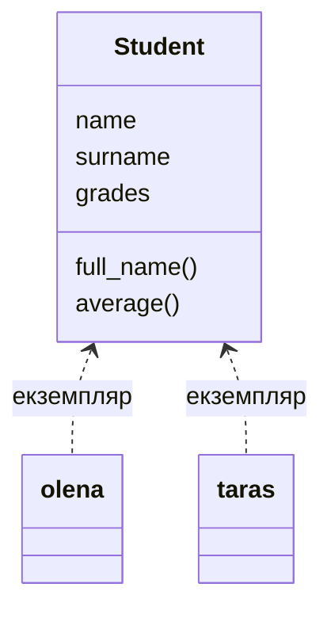

# 39. (Л) Вступ до ООП. Поняття класу й обʼєкта. Атрибути та методи

## Зміст лекції

1. Від словників до обʼєктів
2. Що таке обʼєктно-орієнтоване програмування
3. Клас і обʼєкт
4. Оголошення класу та створення обʼєкта
5. Атрибути екземпляра
6. Методи і параметр `self`
7. Атрибути класу
8. Де зберігаються атрибути: `__dict__`
9. Усе в Python — обʼєкти
10. Приклад: клас `Student`
11. Типові помилки

## Від словників до обʼєктів

У модулі 2 ми описували студента словником, а дії з ним — окремими функціями:

```python
# Program: data in a dict, behaviour in separate functions
def full_name(student):
    return f"{student['name']} {student['surname']}"


def average(student):
    return sum(student["grades"]) / len(student["grades"])


olena = {"name": "Olena", "surname": "Koval", "grades": [10, 12, 11]}
print(full_name(olena), average(olena))
```

```text
Olena Koval 11.0
```

Це працює, але має недоліки:

- нічого не гарантує, що в словнику є ключ `grades`: одруківка `"grade"` зламає програму лише під час виконання;
- функції `full_name` і `average` логічно належать студенту, але існують окремо: їх легко загубити чи викликати з невідповідним словником;
- якщо в проєкті зʼявляться викладачі, групи, розклад — функцій стане десятки, і незрозуміло, яка з чим працює.

**Обʼєктно-орієнтоване програмування** обʼєднує дані й дії над ними в одну конструкцію — **обʼєкт**.

## Що таке обʼєктно-орієнтоване програмування

**ООП** (object-oriented programming) — підхід, у якому програма складається з обʼєктів, що взаємодіють між собою. Кожен обʼєкт має:

- **стан** — дані, які він зберігає (атрибути): імʼя, оцінки, баланс;
- **поведінку** — дії, які він уміє виконувати (методи): обчислити середнє, поповнити рахунок.

ООП спирається на чотири принципи, які ми розглянемо в цьому модулі:

| Принцип | Коротко | Лекція |
|---|---|---|
| інкапсуляція | обʼєкт сам відповідає за свій стан і приховує деталі | 41 |
| наслідування | новий клас отримує атрибути й методи наявного | 43 |
| поліморфізм | різні обʼєкти відповідають на той самий виклик по-своєму | 45 |
| абстракція | працюємо з тим, *що* обʼєкт робить, а не *як* | 49 |

## Клас і обʼєкт

**Клас** — це опис, шаблон: які атрибути й методи матимуть обʼєкти. **Обʼєкт** (екземпляр, instance) — конкретна «річ», створена за цим шаблоном.



Аналогія: клас — це бланк студентського квитка з полями «імʼя», «група», «фото». Обʼєкти — заповнені квитки конкретних студентів. Бланк один, квитків — скільки завгодно, і кожен має власні значення полів.

## Оголошення класу та створення обʼєкта

Клас оголошують ключовим словом `class`. Імена класів пишуть у стилі `CamelCase` (з великої літери, без підкреслень):

```python
# Program: the simplest class
class Student:
    pass


olena = Student()
taras = Student()

print(type(olena))
print(olena is taras)
print(isinstance(olena, Student))
```

```text
<class '__main__.Student'>
False
True
```

Виклик класу як функції — `Student()` — створює новий обʼєкт. `olena` і `taras` — два різні обʼєкти одного класу.

## Атрибути екземпляра

Атрибути зберігають стан обʼєкта. Їх задають у спеціальному методі **`__init__`**, який Python викликає автоматично під час створення обʼєкта (детально про нього — у лекції 41):

```python
# Program: instance attributes are set in __init__
class Student:
    def __init__(self, name, surname, group):
        self.name = name
        self.surname = surname
        self.group = group
        self.grades = []


olena = Student("Olena", "Koval", "PZ-11")
taras = Student("Taras", "Melnyk", "PZ-11")

olena.grades.append(12)
print(olena.name, olena.grades)
print(taras.name, taras.grades)
```

```text
Olena [12]
Taras []
```

Кожен обʼєкт має **власні** атрибути: оцінка, додана Олені, не зʼявилася в Тараса. До атрибутів звертаються через крапку: `olena.name`. Їх можна читати і змінювати:

```python
# Program: read and change attributes
class Student:
    def __init__(self, name, group):
        self.name = name
        self.group = group


olena = Student("Olena", "PZ-11")
olena.group = "PZ-21"  # перевели на другий курс
print(olena.name, olena.group)
```

```text
Olena PZ-21
```

## Методи і параметр `self`

**Метод** — функція, оголошена всередині класу. Перший параметр методу — **`self`**: це обʼєкт, для якого метод викликано.

```python
# Program: methods use self to reach the object's attributes
class Student:
    def __init__(self, name, surname, grades):
        self.name = name
        self.surname = surname
        self.grades = grades

    def full_name(self):
        return f"{self.name} {self.surname}"

    def average(self):
        return sum(self.grades) / len(self.grades)

    def add_grade(self, grade):
        self.grades.append(grade)


olena = Student("Olena", "Koval", [10, 12, 11])
olena.add_grade(12)
print(olena.full_name(), olena.average())
```

```text
Olena Koval 11.25
```

Під час виклику `olena.add_grade(12)` Python насправді виконує `Student.add_grade(olena, 12)`: обʼєкт перед крапкою стає першим аргументом. Тому `self` у визначенні є, а під час виклику його не передають.

```python
# Program: obj.method(x) is the same as Class.method(obj, x)
class Student:
    def __init__(self, name):
        self.name = name

    def greet(self, other):
        return f"{self.name} greets {other}"


olena = Student("Olena")
print(olena.greet("Taras"))
print(Student.greet(olena, "Taras"))
```

```text
Olena greets Taras
Olena greets Taras
```

!!! note "Чому саме `self`"
    Назва `self` — домовленість, а не ключове слово: технічно параметр можна назвати як завгодно. Але всі програмісти Python пишуть `self`, і редактори коду на це розраховують. Не змінюйте його.

## Атрибути класу

Атрибут, оголошений прямо в тілі класу (поза методами), належить **класу** і спільний для всіх обʼєктів:

```python
# Program: a class attribute is shared, an instance attribute is personal
class Student:
    college = "FKTBP VNU"  # атрибут класу
    count = 0

    def __init__(self, name):
        self.name = name  # атрибут екземпляра
        Student.count += 1


olena = Student("Olena")
taras = Student("Taras")
print(olena.college, taras.college, Student.college)
print("students:", Student.count)
```

```text
FKTBP VNU FKTBP VNU FKTBP VNU
students: 2
```

Атрибути класу підходять для того, що справді однакове для всіх: назва коледжу, лічильник створених обʼєктів, константи. Особисті дані — тільки атрибути екземпляра.

!!! danger "Змінюваний атрибут класу — спільний для всіх"
    Якщо оголосити `grades = []` у тілі класу, а не в `__init__`, список буде **один на всіх** студентів: оцінка, додана одному, зʼявиться в усіх. Це та сама пастка, що й зі змінюваним значенням за замовчуванням (лекція 20). Списки й словники для кожного обʼєкта створюйте в `__init__`.

## Де зберігаються атрибути: `__dict__`

Атрибути обʼєкта зберігаються у словнику `__dict__`. Коли ви пишете `olena.college`, Python шукає атрибут спочатку в обʼєкті, а якщо не знайшов — у класі:

```python
# Program: attribute lookup goes from the object to the class
class Student:
    college = "FKTBP VNU"

    def __init__(self, name):
        self.name = name


olena = Student("Olena")
print(olena.__dict__)
print("college" in olena.__dict__, "college" in Student.__dict__)

olena.college = "Other college"  # створює атрибут в обʼєкті, клас не змінюється
print(olena.__dict__)
print(Student.college)
```

```text
{'name': 'Olena'}
False True
{'name': 'Olena', 'college': 'Other college'}
FKTBP VNU
```

Присвоєння через обʼєкт (`olena.college = ...`) **не змінює** атрибут класу, а створює новий атрибут в обʼєкті, який «затіняє» атрибут класу. Щоб змінити атрибут класу для всіх, присвоюйте через клас: `Student.college = ...`.

## Усе в Python — обʼєкти

Ви користувалися обʼєктами з першої лекції. Рядки, списки, словники — екземпляри вбудованих класів, а `upper()` чи `append()` — їхні методи:

```python
# Program: built-in values are objects of built-in classes
text = "python"
numbers = [3, 1, 2]

print(type(text), type(numbers), type(42))
print(text.upper(), str.upper(text))
numbers.sort()
print(numbers)
```

```text
<class 'str'> <class 'list'> <class 'int'>
PYTHON PYTHON
[1, 2, 3]
```

`text.upper()` і `str.upper(text)` — той самий виклик, як і в наших класах. Коли ви створюєте власний клас, ви створюєте новий тип даних, що працює за тими самими правилами.

## Приклад: клас `Student`

Опишемо студента з оцінками й групу студентів, яка вміє рахувати статистику:

```python
# File: students.py
class Student:
    """A student with a list of grades on the 12-point scale."""

    college = "FKTBP VNU"

    def __init__(self, name: str, surname: str, group: str):
        self.name = name
        self.surname = surname
        self.group = group
        self.grades: list[int] = []

    def full_name(self) -> str:
        return f"{self.name} {self.surname}"

    def add_grade(self, grade: int) -> None:
        if not 1 <= grade <= 12:
            raise ValueError(f"grade must be 1..12, got {grade}")
        self.grades.append(grade)

    def average(self) -> float:
        return sum(self.grades) / len(self.grades) if self.grades else 0.0

    def card(self) -> str:
        return f"{self.full_name():<16} {self.group:<6} avg {self.average():.2f}"


class Group:
    """A group of students."""

    def __init__(self, code: str):
        self.code = code
        self.students: list[Student] = []

    def add(self, student: Student) -> None:
        self.students.append(student)

    def best(self) -> Student:
        return max(self.students, key=lambda s: s.average())

    def report(self) -> str:
        lines = [f"group {self.code}, {len(self.students)} students"]
        for student in sorted(self.students, key=lambda s: s.average(), reverse=True):
            lines.append("  " + student.card())
        return "\n".join(lines)


if __name__ == "__main__":
    group = Group("PZ-11")
    for name, surname, grades in [
        ("Olena", "Koval", [10, 12, 11]),
        ("Taras", "Melnyk", [7, 8, 9]),
        ("Iryna", "Shevchuk", [12, 11, 12]),
    ]:
        student = Student(name, surname, group.code)
        for grade in grades:
            student.add_grade(grade)
        group.add(student)

    print(group.report())
    print("best:", group.best().full_name())
```

```text
group PZ-11, 3 students
  Iryna Shevchuk   PZ-11  avg 11.67
  Olena Koval      PZ-11  avg 11.00
  Taras Melnyk     PZ-11  avg 8.00
best: Iryna Shevchuk
```

Зверніть увагу: `Group` зберігає список обʼєктів `Student` і викликає їхні методи. Обʼєкти можуть містити інші обʼєкти — так з простих частин будують складні системи.

## Типові помилки

| Помилка | Чому погано | Як правильно |
|---|---|---|
| Забули `self` у визначенні методу | `TypeError: ... takes 0 positional arguments but 1 was given` | `def average(self):` |
| Передали `self` під час виклику | зайвий аргумент | `olena.average()` |
| Звернулися до атрибута без `self.` у методі | `NameError` або змінна лише всередині методу | `self.grades` |
| `grades = []` у тілі класу | один список на всі обʼєкти | `self.grades = []` у `__init__` |
| `Student` замість `Student()` | змінна містить клас, а не новий обʼєкт | `olena = Student(...)` |
| `olena.average` без дужок | отримали метод, а не результат | `olena.average()` |
| Змінюють атрибут класу через обʼєкт | змінюється лише цей обʼєкт | `Student.college = ...` |
| Імʼя класу в `snake_case` | порушення домовленостей PEP 8 | `class GroupReport:` |

## Підсумок

- **ООП** обʼєднує дані (атрибути) і дії (методи) в обʼєкти.
- **Клас** — шаблон, **обʼєкт** — конкретний екземпляр; `Student()` створює новий обʼєкт.
- **Атрибути екземпляра** задають у `__init__` через `self.name = ...`; у кожного обʼєкта вони свої.
- **Метод** — функція в класі; перший параметр `self` — обʼєкт, для якого метод викликано. `obj.method(x)` — те саме, що `Class.method(obj, x)`.
- **Атрибути класу** спільні для всіх обʼєктів; змінювані дані в них не зберігають.
- Пошук атрибута: спочатку `obj.__dict__`, потім клас.
- Усі значення в Python — обʼєкти вбудованих класів; власний клас — новий тип даних.

## Корисні посилання

- [Офіційний посібник Python — 9. Classes](https://docs.python.org/3/tutorial/classes.html)
- [PEP 8 — імена класів](https://peps.python.org/pep-0008/#class-names)
- [Downey A. Think Python — розд. 15 «Classes and objects»](https://greenteapress.com/thinkpython2/html/thinkpython2016.html)
- [OpenStax. Introduction to Python Programming — розд. 11 «Classes»](https://openstax.org/details/books/introduction-python-programming)
