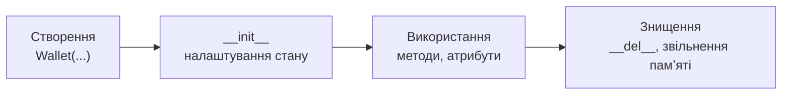

# 41. (Л) Конструктори та деструктори. Інкапсуляція

## Зміст лекції

1. Життєвий цикл обʼєкта
2. Конструктор `__init__`
3. Перевірка даних у конструкторі
4. Значення за замовчуванням
5. Інкапсуляція: навіщо приховувати стан
6. Домовленість `_name`
7. Перетворення імені `__name`
8. Властивості `@property`
9. Властивість лише для читання
10. Деструктор `__del__`
11. Чому на `__del__` не покладаються
12. Приклад: гаманець
13. Типові помилки

## Життєвий цикл обʼєкта

Кожен обʼєкт проходить три етапи:



У лекції 39 ми вже користувалися `__init__`. Сьогодні розберемо, як зробити так, щоб обʼєкт **від самого створення і до знищення** перебував у правильному стані.

## Конструктор `__init__`

Методи з двома підкресленнями з обох боків називають **спеціальними** (special, dunder methods). Python викликає їх сам у певних ситуаціях. `__init__` викликається одразу після створення обʼєкта:

```python
# Program: __init__ runs automatically when an object is created
class Wallet:
    def __init__(self, owner, balance):
        print(f"__init__ called for {owner}")
        self.owner = owner
        self.balance = balance


wallet = Wallet("Olena", 1500)
print(wallet.owner, wallet.balance)
```

```text
__init__ called for Olena
Olena 1500
```

Строго кажучи, `__init__` — **ініціалізатор**: обʼєкт уже створено (це робить метод `__new__`), а `__init__` заповнює його атрибутами. Але в повсякденній мові `__init__` називають конструктором, і ми теж так робитимемо. `__init__` нічого не повертає — він лише налаштовує `self`.

## Перевірка даних у конструкторі

Конструктор — найкраще місце, щоб не допустити створення обʼєкта в неправильному стані. Якщо дані некоректні, генеруємо виняток — і обʼєкт не створюється взагалі:

```python
# Program: refuse to create an object with invalid data
class Wallet:
    def __init__(self, owner, balance):
        if not owner.strip():
            raise ValueError("owner can not be empty")
        if balance < 0:
            raise ValueError(f"balance can not be negative: {balance}")
        self.owner = owner.strip()
        self.balance = round(balance, 2)


for owner, balance in [("Olena", 1500), ("", 100), ("Taras", -50)]:
    try:
        wallet = Wallet(owner, balance)
        print("created:", wallet.owner, wallet.balance)
    except ValueError as error:
        print("error:", error)
```

```text
created: Olena 1500
error: owner can not be empty
error: balance can not be negative: -50
```

Перевірка в одному місці краща, ніж перевірки, розкидані по всій програмі: якщо обʼєкт існує, він гарантовано коректний.

## Значення за замовчуванням

Параметри конструктора можуть мати значення за замовчуванням, як параметри звичайної функції (лекція 10):

```python
# Program: optional constructor parameters
class Wallet:
    def __init__(self, owner, balance=0.0, currency="UAH"):
        self.owner = owner
        self.balance = balance
        self.currency = currency


print(vars(Wallet("Olena")))
print(vars(Wallet("Taras", 200, currency="USD")))
```

```text
{'owner': 'Olena', 'balance': 0.0, 'currency': 'UAH'}
{'owner': 'Taras', 'balance': 200, 'currency': 'USD'}
```

Функція `vars(obj)` повертає `obj.__dict__` — зручно, щоб швидко подивитися всі атрибути.

## Інкапсуляція: навіщо приховувати стан

Конструктор перевірив баланс. Але ніщо не заважає змінити його потім:

```python
# Program: nothing stops us from breaking the object later
class Wallet:
    def __init__(self, owner, balance):
        if balance < 0:
            raise ValueError("negative balance")
        self.owner = owner
        self.balance = balance


wallet = Wallet("Olena", 100)
wallet.balance = -1000000  # ніхто не перевірив
print(wallet.balance)
```

```text
-1000000
```

**Інкапсуляція** — принцип, за яким обʼєкт сам керує своїм станом: зовнішній код змінює дані не напряму, а через методи, які перевіряють правила. Наприклад, гаманець поповнюють методом `deposit`, а знімають гроші методом `withdraw`, який не дозволить піти в мінус.

У мовах на кшталт Java чи C# є модифікатори `private` і `public`, що забороняють доступ до атрибутів. У Python таких заборон немає. Натомість є **домовленості** й механізм властивостей.

## Домовленість `_name`

Одне підкреслення на початку імені означає: «це внутрішня деталь, ззовні не чіпати»:

```python
# Program: a leading underscore marks an internal attribute
class Wallet:
    def __init__(self, owner, balance):
        self.owner = owner
        self._balance = balance

    def deposit(self, amount):
        if amount <= 0:
            raise ValueError("amount must be positive")
        self._balance += amount

    def withdraw(self, amount):
        if amount > self._balance:
            raise ValueError("not enough money")
        self._balance -= amount

    def balance(self):
        return self._balance


wallet = Wallet("Olena", 100)
wallet.deposit(50)
wallet.withdraw(30)
print(wallet.balance())
```

```text
120
```

Python не заборонить написати `wallet._balance = -5`, але кожен програміст, побачивши підкреслення, розуміє: так робити не можна. Редактори коду й лінтери теж попереджають про звернення до «внутрішніх» атрибутів ззовні класу.

## Перетворення імені `__name`

Два підкреслення на початку (без двох у кінці) вмикають **перетворення імені** (name mangling): Python перейменовує атрибут на `_ІмʼяКласу__name`:

```python
# Program: double underscore triggers name mangling
class Wallet:
    def __init__(self, balance):
        self.__balance = balance


wallet = Wallet(100)
print(vars(wallet))
try:
    print(wallet.__balance)
except AttributeError as error:
    print("error:", error)
print(wallet._Wallet__balance)
```

```text
{'_Wallet__balance': 100}
error: 'Wallet' object has no attribute '__balance'
100
```

Головне призначення цього механізму — не захист, а уникнення конфліктів імен під час наслідування (лекція 43): атрибут `__balance` класу `Wallet` не зіткнеться з атрибутом `__balance` нащадка. Звичайно для внутрішніх атрибутів достатньо одного підкреслення.

| Запис | Значення | Доступ ззовні |
|---|---|---|
| `balance` | публічний атрибут | вільний |
| `_balance` | внутрішній, за домовленістю | технічно можливий, але не варто |
| `__balance` | внутрішній з перетворенням імені | лише як `_Wallet__balance` |
| `__init__` | спеціальний метод Python | викликає сам Python |

## Властивості `@property`

Методи `balance()`, `set_balance()` незручні: замість `wallet.balance` доводиться писати `wallet.balance()`. **Властивість** (`property`) виглядає як атрибут, але при читанні і записі викликає ваші методи:

```python
# Program: a property looks like an attribute but runs code
class Wallet:
    def __init__(self, owner, balance):
        self.owner = owner
        self.balance = balance  # навіть тут працює перевірка сетера

    @property
    def balance(self):
        return self._balance

    @balance.setter
    def balance(self, value):
        if value < 0:
            raise ValueError(f"balance can not be negative: {value}")
        self._balance = round(value, 2)


wallet = Wallet("Olena", 100)
wallet.balance = 250.456
print(wallet.balance)
try:
    wallet.balance = -10
except ValueError as error:
    print("error:", error)
print(wallet.balance)
```

```text
250.46
error: balance can not be negative: -10
250.46
```

- `@property` над методом `balance` робить його **гетером**: `wallet.balance` викликає цей метод.
- `@balance.setter` оголошує **сетер**: `wallet.balance = x` викликає його з `value = x`.
- Справжнє значення зберігається в `_balance`.

Перевага властивостей — зовнішній код не змінюється. Можна почати з простого атрибута `balance`, а коли знадобиться перевірка, замінити його властивістю — і жоден рядок, що використовує `wallet.balance`, переписувати не доведеться.

## Властивість лише для читання

Якщо оголосити гетер без сетера, атрибут можна читати, але не можна змінити. Так зручно робити **обчислювані** властивості:

```python
# Program: computed read-only properties
class Wallet:
    def __init__(self, owner, balance, limit):
        self.owner = owner
        self.balance = balance
        self.limit = limit

    @property
    def is_empty(self):
        return self.balance == 0

    @property
    def left_to_limit(self):
        return self.limit - self.balance


wallet = Wallet("Olena", 0, 5000)
print(wallet.is_empty, wallet.left_to_limit)
try:
    wallet.is_empty = False
except AttributeError as error:
    print("error:", error)
```

```text
True 5000
error: property 'is_empty' of 'Wallet' object has no setter
```

Обчислювана властивість завжди актуальна: її значення рахується в момент звернення, тому вона не може «розійтися» з іншими атрибутами.

## Деструктор `__del__`

Метод `__del__` викликається, коли обʼєкт ось-ось буде знищено — коли на нього не залишилося жодного посилання:

```python
# Program: __del__ runs when the last reference disappears
class Wallet:
    def __init__(self, owner):
        self.owner = owner
        print(f"wallet of {owner} created")

    def __del__(self):
        print(f"wallet of {self.owner} deleted")


wallet = Wallet("Olena")
other = wallet          # друге посилання на той самий обʼєкт
del wallet              # видалили одне посилання — обʼєкт живий
print("after del wallet")
del other               # останнє посилання — обʼєкт знищується
print("after del other")
```

```text
wallet of Olena created
after del wallet
wallet of Olena deleted
after del other
```

Інструкція `del` видаляє **імʼя**, а не обʼєкт. Обʼєкт знищується, коли зникає останнє посилання на нього. Python рахує посилання для кожного обʼєкта (reference counting) і звільняє памʼять, щойно лічильник падає до нуля.

## Чому на `__del__` не покладаються

У Python `__del__` використовують рідко:

- момент виклику непередбачуваний: якщо на обʼєкт посилається список, інший обʼєкт або обʼєкти посилаються один на одного по колу, деструктор може не викликатися довго;
- під час завершення програми `__del__` може не викликатися зовсім;
- виняток у `__del__` не можна перехопити звичайним `try`.

Для звільнення ресурсів — закриття файлів, зʼєднань з базою даних — використовують інструкцію `with` (лекція 21) або явний метод `close()`. Деструктор корисний хіба що для навчальних прикладів і налагодження.

## Приклад: гаманець

Гаманець з інкапсульованим балансом, історією операцій і обчислюваними властивостями:

```python
# File: wallet.py
from datetime import date


class Wallet:
    """A wallet that never goes below zero and keeps a history of operations."""

    def __init__(self, owner: str, balance: float = 0.0):
        self.owner = owner
        self._balance = 0.0
        self._history: list[tuple[date, str, float]] = []
        if balance:
            self.deposit(balance, "initial balance")

    @property
    def owner(self) -> str:
        return self._owner

    @owner.setter
    def owner(self, value: str) -> None:
        if not value.strip():
            raise ValueError("owner can not be empty")
        self._owner = value.strip()

    @property
    def balance(self) -> float:
        return self._balance

    @property
    def operations(self) -> int:
        return len(self._history)

    def deposit(self, amount: float, comment: str = "") -> None:
        if amount <= 0:
            raise ValueError("deposit must be positive")
        self._balance = round(self._balance + amount, 2)
        self._history.append((date.today(), comment, amount))

    def withdraw(self, amount: float, comment: str = "") -> None:
        if amount <= 0:
            raise ValueError("amount must be positive")
        if amount > self._balance:
            raise ValueError(f"not enough money: {self._balance:.2f} < {amount:.2f}")
        self._balance = round(self._balance - amount, 2)
        self._history.append((date.today(), comment, -amount))

    def statement(self) -> str:
        lines = [f"wallet of {self.owner}"]
        for day, comment, amount in self._history:
            lines.append(f"  {day.isoformat()}  {amount:+9.2f}  {comment}")
        lines.append(f"  balance: {self.balance:.2f}")
        return "\n".join(lines)


if __name__ == "__main__":
    wallet = Wallet("Olena Koval", 1500)
    for amount, comment in [(85.5, "lunch"), (30, "bus"), (2000, "laptop")]:
        try:
            wallet.withdraw(amount, comment)
        except ValueError as error:
            print("error:", error)
    print(wallet.statement())
    print("operations:", wallet.operations)
```

```text
error: not enough money: 1384.50 < 2000.00
wallet of Olena Koval
  2026-10-20   +1500.00  initial balance
  2026-10-20     -85.50  lunch
  2026-10-20     -30.00  bus
  balance: 1384.50
operations: 3
```

Зовнішній код не може зробити баланс відʼємним: властивість `balance` лише для читання, а змінити його можна тільки через `deposit` і `withdraw`, що перевіряють правила.

## Типові помилки

| Помилка | Чому погано | Як правильно |
|---|---|---|
| `def init(self)` або `def _init_(self)` | метод не викликається автоматично | `def __init__(self)` — по два підкреслення |
| `return self` або `return value` у `__init__` | `TypeError: __init__() should return None` | `__init__` нічого не повертає |
| Перевірка даних розкидана по програмі | легко пропустити | перевірка в конструкторі й сетерах |
| Сетер записує в `self.balance` | нескінченна рекурсія: сетер викликає сам себе | зберігати в `self._balance` |
| Звернення до `obj._internal` ззовні класу | ламається, щойно автор класу змінить реалізацію | публічні методи й властивості |
| Закриття файлу в `__del__` | момент виклику непередбачуваний | `with` або метод `close()` |
| Думка, що `__name` — надійний захист | доступ через `_Class__name` залишається | інкапсуляція — домовленість і дисципліна |

## Підсумок

- **`__init__`** викликається автоматично після створення обʼєкта і задає його початковий стан; некоректні дані — `raise ValueError`, і обʼєкт не створюється.
- **Інкапсуляція**: обʼєкт сам керує своїм станом, зміни — через методи з перевірками.
- `_name` — внутрішній атрибут за домовленістю; `__name` — перетворення імені на `_Class__name`, переважно проти конфліктів під час наслідування.
- **`@property`** робить метод схожим на атрибут; `@x.setter` перевіряє присвоєння; гетер без сетера — властивість лише для читання.
- **`__del__`** викликається, коли зникає останнє посилання; для звільнення ресурсів використовують `with` і `close()`.

## Корисні посилання

- [Офіційний посібник Python — 9.6 Private Variables](https://docs.python.org/3/tutorial/classes.html#private-variables)
- [Вбудована функція `property` — довідник](https://docs.python.org/3/library/functions.html#property)
- [Data model — `object.__init__` і `object.__del__`](https://docs.python.org/3/reference/datamodel.html#basic-customization)
- [Downey A. Think Python — розд. 17 «Classes and methods»](https://greenteapress.com/thinkpython2/html/thinkpython2018.html)
