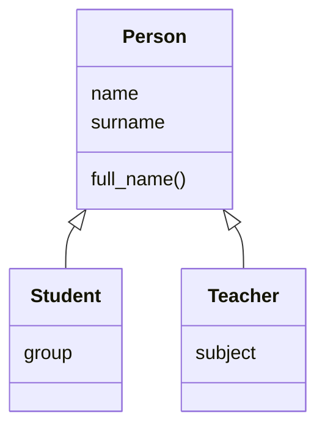

# 43. (Л) Наслідування. Перевизначення методів

## Зміст лекції

1. Проблема дублювання коду
2. Що таке наслідування
3. Синтаксис наслідування
4. Розширення класу-нащадка
5. Перевизначення методів
6. `super()`: виклик методу батьківського класу
7. `super().__init__()` у конструкторі
8. Перевірка належності: `isinstance`, `issubclass`
9. Порядок пошуку методів: `__mro__`
10. Клас `object` — спільний предок
11. Множинне наслідування коротко
12. Наслідування чи композиція
13. Приклад: учасники освітнього процесу
14. Типові помилки

## Проблема дублювання коду

Опишемо студента й викладача:

```python
# Program: two classes with a lot of repeated code
class Student:
    def __init__(self, name, surname, group):
        self.name = name
        self.surname = surname
        self.group = group

    def full_name(self):
        return f"{self.name} {self.surname}"


class Teacher:
    def __init__(self, name, surname, subject):
        self.name = name
        self.surname = surname
        self.subject = subject

    def full_name(self):
        return f"{self.name} {self.surname}"


print(Student("Olena", "Koval", "PZ-11").full_name())
print(Teacher("Petro", "Bondar", "Python").full_name())
```

```text
Olena Koval
Petro Bondar
```

Атрибути `name`, `surname` і метод `full_name` повторюються. Якщо знадобиться додати по батькові, змінювати доведеться обидва класи — і легко забути один. Спільне потрібно винести в одне місце.

## Що таке наслідування

**Наслідування** (inheritance) — механізм, за яким новий клас (**нащадок**, дочірній клас, subclass) отримує всі атрибути й методи наявного класу (**батьківського**, базового, superclass) і може додати власні або змінити успадковані.



Наслідування описує відношення **«є різновидом»** (is-a): студент є людиною, викладач є людиною. Якщо таке речення звучить безглуздо («гаманець є людиною»), наслідування недоречне.

## Синтаксис наслідування

Батьківський клас вказують у дужках після імені нащадка:

```python
# Program: the child class gets everything from the parent
class Person:
    def __init__(self, name, surname):
        self.name = name
        self.surname = surname

    def full_name(self):
        return f"{self.name} {self.surname}"


class Student(Person):
    pass


olena = Student("Olena", "Koval")
print(olena.full_name())
print(type(olena).__name__, isinstance(olena, Person))
```

```text
Olena Koval
Student True
```

Клас `Student` порожній, але має і конструктор, і метод `full_name` — усе успадковано від `Person`.

## Розширення класу-нащадка

Нащадок може додавати нові методи, яких немає в батьківського класу:

```python
# Program: a child class adds its own methods
class Person:
    def __init__(self, name, surname):
        self.name = name
        self.surname = surname

    def full_name(self):
        return f"{self.name} {self.surname}"


class Student(Person):
    def initials(self):
        return f"{self.name[0]}. {self.surname}"


olena = Student("Olena", "Koval")
print(olena.full_name(), "/", olena.initials())

person = Person("Petro", "Bondar")
print(hasattr(person, "initials"))
```

```text
Olena Koval / O. Koval
False
```

Наслідування працює в один бік: нащадок бачить методи батька, але батьківський клас нічого не знає про методи нащадків.

## Перевизначення методів

Якщо нащадок оголошує метод з тим самим імʼям, що й батько, він **перевизначає** (override) його: для обʼєктів нащадка викликається нова версія:

```python
# Program: the child replaces a parent method
class Person:
    def __init__(self, name, surname):
        self.name = name
        self.surname = surname

    def describe(self):
        return f"person {self.name} {self.surname}"


class Student(Person):
    def describe(self):
        return f"student {self.name} {self.surname}"


for someone in [Person("Petro", "Bondar"), Student("Olena", "Koval")]:
    print(someone.describe())
```

```text
person Petro Bondar
student Olena Koval
```

Python шукає метод спочатку в класі обʼєкта, потім у батьківському — і бере **перший знайдений**.

## `super()`: виклик методу батьківського класу

Часто нащадок хоче не замінити метод повністю, а **доповнити** його. Функція `super()` дає доступ до методів батьківського класу:

```python
# Program: extend the parent method instead of rewriting it
class Person:
    def __init__(self, name, surname):
        self.name = name
        self.surname = surname

    def describe(self):
        return f"{self.name} {self.surname}"


class Student(Person):
    def __init__(self, name, surname, group):
        super().__init__(name, surname)
        self.group = group

    def describe(self):
        return f"{super().describe()}, group {self.group}"


print(Student("Olena", "Koval", "PZ-11").describe())
```

```text
Olena Koval, group PZ-11
```

Якщо згодом формат `describe()` у `Person` зміниться (наприклад, додасться по батькові), `Student` отримає зміни автоматично.

## `super().__init__()` у конструкторі

Якщо нащадок оголошує власний `__init__`, конструктор батька **не викликається автоматично**. Його треба викликати явно:

```python
# Program: forgetting super().__init__ leaves attributes undefined
class Person:
    def __init__(self, name, surname):
        self.name = name
        self.surname = surname


class Teacher(Person):
    def __init__(self, name, surname, subject):
        self.subject = subject  # забули super().__init__


teacher = Teacher("Petro", "Bondar", "Python")
print(vars(teacher))
try:
    print(teacher.name)
except AttributeError as error:
    print("error:", error)
```

```text
{'subject': 'Python'}
error: 'Teacher' object has no attribute 'name'
```

Правило: у конструкторі нащадка першим рядком викликайте `super().__init__(...)`, а потім додавайте власні атрибути.

## Перевірка належності: `isinstance`, `issubclass`

```python
# Program: isinstance respects inheritance
class Person:
    pass


class Student(Person):
    pass


class Teacher(Person):
    pass


olena = Student()
print(isinstance(olena, Student), isinstance(olena, Person), isinstance(olena, Teacher))
print(issubclass(Student, Person), issubclass(Person, Student))
print(type(olena) == Person)
```

```text
True True False
True False
False
```

- `isinstance(obj, Class)` — чи є обʼєкт екземпляром класу **або його нащадка**.
- `issubclass(A, B)` — чи є клас `A` нащадком `B` (або тим самим класом).
- `type(obj) == Class` перевіряє лише точний клас, без урахування наслідування, тому для перевірки типу краще `isinstance`.

## Порядок пошуку методів: `__mro__`

Ієрархія може мати кілька рівнів. Порядок, у якому Python шукає атрибути, зберігається в атрибуті класу `__mro__` (Method Resolution Order):

```python
# Program: method lookup order through several levels
class Person:
    def describe(self):
        return "person"


class Student(Person):
    def describe(self):
        return "student, " + super().describe()


class GroupLeader(Student):
    def describe(self):
        return "group leader, " + super().describe()


print(GroupLeader().describe())
print([cls.__name__ for cls in GroupLeader.__mro__])
```

```text
group leader, student, person
['GroupLeader', 'Student', 'Person', 'object']
```

`super()` у кожному класі викликає метод **наступного** класу в цьому списку. Тому ланцюжок `super().describe()` пройшов усі рівні.

## Клас `object` — спільний предок

В кінці кожного `__mro__` стоїть клас `object`. Усі класи Python неявно наслідують його, тому кожен обʼєкт має набір стандартних методів: `__init__`, `__str__`, `__repr__`, `__eq__` та інші:

```python
# Program: every class inherits from object
class Empty:
    pass


print(issubclass(Empty, object))
print(Empty.__bases__)
print(str(Empty())[:22])
```

```text
True
(<class 'object'>,)
<__main__.Empty object
```

Саме тому `print` будь-якого обʼєкта щось виводить: метод `__str__` успадковано від `object`. У лекції 47 ми перевизначимо його, щоб вивід був зрозумілим.

## Множинне наслідування коротко

Клас може мати кількох батьків: `class C(A, B):`. Python будує `__mro__` за алгоритмом C3, щоб кожен клас з'являвся в ньому один раз і батьки йшли в порядку оголошення:

```python
# Program: a class with two parents
class Printable:
    def print_card(self):
        print(f"[{self.describe()}]")


class Person:
    def __init__(self, name):
        self.name = name

    def describe(self):
        return self.name


class Student(Person, Printable):
    pass


Student("Olena").print_card()
print([cls.__name__ for cls in Student.__mro__])
```

```text
[Olena]
['Student', 'Person', 'Printable', 'object']
```

Невеликі класи, що додають одну можливість (як `Printable`), називають **міксинами** (mixin). Складні ієрархії з множинним наслідуванням важко зрозуміти, тому в навчальних і більшості робочих проєктів обходяться одиночним наслідуванням.

## Наслідування чи композиція

Наслідування — не єдиний спосіб повторно використати код. **Композиція** — коли обʼєкт містить інший обʼєкт як атрибут (відношення **«має»**, has-a):

| Відношення | Приклад | Механізм |
|---|---|---|
| is-a, «є різновидом» | студент — людина | наслідування: `class Student(Person)` |
| has-a, «має» | студент має гаманець, група має студентів | композиція: `self.wallet = Wallet()` |

```python
# Program: composition, a student has a wallet
class Wallet:
    def __init__(self, balance=0):
        self.balance = balance


class Student:
    def __init__(self, name, balance):
        self.name = name
        self.wallet = Wallet(balance)  # студент МАЄ гаманець, а не Є гаманцем


olena = Student("Olena", 1500)
print(olena.name, olena.wallet.balance)
```

```text
Olena 1500
```

Якщо сумніваєтеся, що обрати, — обирайте композицію: її легше змінювати.

## Приклад: учасники освітнього процесу

```python
# File: people.py
class Person:
    def __init__(self, name: str, surname: str):
        self.name = name
        self.surname = surname

    def full_name(self) -> str:
        return f"{self.name} {self.surname}"

    def describe(self) -> str:
        return self.full_name()

    def monthly_income(self) -> float:
        return 0.0


class Student(Person):
    def __init__(self, name: str, surname: str, group: str, scholarship: float = 0.0):
        super().__init__(name, surname)
        self.group = group
        self.scholarship = scholarship

    def describe(self) -> str:
        return f"{super().describe()}, student of {self.group}"

    def monthly_income(self) -> float:
        return self.scholarship


class GroupLeader(Student):
    BONUS = 0.1  # надбавка старості до стипендії

    def describe(self) -> str:
        return f"{super().describe()}, group leader"

    def monthly_income(self) -> float:
        return round(super().monthly_income() * (1 + self.BONUS), 2)


class Teacher(Person):
    def __init__(self, name: str, surname: str, subject: str, salary: float):
        super().__init__(name, surname)
        self.subject = subject
        self.salary = salary

    def describe(self) -> str:
        return f"{super().describe()}, teaches {self.subject}"

    def monthly_income(self) -> float:
        return self.salary


if __name__ == "__main__":
    people = [
        Student("Olena", "Koval", "PZ-11", scholarship=2000),
        GroupLeader("Iryna", "Shevchuk", "PZ-11", scholarship=2000),
        Student("Taras", "Melnyk", "PZ-11"),
        Teacher("Petro", "Bondar", "Python", salary=18000),
    ]
    for person in people:
        print(f"{person.describe():<52} {person.monthly_income():>9.2f}")
    students = [p for p in people if isinstance(p, Student)]
    print("students:", len(students))
```

```text
Olena Koval, student of PZ-11                          2000.00
Iryna Shevchuk, student of PZ-11, group leader         2200.00
Taras Melnyk, student of PZ-11                            0.00
Petro Bondar, teaches Python                          18000.00
students: 3
```

Староста потрапив до студентів, бо `GroupLeader` наслідує `Student`, а викладач — ні: `Teacher` є нащадком `Person`, але не `Student`.

Цикл викликає `describe()` і `monthly_income()` для кожного обʼєкта, не перевіряючи його тип: кожен клас сам знає, як описати себе і порахувати дохід. Це вже поліморфізм — тема наступної лекції.

## Типові помилки

| Помилка | Чому погано | Як правильно |
|---|---|---|
| Немає `super().__init__()` у конструкторі нащадка | атрибути батька не створено, `AttributeError` | першим рядком `super().__init__(...)` |
| `super.__init__()` без дужок після `super` | `TypeError` | `super().__init__()` |
| `Person.__init__(name, surname)` без `self` | атрибути не потрапляють в обʼєкт | `super().__init__(name, surname)` |
| Копіювання методу батька в нащадка «з невеликими змінами» | дублювання, зміни в батька не потрапляють у нащадка | `super().method()` + доповнення |
| `type(obj) == Person` для перевірки | не враховує нащадків | `isinstance(obj, Person)` |
| Наслідування заради одного методу («гаманець — це людина») | безглузда ієрархія | композиція: атрибут-обʼєкт |
| Глибокі ієрархії на 5+ рівнів | важко зрозуміти, звідки береться поведінка | 2–3 рівні, композиція |

## Підсумок

- **Наслідування** передає нащадку всі атрибути й методи батька: `class Student(Person):`. Відношення «є різновидом».
- Нащадок може **додавати** методи і **перевизначати** успадковані.
- **`super()`** викликає метод наступного класу в `__mro__`; у конструкторі нащадка обовʼязковий `super().__init__(...)`.
- `isinstance` і `issubclass` враховують наслідування.
- **`__mro__`** — порядок пошуку методів; наприкінці завжди `object`.
- Множинне наслідування існує, але використовують його обережно; часто краще **композиція** (відношення «має»).

## Корисні посилання

- [Офіційний посібник Python — 9.5 Inheritance](https://docs.python.org/3/tutorial/classes.html#inheritance)
- [Вбудована функція `super` — довідник](https://docs.python.org/3/library/functions.html#super)
- [The Python 2.3 Method Resolution Order — пояснення алгоритму C3](https://docs.python.org/3/howto/mro.html)
- [Downey A. Think Python — розд. 18 «Inheritance»](https://greenteapress.com/thinkpython2/html/thinkpython2019.html)
- [OpenStax. Introduction to Python Programming — розд. 13 «Inheritance»](https://openstax.org/details/books/introduction-python-programming)
