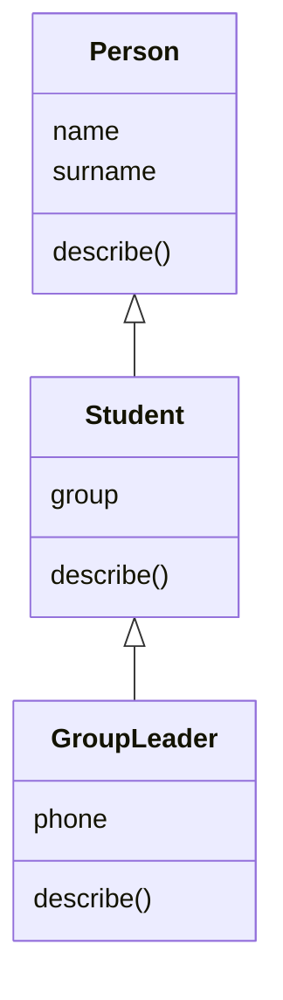

# 44. (П20) Наслідування та перевизначення методів

## Мета роботи

- **Освітня (навчальна):** навчитися будувати ієрархію класів, наслідувати атрибути й методи, перевизначати методи нащадків і викликати методи батьківського класу через `super()`.
- **Дослідна (розвиваюча):** розвинути вміння виділяти спільну поведінку в базовий клас і перевіряти порядок пошуку методів (`__mro__`).
- **Виховна (патріотична):** сформувати прагнення до повторного використання коду замість дублювання — так працюють великі команди, що створюють державні цифрові сервіси.

!!! danger "Персоналізація обовʼязкова"
    Ієрархії описують **вашу** групу та **ваші** витрати: обʼєкти створюються з реальних даних.

## Підготовка

Створіть каталог `lab44`, скопіюйте `data/expenses.csv` з роботи 22. Кожне завдання — в окремому файлі.

## Хід роботи

### Завдання 1. Person → Student → GroupLeader

Файл `task1.py`. Створіть ієрархію:



1. `Person` — імʼя і прізвище, метод `describe()` повертає `Ivan Petrenko`.
2. `Student` — додає групу; `describe()` дописує групу до результату батьківського методу через `super()`.
3. `GroupLeader` (староста) — додає телефон; `describe()` дописує `group leader`.

Створіть себе (як `Student`) і старосту вашої групи (як `GroupLeader`) та виведіть їхні описи.

```text
$ python3 task1.py
Ivan Petrenko, PZ-11
Olena Koval, PZ-11, group leader, +380 67 000 00 00
```

**Очікуваний результат:** жоден клас не дублює код батьківського: кожен `describe()` викликає `super().describe()`.

### Завдання 2. Перевірка належності та MRO

1. Перевірте `isinstance()` і `issubclass()` для всіх пар класів і виведіть результати таблицею.
2. Виведіть `GroupLeader.__mro__` і поясніть порядок пошуку методу `describe()`.

**Очікуваний результат:** у звіті таблиця результатів перевірок і пояснення, чому `isinstance(leader, Person)` повертає `True`.

### Завдання 3. Види витрат

Файл `task3.py`. Створіть базовий клас `Expense` (дата, категорія, сума) з методом `monthly_cost()`, що повертає суму, і двох нащадків:

1. `RecurringExpense` — регулярна витрата (наприклад, проїзний або мобільний звʼязок) з атрибутом `times_per_month`; `monthly_cost()` множить суму на кількість разів.
2. `SharedExpense` — спільна витрата (наприклад, оренда) з атрибутом `people`; `monthly_cost()` ділить суму на кількість людей.

Створіть список з ваших витрат, щонайменше по дві кожного виду, і обчисліть загальну місячну вартість одним циклом.

**Очікуваний результат:** загальна сума обчислюється без перевірок типу (`if isinstance`): кожен обʼєкт сам знає, як рахувати свою вартість.

### Завдання 4. Розширення без змін

Додайте новий вид витрати `YearlyExpense` (річна підписка), що ділить суму на 12, **не змінюючи** код базового класу і циклу із завдання 3.

**Очікуваний результат:** після додавання нового класу цикл підрахунку працює без змін, а сума включає річну витрату.

## Що здати

Каталог `lab44`: файли завдань і звіт у PDF з виводами програм, таблицею із завдання 2 та відповідями на контрольні запитання.

## Контрольні запитання

1. Що таке наслідування і навіщо воно потрібне?
2. Навіщо викликати `super().__init__()` у конструкторі нащадка?
3. Що таке перевизначення методу?
4. Що показує атрибут `__mro__`?
5. Чому в завданні 3 не потрібно перевіряти тип обʼєкта в циклі?
