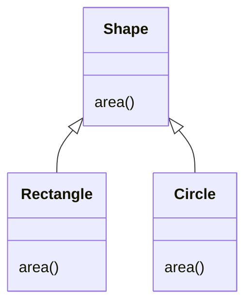
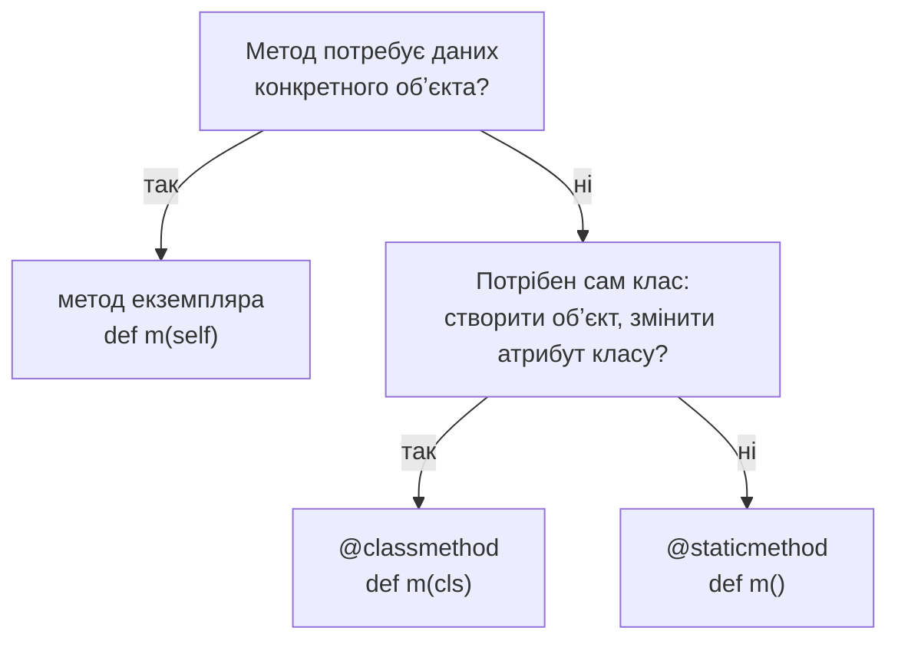

# 45. (Л) Поліморфізм. Методи класу та статичні методи. Змінні класу

## Зміст лекції

1. Що таке поліморфізм
2. Поліморфізм через наслідування
3. Качина типізація
4. Поліморфізм вбудованих функцій
5. Три види методів
6. Метод класу `@classmethod`
7. Альтернативні конструктори
8. Статичний метод `@staticmethod`
9. Змінні класу: лічильники й налаштування
10. Як обрати вид методу
11. Приклад: доходи, витрати й перекази
12. Типові помилки

## Що таке поліморфізм

**Поліморфізм** (з грецької «багато форм») — здатність різних обʼєктів відповідати на той самий виклик по-своєму. Код, що викликає метод, не знає і не повинен знати, з обʼєктом якого класу він працює.

```python
# Program: one call, different behaviour
print(len("python"), len([1, 2, 3]), len({"a": 1}))
print(3 + 4, "3" + "4", [3] + [4])
```

```text
6 3 1
7 34 [3, 4]
```

Функція `len` і оператор `+` працюють з рядками, списками, словниками — кожен тип відповідає по-своєму. Ви вже користувалися поліморфізмом з перших лекцій. Сьогодні навчимося робити поліморфними власні класи.

## Поліморфізм через наслідування

У лекції 43 нащадки перевизначали метод `describe()`. Цикл викликав його для всіх обʼєктів, і кожен відповідав по-своєму:

```python
# Program: polymorphism through inheritance
class Shape:
    def area(self):
        raise NotImplementedError("subclass must implement area()")


class Rectangle(Shape):
    def __init__(self, width, height):
        self.width, self.height = width, height

    def area(self):
        return self.width * self.height


class Circle(Shape):
    def __init__(self, radius):
        self.radius = radius

    def area(self):
        return round(3.14159 * self.radius ** 2, 2)


shapes = [Rectangle(4, 3), Circle(1), Rectangle(2, 2)]
for shape in shapes:
    print(type(shape).__name__, shape.area())
print("total:", sum(shape.area() for shape in shapes))
```

```text
Rectangle 12
Circle 3.14
Rectangle 4
total: 19.14
```

Головне — у циклі **немає** перевірок `if isinstance(shape, Circle)`. Якщо додати новий клас `Triangle` з методом `area`, цикл працюватиме без змін.



## Качина типізація

У Python для поліморфізму **не обовʼязково** мати спільного предка. Достатньо, щоб у обʼєкта був потрібний метод. Цей принцип називають **качиною типізацією** (duck typing): «якщо щось ходить як качка і крякає як качка — це качка».

```python
# Program: duck typing, no common parent class
class Expense:
    def __init__(self, amount):
        self.amount = amount

    def balance_change(self):
        return -self.amount


class Income:
    def __init__(self, amount):
        self.amount = amount

    def balance_change(self):
        return self.amount


class Transfer:
    def balance_change(self):
        return 0  # переказ між своїми картками не змінює загальний баланс


operations = [Income(2600), Expense(85.5), Transfer(), Expense(30)]
print(sum(op.balance_change() for op in operations))
```

```text
2484.5
```

`Expense`, `Income` і `Transfer` не мають спільного батька, але всі мають метод `balance_change()`. Для циклу цього достатньо. Саме так влаштовано багато можливостей Python: функція `for` працює з будь-яким обʼєктом, що вміє видавати елементи, а `with` — з будь-яким обʼєктом, що має методи `__enter__` і `__exit__`.

## Поліморфізм вбудованих функцій

Вбудовані функції й оператори поліморфні завдяки спеціальним методам: `len(x)` викликає `x.__len__()`, `str(x)` — `x.__str__()`, `a + b` — `a.__add__(b)`. Реалізувавши ці методи у своєму класі, ви робите його обʼєкти «рівноправними» з вбудованими типами. Цьому присвячена лекція 47.

## Три види методів

Досі всі наші методи були **методами екземпляра**: першим параметром вони отримують обʼєкт `self`. Python має ще два види:

| Вид | Декоратор | Перший параметр | Має доступ до |
|---|---|---|---|
| метод екземпляра | — | `self` — обʼєкт | атрибутів обʼєкта і класу |
| метод класу | `@classmethod` | `cls` — клас | атрибутів класу |
| статичний метод | `@staticmethod` | — | лише своїх параметрів |

## Метод класу `@classmethod`

Метод класу отримує першим параметром **сам клас** (за домовленістю `cls`). Його можна викликати і через клас, і через обʼєкт:

```python
# Program: a class method receives the class
class Student:
    college = "FKTBP VNU"

    def __init__(self, name):
        self.name = name

    @classmethod
    def set_college(cls, name):
        cls.college = name


Student.set_college("Lutsk College")
olena = Student("Olena")
print(olena.college, Student.college)
```

```text
Lutsk College Lutsk College
```

## Альтернативні конструктори

Найпоширеніше використання методів класу — **альтернативні конструктори**: різні способи створити обʼєкт з різних джерел даних:

```python
# Program: alternative constructors with classmethod
from datetime import date


class Expense:
    def __init__(self, spent_on, category, amount, comment=""):
        self.spent_on = spent_on
        self.category = category
        self.amount = amount
        self.comment = comment

    @classmethod
    def from_csv_line(cls, line):
        day, category, amount, comment = line.strip().split(";")
        return cls(date.fromisoformat(day), category, float(amount), comment)

    @classmethod
    def from_dict(cls, data):
        return cls(date.fromisoformat(data["date"]), data["category"], float(data["amount"]), data.get("comment", ""))

    def __repr__(self):
        return f"Expense({self.spent_on}, {self.category!r}, {self.amount})"


print(Expense.from_csv_line("2026-09-21;food;85.50;lunch"))
print(Expense.from_dict({"date": "2026-09-22", "category": "transport", "amount": "30"}))
```

```text
Expense(2026-09-21, 'food', 85.5)
Expense(2026-09-22, 'transport', 30.0)
```

Вбудовані класи теж мають альтернативні конструктори: `date.fromisoformat("2026-09-21")`, `dict.fromkeys(["a", "b"], 0)`, `int.from_bytes(...)`.

Чому `cls(...)`, а не `Expense(...)`? Якщо від `Expense` успадкувати клас `RecurringExpense`, виклик `RecurringExpense.from_csv_line(...)` створить обʼєкт саме `RecurringExpense`, бо `cls` буде нащадком:

```python
# Program: cls makes alternative constructors work for subclasses
class Expense:
    def __init__(self, amount):
        self.amount = amount

    @classmethod
    def from_text(cls, text):
        return cls(float(text))


class RecurringExpense(Expense):
    pass


print(type(RecurringExpense.from_text("120")).__name__)
```

```text
RecurringExpense
```

## Статичний метод `@staticmethod`

Статичний метод не отримує ні обʼєкта, ні класу — це звичайна функція, розміщена в класі, бо логічно до нього належить. Часто так оформлюють допоміжні перевірки:

```python
# Program: static methods for validation
from datetime import datetime


class Expense:
    @staticmethod
    def is_valid_date(text):
        try:
            datetime.strptime(text, "%Y-%m-%d")
            return True
        except ValueError:
            return False

    @staticmethod
    def is_valid_amount(value):
        try:
            return float(value) > 0
        except ValueError:
            return False


print(Expense.is_valid_date("2026-02-28"), Expense.is_valid_date("2026-02-30"))
print(Expense.is_valid_amount("85.5"), Expense.is_valid_amount("-3"), Expense.is_valid_amount("abc"))
```

```text
True False
True False False
```

Статичний метод викликають без створення обʼєкта: `Expense.is_valid_date(...)`. Його можна було б написати як функцію поза класом; у класі він просто зберігається поруч з кодом, що його використовує.

## Змінні класу: лічильники й налаштування

Змінні класу (лекція 39) зручні для того, що стосується всіх обʼєктів одразу: лічильника створених обʼєктів, спільних налаштувань, реєстру:

```python
# Program: class variables shared by all objects
class Expense:
    currency = "UAH"
    created = 0

    def __init__(self, amount):
        self.amount = amount
        Expense.created += 1

    def __str__(self):
        return f"{self.amount:.2f} {self.currency}"

    @classmethod
    def set_currency(cls, code):
        cls.currency = code


items = [Expense(85.5), Expense(30)]
print(*items, "| created:", Expense.created)
Expense.set_currency("USD")
print(*items)
```

```text
85.50 UAH 30.00 UAH | created: 2
85.50 USD 30.00 USD
```

Зміна змінної класу одразу видна всім обʼєктам, бо жоден з них не має власного атрибута `currency` — пошук атрибута доходить до класу.

## Як обрати вид методу



| Задача | Вид методу |
|---|---|
| обчислити середній бал студента | метод екземпляра |
| створити обʼєкт з рядка CSV чи словника | `@classmethod` |
| змінити валюту для всіх витрат | `@classmethod` |
| перевірити формат дати | `@staticmethod` |

## Приклад: доходи, витрати й перекази

```python
# File: budget.py
from datetime import date


class Operation:
    """Base class: every operation changes the balance in its own way."""

    currency = "UAH"

    def __init__(self, day: date, amount: float, comment: str = ""):
        if amount <= 0:
            raise ValueError("amount must be positive")
        self.day = day
        self.amount = amount
        self.comment = comment

    @classmethod
    def from_csv_line(cls, line: str) -> "Operation":
        kind, day, amount, comment = line.strip().split(";")
        kinds = {"income": Income, "expense": Expense, "transfer": Transfer}
        if kind not in kinds:
            raise ValueError(f"unknown operation: {kind}")
        return kinds[kind](date.fromisoformat(day), float(amount), comment)

    @staticmethod
    def format_money(value: float) -> str:
        return f"{value:+10.2f} {Operation.currency}"

    def balance_change(self) -> float:
        raise NotImplementedError

    def describe(self) -> str:
        return f"{self.day}  {self.format_money(self.balance_change())}  {self.comment}"


class Income(Operation):
    def balance_change(self) -> float:
        return self.amount


class Expense(Operation):
    def balance_change(self) -> float:
        return -self.amount


class Transfer(Operation):
    def balance_change(self) -> float:
        return 0.0


if __name__ == "__main__":
    lines = [
        "income;2026-09-01;2600;scholarship",
        "expense;2026-09-02;85.50;lunch",
        "transfer;2026-09-03;500;to savings card",
        "expense;2026-09-04;30;bus",
    ]
    operations = [Operation.from_csv_line(line) for line in lines]
    for operation in operations:
        print(operation.describe())
    print("balance:", Operation.format_money(sum(op.balance_change() for op in operations)))
```

```text
2026-09-01    +2600.00 UAH  scholarship
2026-09-02      -85.50 UAH  lunch
2026-09-03       +0.00 UAH  to savings card
2026-09-04      -30.00 UAH  bus
balance:   +2484.50 UAH
```

Тут працюють усі три види методів: `from_csv_line` (метод класу) обирає потрібний клас за першим полем рядка, `format_money` (статичний) лише форматує число, а `balance_change` і `describe` (методи екземпляра) працюють з даними конкретної операції, і кожен нащадок рахує зміну балансу по-своєму.

## Типові помилки

| Помилка | Чому погано | Як правильно |
|---|---|---|
| Ланцюжок `if isinstance(...)` для вибору дії | треба змінювати при кожному новому класі | поліморфний метод у кожному класі |
| `@classmethod` без параметра `cls` | `TypeError` під час виклику | `def from_text(cls, text):` |
| `return Expense(...)` в альтернативному конструкторі | нащадки отримують обʼєкт батьківського класу | `return cls(...)` |
| Звернення до `self` у статичному методі | `NameError`: `self` немає | метод екземпляра або `@classmethod` |
| Статичний метод для всього підряд | клас стає набором функцій без стану | статичні — лише допоміжні функції |
| Зміна змінної класу через `self.currency = ...` | змінюється лише один обʼєкт | `cls.currency = ...` у методі класу |

## Підсумок

- **Поліморфізм** — різні обʼєкти відповідають на той самий виклик по-своєму; код, що викликає метод, не перевіряє тип.
- Поліморфізм досягається **перевизначенням** методів у нащадках або **качиною типізацією** — достатньо мати метод з потрібним імʼям.
- **Метод екземпляра** (`self`) працює з даними обʼєкта; **метод класу** (`@classmethod`, `cls`) — з класом, зокрема як альтернативний конструктор; **статичний метод** (`@staticmethod`) — допоміжна функція без доступу до обʼєкта і класу.
- В альтернативних конструкторах створюйте обʼєкт через `cls(...)`, щоб вони працювали і для нащадків.
- **Змінні класу** спільні для всіх обʼєктів: лічильники, спільні налаштування.

## Корисні посилання

- [Вбудована функція `classmethod` — довідник](https://docs.python.org/3/library/functions.html#classmethod)
- [Вбудована функція `staticmethod` — довідник](https://docs.python.org/3/library/functions.html#staticmethod)
- [Глосарій Python — duck typing](https://docs.python.org/3/glossary.html#term-duck-typing)
- [Downey A. Think Python — розд. 17 «Classes and methods», 17.9 «Polymorphism»](https://greenteapress.com/thinkpython2/html/thinkpython2018.html)
