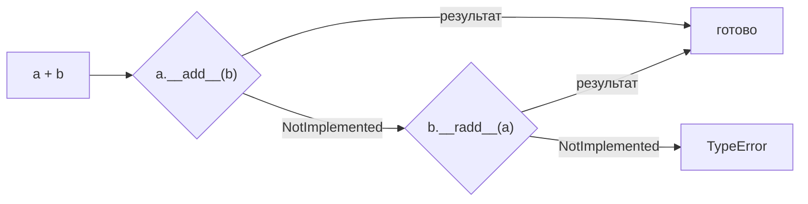

# 47. (Л) Перевантаження операторів. Методи `__str__`, `__len__`, `__add__`

## Зміст лекції

1. Як Python виконує оператори
2. Рядкове подання: `__str__` і `__repr__`
3. Арифметичні оператори: `__add__`, `__sub__`, `__mul__`
4. `NotImplemented` і віддзеркалені методи
5. Порівняння: `__eq__`, `__lt__`
6. `functools.total_ordering`
7. Довжина і логічне значення: `__len__`, `__bool__`
8. Колекції: `__contains__`, `__getitem__`, `__iter__`
9. Таблиця спеціальних методів
10. Приклад: гроші та книга витрат
11. Коли не варто перевантажувати оператори
12. Типові помилки

## Як Python виконує оператори

Коли ви пишете `a + b`, Python насправді викликає метод `a.__add__(b)`. Оператор `==` — це `a.__eq__(b)`, `len(a)` — `a.__len__()`, `print(a)` — `str(a)`, тобто `a.__str__()`:

```python
# Program: operators are method calls
a, b = 7, 5
print(a + b, a.__add__(b))
print("ab" * 3, "ab".__mul__(3))
print(len([1, 2, 3]), [1, 2, 3].__len__())
```

```text
12 12
ababab ababab
3 3
```

**Перевантаження операторів** (operator overloading) — реалізація цих спеціальних методів у власному класі, щоб його обʼєкти працювали з операторами `+`, `==`, `<`, функціями `len`, `str`, циклом `for` тощо.

## Рядкове подання: `__str__` і `__repr__`

Без спеціальних методів `print` власного обʼєкта виводить мало корисного (метод успадковано від `object`, лекція 43):

```python
# Program: the default string representation
class Money:
    def __init__(self, amount, currency="UAH"):
        self.amount = amount
        self.currency = currency


print(Money(85.5))
```

```text
<__main__.Money object at 0x7f3a2c1b9d90>
```

Python має два методи рядкового подання:

| Метод | Для кого | Коли викликається |
|---|---|---|
| `__str__` | для користувача: зрозумілий текст | `print(obj)`, `str(obj)`, f-рядок `f"{obj}"` |
| `__repr__` | для програміста: однозначний опис, бажано як код створення обʼєкта | інтерактивний режим, `repr(obj)`, елементи списку в `print([obj])`, f-рядок `f"{obj!r}"` |

```python
# Program: __str__ for users, __repr__ for developers
class Money:
    def __init__(self, amount, currency="UAH"):
        self.amount = amount
        self.currency = currency

    def __str__(self):
        return f"{self.amount:.2f} {self.currency}"

    def __repr__(self):
        return f"Money({self.amount!r}, {self.currency!r})"


price = Money(85.5)
print(price)
print(repr(price))
print([price, Money(30, "USD")])
```

```text
85.50 UAH
Money(85.5, 'UAH')
[Money(85.5, 'UAH'), Money(30, 'USD')]
```

Якщо реалізувати лише `__repr__`, Python використовуватиме його і для `print`. Тому мінімум для кожного класу — зрозумілий `__repr__`.

## Арифметичні оператори: `__add__`, `__sub__`, `__mul__`

Додамо грошам арифметику. Щоб уникнути похибок дробових чисел (`0.1 + 0.2`, лекція 29), зберігатимемо суму в копійках цілим числом:

```python
# Program: arithmetic for money stored in cents
class Money:
    def __init__(self, amount, currency="UAH"):
        self.cents = round(amount * 100)
        self.currency = currency

    @classmethod
    def from_cents(cls, cents, currency):
        money = cls(0, currency)
        money.cents = cents
        return money

    def _check(self, other):
        if self.currency != other.currency:
            raise ValueError(f"different currencies: {self.currency} and {other.currency}")

    def __add__(self, other):
        self._check(other)
        return Money.from_cents(self.cents + other.cents, self.currency)

    def __sub__(self, other):
        self._check(other)
        return Money.from_cents(self.cents - other.cents, self.currency)

    def __mul__(self, factor):
        return Money.from_cents(round(self.cents * factor), self.currency)

    def __str__(self):
        return f"{self.cents / 100:.2f} {self.currency}"


print(Money(0.1) + Money(0.2), "vs", 0.1 + 0.2)
print(Money(100) - Money(85.5))
print(Money(42.3) * 3)
try:
    Money(10) + Money(10, "USD")
except ValueError as error:
    print("error:", error)
```

```text
0.30 UAH vs 0.30000000000000004
14.50 UAH
126.90 UAH
error: different currencies: UAH and USD
```

Оператори повертають **новий** обʼєкт, а не змінюють наявний — так само, як `3 + 4` не змінює число `3`. Обʼєкти, які після створення не змінюються, легко передавати куди завгодно без ризику, що їх хтось зіпсує.

## `NotImplemented` і віддзеркалені методи

Що станеться з `Money(10) + 5`? Метод `__add__` спробує звернутися до `other.currency` і впаде з незрозумілою помилкою. Правильно — повернути спеціальне значення `NotImplemented`: «я не знаю, як додати такий тип». Тоді Python спробує інший спосіб, а якщо й він не спрацює — згенерує зрозумілий `TypeError`:

```python
# Program: return NotImplemented for unsupported types
class Money:
    def __init__(self, cents):
        self.cents = cents

    def __add__(self, other):
        if not isinstance(other, Money):
            return NotImplemented
        return Money(self.cents + other.cents)

    def __radd__(self, other):
        # sum() починає з 0, тому 0 + Money має працювати
        if other == 0:
            return self
        return NotImplemented


print(sum([Money(100), Money(250)]).cents)
try:
    Money(10) + 5
except TypeError as error:
    print("error:", error)
```

```text
350
error: unsupported operand type(s) for +: 'Money' and 'int'
```

Порядок, у якому Python шукає метод для `a + b`:



**Віддзеркалені** (reflected) методи `__radd__`, `__rsub__`, `__rmul__` викликаються, коли обʼєкт стоїть **праворуч** від оператора. Найчастіше `__radd__` потрібен, щоб працювала функція `sum`: вона починає додавання з числа `0`.

## Порівняння: `__eq__`, `__lt__`

За замовчуванням `==` для власних обʼєктів порівнює **тотожність** (чи це той самий обʼєкт), а не значення:

```python
# Program: default == compares identity, __eq__ compares values
class Money:
    def __init__(self, cents):
        self.cents = cents


class ComparableMoney(Money):
    def __eq__(self, other):
        if not isinstance(other, Money):
            return NotImplemented
        return self.cents == other.cents


print(Money(100) == Money(100))
print(ComparableMoney(100) == ComparableMoney(100))
```

```text
False
True
```

Для сортування (`sorted`, `min`, `max`) потрібен оператор `<`, тобто метод `__lt__` (less than):

| Оператор | Метод |
|---|---|
| `==`, `!=` | `__eq__`, `__ne__` (за замовчуванням — заперечення `__eq__`) |
| `<`, `<=` | `__lt__`, `__le__` |
| `>`, `>=` | `__gt__`, `__ge__` |

## `functools.total_ordering`

Писати всі шість методів порівняння довго. Декоратор `functools.total_ordering` дописує решту, якщо реалізовано `__eq__` і один з методів порядку:

```python
# Program: total_ordering builds the remaining comparisons
from functools import total_ordering


@total_ordering
class Money:
    def __init__(self, cents):
        self.cents = cents

    def __eq__(self, other):
        return self.cents == other.cents

    def __lt__(self, other):
        return self.cents < other.cents

    def __repr__(self):
        return f"Money({self.cents})"


prices = [Money(250), Money(80), Money(1200)]
print(sorted(prices))
print(max(prices), Money(80) <= Money(80), Money(5) >= Money(9))
```

```text
[Money(80), Money(250), Money(1200)]
Money(1200) True False
```

!!! note "`__eq__` і `__hash__`"
    Якщо клас перевизначає `__eq__`, Python автоматично робить його обʼєкти **нехешованими**: їх не можна покласти в множину або використати як ключ словника (лекція 16). Якщо це потрібно, реалізуйте ще `__hash__`, що повертає хеш тих самих полів, які порівнює `__eq__`: `return hash((self.cents, self.currency))`. Робіть так лише для незмінних обʼєктів.

## Довжина і логічне значення: `__len__`, `__bool__`

```python
# Program: len() and truth value of a custom object
class ExpenseBook:
    def __init__(self, items):
        self.items = list(items)

    def __len__(self):
        return len(self.items)


empty, full = ExpenseBook([]), ExpenseBook([85.5, 30])
print(len(empty), len(full))
if not empty:
    print("no expenses yet")
```

```text
0 2
no expenses yet
```

Якщо `__bool__` не оголошено, Python використовує `__len__`: обʼєкт з довжиною 0 вважається хибним, як порожній список.

## Колекції: `__contains__`, `__getitem__`, `__iter__`

Щоб обʼєкт поводився як колекція, реалізують:

```python
# Program: a custom collection
class ExpenseBook:
    def __init__(self, items):
        self.items = list(items)  # список пар (category, amount)

    def __contains__(self, category):
        return any(c == category for c, _ in self.items)

    def __getitem__(self, index):
        return self.items[index]

    def __iter__(self):
        return iter(self.items)


book = ExpenseBook([("food", 85.5), ("transport", 30), ("food", 64.5)])
print("food" in book, "books" in book)
print(book[0], book[-1], book[1:])
for category, amount in book:
    print(f"{category:<10} {amount:>6.2f}")
```

```text
True False
('food', 85.5) ('food', 64.5) [('transport', 30), ('food', 64.5)]
food        85.50
transport   30.00
food        64.50
```

`__getitem__` отримує те, що стоїть у квадратних дужках: число або зріз, тому `book[1:]` теж працює.

## Таблиця спеціальних методів

| Вираз | Метод |
|---|---|
| `str(x)`, `print(x)` | `x.__str__()` |
| `repr(x)` | `x.__repr__()` |
| `x + y`, `x - y`, `x * y`, `x / y` | `__add__`, `__sub__`, `__mul__`, `__truediv__` |
| `y + x`, якщо `y` не вміє | `x.__radd__(y)` |
| `x == y`, `x < y` | `__eq__`, `__lt__` |
| `len(x)` | `x.__len__()` |
| `bool(x)`, `if x:` | `x.__bool__()` або `__len__` |
| `item in x` | `x.__contains__(item)` |
| `x[key]` | `x.__getitem__(key)` |
| `for item in x` | `x.__iter__()` |
| `hash(x)`, ключ словника | `x.__hash__()` |

## Приклад: гроші та книга витрат

```python
# File: money.py
from functools import total_ordering


@total_ordering
class Money:
    """An immutable amount of money stored in cents."""

    def __init__(self, amount: float = 0, currency: str = "UAH"):
        self._cents = round(amount * 100)
        self._currency = currency

    @property
    def currency(self) -> str:
        return self._currency

    def _same(self, other: "Money") -> None:
        if self._currency != other._currency:
            raise ValueError("different currencies")

    def __add__(self, other):
        if not isinstance(other, Money):
            return NotImplemented
        self._same(other)
        return Money((self._cents + other._cents) / 100, self._currency)

    def __radd__(self, other):
        return self if other == 0 else NotImplemented

    def __mul__(self, factor):
        if not isinstance(factor, (int, float)):
            return NotImplemented
        return Money(self._cents * factor / 100, self._currency)

    __rmul__ = __mul__

    def __eq__(self, other):
        if not isinstance(other, Money):
            return NotImplemented
        return (self._cents, self._currency) == (other._cents, other._currency)

    def __lt__(self, other):
        self._same(other)
        return self._cents < other._cents

    def __hash__(self):
        return hash((self._cents, self._currency))

    def __str__(self):
        return f"{self._cents / 100:.2f} {self._currency}"

    def __repr__(self):
        return f"Money({self._cents / 100}, {self._currency!r})"


class ExpenseBook:
    def __init__(self, expenses=()):
        self._expenses = list(expenses)  # пари (category, Money)

    def __len__(self):
        return len(self._expenses)

    def __iter__(self):
        return iter(self._expenses)

    def __contains__(self, category):
        return any(c == category for c, _ in self._expenses)

    def __add__(self, other):
        return ExpenseBook(self._expenses + other._expenses)

    def total(self) -> Money:
        return sum(amount for _, amount in self._expenses)

    def __str__(self):
        return f"ExpenseBook: {len(self)} expenses, total {self.total()}"


if __name__ == "__main__":
    first_half = ExpenseBook([("food", Money(85.5)), ("transport", Money(30))])
    second_half = ExpenseBook([("food", Money(64.5)), ("fun", Money(315))])
    month = first_half + second_half
    print(month)
    print("fun" in month, "books" in month)
    print("biggest:", max(amount for _, amount in month))
    print("double lunch:", 2 * Money(85.5))
    print("unique amounts:", len({Money(30), Money(30.0), Money(85.5)}))
```

```text
ExpenseBook: 4 expenses, total 495.00 UAH
True False
biggest: 315.00 UAH
double lunch: 171.00 UAH
unique amounts: 2
```

Запис `__rmul__ = __mul__` робить віддзеркалене множення таким самим, як пряме: `2 * Money(...)` і `Money(...) * 2` дають однаковий результат.

## Коли не варто перевантажувати оператори

Оператор має робити те, чого від нього очікує читач коду:

- `+` для грошей, векторів, книг витрат — природно;
- `+` для «додати студента в групу» або `-` для «видалити файл» — незрозуміло: краще звичайні методи `group.add(student)`, `file.delete()`;
- `==` має бути симетричним (`a == b` означає `b == a`) і не повинен змінювати обʼєкти.

## Типові помилки

| Помилка | Чому погано | Як правильно |
|---|---|---|
| `__str__` друкує замість повертати | `TypeError: __str__ returned non-string` | `return f"..."` |
| `__add__` змінює `self` | несподівані зміни обʼєкта, що бере участь в операції | повертати новий обʼєкт |
| `raise TypeError` для невідомого типу в `__add__` | Python не спробує `__radd__` іншого обʼєкта | `return NotImplemented` |
| `sum(items)` для власних обʼєктів падає | `sum` починає з `0` | `__radd__` або `sum(items, Money(0))` |
| Перевизначено `__eq__` — обʼєкти перестали класти в множину | `TypeError: unhashable type` | `__hash__` для незмінних обʼєктів |
| Гроші у `float` | похибки округлення | ціле число копійок або `decimal.Decimal` |
| Оператор з неочевидним змістом | код важко зрозуміти | звичайний метод з назвою |

## Підсумок

- Оператори і вбудовані функції викликають **спеціальні методи**: `a + b` → `a.__add__(b)`, `len(x)` → `x.__len__()`.
- `__str__` — для користувача, `__repr__` — для програміста; мінімум для класу — зрозумілий `__repr__`.
- Арифметичні методи повертають **новий** обʼєкт; для непідтримуваних типів — `NotImplemented`; `__radd__` потрібен для `sum`.
- `__eq__` порівнює значення замість тотожності; `__lt__` дає сортування; `total_ordering` дописує решту порівнянь; разом з `__eq__` часто потрібен `__hash__`.
- `__len__`, `__contains__`, `__getitem__`, `__iter__` роблять обʼєкт колекцією.
- Перевантажуйте оператори лише там, де їхній зміст очевидний.

## Корисні посилання

- [Data model — Special method names](https://docs.python.org/3/reference/datamodel.html#special-method-names)
- [Модуль `functools.total_ordering` — довідник](https://docs.python.org/3/library/functools.html#functools.total_ordering)
- [Вбудована константа `NotImplemented`](https://docs.python.org/3/library/constants.html#NotImplemented)
- [Downey A. Think Python — розд. 17.7 «Operator overloading»](https://greenteapress.com/thinkpython2/html/thinkpython2018.html)
