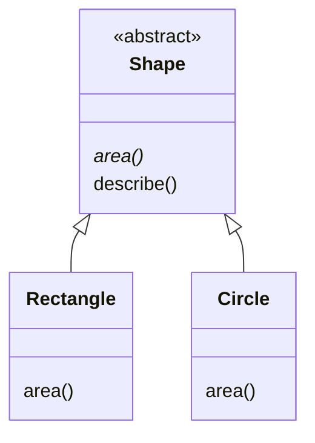

# 49. (Л) Абстрактні класи та інтерфейси (ABC — Abstract Base Classes)

## Зміст лекції

1. Проблема: «забутий» метод
2. Абстракція в ООП
3. Модуль `abc`: `ABC` і `@abstractmethod`
4. Що забороняє абстрактний клас
5. Абстрактний клас зі звичайними методами
6. Абстрактні властивості
7. Інтерфейс: лише контракт
8. Вбудовані абстрактні класи `collections.abc`
9. Протоколи та качина типізація
10. Приклад: експорт витрат у різні формати
11. Типові помилки

## Проблема: «забутий» метод

У лекції 45 базовий клас `Shape` мав метод `area`, що генерував `NotImplementedError`. Нащадки мали його перевизначити. Але що, як нащадок забуде?

```python
# Program: a forgotten method is noticed only when it is called
class Shape:
    def area(self):
        raise NotImplementedError("subclass must implement area()")


class Square(Shape):
    def __init__(self, side):
        self.side = side
    # area() забули


square = Square(3)  # обʼєкт створено без жодного попередження
print("created")
try:
    print(square.area())
except NotImplementedError as error:
    print("error:", error)
```

```text
created
error: subclass must implement area()
```

Помилка виявилася лише в момент виклику — можливо, через тиждень після релізу, у користувача. Краще, щоб Python не дозволив **створити** такий обʼєкт.

## Абстракція в ООП

**Абстракція** — четвертий принцип ООП: працювати з тим, **що** обʼєкт уміє робити, не знаючи, **як** він це робить. Програма, що рахує загальну площу, знає лише, що кожна фігура має `area()`.

**Абстрактний клас** описує спільний «контракт» для групи класів: які методи вони зобовʼязані мати. Сам по собі він неповний, тому створити його обʼєкт не можна. Конкретні класи-нащадки реалізують усі абстрактні методи.



## Модуль `abc`: `ABC` і `@abstractmethod`

Стандартний модуль `abc` (Abstract Base Classes) має клас `ABC` і декоратор `@abstractmethod`:

```python
# Program: an abstract base class
from abc import ABC, abstractmethod


class Shape(ABC):
    @abstractmethod
    def area(self):
        """Return the area of the shape."""


class Rectangle(Shape):
    def __init__(self, width, height):
        self.width, self.height = width, height

    def area(self):
        return self.width * self.height


print(Rectangle(4, 3).area())
```

```text
12
```

- Абстрактний клас наслідує `ABC`.
- Абстрактний метод позначають `@abstractmethod`. Тіло зазвичай містить лише рядок документації: він описує, що метод повинен робити.

## Що забороняє абстрактний клас

```python
# Program: abstract classes can not be instantiated
from abc import ABC, abstractmethod


class Shape(ABC):
    @abstractmethod
    def area(self):
        """Return the area of the shape."""

    @abstractmethod
    def perimeter(self):
        """Return the perimeter of the shape."""


class Square(Shape):
    def __init__(self, side):
        self.side = side

    def area(self):
        return self.side ** 2
    # perimeter() забули


for cls in (Shape, Square):
    try:
        cls() if cls is Shape else cls(3)
    except TypeError as error:
        print("error:", error)
```

```text
error: Can't instantiate abstract class Shape without an implementation for abstract methods 'area', 'perimeter'
error: Can't instantiate abstract class Square without an implementation for abstract method 'perimeter'
```

Тепер помилку видно **одразу під час створення обʼєкта**, і повідомлення називає, який саме метод забули. Клас, що реалізував усі абстрактні методи, називають **конкретним**.

## Абстрактний клас зі звичайними методами

Абстрактний клас може містити й звичайні методи. Вони спираються на абстрактні, які реалізують нащадки. Так спільну логіку пишуть один раз:

```python
# Program: concrete methods built on top of abstract ones
from abc import ABC, abstractmethod
import math


class Shape(ABC):
    @abstractmethod
    def area(self):
        """Return the area."""

    @abstractmethod
    def perimeter(self):
        """Return the perimeter."""

    def describe(self):
        # Звичайний метод: однаковий для всіх фігур
        return f"{type(self).__name__}: area {self.area():.2f}, perimeter {self.perimeter():.2f}"


class Rectangle(Shape):
    def __init__(self, width, height):
        self.width, self.height = width, height

    def area(self):
        return self.width * self.height

    def perimeter(self):
        return 2 * (self.width + self.height)


class Circle(Shape):
    def __init__(self, radius):
        self.radius = radius

    def area(self):
        return math.pi * self.radius ** 2

    def perimeter(self):
        return 2 * math.pi * self.radius


for shape in (Rectangle(4, 3), Circle(1)):
    print(shape.describe())
```

```text
Rectangle: area 12.00, perimeter 14.00
Circle: area 3.14, perimeter 6.28
```

Такий прийом називають **шаблонним методом** (template method): загальний алгоритм (`describe`) у базовому класі, змінні кроки (`area`, `perimeter`) — у нащадках.

## Абстрактні властивості

Декоратори можна поєднувати: `@property` над `@abstractmethod` вимагає від нащадків властивість:

```python
# Program: an abstract property
from abc import ABC, abstractmethod


class Exporter(ABC):
    @property
    @abstractmethod
    def extension(self):
        """File extension without the dot."""

    def file_name(self, base):
        return f"{base}.{self.extension}"


class CsvExporter(Exporter):
    @property
    def extension(self):
        return "csv"


print(CsvExporter().file_name("report"))
```

```text
report.csv
```

## Інтерфейс: лише контракт

**Інтерфейс** — абстрактний клас, що не має жодної реалізації: лише перелік абстрактних методів. У Python окремого ключового слова `interface` немає (на відміну від Java чи C#); інтерфейсом слугує абстрактний клас, у якому всі методи абстрактні.

| | Абстрактний клас | Інтерфейс |
|---|---|---|
| абстрактні методи | є | лише вони |
| звичайні методи і атрибути | можуть бути | немає |
| призначення | спільний контракт + спільна реалізація | лише контракт: «що вміє обʼєкт» |
| у Python | `class X(ABC)` з частиною `@abstractmethod` | `class X(ABC)` з усіма `@abstractmethod` |

## Вбудовані абстрактні класи `collections.abc`

Модуль `collections.abc` містить абстрактні класи для колекцій: `Iterable`, `Sized`, `Container`, `Sequence`, `Mapping`. Їх використовують для перевірок і як основу власних колекцій:

```python
# Program: built-in types match the abstract classes from collections.abc
from collections.abc import Iterable, Mapping, Sequence, Sized

for value in ([1, 2], "abc", {"a": 1}, 42):
    print(f"{value!r:<10} iterable={isinstance(value, Iterable)} sized={isinstance(value, Sized)} "
          f"sequence={isinstance(value, Sequence)} mapping={isinstance(value, Mapping)}")
```

```text
[1, 2]     iterable=True sized=True sequence=True mapping=False
'abc'      iterable=True sized=True sequence=True mapping=False
{'a': 1}   iterable=True sized=True sequence=False mapping=True
42         iterable=False sized=False sequence=False mapping=False
```

Якщо наслідувати `collections.abc.Sequence` і реалізувати лише `__getitem__` та `__len__`, клас автоматично отримає `__contains__`, `__iter__`, `index`, `count` — так працює шаблонний метод у стандартній бібліотеці.

## Протоколи та качина типізація

Python не вимагає наслідування для поліморфізму (качина типізація, лекція 45). Абстрактні класи потрібні, коли важливо **гарантувати** контракт і отримати ранню помилку. Для перевірки типів без наслідування є `typing.Protocol`: він описує, які методи має мати обʼєкт, і інструменти перевірки типів (наприклад, mypy) перевіряють це до запуску програми:

```python
# Program: a Protocol describes required methods without inheritance
from typing import Protocol


class HasArea(Protocol):
    def area(self) -> float: ...


class Square:  # не наслідує HasArea
    def __init__(self, side: float):
        self.side = side

    def area(self) -> float:
        return self.side ** 2


def total_area(shapes: list[HasArea]) -> float:
    return sum(shape.area() for shape in shapes)


print(total_area([Square(2), Square(3)]))
```

```text
13
```

Для навчальних проєктів досить абстрактних класів `ABC`; протоколи ви зустрінете у великих проєктах з перевіркою типів.

## Приклад: експорт витрат у різні формати

```python
# File: exporters.py
import csv
import json
import sys
from abc import ABC, abstractmethod
from pathlib import Path

Expense = tuple[str, str, float]  # date, category, amount


class Exporter(ABC):
    """Contract: every exporter knows its extension and how to write expenses."""

    @property
    @abstractmethod
    def extension(self) -> str:
        """File extension without the dot."""

    @abstractmethod
    def write(self, expenses: list[Expense], path: Path) -> None:
        """Write expenses to path."""

    def export(self, expenses: list[Expense], base: str) -> Path:
        # Шаблонний метод: спільні кроки для всіх форматів
        path = Path(f"{base}.{self.extension}")
        self.write(expenses, path)
        return path


class CsvExporter(Exporter):
    extension = "csv"

    def write(self, expenses, path):
        with path.open("w", newline="", encoding="utf-8") as file:
            writer = csv.writer(file, delimiter=";")
            writer.writerow(["date", "category", "amount"])
            writer.writerows(expenses)


class JsonExporter(Exporter):
    extension = "json"

    def write(self, expenses, path):
        rows = [{"date": d, "category": c, "amount": a} for d, c, a in expenses]
        path.write_text(json.dumps(rows, indent=2), encoding="utf-8")


class TxtExporter(Exporter):
    extension = "txt"

    def write(self, expenses, path):
        lines = [f"{d}  {c:<10} {a:>8.2f}" for d, c, a in expenses]
        lines.append(f"{'total':<22} {sum(a for _, _, a in expenses):>8.2f}")
        path.write_text("\n".join(lines) + "\n", encoding="utf-8")


EXPORTERS: dict[str, Exporter] = {e.extension: e for e in (CsvExporter(), JsonExporter(), TxtExporter())}


def main(args: list[str]) -> None:
    expenses = [("2026-09-21", "food", 85.5), ("2026-09-22", "transport", 30.0), ("2026-09-25", "fun", 315.0)]
    formats = args or sorted(EXPORTERS)
    for name in formats:
        if name not in EXPORTERS:
            sys.exit(f"error: unknown format {name}, available: {', '.join(sorted(EXPORTERS))}")
        path = EXPORTERS[name].export(expenses, "report")
        print(f"saved: {path} ({path.stat().st_size} bytes)")


if __name__ == "__main__":
    main(sys.argv[1:])
```

```bash
python3 exporters.py
cat report.txt
python3 exporters.py xml
```

```text
saved: report.csv (79 bytes)
saved: report.json (219 bytes)
saved: report.txt (111 bytes)
2026-09-21  food          85.50
2026-09-22  transport     30.00
2026-09-25  fun          315.00
total                    430.50
error: unknown format xml, available: csv, json, txt
```

Тут абстрактна властивість `extension` реалізована звичайним атрибутом класу — це теж дозволено: важливо, щоб імʼя `extension` було визначене. Щоб додати новий формат, досить написати клас-нащадок і додати його до `EXPORTERS`; функцію `main` змінювати не потрібно.

## Типові помилки

| Помилка | Чому погано | Як правильно |
|---|---|---|
| `@abstractmethod` без наслідування `ABC` | обмеження не працює, обʼєкт створюється | `class Shape(ABC):` |
| Абстрактний метод з повною реалізацією «про запас» | нащадки все одно зобовʼязані його перевизначити, код марний | лише docstring або спільна частина, що викликається через `super()` |
| Спроба створити обʼєкт базового класу «для перевірки» | `TypeError` | створювати лише конкретні класи |
| Порядок `@abstractmethod` над `@property` | `AttributeError` під час оголошення | `@property`, а під ним `@abstractmethod` |
| Абстрактний клас для однієї реалізації | зайва складність | вводити абстракцію, коли реалізацій хоча б дві |
| `isinstance(x, list)` замість `collections.abc.Sequence` | відкидає кортежі й власні послідовності | `isinstance(x, Sequence)` |

## Підсумок

- **Абстракція** — працювати з тим, що обʼєкт уміє, а не як він це робить.
- **Абстрактний клас** (`class X(ABC)` з `@abstractmethod`) задає контракт; створити його обʼєкт неможливо, як і обʼєкт нащадка, що реалізував не всі абстрактні методи. Помилка видна під час створення обʼєкта.
- Абстрактний клас може мати звичайні методи, що спираються на абстрактні (**шаблонний метод**).
- **Інтерфейс** — абстрактний клас лише з абстрактними методами.
- `collections.abc` містить абстрактні класи колекцій; `typing.Protocol` описує контракт без наслідування.

## Корисні посилання

- [Модуль `abc` — довідник](https://docs.python.org/3/library/abc.html)
- [Модуль `collections.abc` — довідник](https://docs.python.org/3/library/collections.abc.html)
- [`typing.Protocol` — довідник](https://docs.python.org/3/library/typing.html#typing.Protocol)
- [PEP 3119 — Introducing Abstract Base Classes](https://peps.python.org/pep-3119/)
