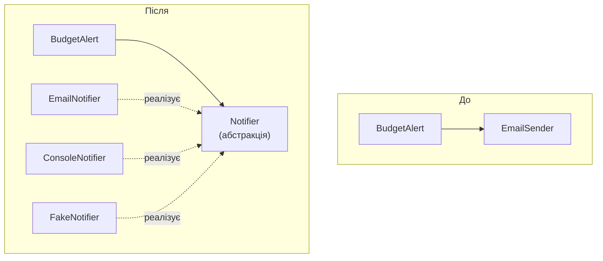

# 51. (Л) Проєктування класів та принципи SOLID

## Зміст лекції

1. Чому код «гниє»
2. Що таке SOLID
3. S — принцип єдиної відповідальності
4. O — принцип відкритості/закритості
5. L — принцип підстановки Лісков
6. I — принцип розділення інтерфейсу
7. D — принцип інверсії залежностей
8. Як принципи працюють разом
9. Інші корисні правила: DRY, KISS, YAGNI
10. Приклад: рефакторинг звіту про витрати
11. Типові помилки

## Чому код «гниє»

Програма, написана за вечір, працює. Через місяць до неї додали новий формат звіту, через два — надсилання поштою, через пів року — збереження в базу даних. Кожна зміна була невеликою, але тепер:

- щоб змінити формат дати у звіті, треба правити клас, який ще й надсилає листи;
- виправлення в одному місці ламає щось в іншому;
- код неможливо протестувати без справжнього поштового сервера;
- новий колега тиждень розбирається, що де лежить.

Такий код називають **крихким**. Причина зазвичай не в окремих помилках, а в тому, як класи повʼязані між собою. Принципи проєктування допомагають будувати код, який легко змінювати.

## Що таке SOLID

**SOLID** — пʼять принципів обʼєктно-орієнтованого проєктування, сформульованих Робертом Мартіном (Robert C. Martin). Назва складена з перших літер:

| Літера | Принцип | Коротко |
|---|---|---|
| **S** | Single Responsibility | у класу одна причина для змін |
| **O** | Open/Closed | розширюємо додаванням коду, а не зміною наявного |
| **L** | Liskov Substitution | нащадка можна підставити замість батька |
| **I** | Interface Segregation | краще кілька вузьких інтерфейсів, ніж один «всеосяжний» |
| **D** | Dependency Inversion | залежимо від абстракцій, а не від конкретних класів |

Це не закони, а орієнтири. Їх застосовують, коли код росте; для скрипта на 30 рядків вони зайві.

## S — принцип єдиної відповідальності

> У класу має бути лише одна причина для змін.

Подивіться на клас, який робить «все про звіт»:

```python
# Program: one class with three responsibilities
class Report:
    def __init__(self, expenses):
        self.expenses = expenses

    def total(self):
        return sum(amount for _, amount in self.expenses)

    def to_text(self):
        lines = [f"{c:<10} {a:>8.2f}" for c, a in self.expenses]
        return "\n".join(lines + [f"{'total':<10} {self.total():>8.2f}"])

    def save(self, path):
        with open(path, "w", encoding="utf-8") as file:
            file.write(self.to_text())


Report([("food", 85.5), ("transport", 30)]).save("report.txt")
print(open("report.txt", encoding="utf-8").read())
```

```text
food          85.50
transport     30.00
total        115.50
```

У класу `Report` три причини змінюватися: змінилися правила підрахунку; змінився вигляд звіту; змінився спосіб збереження (база даних замість файлу). Розділимо обовʼязки:

```python
# Program: one responsibility per class
from pathlib import Path


class ExpenseStats:
    """Knows how to calculate."""

    def __init__(self, expenses):
        self.expenses = expenses

    def total(self):
        return sum(amount for _, amount in self.expenses)


class TextFormatter:
    """Knows how the report looks."""

    def format(self, expenses, total):
        lines = [f"{c:<10} {a:>8.2f}" for c, a in expenses]
        return "\n".join(lines + [f"{'total':<10} {total:>8.2f}"])


class FileStorage:
    """Knows where the report is saved."""

    def save(self, text, path):
        Path(path).write_text(text, encoding="utf-8")


expenses = [("food", 85.5), ("transport", 30)]
text = TextFormatter().format(expenses, ExpenseStats(expenses).total())
FileStorage().save(text, "report.txt")
print(text)
```

```text
food          85.50
transport     30.00
total        115.50
```

Тепер зміна формату стосується лише `TextFormatter`, і кожен клас легко протестувати окремо.

## O — принцип відкритості/закритості

> Класи мають бути відкриті для розширення, але закриті для змін.

Нова можливість додається **новим** кодом, а не правкою вже перевіреного. Порушення — ланцюжок `if` за типом:

```python
# Program: every new format requires changing this function
def export(expenses, fmt):
    if fmt == "csv":
        return "\n".join(f"{c};{a}" for c, a in expenses)
    elif fmt == "txt":
        return "\n".join(f"{c:<10} {a:>8.2f}" for c, a in expenses)
    # для json доведеться дописати ще одну гілку сюди
    raise ValueError(f"unknown format {fmt}")


print(export([("food", 85.5)], "csv"))
```

```text
food;85.5
```

Розвʼязок — поліморфізм (лекції 45, 49): кожен формат — окремий клас із спільним контрактом:

```python
# Program: new formats are added as new classes
from abc import ABC, abstractmethod


class Formatter(ABC):
    @abstractmethod
    def format(self, expenses):
        """Return expenses as text."""


class CsvFormatter(Formatter):
    def format(self, expenses):
        return "\n".join(f"{c};{a}" for c, a in expenses)


class TxtFormatter(Formatter):
    def format(self, expenses):
        return "\n".join(f"{c:<10} {a:>8.2f}" for c, a in expenses)


class JsonFormatter(Formatter):  # новий формат: жоден старий рядок не змінено
    def format(self, expenses):
        import json
        return json.dumps(dict(expenses))


for formatter in (CsvFormatter(), TxtFormatter(), JsonFormatter()):
    print(formatter.format([("food", 85.5)]))
```

```text
food;85.5
food          85.50
{"food": 85.5}
```

## L — принцип підстановки Лісков

> Обʼєкт нащадка має працювати скрізь, де очікується обʼєкт батьківського класу.

Принцип названо на честь Барбари Лісков (Barbara Liskov). Нащадок не повинен «ламати» обіцянки батька: змінювати зміст методу, вимагати додаткових умов або генерувати винятки там, де батько працював. Класичний приклад порушення — квадрат як нащадок прямокутника:

```python
# Program: Square breaks the promise of Rectangle
class Rectangle:
    def __init__(self, width, height):
        self.width, self.height = width, height

    def set_width(self, width):
        self.width = width

    def area(self):
        return self.width * self.height


class Square(Rectangle):
    def __init__(self, side):
        super().__init__(side, side)

    def set_width(self, width):
        # квадрат має однакові сторони — змінюємо обидві
        self.width = self.height = width


def stretch(rect):
    # Код, написаний для Rectangle: змінюємо ширину, висота лишається
    rect.set_width(10)
    return rect.area()


print(stretch(Rectangle(2, 5)), stretch(Square(5)))
```

```text
50 100
```

Функція `stretch` розраховує, що після зміни ширини висота не зміниться. Для прямокутника 2×5 вона отримала 50, як і очікувалося, а квадрат «тихо» змінив і висоту. Підставити `Square` замість `Rectangle` не можна, тож наслідування тут помилкове, хоча в математиці квадрат — це прямокутник. Правильніше зробити обидва класи незалежними нащадками абстрактного `Shape`.

Ознаки порушення: нащадок перевизначає метод порожнім тілом або `raise NotImplementedError`, звужує допустимі вхідні дані, повертає результат іншого типу.

## I — принцип розділення інтерфейсу

> Клієнт не повинен залежати від методів, якими він не користується.

Якщо абстрактний клас вимагає забагато, нащадки змушені реалізовувати непотрібні методи «заглушками»:

```python
# Program: a fat interface forces useless methods
from abc import ABC, abstractmethod


class Device(ABC):
    @abstractmethod
    def print_document(self, text): ...

    @abstractmethod
    def scan_document(self): ...


class SimplePrinter(Device):
    def print_document(self, text):
        print("printing:", text)

    def scan_document(self):
        raise NotImplementedError("this printer can not scan")  # порушення L і I


SimplePrinter().print_document("report")
```

```text
printing: report
```

Краще розділити великий інтерфейс на вузькі. Клас реалізує лише те, що вміє, а пристрій «все в одному» наслідує обидва:

```python
# Program: narrow interfaces
from abc import ABC, abstractmethod


class Printer(ABC):
    @abstractmethod
    def print_document(self, text): ...


class Scanner(ABC):
    @abstractmethod
    def scan_document(self): ...


class SimplePrinter(Printer):
    def print_document(self, text):
        print("printing:", text)


class MultiFunctionDevice(Printer, Scanner):
    def print_document(self, text):
        print("printing:", text)

    def scan_document(self):
        return "scanned page"


SimplePrinter().print_document("report")
print(MultiFunctionDevice().scan_document())
```

```text
printing: report
scanned page
```

## D — принцип інверсії залежностей

> Модулі верхнього рівня не повинні залежати від модулів нижнього рівня. Обидва залежать від абстракцій.

Якщо клас сам створює свої залежності, його неможливо перевірити чи переналаштувати:

```python
# Program: the service creates its dependency itself
class EmailSender:
    def send(self, to, text):
        print(f"connecting to smtp server... sending to {to}")


class BudgetAlert:
    def __init__(self, limit):
        self.limit = limit
        self.sender = EmailSender()  # жорстко прошито: тести надсилатимуть справжні листи

    def check(self, spent, owner):
        if spent > self.limit:
            self.sender.send(owner, f"limit exceeded by {spent - self.limit:.2f}")


BudgetAlert(1000).check(1248, "olena@example.com")
```

```text
connecting to smtp server... sending to olena@example.com
```

Розвʼязок — залежати від абстракції та отримувати конкретну реалізацію ззовні (**впровадження залежностей**, dependency injection):

```python
# Program: the dependency is passed in from outside
from abc import ABC, abstractmethod


class Notifier(ABC):
    @abstractmethod
    def send(self, to, text): ...


class EmailNotifier(Notifier):
    def send(self, to, text):
        print(f"email to {to}: {text}")


class ConsoleNotifier(Notifier):
    def send(self, to, text):
        print(f"[{to}] {text}")


class FakeNotifier(Notifier):
    """For tests: remembers messages instead of sending them."""

    def __init__(self):
        self.messages = []

    def send(self, to, text):
        self.messages.append((to, text))


class BudgetAlert:
    def __init__(self, limit, notifier: Notifier):
        self.limit = limit
        self.notifier = notifier

    def check(self, spent, owner):
        if spent > self.limit:
            self.notifier.send(owner, f"limit exceeded by {spent - self.limit:.2f}")


BudgetAlert(1000, ConsoleNotifier()).check(1248, "olena")
fake = FakeNotifier()
BudgetAlert(1000, fake).check(1248, "olena")
assert fake.messages == [("olena", "limit exceeded by 248.00")]
print("test passed")
```

```text
[olena] limit exceeded by 248.00
test passed
```

`BudgetAlert` тепер нічого не знає про пошту. У тесті (лекція 33) йому передають `FakeNotifier`, у робочій програмі — `EmailNotifier`.



## Як принципи працюють разом

Принципи підсилюють один одного:

- **S** дає маленькі класи з однією роллю;
- **I** описує ці ролі вузькими абстракціями;
- **D** зʼєднує класи через ці абстракції;
- **O** дозволяє додавати нові реалізації, не змінюючи наявних;
- **L** гарантує, що будь-яку реалізацію можна безпечно підставити.

## Інші корисні правила: DRY, KISS, YAGNI

| Правило | Розшифровка | Зміст |
|---|---|---|
| **DRY** | Don't Repeat Yourself | кожне знання — в одному місці; дублювання коду — сигнал винести спільне |
| **KISS** | Keep It Simple, Stupid | найпростіше рішення, що працює, — найкраще |
| **YAGNI** | You Aren't Gonna Need It | не пишіть код «на майбутнє», доки він справді не знадобився |

YAGNI урівноважує SOLID: не варто створювати абстрактний клас для єдиної реалізації чи три шари класів для програми з однією функцією. Абстракції вводять тоді, коли зʼявляється друга реалізація або потреба в тестуванні.

## Приклад: рефакторинг звіту про витрати

Зведемо все разом. Програма читає витрати, рахує підсумки за категоріями, форматує звіт і передає його «отримувачу» — у консоль або у файл:

```python
# File: expense_report.py
from abc import ABC, abstractmethod
from collections import defaultdict
from pathlib import Path


# S: дані
class Expense:
    def __init__(self, category: str, amount: float):
        if amount <= 0:
            raise ValueError("amount must be positive")
        self.category = category
        self.amount = amount


# S: обчислення
class Summary:
    def __init__(self, expenses: list[Expense]):
        self.by_category: dict[str, float] = defaultdict(float)
        for expense in expenses:
            self.by_category[expense.category] += expense.amount
        self.total = sum(self.by_category.values())


# I + O: вузька абстракція форматування і її реалізації
class Formatter(ABC):
    @abstractmethod
    def format(self, summary: Summary) -> str: ...


class TableFormatter(Formatter):
    def format(self, summary):
        rows = [f"{c:<10} {a:>8.2f}" for c, a in sorted(summary.by_category.items())]
        return "\n".join(rows + [f"{'total':<10} {summary.total:>8.2f}"])


class ShareFormatter(Formatter):
    def format(self, summary):
        return "\n".join(f"{c:<10} {a / summary.total:>6.1%}" for c, a in sorted(summary.by_category.items()))


# I + O: вузька абстракція виводу і її реалізації
class Output(ABC):
    @abstractmethod
    def write(self, text: str) -> None: ...


class ConsoleOutput(Output):
    def write(self, text):
        print(text)


class FileOutput(Output):
    def __init__(self, path: Path):
        self.path = path

    def write(self, text):
        self.path.write_text(text + "\n", encoding="utf-8")


# D: сервіс залежить лише від абстракцій
class ReportService:
    def __init__(self, formatter: Formatter, output: Output):
        self.formatter = formatter
        self.output = output

    def run(self, expenses: list[Expense]) -> None:
        self.output.write(self.formatter.format(Summary(expenses)))


if __name__ == "__main__":
    expenses = [Expense("food", 85.5), Expense("transport", 30), Expense("food", 64.5), Expense("fun", 315)]
    ReportService(TableFormatter(), ConsoleOutput()).run(expenses)
    ReportService(ShareFormatter(), ConsoleOutput()).run(expenses)
    ReportService(TableFormatter(), FileOutput(Path("report.txt"))).run(expenses)
    print("saved:", Path("report.txt").read_text(encoding="utf-8").splitlines()[-1])
```

```text
food         150.00
fun          315.00
transport     30.00
total        495.00
food        30.3%
fun         63.6%
transport    6.1%
saved: total        495.00
```

Новий формат (наприклад, HTML) чи новий спосіб виводу (поштою) додається новим класом. `Summary` і `ReportService` при цьому не змінюються, а тести можуть передати `ReportService` власний `Output`, що просто запамʼятовує текст.

## Типові помилки

| Помилка | Чому погано | Як правильно |
|---|---|---|
| Клас «Бог» (`Manager`, `Utils`) на сотні рядків | будь-яка зміна зачіпає все | розділити за відповідальностями (S) |
| Ланцюжок `if type == ...` для вибору поведінки | кожен новий варіант — правка перевіреного коду | поліморфізм (O) |
| Нащадок перевизначає метод `raise NotImplementedError` | нащадка не можна підставити замість батька | змінити ієрархію (L), розділити інтерфейс (I) |
| Клас сам створює підключення до бази, поштовий клієнт | неможливо протестувати й переналаштувати | передавати залежності ззовні (D) |
| Абстракції «про запас» для однієї реалізації | зайва складність | YAGNI: абстракція з появою другої реалізації |
| Сліпе дотримання принципів у маленькому скрипті | три класи замість однієї функції | KISS |

## Підсумок

- Принципи проєктування роблять код **легким для змін**; SOLID — пʼять таких принципів.
- **S**: одна причина для змін — один клас. **O**: нову поведінку додають новими класами, а не правками. **L**: нащадок працює скрізь, де працює батько. **I**: вузькі інтерфейси замість одного великого. **D**: залежати від абстракцій і отримувати реалізації ззовні.
- Впровадження залежностей робить класи тестованими: у тестах підставляють «фальшиві» реалізації.
- DRY, KISS і YAGNI урівноважують SOLID: абстракції вводять тоді, коли вони справді потрібні.

## Корисні посилання

- [Martin R. C. Clean Architecture — розд. III «Design Principles» (опис SOLID від автора)](https://www.oreilly.com/library/view/clean-architecture-a/9780134494272/)
- [SOLID — огляд принципів (Wikipedia)](https://en.wikipedia.org/wiki/SOLID)
- [Модуль `abc` — довідник](https://docs.python.org/3/library/abc.html)
- [The Zen of Python — `import this`](https://peps.python.org/pep-0020/)
