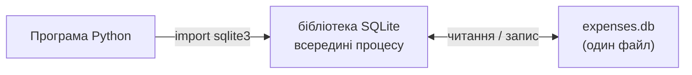

# 1. (Л) Python та SQLite. Робота з бібліотекою sqlite3

## Зміст лекції

1. Від файлів до бази даних
2. SQLite: база даних в одному файлі
3. Модуль `sqlite3` і стандарт DB-API
4. Підключення і курсор
5. Створення таблиці
6. Вставка даних і `commit`
7. Параметри запиту замість форматування рядка
8. `executemany`: багато рядків за раз
9. Вибірка: `fetchone`, `fetchall`, ітерація
10. `row_factory`: рядки як словники
11. Оновлення і видалення: `rowcount`
12. Контекстний менеджер і закриття підключення
13. Типи даних SQLite і Python
14. Приклад: журнал витрат у SQLite
15. Типові помилки

## Від файлів до бази даних

У 5 семестрі ми зберігали витрати у текстовому файлі `data/expenses.csv` (лекція 21, 5 семестр) і в JSON (лекція 35, 5 семестр). Для невеликого обсягу даних цього достатньо, але зі зростанням проєкту виникають проблеми:

- щоб знайти витрати за одну категорію, доводиться читати **весь** файл;
- щоб змінити один рядок, файл перезаписують повністю;
- дві програми, що одночасно пишуть у файл, можуть зіпсувати його;
- немає перевірок: у поле суми можна записати текст.

**Система керування базами даних** (СУБД) розвʼязує ці проблеми: зберігає дані в таблицях, перевіряє обмеження, швидко шукає за індексами й мовою **SQL** дозволяє формулювати запити. Мову SQL ви вивчаєте в дисципліні «Бази даних в інформаційних системах»; сьогодні навчимося працювати з базою з програми на Python.

## SQLite: база даних в одному файлі

**SQLite** — вбудована СУБД: уся база зберігається в одному файлі (`expenses.db`), а окремий сервер не потрібен. SQLite використовують браузери, мобільні застосунки, Python-скрипти. Підтримка SQLite є в стандартній бібліотеці Python — встановлювати нічого не потрібно.



| | SQLite | PostgreSQL (лекція 3) |
|---|---|---|
| сервер | не потрібен | окремий процес-сервер |
| де дані | один файл | каталог даних сервера |
| одночасні записи | обмежено | багато користувачів |
| типове використання | застосунки, прототипи, тести | вебсервіси, корпоративні системи |

## Модуль `sqlite3` і стандарт DB-API

Модуль `sqlite3` реалізує стандарт **DB-API 2.0** (PEP 249). Цей стандарт описує, як Python-програма працює з будь-якою реляційною базою. Тому код для SQLite і для PostgreSQL (бібліотека `psycopg2`) дуже схожий:

| Обʼєкт / метод | Призначення |
|---|---|
| `connect(...)` | підключитися до бази, отримати обʼєкт `Connection` |
| `conn.cursor()` | створити курсор для виконання запитів |
| `cur.execute(sql, params)` | виконати один запит |
| `cur.executemany(sql, rows)` | виконати запит для кожного набору параметрів |
| `cur.fetchone()`, `fetchall()` | отримати рядки результату |
| `conn.commit()` | зафіксувати зміни |
| `conn.rollback()` | скасувати незафіксовані зміни |
| `conn.close()` | закрити підключення |

## Підключення і курсор

```python
# Program: connect to an SQLite database and run a query
import sqlite3

conn = sqlite3.connect("expenses.db")  # файл створюється, якщо його немає
cur = conn.cursor()
cur.execute("SELECT sqlite_version()")
print("SQLite", cur.fetchone()[0])
conn.close()
```

```text
SQLite 3.40.1
```

- `sqlite3.connect(path)` відкриває файл бази; якщо файлу немає — створює порожню базу.
- **Курсор** (cursor) — обʼєкт, через який виконують запити й читають результати. Назва історична: курсор «показує» на поточний рядок результату.
- `sqlite3.connect(":memory:")` створює тимчасову базу в памʼяті — зручно для експериментів і тестів.

## Створення таблиці

```python
# Program: create a table if it does not exist
import sqlite3

conn = sqlite3.connect("expenses.db")
conn.execute(
    """
    CREATE TABLE IF NOT EXISTS expenses (
        id INTEGER PRIMARY KEY,
        spent_on TEXT NOT NULL,
        category TEXT NOT NULL,
        amount REAL NOT NULL CHECK (amount > 0),
        comment TEXT
    )
    """
)
conn.commit()
tables = conn.execute("SELECT name FROM sqlite_master WHERE type = 'table'").fetchall()
print(tables)
conn.close()
```

```text
[('expenses',)]
```

`conn.execute(...)` — скорочення: підключення саме створює тимчасовий курсор і повертає його. `IF NOT EXISTS` дозволяє запускати програму повторно без помилки «таблиця вже існує». Стовпець `INTEGER PRIMARY KEY` у SQLite отримує значення автоматично.

## Вставка даних і `commit`

```python
# Program: insert one row and commit
import sqlite3

conn = sqlite3.connect(":memory:")
conn.execute("CREATE TABLE expenses (id INTEGER PRIMARY KEY, category TEXT, amount REAL)")

cur = conn.execute("INSERT INTO expenses (category, amount) VALUES ('food', 85.5)")
print("new id:", cur.lastrowid)
conn.commit()
print(conn.execute("SELECT * FROM expenses").fetchall())
conn.close()
```

```text
new id: 1
[(1, 'food', 85.5)]
```

Команди, що змінюють дані (`INSERT`, `UPDATE`, `DELETE`), виконуються в **транзакції** (лекція 7). Поки не викликано `conn.commit()`, зміни бачить лише це підключення. Якщо закрити підключення без `commit`, зміни буде **втрачено**.

```python
# Program: changes without commit are lost
import sqlite3
from pathlib import Path

Path("demo.db").unlink(missing_ok=True)
conn = sqlite3.connect("demo.db")
conn.execute("CREATE TABLE notes (text TEXT)")
conn.commit()
conn.execute("INSERT INTO notes VALUES ('forgotten')")
conn.close()  # commit не викликано

conn = sqlite3.connect("demo.db")
print(conn.execute("SELECT COUNT(*) FROM notes").fetchone()[0])
conn.close()
```

```text
0
```

`cur.lastrowid` повертає `id` щойно вставленого рядка — зручно, коли треба одразу послатися на новий запис.

## Параметри запиту замість форматування рядка

Значення, що надходять ззовні (від користувача, з файлу), **ніколи** не вставляють у SQL форматуванням рядка. Так зʼявляється **SQL-інʼєкція** — найвідоміша вразливість вебзастосунків:

```python
# Program: SQL injection through an f-string
import sqlite3

conn = sqlite3.connect(":memory:")
conn.execute("CREATE TABLE users (name TEXT, password TEXT)")
conn.executemany("INSERT INTO users VALUES (?, ?)", [("olena", "s3cret"), ("taras", "qwerty")])

name = "' OR '1'='1"  # «імʼя», яке ввів зловмисник
rows = conn.execute(f"SELECT name, password FROM users WHERE name = '{name}'").fetchall()
print("unsafe:", rows)

rows = conn.execute("SELECT name, password FROM users WHERE name = ?", (name,)).fetchall()
print("safe:", rows)
conn.close()
```

```text
unsafe: [('olena', 's3cret'), ('taras', 'qwerty')]
safe: []
```

Після підстановки запит став `... WHERE name = '' OR '1'='1'`: умова завжди істинна, і програма віддала паролі всіх користувачів. З параметром `?` бібліотека передає значення окремо від тексту запиту, і воно ніколи не стає частиною SQL.

| Стиль параметрів | Приклад | Де |
|---|---|---|
| `?` | `WHERE id = ?` | `sqlite3` |
| `:name` | `WHERE id = :id`, параметри — словник | `sqlite3` |
| `%s` | `WHERE id = %s` | `psycopg2` (лекція 3) |

!!! danger "Параметри — лише для значень"
    Через `?` передають **значення**: числа, рядки, дати. Імена таблиць і стовпців через параметри передати не можна. Якщо імʼя стовпця обирає користувач (наприклад, сортування), перевіряйте його за списком дозволених значень.

## `executemany`: багато рядків за раз

```python
# Program: insert many rows with one call
import sqlite3

rows = [
    ("2026-09-21", "food", 85.5, "lunch"),
    ("2026-09-22", "transport", 30.0, "bus"),
    ("2026-09-23", "food", 185.0, "groceries"),
    ("2026-09-25", "fun", 315.0, "cinema"),
]
conn = sqlite3.connect(":memory:")
conn.execute("CREATE TABLE expenses (id INTEGER PRIMARY KEY, spent_on TEXT, category TEXT, amount REAL, comment TEXT)")
conn.executemany("INSERT INTO expenses (spent_on, category, amount, comment) VALUES (?, ?, ?, ?)", rows)
conn.commit()
print(conn.execute("SELECT COUNT(*), SUM(amount) FROM expenses").fetchone())
conn.close()
```

```text
(4, 615.5)
```

`executemany` виконує той самий запит для кожного кортежу зі списку. Це і коротше, і швидше, ніж цикл з `execute`.

## Вибірка: `fetchone`, `fetchall`, ітерація

```python
# Program: three ways to read query results
import sqlite3

conn = sqlite3.connect(":memory:")
conn.execute("CREATE TABLE expenses (category TEXT, amount REAL)")
conn.executemany("INSERT INTO expenses VALUES (?, ?)", [("food", 85.5), ("transport", 30), ("fun", 315)])

cur = conn.execute("SELECT category, amount FROM expenses ORDER BY amount DESC")
print("fetchone:", cur.fetchone())
print("fetchall:", cur.fetchall())

for category, amount in conn.execute("SELECT category, amount FROM expenses WHERE amount > ?", (50,)):
    print(f"{category:<10} {amount:>7.2f}")
conn.close()
```

```text
fetchone: ('fun', 315.0)
fetchall: [('food', 85.5), ('transport', 30.0)]
food         85.50
fun         315.00
```

- `fetchone()` повертає наступний рядок (кортеж) або `None`, якщо рядків більше немає;
- `fetchall()` — усі **решта** рядків списком: перший рядок уже забрав `fetchone`;
- курсор можна перебирати в циклі `for` — рядки читаються по одному, не завантажуючи весь результат у памʼять.

## `row_factory`: рядки як словники

Звертатися до стовпців за номером (`row[2]`) незручно. Атрибут `row_factory = sqlite3.Row` дає доступ за назвою:

```python
# Program: access columns by name
import sqlite3

conn = sqlite3.connect(":memory:")
conn.row_factory = sqlite3.Row
conn.execute("CREATE TABLE expenses (category TEXT, amount REAL, comment TEXT)")
conn.execute("INSERT INTO expenses VALUES ('food', 85.5, 'lunch')")

row = conn.execute("SELECT * FROM expenses").fetchone()
print(row["category"], row["amount"], row[2])
print(dict(row))
conn.close()
```

```text
food 85.5 lunch
{'category': 'food', 'amount': 85.5, 'comment': 'lunch'}
```

`sqlite3.Row` поводиться і як кортеж, і як словник; `dict(row)` перетворює його на звичайний словник — зручно для JSON (лекція 35, 5 семестр).

## Оновлення і видалення: `rowcount`

```python
# Program: update and delete, then check how many rows changed
import sqlite3

conn = sqlite3.connect(":memory:")
conn.execute("CREATE TABLE expenses (id INTEGER PRIMARY KEY, category TEXT, amount REAL)")
conn.executemany("INSERT INTO expenses (category, amount) VALUES (?, ?)", [("food", 85.5), ("food", 64.5), ("fun", 315)])

cur = conn.execute("UPDATE expenses SET amount = amount * 1.1 WHERE category = ?", ("food",))
print("updated:", cur.rowcount)
cur = conn.execute("DELETE FROM expenses WHERE amount > ?", (300,))
print("deleted:", cur.rowcount)
conn.commit()
print(conn.execute("SELECT category, ROUND(amount, 2) FROM expenses").fetchall())
conn.close()
```

```text
updated: 2
deleted: 1
[('food', 94.05), ('food', 70.95)]
```

`cur.rowcount` — кількість рядків, яких торкнувся запит. Якщо `UPDATE` чи `DELETE` повернув `0`, умова не знайшла жодного рядка — часто це ознака помилки в умові.

## Контекстний менеджер і закриття підключення

Підключення можна використати з `with`, але **обережно**: у `sqlite3` блок `with conn:` керує **транзакцією** (успіх — `commit`, виняток — `rollback`), а не закриває підключення. Для закриття використовують `contextlib.closing`:

```python
# Program: with conn manages the transaction, closing() closes the connection
import sqlite3
from contextlib import closing

with closing(sqlite3.connect(":memory:")) as conn:
    conn.execute("CREATE TABLE expenses (amount REAL CHECK (amount > 0))")
    with conn:  # commit наприкінці блоку
        conn.execute("INSERT INTO expenses VALUES (100)")
    try:
        with conn:  # виняток — rollback, вставка 50 скасована разом з -5
            conn.execute("INSERT INTO expenses VALUES (50)")
            conn.execute("INSERT INTO expenses VALUES (-5)")
    except sqlite3.IntegrityError as error:
        print("error:", error)
    print(conn.execute("SELECT * FROM expenses").fetchall())
```

```text
error: CHECK constraint failed: amount > 0
[(100.0,)]
```

## Типи даних SQLite і Python

SQLite має пʼять класів зберігання. `sqlite3` автоматично перетворює їх на типи Python:

| SQLite | Python |
|---|---|
| `NULL` | `None` |
| `INTEGER` | `int` |
| `REAL` | `float` |
| `TEXT` | `str` |
| `BLOB` | `bytes` |

Окремого типу для дат у SQLite немає. Дати зберігають рядком у форматі ISO `YYYY-MM-DD`: такі рядки правильно сортуються й порівнюються, а в Python їх перетворюють функцією `date.fromisoformat`.

## Приклад: журнал витрат у SQLite

Перенесемо журнал витрат з CSV у базу і зробимо звіт:

```python
# File: expenses_db.py
import sqlite3
from contextlib import closing
from pathlib import Path

HERE = Path(__file__).parent
DB = HERE / "expenses.db"
CSV_TEXT = """# date;category;amount;comment
2026-09-21;food;85.50;lunch
2026-09-22;transport;30;bus
2026-09-23;food;185;groceries
2026-09-25;fun;315;cinema
2026-09-26;transport;12.5;tram
"""

SCHEMA = """
CREATE TABLE IF NOT EXISTS expenses (
    id INTEGER PRIMARY KEY,
    spent_on TEXT NOT NULL,
    category TEXT NOT NULL,
    amount REAL NOT NULL CHECK (amount > 0),
    comment TEXT
)
"""


def parse(text: str) -> list[tuple]:
    rows = []
    for line in text.splitlines():
        if line.strip() and not line.startswith("#"):
            day, category, amount, comment = line.split(";")
            rows.append((day, category, float(amount), comment))
    return rows


def main() -> None:
    DB.unlink(missing_ok=True)
    with closing(sqlite3.connect(DB)) as conn:
        conn.row_factory = sqlite3.Row
        with conn:
            conn.execute(SCHEMA)
            conn.executemany("INSERT INTO expenses (spent_on, category, amount, comment) VALUES (?, ?, ?, ?)",
                             parse(CSV_TEXT))
        print("by category:")
        query = "SELECT category, COUNT(*) AS n, SUM(amount) AS total FROM expenses GROUP BY category ORDER BY total DESC"
        for row in conn.execute(query):
            print(f"  {row['category']:<10} {row['n']:>2} {row['total']:>8.2f}")
        top = conn.execute("SELECT spent_on, comment, amount FROM expenses ORDER BY amount DESC LIMIT 1").fetchone()
        print(f"biggest: {top['amount']:.2f} on {top['spent_on']} ({top['comment']})")


if __name__ == "__main__":
    main()
```

```text
by category:
  fun         1   315.00
  food        2   270.50
  transport   2    42.50
biggest: 315.00 on 2026-09-25 (cinema)
```

Групування й сортування виконує база даних, а Python лише виводить результат. Файл `expenses.db` можна відкрити в DB Browser for SQLite і перевірити дані.

## Типові помилки

| Помилка | Чому погано | Як правильно |
|---|---|---|
| Значення вставлено в SQL через f-рядок | SQL-інʼєкція, помилки з лапками | параметри `?` |
| `execute("... WHERE id = ?", 5)` | `ProgrammingError`: параметри мають бути послідовністю | `(5,)` — кортеж з комою |
| Немає `commit()` після змін | зміни втрачено після закриття | `conn.commit()` або `with conn:` |
| `with sqlite3.connect(...) as conn:` для закриття | `with` лише фіксує транзакцію, підключення лишається відкритим | `with closing(sqlite3.connect(...))` |
| `fetchall()` після `fetchone()` очікує всі рядки | перший рядок уже прочитано | один спосіб читання на запит |
| Дати збережено як `21.09.2026` | неправильне сортування й порівняння | ISO `2026-09-21` |
| `CREATE TABLE` без `IF NOT EXISTS` у програмі, що запускається повторно | `OperationalError: table already exists` | `IF NOT EXISTS` |
| Ім'я стовпця підставлено з вводу користувача | інʼєкція через ім'я стовпця | перевірка за списком дозволених |

## Підсумок

- **SQLite** — вбудована СУБД: база в одному файлі, сервер не потрібен; модуль `sqlite3` є в стандартній бібліотеці.
- Робота з базою за стандартом **DB-API**: `connect` → курсор → `execute` → `fetch...` → `commit` → `close`.
- Значення передають лише **параметрами** (`?`), ніколи форматуванням рядка — інакше SQL-інʼєкція.
- `executemany` вставляє багато рядків; `lastrowid` — id нового рядка; `rowcount` — скільки рядків змінено.
- `row_factory = sqlite3.Row` дає доступ до стовпців за назвою.
- `with conn:` керує транзакцією (`commit`/`rollback`), `closing(...)` закриває підключення.
- Дати зберігають рядками ISO `YYYY-MM-DD`.

## Корисні посилання

- [Модуль `sqlite3` — довідник](https://docs.python.org/3/library/sqlite3.html)
- [PEP 249 — Python Database API Specification v2.0](https://peps.python.org/pep-0249/)
- [Документація SQLite](https://www.sqlite.org/docs.html)
- [DB Browser for SQLite](https://sqlitebrowser.org)
- [OWASP — SQL Injection](https://owasp.org/www-community/attacks/SQL_Injection)
