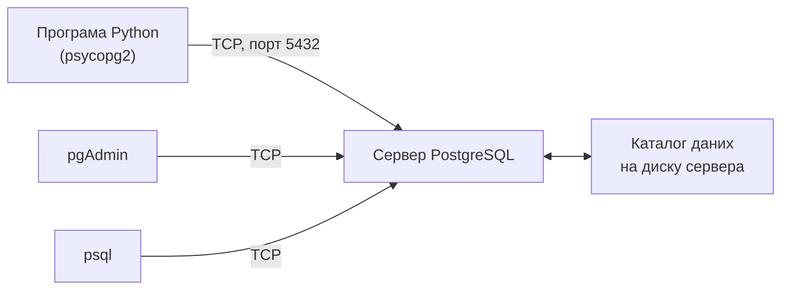

# 3. (Л) Python та PostgreSQL. Робота з бібліотекою psycopg2

## Зміст лекції

1. Клієнт-серверна СУБД
2. Встановлення psycopg2
3. Параметри підключення
4. Облікові дані у змінних оточення
5. Перше підключення і помилки підключення
6. Курсор і параметри `%s`
7. Створення таблиці з типами PostgreSQL
8. Вставка і `RETURNING`
9. Типи PostgreSQL і Python: `Decimal`, `date`
10. Курсор-словник `RealDictCursor`
11. Великі результати: ітерація і `fetchmany`
12. Перенесення даних з SQLite у PostgreSQL
13. Типові помилки

## Клієнт-серверна СУБД

SQLite (лекція 1) працює всередині процесу програми. **PostgreSQL** — клієнт-серверна СУБД: окремий процес-сервер зберігає дані й приймає підключення від багатьох клієнтів одночасно — вашої програми, pgAdmin, `psql`, вебзастосунку.



Клієнт і сервер можуть працювати на різних компʼютерах. Тому для підключення потрібні адреса сервера, порт, назва бази, імʼя користувача й пароль.

## Встановлення psycopg2

**psycopg2** — найпоширеніша бібліотека для роботи з PostgreSQL з Python. Вона реалізує той самий стандарт DB-API, що й `sqlite3`, тож більшість прийомів з лекції 1 працює без змін.

```bash
python3 -m venv env
source env/bin/activate
python3 -m pip install psycopg2-binary
```

Пакет `psycopg2-binary` містить уже скомпільовану бібліотеку і встановлюється без компілятора — для навчання й розробки це найпростіший варіант. Сервер PostgreSQL ставлять окремо: системним пакетом або в Docker-контейнері (лекція 14).

## Параметри підключення

| Параметр | Значення | Типово |
|---|---|---|
| `host` | адреса сервера | `localhost` |
| `port` | TCP-порт | `5432` |
| `dbname` | назва бази даних | — |
| `user` | імʼя користувача (роль) | — |
| `password` | пароль | — |

Параметри передають іменованими аргументами `psycopg2.connect(...)` або одним рядком підключення (DSN): `"host=localhost dbname=school user=postgres"`.

## Облікові дані у змінних оточення

Пароль у коді — серйозна помилка безпеки: код потрапляє в git, і пароль бачать усі, хто має доступ до репозиторію. Облікові дані читають зі **змінних оточення** (лекція 29, 5 семестр):

```bash
export PGHOST=localhost
export PGPORT=5432
export PGDATABASE=school
export PGUSER=postgres
export PGPASSWORD=secret
```

Бібліотека libpq, на якій побудовано psycopg2, сама читає змінні `PGHOST`, `PGPORT`, `PGDATABASE`, `PGUSER`, `PGPASSWORD`. Тому якщо їх задано, достатньо викликати `psycopg2.connect()` без аргументів. У прикладах цієї лекції ми передаємо параметри явно, щоб було видно, звідки вони беруться.

## Перше підключення і помилки підключення

```python
# Program: connect to PostgreSQL using environment variables
import os

import psycopg2

conn = psycopg2.connect(
    host=os.environ.get("PGHOST", "localhost"),
    port=os.environ.get("PGPORT", "5432"),
    dbname=os.environ.get("PGDATABASE", "school"),
    user=os.environ.get("PGUSER", "postgres"),
    password=os.environ["PGPASSWORD"],
)
with conn.cursor() as cur:
    cur.execute("SELECT current_database(), current_user, split_part(version(), ' ', 2)")
    print(cur.fetchone())
conn.close()
```

```text
('school', 'postgres', '15.19')
```

Якщо сервер недоступний або пароль неправильний, `connect` генерує `psycopg2.OperationalError`. Повідомлення варто показати користувачу зрозуміло і завершити програму:

```python
# Program: a clear message when the connection fails
import sys

import psycopg2

try:
    conn = psycopg2.connect(host="localhost", dbname="school", user="postgres", password="wrong", connect_timeout=3)
except psycopg2.OperationalError as error:
    first_line = str(error).strip().splitlines()[-1]
    sys.exit(f"error: can not connect to the database: {first_line}")
```

```text
error: can not connect to the database: connection to server at "localhost" (::1), port 5432 failed: FATAL:  password authentication failed for user "postgres"
```

Параметр `connect_timeout` обмежує час очікування сервера, щоб програма не «зависала» без мережі.

## Курсор і параметри `%s`

Курсор у psycopg2 зручно використовувати з `with`: він закривається автоматично. **Параметри** запиту позначають `%s` — незалежно від типу значення:

```python
# Program: query parameters in psycopg2 are %s
import os

import psycopg2

conn = psycopg2.connect(host="localhost", dbname="school", user="postgres", password=os.environ["PGPASSWORD"])
with conn.cursor() as cur:
    cur.execute("SELECT %s + %s, upper(%s), %s::date + 1", (2, 3, "olena", "2026-09-01"))
    print(cur.fetchone())
conn.close()
```

```text
(5, 'OLENA', datetime.date(2026, 9, 2))
```

!!! warning "`%s` — не форматування рядка Python"
    `%s` у запиті psycopg2 — це позначка параметра, а не оператор `%` для рядків. **Ніколи** не пишіть `cur.execute("... WHERE id = %s" % user_id)` — це та сама SQL-інʼєкція, що й f-рядок (лекція 1). Значення передають другим аргументом `execute`. Знак відсотка в самому тексті запиту (наприклад, у `LIKE 'a%'`) записують як `%%`.

## Створення таблиці з типами PostgreSQL

PostgreSQL перевіряє типи суворіше за SQLite і має багато корисних типів:

```python
# Program: create a table with PostgreSQL types
import os

import psycopg2

DDL = """
DROP TABLE IF EXISTS expenses;
CREATE TABLE expenses (
    id INTEGER GENERATED ALWAYS AS IDENTITY PRIMARY KEY,
    spent_on DATE NOT NULL,
    category TEXT NOT NULL,
    amount NUMERIC(10, 2) NOT NULL CHECK (amount > 0),
    comment TEXT,
    created_at TIMESTAMPTZ NOT NULL DEFAULT now()
);
"""

conn = psycopg2.connect(host="localhost", dbname="school", user="postgres", password=os.environ["PGPASSWORD"])
with conn, conn.cursor() as cur:
    cur.execute(DDL)
    cur.execute(
        "SELECT column_name, data_type FROM information_schema.columns "
        "WHERE table_name = 'expenses' ORDER BY ordinal_position"
    )
    for name, data_type in cur.fetchall():
        print(f"{name:<11} {data_type}")
conn.close()
```

```text
id          integer
spent_on    date
category    text
amount      numeric
comment     text
created_at  timestamp with time zone
```

| Тип PostgreSQL | Для чого |
|---|---|
| `INTEGER GENERATED ALWAYS AS IDENTITY` | автоматичний первинний ключ |
| `DATE`, `TIMESTAMPTZ` | дата; дата й час з часовим поясом |
| `NUMERIC(10, 2)` | точні десяткові числа — гроші |
| `TEXT`, `VARCHAR(n)` | рядки |
| `BOOLEAN` | логічні значення |

`with conn:` у psycopg2, як і в `sqlite3`, керує транзакцією: `commit` після успішного блоку, `rollback` у разі винятку.

## Вставка і `RETURNING`

PostgreSQL уміє повернути дані вставленого рядка одразу — зокрема згенерований `id`. Для цього до `INSERT` додають `RETURNING`:

```python
# Program: INSERT ... RETURNING gives the generated values back
import os
from datetime import date

import psycopg2

conn = psycopg2.connect(host="localhost", dbname="school", user="postgres", password=os.environ["PGPASSWORD"])
with conn, conn.cursor() as cur:
    cur.execute("CREATE TEMP TABLE expenses (id INTEGER GENERATED ALWAYS AS IDENTITY, spent_on DATE, amount NUMERIC(10, 2))")
    cur.execute(
        "INSERT INTO expenses (spent_on, amount) VALUES (%s, %s) RETURNING id, spent_on, amount",
        (date(2026, 9, 21), 85.5),
    )
    print(cur.fetchone())
conn.close()
```

```text
(1, datetime.date(2026, 9, 21), Decimal('85.50'))
```

У psycopg2 атрибут `cur.lastrowid` для PostgreSQL не дає `id` рядка, тому `RETURNING id` — стандартний спосіб.

## Типи PostgreSQL і Python: `Decimal`, `date`

psycopg2 автоматично перетворює типи в обидва боки:

| PostgreSQL | Python |
|---|---|
| `INTEGER`, `BIGINT` | `int` |
| `NUMERIC` | `decimal.Decimal` |
| `REAL`, `DOUBLE PRECISION` | `float` |
| `TEXT`, `VARCHAR` | `str` |
| `BOOLEAN` | `bool` |
| `DATE` | `datetime.date` |
| `TIMESTAMPTZ` | `datetime.datetime` з часовим поясом |
| `NULL` | `None` |

Для грошей важливо, що `NUMERIC` перетворюється на `Decimal` — точне десяткове число без похибок `float`:

```python
# Program: Decimal keeps money exact, float does not
from decimal import Decimal

print(0.1 + 0.2, Decimal("0.1") + Decimal("0.2"))
print(sum([Decimal("85.50"), Decimal("30.00"), Decimal("12.50")]))
```

```text
0.30000000000000004 0.3
128.00
```

## Курсор-словник `RealDictCursor`

Аналог `sqlite3.Row` у psycopg2 — курсор з модуля `psycopg2.extras`, який повертає рядки словниками:

```python
# Program: rows as dictionaries
import os

import psycopg2
from psycopg2.extras import RealDictCursor

conn = psycopg2.connect(host="localhost", dbname="school", user="postgres", password=os.environ["PGPASSWORD"])
with conn, conn.cursor(cursor_factory=RealDictCursor) as cur:
    cur.execute("SELECT 'food' AS category, 85.5::numeric(10,2) AS amount")
    row = cur.fetchone()
    print(row)
    print(row["category"], row["amount"])
conn.close()
```

```text
RealDictRow({'category': 'food', 'amount': Decimal('85.50')})
food 85.50
```

Назви стовпців результату можна також отримати з `cur.description` будь-якого курсора: `[col.name for col in cur.description]`.

## Великі результати: ітерація і `fetchmany`

`fetchall()` для запиту на мільйон рядків завантажить їх усі в памʼять. Курсор можна перебирати циклом або читати порціями:

```python
# Program: read a big result in portions
import os

import psycopg2

conn = psycopg2.connect(host="localhost", dbname="school", user="postgres", password=os.environ["PGPASSWORD"])
with conn, conn.cursor() as cur:
    cur.execute("SELECT n FROM generate_series(1, 10) AS n")
    while batch := cur.fetchmany(4):
        print([n for (n,) in batch])
conn.close()
```

```text
[1, 2, 3, 4]
[5, 6, 7, 8]
[9, 10]
```

Для справді великих таблиць використовують **іменований курсор** `conn.cursor(name="big")`: тоді рядки залишаються на сервері й передаються порціями в міру читання.

## Перенесення даних з SQLite у PostgreSQL

Перенесемо журнал витрат з `expenses.db` (лекція 1) у PostgreSQL:

```python
# File: migrate.py
import os
import sqlite3
from contextlib import closing
from datetime import date

import psycopg2

DDL = """
CREATE TABLE IF NOT EXISTS expenses (
    id INTEGER GENERATED ALWAYS AS IDENTITY PRIMARY KEY,
    spent_on DATE NOT NULL,
    category TEXT NOT NULL,
    amount NUMERIC(10, 2) NOT NULL CHECK (amount > 0),
    comment TEXT
)
"""


def read_sqlite() -> list[tuple]:
    with closing(sqlite3.connect(":memory:")) as source:
        # У роботі тут sqlite3.connect("expenses.db"); для прикладу — тимчасова база
        source.execute("CREATE TABLE expenses (spent_on TEXT, category TEXT, amount REAL, comment TEXT)")
        source.executemany("INSERT INTO expenses VALUES (?, ?, ?, ?)", [
            ("2026-09-21", "food", 85.5, "lunch"),
            ("2026-09-22", "transport", 30.0, "bus"),
            ("2026-09-25", "fun", 315.0, "cinema"),
        ])
        rows = source.execute("SELECT spent_on, category, amount, comment FROM expenses").fetchall()
    return [(date.fromisoformat(day), category, amount, comment) for day, category, amount, comment in rows]


def main() -> None:
    rows = read_sqlite()
    conn = psycopg2.connect(host="localhost", dbname="school", user="postgres", password=os.environ["PGPASSWORD"])
    with conn, conn.cursor() as cur:
        cur.execute("DROP TABLE IF EXISTS expenses")
        cur.execute(DDL)
        cur.executemany(
            "INSERT INTO expenses (spent_on, category, amount, comment) VALUES (%s, %s, %s, %s)", rows
        )
        cur.execute("SELECT COUNT(*), SUM(amount) FROM expenses")
        count, total = cur.fetchone()
    conn.close()
    print(f"sqlite: {len(rows)} rows, {sum(r[2] for r in rows):.2f}")
    print(f"postgres: {count} rows, {total}")


if __name__ == "__main__":
    main()
```

```text
sqlite: 3 rows, 430.50
postgres: 3 rows, 430.50
```

Порівняння кількості рядків і суми в обох базах — простий і надійний спосіб переконатися, що перенесення пройшло без втрат.

## Типові помилки

| Помилка | Чому погано | Як правильно |
|---|---|---|
| Пароль у коді програми | потрапляє в git, бачать усі | змінні оточення `PGPASSWORD` |
| `?` замість `%s` у psycopg2 | `SyntaxError` у запиті | `%s` |
| `execute(sql % values)` | SQL-інʼєкція | `execute(sql, values)` |
| `execute(sql, 5)` або `(5)` | параметри мають бути кортежем | `(5,)` |
| `LIKE 'a%'` разом з параметрами | psycopg2 сприймає `%` як позначку | `LIKE 'a%%'` або параметр `'a%'` |
| Очікують `id` з `lastrowid` | для PostgreSQL не працює | `INSERT ... RETURNING id` |
| Сума `NUMERIC` перетворена на `float` | втрачається точність | працювати з `Decimal` |
| Після помилки запиту виконують наступний | `InFailedSqlTransaction` (лекція 7) | `conn.rollback()` або `with conn:` |

## Підсумок

- **PostgreSQL** — клієнт-серверна СУБД; з Python з нею працюють через **psycopg2** (`pip install psycopg2-binary`) за тим самим стандартом DB-API, що й `sqlite3`.
- Підключення потребує `host`, `port`, `dbname`, `user`, `password`; облікові дані беруть зі **змінних оточення**, а не з коду.
- Параметри запиту — `%s`, значення передають другим аргументом `execute`.
- `INSERT ... RETURNING` повертає згенерований `id` та інші значення.
- `NUMERIC` → `Decimal`, `DATE` → `date`; для грошей — `NUMERIC` і `Decimal`.
- `RealDictCursor` дає рядки-словники, `fetchmany` і ітерація — читання великих результатів порціями.

## Корисні посилання

- [Документація psycopg2 — Basic module usage](https://www.psycopg.org/docs/usage.html)
- [psycopg2 — адаптація типів Python і PostgreSQL](https://www.psycopg.org/docs/usage.html#adaptation-of-python-values-to-sql-types)
- [Документація PostgreSQL](https://www.postgresql.org/docs/current/)
- [PostgreSQL — змінні оточення libpq](https://www.postgresql.org/docs/current/libpq-envars.html)
- [Модуль `decimal` — довідник](https://docs.python.org/3/library/decimal.html)
