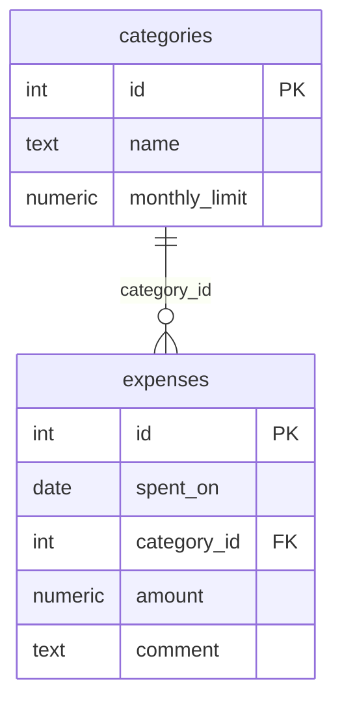

# 5. (Л) Розширені SQL-запити з Python

## Зміст лекції

1. Звіти, які рахує база даних
2. Навчальна схема: категорії й витрати
3. Допоміжний модуль `db.py`
4. `JOIN`: обʼєднання таблиць
5. `LEFT JOIN`: рядки без пари
6. Агрегатні функції і `GROUP BY`
7. `HAVING`: умова для груп
8. Підзапити
9. `WITH`: іменовані підзапити (CTE)
10. Віконні функції
11. Назви стовпців з `cursor.description`
12. Динамічні фільтри безпечно
13. Типові помилки

## Звіти, які рахує база даних

У лекції 1 база згрупувала витрати за категоріями одним запитом. Можна було б прочитати всі рядки й порахувати суми циклом у Python, але:

- база передала б по мережі **всі** рядки, хоча потрібні лише підсумки;
- СУБД рахує агрегати швидше: вона використовує індекси й оптимізатор запитів;
- запит SQL коротший і зрозуміліший за цикл зі словником.

Правило: **фільтрувати, обʼєднувати й агрегувати — у базі; форматувати й показувати — у Python**.

## Навчальна схема: категорії й витрати



Кожна витрата посилається на категорію через **зовнішній ключ** `category_id`. Ліміт категорії зберігається один раз — у таблиці `categories`, а не в кожному рядку витрат.

## Допоміжний модуль `db.py`

Щоб не повторювати в кожному прикладі підключення й створення таблиць, винесемо їх в окремий модуль. Усі приклади лекції імпортують його, тому `db.py` має лежати в тому самому каталозі:

```python
# File: db.py
import os

import psycopg2

SCHEMA = """
DROP TABLE IF EXISTS expenses;
DROP TABLE IF EXISTS categories;
CREATE TABLE categories (
    id INTEGER GENERATED ALWAYS AS IDENTITY PRIMARY KEY,
    name TEXT NOT NULL UNIQUE,
    monthly_limit NUMERIC(10, 2) NOT NULL
);
CREATE TABLE expenses (
    id INTEGER GENERATED ALWAYS AS IDENTITY PRIMARY KEY,
    spent_on DATE NOT NULL,
    category_id INTEGER NOT NULL REFERENCES categories (id),
    amount NUMERIC(10, 2) NOT NULL CHECK (amount > 0),
    comment TEXT
);
INSERT INTO categories (name, monthly_limit) VALUES
    ('food', 3000), ('transport', 600), ('fun', 1000), ('health', 800);
INSERT INTO expenses (spent_on, category_id, amount, comment) VALUES
    ('2026-09-01', 1, 85.50, 'lunch'),
    ('2026-09-03', 2, 30.00, 'bus'),
    ('2026-09-05', 1, 1250.00, 'groceries'),
    ('2026-09-12', 3, 315.00, 'cinema'),
    ('2026-09-14', 2, 12.50, 'tram'),
    ('2026-09-20', 1, 1940.00, 'groceries'),
    ('2026-10-02', 3, 780.00, 'concert'),
    ('2026-10-04', 1, 64.50, 'coffee');
"""


def connect():
    return psycopg2.connect(
        host=os.environ.get("PGHOST", "localhost"),
        dbname=os.environ.get("PGDATABASE", "school"),
        user=os.environ.get("PGUSER", "postgres"),
        password=os.environ["PGPASSWORD"],
    )


def reset(conn) -> None:
    """Recreate the demo tables with test data."""
    with conn, conn.cursor() as cur:
        cur.execute(SCHEMA)
```

## `JOIN`: обʼєднання таблиць

`JOIN` зʼєднує рядки двох таблиць за умовою `ON`. Так замість номера категорії отримуємо її назву:

```python
# Program: expenses with category names
import db

conn = db.connect()
db.reset(conn)
with conn, conn.cursor() as cur:
    cur.execute(
        """
        SELECT e.spent_on, c.name, e.amount
        FROM expenses AS e
        JOIN categories AS c ON c.id = e.category_id
        WHERE e.spent_on < %s
        ORDER BY e.spent_on
        """,
        ("2026-09-10",),
    )
    for day, category, amount in cur:
        print(day, f"{category:<10}", f"{amount:>8}")
conn.close()
```

```text
2026-09-01 food          85.50
2026-09-03 transport     30.00
2026-09-05 food        1250.00
```

Псевдоніми таблиць (`e`, `c`) скорочують запит і усувають неоднозначність, коли стовпець з однаковою назвою (`id`) є в обох таблицях.

## `LEFT JOIN`: рядки без пари

Звичайний (`INNER`) `JOIN` повертає лише рядки, що мають пару. Категорія `health` не має жодної витрати — і зникає зі звіту. `LEFT JOIN` залишає **всі** рядки лівої таблиці, а відсутні значення праворуч заповнює `NULL`:

| Тип | Що повертає |
|---|---|
| `JOIN` (`INNER JOIN`) | лише пари, що збіглися |
| `LEFT JOIN` | усі рядки лівої таблиці + пари або `NULL` |
| `RIGHT JOIN` | усі рядки правої таблиці + пари або `NULL` |
| `FULL JOIN` | усі рядки обох таблиць |

```python
# Program: LEFT JOIN keeps categories without expenses
import db

conn = db.connect()
db.reset(conn)
with conn, conn.cursor() as cur:
    cur.execute(
        """
        SELECT c.name, COUNT(e.id), COALESCE(SUM(e.amount), 0)
        FROM categories AS c
        LEFT JOIN expenses AS e ON e.category_id = c.id
        GROUP BY c.name
        ORDER BY c.name
        """
    )
    for name, count, total in cur.fetchall():
        print(f"{name:<10} {count:>2} {total:>9}")
conn.close()
```

```text
food        4   3340.00
fun         2   1095.00
health      0         0
transport   2     42.50
```

`COUNT(e.id)` рахує лише не-`NULL` значення, тому для `health` маємо `0`, а не `1`. `COALESCE(x, 0)` замінює `NULL` на нуль: сума порожньої групи дорівнює `NULL`.

## Агрегатні функції і `GROUP BY`

| Функція | Результат |
|---|---|
| `COUNT(*)` | кількість рядків |
| `SUM(x)` | сума |
| `AVG(x)` | середнє |
| `MIN(x)`, `MAX(x)` | найменше, найбільше |

`GROUP BY` розбиває рядки на групи, а агрегатна функція рахує одне значення для кожної групи. Згрупуємо витрати за місяцями функцією `date_trunc`:

```python
# Program: totals per month
import db

conn = db.connect()
db.reset(conn)
with conn, conn.cursor() as cur:
    cur.execute(
        """
        SELECT to_char(spent_on, 'YYYY-MM') AS month,
               COUNT(*), SUM(amount), ROUND(AVG(amount), 2), MAX(amount)
        FROM expenses
        GROUP BY month
        ORDER BY month
        """
    )
    print("month    n      sum      avg      max")
    for month, n, total, avg, biggest in cur:
        print(f"{month} {n:>2} {total:>8} {avg:>8} {biggest:>8}")
conn.close()
```

```text
month    n      sum      avg      max
2026-09  6  3633.00   605.50  1940.00
2026-10  2   844.50   422.25   780.00
```

!!! warning "Правило `GROUP BY`"
    У `SELECT` запиту з групуванням можуть бути лише стовпці з `GROUP BY` та агрегатні функції. Запит `SELECT category_id, comment, SUM(amount) ... GROUP BY category_id` PostgreSQL відхилить: незрозуміло, який з коментарів групи показати.

## `HAVING`: умова для груп

`WHERE` фільтрує **рядки до** групування, `HAVING` — **групи після** нього. Знайдемо категорії, де сума за вересень перевищила ліміт:

```python
# Program: categories over the monthly limit
import db

conn = db.connect()
db.reset(conn)
with conn, conn.cursor() as cur:
    cur.execute(
        """
        SELECT c.name, SUM(e.amount) AS total, c.monthly_limit
        FROM expenses AS e
        JOIN categories AS c ON c.id = e.category_id
        WHERE e.spent_on BETWEEN %s AND %s
        GROUP BY c.name, c.monthly_limit
        HAVING SUM(e.amount) > c.monthly_limit
        """,
        ("2026-09-01", "2026-09-30"),
    )
    for name, total, limit in cur:
        print(f"{name}: {total} > {limit} (over by {total - limit})")
conn.close()
```

```text
food: 3275.50 > 3000.00 (over by 275.50)
```

Різниця `total - limit` рахується в Python: обидва значення — `Decimal`, тож результат точний.


## Підзапити

**Підзапит** — запит усередині іншого запиту. Його результат використовують як значення, список або таблицю:

```python
# Program: expenses above the average one
import db

conn = db.connect()
db.reset(conn)
with conn, conn.cursor() as cur:
    cur.execute(
        """
        SELECT spent_on, comment, amount
        FROM expenses
        WHERE amount > (SELECT AVG(amount) FROM expenses)
        ORDER BY amount DESC
        """
    )
    print(cur.fetchall())
    cur.execute(
        """
        SELECT name FROM categories
        WHERE id NOT IN (SELECT category_id FROM expenses WHERE spent_on >= %s)
        ORDER BY name
        """,
        ("2026-10-01",),
    )
    print("no expenses in october:", [name for (name,) in cur])
conn.close()
```

```text
[(datetime.date(2026, 9, 20), 'groceries', Decimal('1940.00')), (datetime.date(2026, 9, 5), 'groceries', Decimal('1250.00')), (datetime.date(2026, 10, 2), 'concert', Decimal('780.00'))]
no expenses in october: ['health', 'transport']
```

## `WITH`: іменовані підзапити (CTE)

Коли підзапитів кілька, запит стає важко читати. Конструкція `WITH` (Common Table Expression) дає підзапиту імʼя, ніби це тимчасова таблиця:

```python
# Program: a CTE makes a long query readable
import db

conn = db.connect()
db.reset(conn)
with conn, conn.cursor() as cur:
    cur.execute(
        """
        WITH monthly AS (
            SELECT category_id, SUM(amount) AS total
            FROM expenses
            WHERE spent_on BETWEEN %s AND %s
            GROUP BY category_id
        )
        SELECT c.name, COALESCE(m.total, 0) AS total, c.monthly_limit,
               ROUND(100 * COALESCE(m.total, 0) / c.monthly_limit) AS percent
        FROM categories AS c
        LEFT JOIN monthly AS m ON m.category_id = c.id
        ORDER BY percent DESC
        """,
        ("2026-09-01", "2026-09-30"),
    )
    for name, total, limit, percent in cur:
        bar = "#" * int(percent // 10)
        print(f"{name:<10} {total:>8} / {limit:>8} {percent:>4}% {bar}")
conn.close()
```

```text
food        3275.50 /  3000.00  109% ##########
fun          315.00 /  1000.00   32% ###
transport     42.50 /   600.00    7%
health            0 /   800.00    0%
```

## Віконні функції

Агрегатна функція з `GROUP BY` «згортає» групу в один рядок. **Віконна функція** (`... OVER (...)`) рахує значення по групі, але **зберігає всі рядки**. Типові задачі — накопичувальна сума і місце в рейтингу:

```python
# Program: running total and rank with window functions
import db

conn = db.connect()
db.reset(conn)
with conn, conn.cursor() as cur:
    cur.execute(
        """
        SELECT spent_on, amount,
               SUM(amount) OVER (ORDER BY spent_on) AS running_total,
               RANK() OVER (ORDER BY amount DESC) AS place
        FROM expenses
        WHERE spent_on < %s
        ORDER BY spent_on
        """,
        ("2026-10-01",),
    )
    for day, amount, running, place in cur:
        print(day, f"{amount:>8} {running:>8}  #{place}")
conn.close()
```

```text
2026-09-01    85.50    85.50  #4
2026-09-03    30.00   115.50  #5
2026-09-05  1250.00  1365.50  #2
2026-09-12   315.00  1680.50  #3
2026-09-14    12.50  1693.00  #6
2026-09-20  1940.00  3633.00  #1
```

## Назви стовпців з `cursor.description`

Після `execute` атрибут `cur.description` містить опис стовпців результату. Це дозволяє написати одну функцію, що друкує таблицею результат **будь-якого** запиту:

```python
# Program: print any query result as a table
import db


def print_table(cur) -> None:
    headers = [col.name for col in cur.description]
    rows = [[str(value) for value in row] for row in cur.fetchall()]
    widths = [max(len(h), *(len(r[i]) for r in rows)) for i, h in enumerate(headers)]
    print("  ".join(h.ljust(w) for h, w in zip(headers, widths)))
    print("  ".join("-" * w for w in widths))
    for row in rows:
        print("  ".join(v.ljust(w) for v, w in zip(row, widths)))


conn = db.connect()
db.reset(conn)
with conn, conn.cursor() as cur:
    cur.execute("SELECT name, monthly_limit AS limit_uah FROM categories ORDER BY monthly_limit DESC")
    print_table(cur)
conn.close()
```

```text
name       limit_uah
---------  ---------
food       3000.00
fun        1000.00
health     800.00
transport  600.00
```

## Динамічні фільтри безпечно

Часто частина умов необовʼязкова: користувач може вказати категорію, мінімальну суму, обидва або жодного. Запит збирають зі **шматків тексту з `%s`** і окремого **списку параметрів** — значення ніколи не потрапляють у текст:

```python
# Program: build a WHERE clause from optional filters
import db

ALLOWED_ORDER = {"date": "e.spent_on", "amount": "e.amount"}


def find(conn, category=None, min_amount=None, order="date"):
    conditions, params = [], []
    if category is not None:
        conditions.append("c.name = %s")
        params.append(category)
    if min_amount is not None:
        conditions.append("e.amount >= %s")
        params.append(min_amount)
    where = ("WHERE " + " AND ".join(conditions)) if conditions else ""
    sql = (f"SELECT e.spent_on, c.name, e.amount FROM expenses e "
           f"JOIN categories c ON c.id = e.category_id {where} ORDER BY {ALLOWED_ORDER[order]}")
    with conn.cursor() as cur:
        cur.execute(sql, params)
        return cur.fetchall()


conn = db.connect()
db.reset(conn)
print(len(find(conn)))
print(find(conn, category="fun"))
print(find(conn, category="food", min_amount=1000, order="amount"))
conn.close()
```

```text
8
[(datetime.date(2026, 9, 12), 'fun', Decimal('315.00')), (datetime.date(2026, 10, 2), 'fun', Decimal('780.00'))]
[(datetime.date(2026, 9, 5), 'food', Decimal('1250.00')), (datetime.date(2026, 9, 20), 'food', Decimal('1940.00'))]
```

У f-рядок потрапляють лише **наші** фрагменти тексту: умови з `%s` і назва стовпця зі словника `ALLOWED_ORDER`. Невідомий `order` спричинить `KeyError`, а не інʼєкцію.

## Типові помилки

| Помилка | Чому погано | Як правильно |
|---|---|---|
| Суми рахують циклом у Python після `SELECT *` | зайвий трафік і код | `GROUP BY` і агрегати в базі |
| `JOIN`, коли потрібні й рядки без пари | категорії без витрат зникають | `LEFT JOIN` |
| `COUNT(*)` разом з `LEFT JOIN` | порожня група дає `1` | `COUNT(e.id)` |
| `SUM` порожньої групи вважають нулем | результат `NULL` → `None` | `COALESCE(SUM(x), 0)` |
| Умова для агрегату у `WHERE` | `aggregate functions are not allowed in WHERE` | `HAVING` |
| Стовпець не з `GROUP BY` у `SELECT` | помилка запиту | додати до `GROUP BY` або агрегувати |
| Динамічний фільтр через f-рядок зі значенням | SQL-інʼєкція | `%s` + список параметрів |
| Назва стовпця сортування з вводу | інʼєкція | словник дозволених назв |

## Підсумок

- Фільтрування, обʼєднання й агрегацію виконує **база даних**, Python — показує результат.
- `JOIN ... ON` зʼєднує таблиці за ключем; `LEFT JOIN` зберігає рядки без пари.
- `GROUP BY` з `COUNT`, `SUM`, `AVG`, `MIN`, `MAX` рахує підсумки груп; `HAVING` фільтрує групи.
- Підзапити й `WITH` (CTE) розбивають складний запит на зрозумілі частини.
- Віконні функції (`OVER`) дають накопичувальні суми й рейтинги без втрати рядків.
- `cur.description` містить назви стовпців результату.
- Динамічні запити збирають з фрагментів з `%s` і списку параметрів; назви стовпців — лише зі списку дозволених.

## Корисні посилання

- [PostgreSQL — Joins Between Tables](https://www.postgresql.org/docs/current/tutorial-join.html)
- [PostgreSQL — Aggregate Functions](https://www.postgresql.org/docs/current/functions-aggregate.html)
- [PostgreSQL — WITH Queries (CTE)](https://www.postgresql.org/docs/current/queries-with.html)
- [PostgreSQL — Window Functions](https://www.postgresql.org/docs/current/tutorial-window.html)
- [psycopg2 — cursor.description](https://www.psycopg.org/docs/cursor.html#cursor.description)
