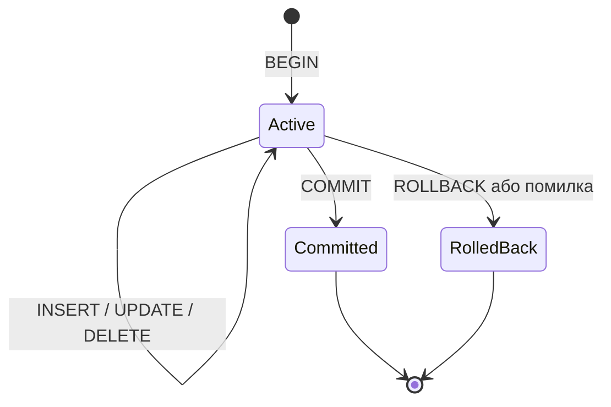
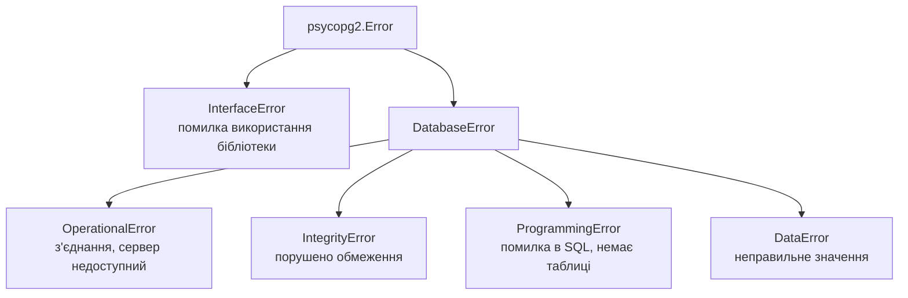

# 7. (Л) Обробка помилок і транзакцій при роботі з PostgreSQL

## Зміст лекції

1. Чому операція має виконатися повністю або ніяк
2. Транзакція і властивості ACID
3. Транзакції в psycopg2: неявний `BEGIN`
4. `commit` і `rollback`
5. `with conn`: транзакція як блок
6. Ієрархія винятків psycopg2
7. Коди помилок PostgreSQL: `pgcode`
8. Стан «транзакцію перервано»
9. `SAVEPOINT`: часткове скасування
10. Режим `autocommit`
11. Одночасні зміни: `SELECT ... FOR UPDATE`
12. Приклад: надійний переказ між рахунками
13. Типові помилки

## Чому операція має виконатися повністю або ніяк

Переказ 500 грн з картки на ощадний рахунок — це **дві** команди:

```sql
UPDATE accounts SET balance = balance - 500 WHERE name = 'card';
UPDATE accounts SET balance = balance + 500 WHERE name = 'savings';
```

Якщо програма впаде між ними (помилка в коді, обрив мережі, вимкнення живлення), гроші зникнуть з картки, але не зʼявляться на рахунку. Потрібен механізм, який гарантує: **або обидві зміни, або жодної**.

## Транзакція і властивості ACID

**Транзакція** — група команд, яку база виконує як одне ціле. Надійні СУБД гарантують для транзакцій чотири властивості **ACID**:

| Властивість | Значення | Приклад з переказом |
|---|---|---|
| **A**tomicity — атомарність | усі зміни або жодної | гроші не «зависають» посередині |
| **C**onsistency — узгодженість | обмеження (`CHECK`, `FOREIGN KEY`) не порушуються | баланс не стає відʼємним |
| **I**solation — ізольованість | паралельні транзакції не бачать проміжних станів одна одної | інший клієнт не побачить «половину» переказу |
| **D**urability — довговічність | після `COMMIT` зміни переживуть збій | після підтвердження переказ збережено на диску |



## Транзакції в psycopg2: неявний `BEGIN`

psycopg2 відкриває транзакцію **автоматично** перед першою командою після підключення або після попереднього `commit`/`rollback`. Усі наступні команди виконуються в цій транзакції, доки її не завершити:

```python
# Program: psycopg2 starts a transaction automatically
import os

import psycopg2
from psycopg2 import extensions

conn = psycopg2.connect(host="localhost", dbname="school", user="postgres", password=os.environ["PGPASSWORD"])
states = {extensions.TRANSACTION_STATUS_IDLE: "idle", extensions.TRANSACTION_STATUS_INTRANS: "in transaction"}
print("after connect:", states[conn.get_transaction_status()])
cur = conn.cursor()
cur.execute("SELECT 1")
print("after SELECT:", states[conn.get_transaction_status()])
conn.commit()
print("after commit:", states[conn.get_transaction_status()])
conn.close()
```

```text
after connect: idle
after SELECT: in transaction
after commit: idle
```

Навіть `SELECT` відкриває транзакцію. Тому програма, що довго тримає підключення без `commit`, тримає й відкриту транзакцію — це заважає обслуговуванню бази.

## `commit` і `rollback`

```python
# Program: rollback cancels all changes of the transaction
import os

import psycopg2

conn = psycopg2.connect(host="localhost", dbname="school", user="postgres", password=os.environ["PGPASSWORD"])
cur = conn.cursor()
cur.execute("DROP TABLE IF EXISTS notes")
cur.execute("CREATE TABLE notes (text TEXT)")
conn.commit()

cur.execute("INSERT INTO notes VALUES ('first')")
cur.execute("INSERT INTO notes VALUES ('second')")
conn.rollback()
cur.execute("INSERT INTO notes VALUES ('third')")
conn.commit()

cur.execute("SELECT text FROM notes")
print(cur.fetchall())
conn.close()
```

```text
[('third',)]
```

`rollback()` скасував обидві вставки, зроблені після останнього `commit`. Якщо закрити підключення без `commit`, PostgreSQL так само скасує незавершену транзакцію.

## `with conn`: транзакція як блок

Ручні `commit`/`rollback` легко забути в одній з гілок `try`. Блок `with conn:` робить це сам:

- блок завершився без винятку → `commit`;
- у блоці виник виняток → `rollback`, а виняток передається далі.

```python
# Program: with conn commits on success and rolls back on error
import os

import psycopg2

conn = psycopg2.connect(host="localhost", dbname="school", user="postgres", password=os.environ["PGPASSWORD"])
with conn, conn.cursor() as cur:
    cur.execute("DROP TABLE IF EXISTS notes")
    cur.execute("CREATE TABLE notes (text TEXT NOT NULL)")

try:
    with conn, conn.cursor() as cur:
        cur.execute("INSERT INTO notes VALUES ('saved?')")
        raise RuntimeError("power off")
except RuntimeError as error:
    print("error:", error)

with conn, conn.cursor() as cur:
    cur.execute("SELECT COUNT(*) FROM notes")
    print("rows:", cur.fetchone()[0])
conn.close()
```

```text
error: power off
rows: 0
```

!!! note "`with conn` не закриває підключення"
    Як і в `sqlite3`, у psycopg2 вихід з `with conn:` завершує **транзакцію**, але підключення лишається відкритим і його можна використовувати далі. Закривають його явно `conn.close()` або через `contextlib.closing`.

## Ієрархія винятків psycopg2

psycopg2 генерує винятки, описані стандартом DB-API:



| Виняток | Типова причина |
|---|---|
| `OperationalError` | сервер недоступний, неправильний пароль, обрив зʼєднання |
| `IntegrityError` | `UNIQUE`, `NOT NULL`, `CHECK`, `FOREIGN KEY` |
| `ProgrammingError` | синтаксична помилка SQL, невідома таблиця чи стовпець |
| `DataError` | `'abc'::int`, ділення на нуль, задовге значення |

```python
# Program: catch different kinds of database errors
import os

import psycopg2

conn = psycopg2.connect(host="localhost", dbname="school", user="postgres", password=os.environ["PGPASSWORD"])
with conn, conn.cursor() as cur:
    cur.execute("DROP TABLE IF EXISTS accounts")
    cur.execute("CREATE TABLE accounts (name TEXT UNIQUE, balance NUMERIC(10, 2) CHECK (balance >= 0))")
    cur.execute("INSERT INTO accounts VALUES ('card', 1500)")

queries = [
    ("INSERT INTO accounts VALUES (%s, %s)", ("card", 100)),
    ("INSERT INTO accounts VALUES (%s, %s)", ("cash", -5)),
    ("SELECT * FROM acounts", None),
    ("SELECT %s::int", ("abc",)),
]
for sql, params in queries:
    try:
        with conn, conn.cursor() as cur:
            cur.execute(sql, params)
    except psycopg2.IntegrityError as error:
        print("integrity:", error.diag.constraint_name)
    except psycopg2.ProgrammingError as error:
        print("programming:", error.diag.message_primary)
    except psycopg2.DataError as error:
        print("data:", error.diag.message_primary)
conn.close()
```

```text
integrity: accounts_name_key
integrity: accounts_balance_check
programming: relation "acounts" does not exist
data: invalid input syntax for type integer: "abc"
```

Атрибут `error.diag` містить подробиці від сервера: назву порушеного обмеження, основне повідомлення, таблицю, стовпець.

## Коди помилок PostgreSQL: `pgcode`

Кожна помилка PostgreSQL має пʼятисимвольний код `SQLSTATE`. Модуль `psycopg2.errors` містить окремий клас винятку для кожного коду — так можна перехопити саме «дублікат ключа», а не будь-яке порушення цілісності:

```python
# Program: catch a specific PostgreSQL error class
import os

import psycopg2
from psycopg2 import errors

conn = psycopg2.connect(host="localhost", dbname="school", user="postgres", password=os.environ["PGPASSWORD"])
with conn, conn.cursor() as cur:
    cur.execute("DROP TABLE IF EXISTS users")
    cur.execute("CREATE TABLE users (email TEXT PRIMARY KEY)")


def register(email: str) -> str:
    try:
        with conn, conn.cursor() as cur:
            cur.execute("INSERT INTO users VALUES (%s)", (email,))
        return "registered"
    except errors.UniqueViolation as error:
        return f"already exists (pgcode {error.pgcode})"


print(register("olena@example.com"))
print(register("olena@example.com"))
conn.close()
```

```text
registered
already exists (pgcode 23505)
```

| Клас у `psycopg2.errors` | `pgcode` |
|---|---|
| `UniqueViolation` | `23505` |
| `ForeignKeyViolation` | `23503` |
| `NotNullViolation` | `23502` |
| `CheckViolation` | `23514` |
| `UndefinedTable` | `42P01` |
| `InFailedSqlTransaction` | `25P02` |

## Стан «транзакцію перервано»

Після помилки PostgreSQL позначає транзакцію як **перервану** і відхиляє всі наступні команди, доки не буде `rollback`:

```python
# Program: after an error the transaction must be rolled back
import os

import psycopg2

conn = psycopg2.connect(host="localhost", dbname="school", user="postgres", password=os.environ["PGPASSWORD"])
cur = conn.cursor()
try:
    cur.execute("SELECT 1 / 0")
except psycopg2.DataError as error:
    print("first:", error.diag.message_primary)

try:
    cur.execute("SELECT 1")
except psycopg2.errors.InFailedSqlTransaction as error:
    print("second:", error.diag.message_primary)

conn.rollback()
cur.execute("SELECT 1")
print("after rollback:", cur.fetchone())
conn.close()
```

```text
first: division by zero
second: current transaction is aborted, commands ignored until end of transaction block
after rollback: (1,)
```

Якщо програма перехоплює помилку бази і продовжує роботу з тим самим підключенням, вона **мусить** викликати `rollback()`. Блок `with conn:` робить це автоматично.

## `SAVEPOINT`: часткове скасування

Іноді треба скасувати лише частину транзакції. Наприклад, при імпорті 1000 рядків пропустити кілька помилкових, а решту зберегти **однією** транзакцією. Для цього є **точки збереження**:

```python
# Program: skip bad rows with savepoints, keep the good ones
import os

import psycopg2

rows = [("2026-09-01", 85.5), ("2026-09-02", -10), ("2026-09-31", 40), ("2026-09-03", 30)]

conn = psycopg2.connect(host="localhost", dbname="school", user="postgres", password=os.environ["PGPASSWORD"])
with conn, conn.cursor() as cur:
    cur.execute("DROP TABLE IF EXISTS expenses")
    cur.execute("CREATE TABLE expenses (spent_on DATE, amount NUMERIC(10, 2) CHECK (amount > 0))")
    for day, amount in rows:
        cur.execute("SAVEPOINT row_start")
        try:
            cur.execute("INSERT INTO expenses VALUES (%s, %s)", (day, amount))
        except psycopg2.Error as error:
            cur.execute("ROLLBACK TO SAVEPOINT row_start")
            print(f"skip {day} {amount}: {error.diag.message_primary}")
        else:
            cur.execute("RELEASE SAVEPOINT row_start")
    cur.execute("SELECT COUNT(*) FROM expenses")
    print("imported:", cur.fetchone()[0])
conn.close()
```

```text
skip 2026-09-02 -10: new row for relation "expenses" violates check constraint "expenses_amount_check"
skip 2026-09-31 40: date/time field value out of range: "2026-09-31"
imported: 2
```

`ROLLBACK TO SAVEPOINT` скасовує зміни лише після точки збереження і знімає з транзакції стан «перервано».

## Режим `autocommit`

У режимі `conn.autocommit = True` кожна команда фіксується одразу, окремо від інших. Він потрібен для команд, які не можна виконувати в транзакції, — наприклад, `CREATE DATABASE`:

```python
# Program: CREATE DATABASE needs autocommit
import os

import psycopg2

conn = psycopg2.connect(host="localhost", dbname="school", user="postgres", password=os.environ["PGPASSWORD"])
cur = conn.cursor()
try:
    cur.execute("CREATE DATABASE demo_tx")
except psycopg2.Error as error:
    print("in transaction:", error.diag.message_primary)
    conn.rollback()

conn.autocommit = True
cur.execute("DROP DATABASE IF EXISTS demo_tx")
cur.execute("CREATE DATABASE demo_tx")
print("created")
cur.execute("DROP DATABASE demo_tx")
conn.close()
```

```text
in transaction: CREATE DATABASE cannot run inside a transaction block
created
```

Для звичайної роботи з даними `autocommit` **не** вмикають: тоді зникає атомарність груп команд.

## Одночасні зміни: `SELECT ... FOR UPDATE`

Дві програми одночасно перевіряють баланс і списують гроші:

| Час | Клієнт A | Клієнт B |
|---|---|---|
| 1 | читає баланс: 1000 | |
| 2 | | читає баланс: 1000 |
| 3 | списує 800 → 200 | |
| 4 | | списує 800, бо «бачив» 1000 |

Перевірка в Python відбулася на застарілих даних. Розвʼязання — **заблокувати рядок** на час транзакції: `SELECT ... FOR UPDATE`. Друга транзакція чекатиме, доки перша не завершиться, і прочитає вже новий баланс. Ще надійніше — довірити перевірку самій базі обмеженням `CHECK (balance >= 0)`: тоді недопустимий `UPDATE` буде відхилено незалежно від того, що «бачила» програма.

## Приклад: надійний переказ між рахунками

```python
# File: transfer.py
import os
from decimal import Decimal

import psycopg2
from psycopg2 import errors


class TransferError(Exception):
    pass


def setup(conn) -> None:
    with conn, conn.cursor() as cur:
        cur.execute("DROP TABLE IF EXISTS accounts")
        cur.execute(
            "CREATE TABLE accounts (name TEXT PRIMARY KEY, balance NUMERIC(10, 2) NOT NULL CHECK (balance >= 0))"
        )
        cur.executemany("INSERT INTO accounts VALUES (%s, %s)", [("card", 1500), ("cash", 300), ("savings", 0)])


def transfer(conn, source: str, target: str, amount: Decimal) -> None:
    if amount <= 0:
        raise TransferError("amount must be positive")
    try:
        with conn, conn.cursor() as cur:
            cur.execute("SELECT name FROM accounts WHERE name IN (%s, %s) ORDER BY name FOR UPDATE",
                        (source, target))
            if cur.rowcount != 2:
                raise TransferError(f"unknown account: {source} or {target}")
            cur.execute("UPDATE accounts SET balance = balance - %s WHERE name = %s", (amount, source))
            cur.execute("UPDATE accounts SET balance = balance + %s WHERE name = %s", (amount, target))
    except errors.CheckViolation:
        raise TransferError(f"not enough money on {source}") from None


def balances(conn) -> str:
    with conn, conn.cursor() as cur:
        cur.execute("SELECT name, balance FROM accounts ORDER BY name")
        return ", ".join(f"{name}={balance}" for name, balance in cur)


def main() -> None:
    conn = psycopg2.connect(host="localhost", dbname="school", user="postgres", password=os.environ["PGPASSWORD"])
    setup(conn)
    for source, target, amount in [("card", "savings", "500"), ("cash", "card", "1000"), ("card", "wallet", "10")]:
        try:
            transfer(conn, source, target, Decimal(amount))
            print(f"ok   {source} -> {target} {amount}")
        except TransferError as error:
            print(f"fail {source} -> {target} {amount}: {error}")
    print(balances(conn))
    conn.close()


if __name__ == "__main__":
    main()
```

```text
ok   card -> savings 500
fail cash -> card 1000: not enough money on cash
fail card -> wallet 10: unknown account: card or wallet
card=1000.00, cash=300.00, savings=500.00
```

Що тут важливо:

- обидва `UPDATE` — в одному блоці `with conn:`, тож переказ атомарний;
- `FOR UPDATE` блокує обидва рядки; `ORDER BY name` задає однаковий порядок блокування і запобігає **взаємоблокуванню** (deadlock) двох зустрічних переказів;
- достатність коштів перевіряє `CHECK` у базі, а програма перетворює технічний виняток на зрозумілий `TransferError`;
- після невдалих переказів баланси не змінилися.

## Типові помилки

| Помилка | Чому погано | Як правильно |
|---|---|---|
| `commit()` після кожного `UPDATE` переказу | збій посередині «губить» гроші | один `commit` на всю операцію |
| `except Exception: pass` навколо запиту | транзакція лишається перерваною | `rollback()` або `with conn:` |
| Продовжують роботу після помилки без `rollback` | `InFailedSqlTransaction` | `conn.rollback()` |
| Перехоплюють `psycopg2.Error` для всього | не відрізнити дублікат від обриву звʼязку | конкретні класи `errors.UniqueViolation` тощо |
| Перевірка залишку лише в Python | гонка між клієнтами | `CHECK` у базі, `FOR UPDATE` |
| `autocommit = True` для бізнес-операцій | немає атомарності | транзакції; autocommit — для `CREATE DATABASE` |
| Користувачу показують текст помилки SQL | незрозуміло й розкриває структуру бази | власний виняток з людським повідомленням |

## Підсумок

- **Транзакція** — група команд, що виконується повністю або ніяк; СУБД гарантує властивості **ACID**.
- psycopg2 відкриває транзакцію автоматично; `commit()` фіксує, `rollback()` скасовує зміни.
- `with conn:` — `commit` при успіху, `rollback` при винятку; підключення при цьому не закривається.
- Винятки: `OperationalError`, `IntegrityError`, `ProgrammingError`, `DataError`; точні класи — у `psycopg2.errors`, подробиці — в `error.diag`.
- Після помилки транзакція перервана до `rollback`; `SAVEPOINT` дозволяє скасувати лише частину змін.
- Одночасні зміни захищають обмеженнями бази і блокуванням `SELECT ... FOR UPDATE`.

## Корисні посилання

- [psycopg2 — Transactions control](https://www.psycopg.org/docs/usage.html#transactions-control)
- [psycopg2 — `errors`: класи винятків за SQLSTATE](https://www.psycopg.org/docs/errors.html)
- [PostgreSQL — Transactions](https://www.postgresql.org/docs/current/tutorial-transactions.html)
- [PostgreSQL — Error Codes](https://www.postgresql.org/docs/current/errcodes-appendix.html)
- [PostgreSQL — Explicit Locking](https://www.postgresql.org/docs/current/explicit-locking.html)
