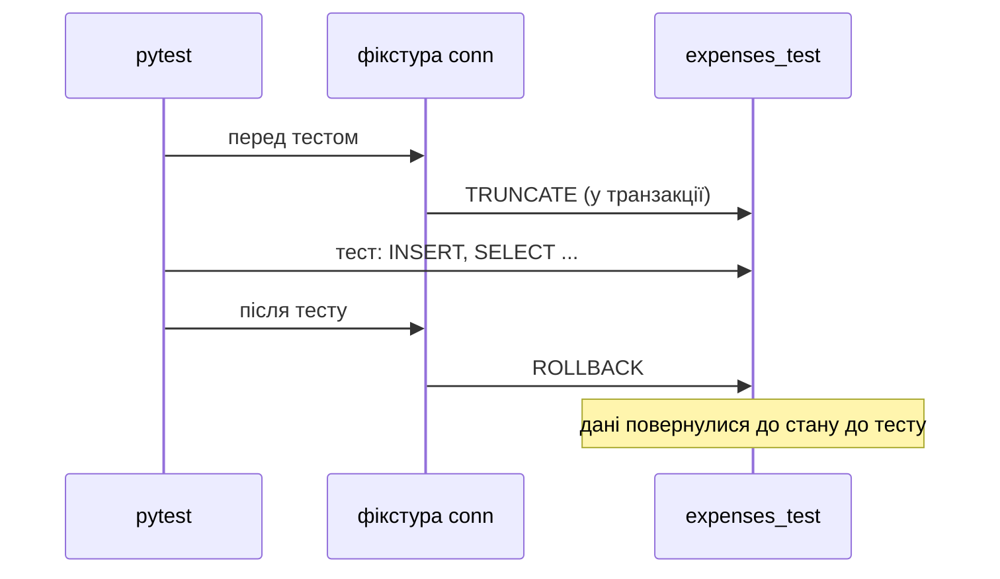

# 9. (Л) Тестування програм, що працюють з PostgreSQL

## Зміст лекції

1. Чому код з базою даних важко тестувати
2. Окрема тестова база
3. Шар доступу до даних: модуль `repository.py`
4. Фікстури pytest для бази
5. Ізоляція тестів транзакцією
6. Тести звичайних сценаріїв
7. Тести помилкових сценаріїв
8. Параметризовані тести
9. Тести без бази: заміна залежності
10. Запуск і структура проєкту
11. Типові помилки

## Чому код з базою даних важко тестувати

У лекції 33 (5 семестр) ми тестували «чисті» функції: однаковий вхід — однаковий результат. Функція, що працює з базою, залежить від **стану** бази:

- тест, що вставив рядок, змінює дані для наступного тесту;
- тест, який пройшов учора, сьогодні падає, бо хтось додав у базу запис;
- запуск тестів на робочій базі може **знищити реальні дані**.

Тому тести з базою будують за трьома правилами:

1. **Окрема тестова база**, яку не шкода очистити.
2. **Відомий початковий стан**: перед кожним тестом база містить ті самі дані.
3. **Ізоляція**: зміни одного тесту не бачать інші.

## Окрема тестова база

```bash
psql -h localhost -U postgres -c "CREATE DATABASE expenses_test"
export TEST_DATABASE=expenses_test
```

Назву тестової бази беруть зі змінної оточення. Додатковий захист — тести відмовляються працювати з базою, назва якої не закінчується на `_test`:

```python
# Program: refuse to run tests against a non-test database
import os

name = os.environ.get("TEST_DATABASE", "expenses")
if not name.endswith("_test"):
    raise SystemExit(f"refusing to run tests on database {name!r}")
print("ok:", name)
```

```text
refusing to run tests on database 'expenses'
```

## Шар доступу до даних: модуль `repository.py`

Тестувати легше, коли весь SQL зібрано в одному модулі з невеликими функціями. Кожна функція приймає **підключення параметром**, а не створює його сама — тоді тест може передати підключення до тестової бази:

```python
# File: repository.py
from dataclasses import dataclass
from datetime import date
from decimal import Decimal

SCHEMA = """
CREATE TABLE IF NOT EXISTS expenses (
    id INTEGER GENERATED ALWAYS AS IDENTITY PRIMARY KEY,
    spent_on DATE NOT NULL,
    category TEXT NOT NULL,
    amount NUMERIC(10, 2) NOT NULL CHECK (amount > 0)
)
"""


@dataclass
class Expense:
    spent_on: date
    category: str
    amount: Decimal
    id: int | None = None


def create_schema(conn) -> None:
    with conn.cursor() as cur:
        cur.execute(SCHEMA)


def add(conn, expense: Expense) -> int:
    with conn.cursor() as cur:
        cur.execute(
            "INSERT INTO expenses (spent_on, category, amount) VALUES (%s, %s, %s) RETURNING id",
            (expense.spent_on, expense.category, expense.amount),
        )
        return cur.fetchone()[0]


def get(conn, expense_id: int) -> Expense | None:
    with conn.cursor() as cur:
        cur.execute("SELECT spent_on, category, amount, id FROM expenses WHERE id = %s", (expense_id,))
        row = cur.fetchone()
    return Expense(*row) if row else None


def total_by_category(conn) -> dict[str, Decimal]:
    with conn.cursor() as cur:
        cur.execute("SELECT category, SUM(amount) FROM expenses GROUP BY category")
        return dict(cur.fetchall())


def delete(conn, expense_id: int) -> bool:
    with conn.cursor() as cur:
        cur.execute("DELETE FROM expenses WHERE id = %s", (expense_id,))
        return cur.rowcount == 1
```

Функції не викликають `commit`: завершувати транзакцію вирішує код, що їх викликає. Це й дозволяє тестам скасувати всі зміни (далі).

## Фікстури pytest для бази

**Фікстура** (лекція 33, 5 семестр) готує ресурс для тесту. Для бази зручно мати дві:

- `db_conn` з областю `session` — **одне** підключення на весь запуск тестів; створює таблиці;
- `conn` — для **кожного** тесту: відкриває транзакцію і після тесту скасовує її.

```python
# File: tests/conftest.py
import os

import psycopg2
import pytest

import repository


@pytest.fixture(scope="session")
def db_conn():
    name = os.environ.get("TEST_DATABASE", "expenses_test")
    if not name.endswith("_test"):
        pytest.exit(f"refusing to run tests on database {name!r}")
    conn = psycopg2.connect(host="localhost", dbname=name, user="postgres", password=os.environ["PGPASSWORD"])
    with conn:
        repository.create_schema(conn)
    yield conn
    conn.close()


@pytest.fixture
def conn(db_conn):
    with db_conn.cursor() as cur:
        cur.execute("TRUNCATE expenses RESTART IDENTITY")
    yield db_conn
    db_conn.rollback()
```



## Ізоляція тестів транзакцією

Код після `yield` у фікстурі виконується після тесту — навіть якщо тест упав. `rollback()` скасовує **все**, що зробив тест: вставки, видалення, навіть `TRUNCATE`. Тому:

- кожен тест починає з порожньої таблиці;
- порядок запуску тестів не впливає на результат;
- тестова база після запуску лишається такою, як була.

!!! warning "Не викликайте `commit` у коді, який тестуєте"
    Якщо функція `add` сама викликала б `conn.commit()`, рядок зберігся б назавжди, і `rollback` фікстури його вже не скасував би. Транзакцією керує верхній рівень програми — наприклад, обробник запиту у вебзастосунку (лекція 22).

## Тести звичайних сценаріїв

```python
# File: tests/test_repository.py
from datetime import date
from decimal import Decimal

import psycopg2
import pytest

import repository
from repository import Expense


def make(category="food", amount="100.00", day=date(2026, 9, 1)) -> Expense:
    return Expense(day, category, Decimal(amount))


def test_add_returns_id_and_get_reads_row(conn):
    new_id = repository.add(conn, make(amount="85.50"))
    saved = repository.get(conn, new_id)
    assert saved == Expense(date(2026, 9, 1), "food", Decimal("85.50"), new_id)


def test_get_unknown_id_returns_none(conn):
    assert repository.get(conn, 999) is None


def test_total_by_category(conn):
    for category, amount in [("food", "85.50"), ("food", "14.50"), ("fun", "315")]:
        repository.add(conn, make(category, amount))
    assert repository.total_by_category(conn) == {"food": Decimal("100.00"), "fun": Decimal("315.00")}


def test_total_of_empty_table(conn):
    assert repository.total_by_category(conn) == {}


def test_delete(conn):
    new_id = repository.add(conn, make())
    assert repository.delete(conn, new_id) is True
    assert repository.delete(conn, new_id) is False
    assert repository.get(conn, new_id) is None


def test_negative_amount_is_rejected(conn):
    with pytest.raises(psycopg2.errors.CheckViolation):
        repository.add(conn, make(amount="-5"))


@pytest.mark.parametrize("amount, ok", [("0.01", True), ("0", False), ("99999999.99", True)])
def test_amount_limits(conn, amount, ok):
    if ok:
        assert repository.add(conn, make(amount=amount)) > 0
    else:
        with pytest.raises(psycopg2.IntegrityError):
            repository.add(conn, make(amount=amount))
```

Кожен тест перевіряє **одну** поведінку і має назву, що її описує. Тест `test_total_of_empty_table` важливий: без нього легко пропустити випадок, коли запит повертає `None` замість порожнього результату.

## Тести помилкових сценаріїв

Тести на помилки так само важливі, як і на успіх. `pytest.raises` перевіряє, що виклик згенерував очікуваний виняток. Для бази даних варто перевірити:

| Сценарій | Очікування |
|---|---|
| сума `<= 0` | `CheckViolation` |
| дублікат унікального поля | `UniqueViolation` |
| неіснуючий `id` | `None` або `False`, а не виняток |
| порожня таблиця | порожній словник або нуль |
| межові значення `NUMERIC(10, 2)` | найбільше допустиме проходить |

Після тесту, що спричинив помилку бази, транзакція перервана — але це не зашкодить наступним тестам, бо фікстура викликає `rollback()`.

## Параметризовані тести

`@pytest.mark.parametrize` запускає один тест з кількома наборами даних. У звіті pytest кожен набір — окремий тест:

```text
tests/test_repository.py::test_amount_limits[0.01-True] PASSED
tests/test_repository.py::test_amount_limits[0-False] PASSED
tests/test_repository.py::test_amount_limits[99999999.99-True] PASSED
```

## Тести без бази: заміна залежності

Не все потрібно тестувати з реальною базою. Логіку, що лише **використовує** дані репозиторію, краще тестувати окремо, підставивши замість функції репозиторію просту заміну. Для цього pytest має вбудовану фікстуру `monkeypatch`:

```python
# File: tests/test_budget.py
from decimal import Decimal

import repository


def over_limit(conn, limits: dict[str, Decimal]) -> list[str]:
    totals = repository.total_by_category(conn)
    return sorted(c for c, total in totals.items() if total > limits.get(c, Decimal("Infinity")))


def test_over_limit_without_database(monkeypatch):
    fake = {"food": Decimal("3200"), "fun": Decimal("300")}
    monkeypatch.setattr(repository, "total_by_category", lambda conn: fake)
    assert over_limit(None, {"food": Decimal("3000"), "fun": Decimal("1000")}) == ["food"]
```

Такий тест виконується за мілісекунди й не потребує сервера. Підхід поєднує два рівні:

| Рівень | Що перевіряє | Потрібна база |
|---|---|---|
| тести репозиторію | правильність SQL, обмеження, типи | так, тестова |
| тести логіки з заміною | розрахунки, правила, форматування | ні |

## Запуск і структура проєкту

```text
lab05_db_tests/
  repository.py
  tests/
    conftest.py
    test_repository.py
    test_budget.py
  pytest.ini
```

Файл `pytest.ini` додає корінь проєкту до шляху імпорту, щоб тести бачили `repository.py`:

```ini
[pytest]
pythonpath = .
testpaths = tests
```

```bash
export PGPASSWORD=secret
export TEST_DATABASE=expenses_test
python3 -m pytest -v
```

```text
tests/test_budget.py::test_over_limit_without_database PASSED              [ 10%]
tests/test_repository.py::test_add_returns_id_and_get_reads_row PASSED     [ 20%]
tests/test_repository.py::test_get_unknown_id_returns_none PASSED          [ 30%]
tests/test_repository.py::test_total_by_category PASSED                    [ 40%]
tests/test_repository.py::test_total_of_empty_table PASSED                 [ 50%]
tests/test_repository.py::test_delete PASSED                               [ 60%]
tests/test_repository.py::test_negative_amount_is_rejected PASSED          [ 70%]
tests/test_repository.py::test_amount_limits[0.01-True] PASSED             [ 80%]
tests/test_repository.py::test_amount_limits[0-False] PASSED               [ 90%]
tests/test_repository.py::test_amount_limits[99999999.99-True] PASSED      [100%]

============================== 10 passed in 0.21s ==============================
```

У лекції 14 тестову базу запустимо в Docker-контейнері, а в лекції 28 — автоматично в GitHub Actions при кожному push.

## Типові помилки

| Помилка | Чому погано | Як правильно |
|---|---|---|
| Тести працюють з робочою базою | втрата реальних даних | окрема база `*_test` і перевірка назви |
| Тести залежать від порядку запуску | випадкові падіння | `TRUNCATE` + `rollback` у фікстурі |
| Функції репозиторію викликають `commit` | зміни тестів зберігаються назавжди | транзакцією керує верхній рівень |
| Функція сама створює підключення | не підставити тестову базу | підключення — параметр |
| Пароль тестової бази в `conftest.py` | потрапляє в git | змінні оточення |
| Немає тестів на помилки | не відомо, як код поводиться при збоях | `pytest.raises`, межові значення |
| Усю логіку тестують з базою | тести повільні | заміна залежності `monkeypatch` |

## Підсумок

- Тести з базою даних потребують **окремої тестової бази**, **відомого початкового стану** та **ізоляції** тестів.
- Увесь SQL збирають у модулі-репозиторії; функції приймають підключення параметром і не викликають `commit`.
- Фікстура з `scope="session"` створює підключення один раз; фікстура тесту очищає таблицю і після тесту робить `rollback`.
- `pytest.raises` перевіряє помилкові сценарії, `parametrize` — кілька наборів даних.
- Логіку над даними тестують без бази, підмінюючи функції репозиторію через `monkeypatch`.

## Корисні посилання

- [pytest — How to use fixtures](https://docs.pytest.org/en/stable/how-to/fixtures.html)
- [pytest — Parametrizing tests](https://docs.pytest.org/en/stable/how-to/parametrize.html)
- [pytest — monkeypatch](https://docs.pytest.org/en/stable/how-to/monkeypatch.html)
- [PostgreSQL — TRUNCATE](https://www.postgresql.org/docs/current/sql-truncate.html)
- [psycopg2 — Connection](https://www.psycopg.org/docs/connection.html)
