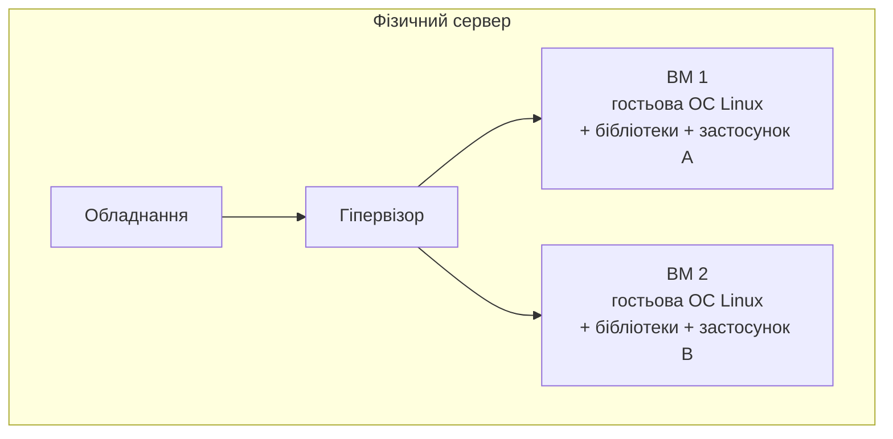
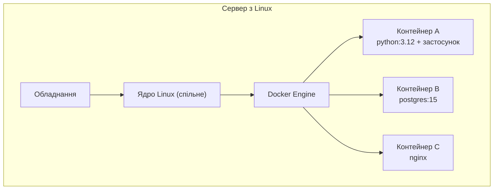
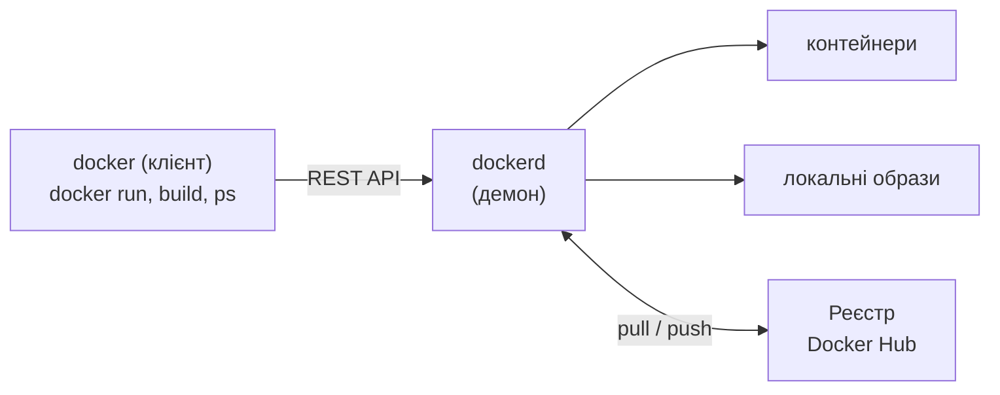
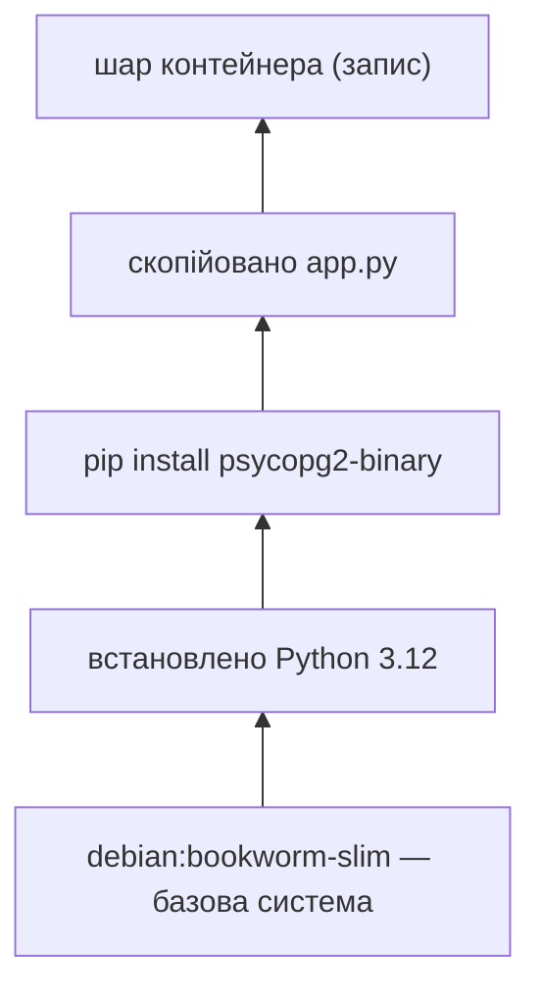
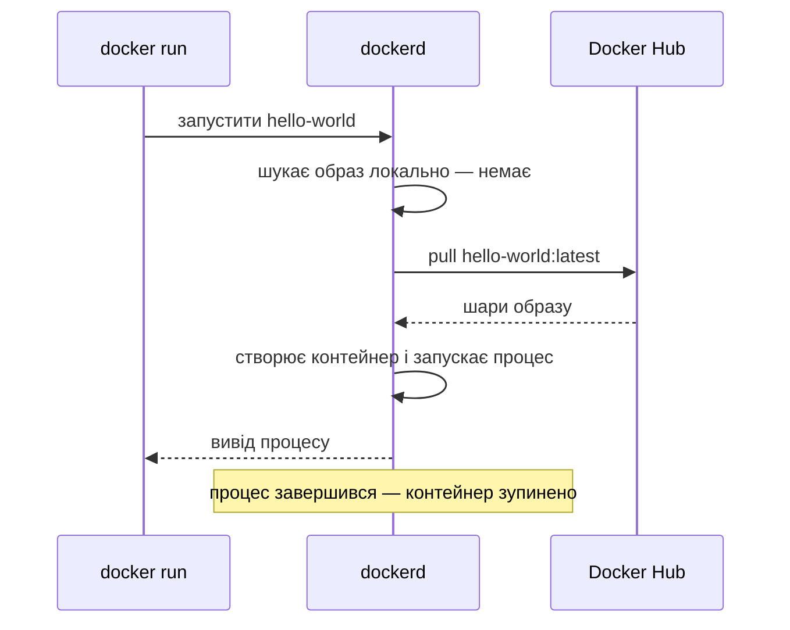

# 11. (Л) Віртуалізація і контейнеризація. Docker

## Зміст лекції

1. Проблема «у мене працює»
2. Віртуальні машини
3. Контейнери
4. Віртуальна машина чи контейнер
5. Docker: архітектура
6. Образ і контейнер
7. Шари образу
8. Реєстри образів: Docker Hub
9. Встановлення і перевірка
10. Перший контейнер: що відбувається
11. Ізоляція: що бачить процес у контейнері
12. Де використовують контейнери
13. Типові помилки

## Проблема «у мене працює»

Програма з лекцій 1–9 потребує конкретного набору: Python 3.12, бібліотеку `psycopg2-binary` певної версії, сервер PostgreSQL 15 з налаштованою базою. На компʼютері розробника все працює, а на сервері чи в колеги:

- інша версія Python — синтаксис `match` чи `X | None` не підтримується;
- не встановлено системну бібліотеку `libpq`;
- PostgreSQL 13 замість 15;
- інший шлях до файлів, інші змінні оточення.

Віртуальне середовище `venv` (лекція 31, 5 семестр) ізолює лише **пакети Python**. Потрібен спосіб упакувати програму **разом з усім оточенням** — інтерпретатором, системними бібліотеками, налаштуваннями — і запускати однаково будь-де.

## Віртуальні машини

**Віртуальна машина** (ВМ) імітує цілий компʼютер: процесор, памʼять, диск, мережеву карту. Програма-**гіпервізор** (VirtualBox, VMware, KVM, Hyper-V) запускає на одному фізичному сервері кілька ВМ, у кожній — власна повна операційна система.



Переваги — повна ізоляція і можливість запускати різні ОС. Недоліки — кожна ВМ займає гігабайти диска й памʼяті, завантажується хвилинами.

## Контейнери

**Контейнер** — ізольований процес (або група процесів), що працює на **спільному ядрі** операційної системи хоста. Контейнер має власну файлову систему, мережу, список процесів, але не має окремого ядра ОС. Ізоляцію забезпечують механізми ядра Linux:

- **namespaces** (простори імен) — процес бачить лише «свої» процеси, мережеві інтерфейси, файлову систему, імʼя хоста;
- **cgroups** (контрольні групи) — обмеження процесора, памʼяті, диска для групи процесів.



## Віртуальна машина чи контейнер

| | Віртуальна машина | Контейнер |
|---|---|---|
| що віртуалізує | обладнання | операційну систему |
| ядро ОС | власне в кожній ВМ | спільне з хостом |
| розмір | гігабайти | десятки–сотні мегабайтів |
| запуск | хвилини | секунди |
| ізоляція | сильніша | достатня для більшості задач |
| інша ОС (Windows на Linux) | так | ні — лише Linux-контейнери на Linux-ядрі |

На macOS Docker Desktop запускає невелику Linux-ВМ, а контейнери працюють усередині неї — тому контейнери з Linux-образами можна запускати й на Mac.

## Docker: архітектура

**Docker** — найпоширеніша платформа для створення й запуску контейнерів. Вона складається з кількох частин:



- **клієнт** `docker` — команди, які ви вводите в терміналі;
- **демон** `dockerd` — фоновий сервіс, що завантажує образи, створює й запускає контейнери;
- **реєстр** — сховище образів (Docker Hub, GitHub Container Registry).

## Образ і контейнер

Два найважливіші поняття Docker:

| | Образ (image) | Контейнер (container) |
|---|---|---|
| що це | шаблон: файлова система + налаштування запуску | запущений екземпляр образу |
| змінюється? | ні, лише для читання | так, має свій шар для запису |
| аналогія з ООП | клас | обʼєкт |
| команда створення | `docker build`, `docker pull` | `docker run` |
| приклад | `python:3.12-slim` | `petrenko-web` |

З одного образу можна запустити багато контейнерів — як з одного класу створюють багато обʼєктів (лекція 39, 5 семестр).

## Шари образу

Образ складається з **шарів** — незмінних наборів змін файлової системи. Кожна інструкція `Dockerfile` (лекція 12) додає шар:



Шари **спільні**: якщо десять образів побудовано на `python:3.12-slim`, базові шари зберігаються на диску один раз. Контейнер додає зверху тонкий шар для запису; після видалення контейнера цей шар зникає разом з усіма змінами (дані зберігають у томах — лекція 14).

## Реєстри образів: Docker Hub

**Docker Hub** (hub.docker.com) — публічний реєстр з тисячами образів. Повна назва образу:

```text
[registry/][namespace/]name[:tag]
docker.io/library/python:3.12-slim
```

| Частина | Приклад | Типово |
|---|---|---|
| реєстр | `docker.io`, `ghcr.io` | `docker.io` |
| простір імен | `library` (офіційні образи), `bitnami` | `library` |
| назва | `python`, `postgres`, `nginx` | — |
| тег | `3.12-slim`, `15`, `latest` | `latest` |

!!! warning "Вказуйте тег явно"
    Тег `latest` означає «остання версія на момент завантаження» — сьогодні це Python 3.12, через рік 3.14. Для відтворюваності вказуйте конкретний тег: `python:3.12-slim`, `postgres:15`. Користуйтеся **офіційними** образами (позначка *Docker Official Image*) або образами перевірених видавців: образ з Docker Hub — це чужий код, який виконуватиметься на вашому компʼютері.

Поширені варіанти тегів Python-образів:

| Тег | Розмір | Для чого |
|---|---|---|
| `python:3.12` | ~1 ГБ | повна система з компіляторами |
| `python:3.12-slim` | ~130 МБ | мінімальна Debian — типовий вибір |
| `python:3.12-alpine` | ~50 МБ | Alpine Linux; деякі пакети потребують компіляції |

## Встановлення і перевірка

Docker встановлюють за [офіційною інструкцією](https://docs.docker.com/get-started/get-docker/): на Linux — пакет Docker Engine, на macOS — Docker Desktop. Після встановлення на Linux додайте користувача до групи `docker`, щоб не писати `sudo` перед кожною командою:

```bash
sudo usermod -aG docker "$USER"
newgrp docker
docker --version
docker info --format '{{.ServerVersion}} {{.OperatingSystem}}'
```

```text
Docker version 27.3.1, build ce12230
27.3.1 Ubuntu 24.04.1 LTS
```

`docker --version` показує версію клієнта, `docker info` — що клієнт зміг зʼєднатися з демоном.

## Перший контейнер: що відбувається

```bash
docker run hello-world
```

```text
Unable to find image 'hello-world:latest' locally
latest: Pulling from library/hello-world
c1ec31eb5944: Pull complete
Status: Downloaded newer image for hello-world:latest

Hello from Docker!
This message shows that your installation appears to be working correctly.
...
```



Контейнер живе, доки працює його **головний процес**. Програма `hello-world` надрукувала повідомлення й завершилася — контейнер зупинився. Він лишився в списку `docker ps -a` зі статусом `Exited (0)`.

Запустимо Python у контейнері — не встановлюючи його на компʼютер:

```bash
docker run --rm python:3.12-slim python -c "import sys, platform; print(sys.version.split()[0], platform.system())"
```

```text
3.12.7 Linux
```

Ключ `--rm` видаляє контейнер одразу після завершення.

## Ізоляція: що бачить процес у контейнері

Запустимо інтерактивну оболонку в контейнері й подивимося навколо:

```bash
docker run --rm -it --hostname demo python:3.12-slim bash
```

```text
root@demo:/# hostname
demo
root@demo:/# ps aux
USER  PID %CPU %MEM    VSZ   RSS TTY  STAT START TIME COMMAND
root    1  0.0  0.0   4188  3456 pts/0 Ss  10:00 0:00 bash
root    7  0.0  0.0   8088  4096 pts/0 R+  10:00 0:00 ps aux
root@demo:/# ls /home
root@demo:/# exit
```

- власне імʼя хоста (namespace UTS);
- лише власні процеси, а `bash` має PID 1 (namespace PID);
- власна файлова система з образу: каталог `/home` порожній, файлів хоста не видно (namespace mount).

Ключі `-i` (interactive) і `-t` (tty) потрібні для інтерактивної роботи в терміналі.

## Де використовують контейнери

| Задача | Як допомагають контейнери |
|---|---|
| розробка | PostgreSQL, Redis, брокер повідомлень запускаються однією командою без встановлення (лекція 14) |
| тестування | чиста база для кожного запуску тестів; CI у GitHub Actions (лекція 28) |
| розгортання | той самий образ працює на ноутбуці й на сервері (лекція 30) |
| масштабування | оркестратори (Kubernetes) запускають десятки копій контейнера |
| навчання | однакове середовище в усіх студентів (dev container у VS Code) |

## Типові помилки

| Помилка | Чому погано | Як правильно |
|---|---|---|
| Плутають образ і контейнер | незрозуміло, що видаляти й перезапускати | образ — шаблон, контейнер — запущений екземпляр |
| Образ без тегу або з `latest` | інша версія при наступному завантаженні | конкретний тег `python:3.12-slim` |
| Образи невідомих авторів | чужий, неперевірений код | офіційні образи й перевірені видавці |
| Дані зберігають у контейнері | зникнуть після `docker rm` | томи (лекція 14) |
| Очікують, що контейнер «працює сам» | контейнер зупиняється, коли завершився головний процес | головний процес має працювати весь час (сервер) |
| `sudo docker` у кожній команді | незручно, файли належать root | група `docker` |
| Вважають контейнер повною ВМ | спільне ядро, інша модель безпеки | контейнер — ізольований процес |

## Підсумок

- **Віртуальна машина** імітує цілий компʼютер з власною ОС; **контейнер** — ізольований процес на спільному ядрі Linux (namespaces + cgroups).
- Контейнери легші й швидші за ВМ і розвʼязують проблему «у мене працює»: програма постачається разом з оточенням.
- **Docker** складається з клієнта `docker`, демона `dockerd` і реєстрів образів (Docker Hub).
- **Образ** — незмінний шаблон із шарів; **контейнер** — запущений екземпляр образу з власним шаром для запису.
- Контейнер живе, доки працює головний процес.
- Використовуйте офіційні образи з явним тегом.

## Корисні посилання

- [Docker — What is a container?](https://docs.docker.com/get-started/docker-concepts/the-basics/what-is-a-container/)
- [Docker — What is an image?](https://docs.docker.com/get-started/docker-concepts/the-basics/what-is-an-image/)
- [Docker — Get Docker](https://docs.docker.com/get-started/get-docker/)
- [Docker Hub — офіційний образ python](https://hub.docker.com/_/python)
- [Linux namespaces — man 7 namespaces](https://man7.org/linux/man-pages/man7/namespaces.7.html)
