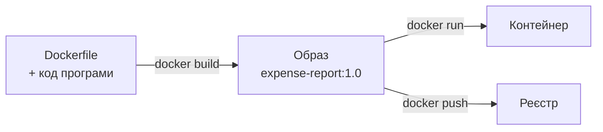
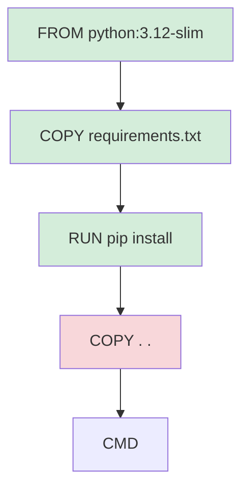

# 12. (Л) Створення та запуск Docker-контейнерів. Dockerfile

## Зміст лекції

1. Від готових образів до власних
2. Dockerfile: рецепт образу
3. Основні інструкції
4. Перший Dockerfile для Python-програми
5. `docker build` і контекст збирання
6. `.dockerignore`
7. Кешування шарів і порядок інструкцій
8. `CMD` і `ENTRYPOINT`
9. Змінні оточення й аргументи збирання
10. Безпека: користувач без прав root
11. Розмір образу
12. Теги та версії образу
13. Типові помилки

## Від готових образів до власних

У лекції 11 ми запускали готові образи: `hello-world`, `python:3.12-slim`. Щоб запускати в контейнері **власну** програму, треба створити образ, у якому є Python, потрібні бібліотеки і код програми. Такий образ описують текстовим файлом **Dockerfile**.

## Dockerfile: рецепт образу

**Dockerfile** — файл з інструкціями, які Docker виконує по черзі, щоб побудувати образ. Це «інфраструктура як код»: опис середовища зберігається в репозиторії поруч з програмою, і будь-хто може відтворити те саме середовище однією командою.



## Основні інструкції

| Інструкція | Що робить |
|---|---|
| `FROM image:tag` | базовий образ — з нього починається збирання |
| `WORKDIR /app` | робочий каталог для наступних інструкцій і для запуску |
| `COPY src dst` | копіює файли з контексту збирання в образ |
| `RUN command` | виконує команду під час **збирання** (встановлення пакетів) |
| `ENV NAME=value` | змінна оточення в образі та контейнері |
| `ARG NAME=value` | змінна, доступна лише під час збирання |
| `EXPOSE 8000` | документує порт, який слухає програма |
| `USER name` | від імені якого користувача виконувати наступне |
| `CMD ["cmd", "arg"]` | команда запуску контейнера за замовчуванням |
| `ENTRYPOINT ["cmd"]` | незмінна частина команди запуску |

## Перший Dockerfile для Python-програми

Програма, яку запакуємо, — звіт про витрати з файлу CSV:

```python
# File: report.py
import csv
import os
import sys
from collections import defaultdict
from pathlib import Path

DATA = Path(os.environ.get("DATA_FILE", Path(__file__).parent / "expenses.csv"))


def main() -> None:
    if not DATA.exists():
        sys.exit(f"error: data file not found: {DATA}")
    totals = defaultdict(float)
    with DATA.open(encoding="utf-8", newline="") as file:
        for row in csv.DictReader(file):
            totals[row["category"]] += float(row["amount"])
    owner = os.environ.get("REPORT_OWNER", "unknown")
    print(f"report for {owner}")
    for category, total in sorted(totals.items(), key=lambda item: -item[1]):
        print(f"  {category:<10} {total:>8.2f}")


if __name__ == "__main__":
    main()
```

Файл даних `expenses.csv` лежить поруч:

```text
date,category,amount
2026-09-21,food,85.50
2026-09-22,transport,30
2026-09-25,fun,315
2026-09-26,food,185
```

Dockerfile:

```dockerfile
# File: Dockerfile
FROM python:3.12-slim

WORKDIR /app

COPY report.py expenses.csv ./

ENV REPORT_OWNER="Ivan Petrenko"

CMD ["python", "report.py"]
```

Структура проєкту:

```text
expense-report/
  Dockerfile
  report.py
  expenses.csv
```

## `docker build` і контекст збирання

```bash
cd expense-report
docker build -t expense-report:1.0 .
docker images expense-report
docker run --rm expense-report:1.0
```

```text
[+] Building 6.2s (8/8) FINISHED
 => [internal] load build definition from Dockerfile
 => [1/3] FROM docker.io/library/python:3.12-slim
 => [2/3] WORKDIR /app
 => [3/3] COPY report.py expenses.csv ./
 => exporting to image
 => => naming to docker.io/library/expense-report:1.0
REPOSITORY       TAG   IMAGE ID       CREATED         SIZE
expense-report   1.0   3f1c2a9b7d10   5 seconds ago   130MB
report for Ivan Petrenko
  fun          315.00
  food         270.50
  transport     30.00
```

- `-t expense-report:1.0` — назва й тег образу;
- крапка `.` наприкінці — **контекст збирання**: каталог, вміст якого надсилається демону. `COPY` може копіювати лише файли з контексту.

## `.dockerignore`

Docker надсилає демону **весь** каталог контексту. Якщо там лежить віртуальне середовище, `.git` чи великі дані, збирання сповільнюється, а в образ можуть потрапити секрети. Файл `.dockerignore` виключає зайве — як `.gitignore`:

```text
# File: .dockerignore
.git
.venv
env
__pycache__
*.pyc
.env
tests
```

!!! danger "Секрети не потрапляють в образ"
    Файл `.env` з паролями, ключі SSH, токени **ніколи** не копіюють в образ: будь-хто, хто має образ, зможе їх прочитати командою `docker history` або розпакувавши шари. Секрети передають під час **запуску** контейнера змінними оточення (лекція 14).

## Кешування шарів і порядок інструкцій

Кожна інструкція створює шар, і Docker **кешує** шари. Якщо інструкція і файли, які вона використовує, не змінилися, шар береться з кешу. Але щойно один шар змінився — усі наступні збираються заново.

Тому інструкції впорядковують **від тих, що змінюються рідко, до тих, що часто**. Залежності змінюються рідше за код, тож спочатку копіюють `requirements.txt` і встановлюють пакети, а вже потім — код:

```dockerfile
# File: Dockerfile
FROM python:3.12-slim

WORKDIR /app

COPY requirements.txt .
RUN pip install --no-cache-dir -r requirements.txt

COPY . .

CMD ["python", "app.py"]
```



Файл `requirements.txt` лежить у корені проєкту поруч з Dockerfile. Програма `report.py` використовує лише стандартну бібліотеку, тому для неї він може бути порожнім, а для програм з лекцій 1–9 містить, наприклад, `psycopg2-binary==2.9.10`.

Після зміни `app.py` зелені шари беруться з кешу, і збирання триває секунди замість хвилини на встановлення пакетів.

| Порядок | Що станеться при зміні коду |
|---|---|
| `COPY . .`, потім `RUN pip install` | пакети перевстановлюються щоразу |
| `COPY requirements.txt`, `RUN pip install`, `COPY . .` | пакети з кешу |

## `CMD` і `ENTRYPOINT`

`CMD` задає команду за замовчуванням, яку можна замінити при запуску:

```bash
docker run --rm expense-report:1.0 python -c "print('other command')"
```

```text
other command
```

`ENTRYPOINT` задає незмінну частину команди, а `CMD` — аргументи за замовчуванням. Так контейнер поводиться як звичайна консольна програма:

```dockerfile
ENTRYPOINT ["python", "report.py"]
CMD ["--help"]
```

!!! tip "Exec-форма"
    Пишіть `CMD ["python", "app.py"]` (JSON-масив), а не `CMD python app.py`. У першому випадку Python стає процесом з PID 1 і отримує сигнал зупинки від `docker stop`. У другому команда запускається через `/bin/sh -c`, і сигнал отримує оболонка, а не програма.

## Змінні оточення й аргументи збирання

`ENV` задає значення за замовчуванням, які можна перевизначити при запуску ключем `-e`:

```bash
docker run --rm -e REPORT_OWNER="Olena Kovalenko" expense-report:1.0
```

```text
report for Olena Kovalenko
  fun          315.00
  food         270.50
  transport     30.00
```

Корисні змінні для Python-образів:

```dockerfile
ENV PYTHONDONTWRITEBYTECODE=1 \
    PYTHONUNBUFFERED=1
```

- `PYTHONDONTWRITEBYTECODE=1` — не створювати файли `.pyc`;
- `PYTHONUNBUFFERED=1` — виводити `print` одразу, без буфера; інакше `docker logs` показує вивід із затримкою.

`ARG` діє лише під час збирання — наприклад, щоб обрати версію Python: `docker build --build-arg PYTHON_VERSION=3.13 .`

```dockerfile
ARG PYTHON_VERSION=3.12
FROM python:${PYTHON_VERSION}-slim
```

## Безпека: користувач без прав root

За замовчуванням процес у контейнері працює від імені `root`. Якщо в програмі є вразливість, зловмисник отримає права root усередині контейнера — і більше можливостей для атаки на хост. Тому в образі створюють звичайного користувача:

```dockerfile
# File: Dockerfile
FROM python:3.12-slim

ENV PYTHONDONTWRITEBYTECODE=1 \
    PYTHONUNBUFFERED=1

WORKDIR /app

COPY requirements.txt .
RUN pip install --no-cache-dir -r requirements.txt

RUN useradd --create-home --uid 1000 appuser
COPY --chown=appuser:appuser . .
USER appuser

CMD ["python", "report.py"]
```

```bash
docker build -t expense-report:1.1 .
docker run --rm expense-report:1.1 whoami
```

```text
appuser
```

## Розмір образу

| Прийом | Ефект |
|---|---|
| базовий образ `-slim` | ~130 МБ замість ~1 ГБ |
| `pip install --no-cache-dir` | не зберігає кеш завантажених пакетів |
| `.dockerignore` | у шари не потрапляє зайве |
| кілька команд в одному `RUN` з очищенням | тимчасові файли не лишаються в шарі |

```dockerfile
RUN apt-get update \
    && apt-get install -y --no-install-recommends curl \
    && rm -rf /var/lib/apt/lists/*
```

Шар зберігає стан файлової системи **після** інструкції. Якщо видалити файли окремою інструкцією `RUN rm`, вони залишаться в попередньому шарі й займатимуть місце.

Історію шарів і їхні розміри показує `docker history`:

```bash
docker history expense-report:1.1 --format "{{.Size}}\t{{.CreatedBy}}" | head -5
```

```text
0B      CMD ["python" "report.py"]
0B      USER appuser
4.1kB   COPY . . # buildkit
360kB   RUN /bin/sh -c useradd --create-home --uid 1000 appuser
12.3MB  RUN /bin/sh -c pip install --no-cache-dir -r requirements.txt
```

## Теги та версії образу

Один образ може мати кілька тегів. Типова схема — конкретна версія плюс рухомий тег:

```bash
docker tag expense-report:1.1 expense-report:latest
docker images expense-report
```

```text
REPOSITORY       TAG      IMAGE ID       CREATED          SIZE
expense-report   1.1      8a2e4c1f0b33   2 minutes ago    143MB
expense-report   latest   8a2e4c1f0b33   2 minutes ago    143MB
expense-report   1.0      3f1c2a9b7d10   10 minutes ago   130MB
```

Однаковий `IMAGE ID` показує, що `1.1` і `latest` — той самий образ під двома назвами. Щоб опублікувати образ, його позначають тегом з назвою реєстру й простором імен (`ghcr.io/petrenko/expense-report:1.1`) і виконують `docker push`.

## Типові помилки

| Помилка | Чому погано | Як правильно |
|---|---|---|
| `COPY . .` перед `pip install` | пакети перевстановлюються при кожній зміні коду | спочатку `requirements.txt` |
| Немає `.dockerignore` | у контексті `.venv`, `.git`, секрети | `.dockerignore` |
| Паролі в `ENV` чи у файлах образу | їх видно в `docker history` | змінні оточення при запуску |
| `CMD python app.py` (shell-форма) | програма не отримує сигнал зупинки | `CMD ["python", "app.py"]` |
| Процес працює від `root` | більший ризик при вразливості | `USER appuser` |
| `RUN rm` окремою інструкцією | файли лишаються в попередньому шарі | очищення в тому самому `RUN` |
| `print` не видно в `docker logs` | буферизація виводу | `PYTHONUNBUFFERED=1` |
| `FROM python` без тегу | інша версія при наступному збиранні | `FROM python:3.12-slim` |

## Підсумок

- **Dockerfile** описує, як побудувати образ: базовий образ, файли, команди встановлення, команда запуску.
- Основні інструкції: `FROM`, `WORKDIR`, `COPY`, `RUN`, `ENV`, `USER`, `CMD`, `ENTRYPOINT`.
- `docker build -t name:tag .` збирає образ з контексту; `.dockerignore` виключає зайве.
- Шари кешуються: залежності встановлюють **до** копіювання коду.
- `CMD` — команда за замовчуванням, `ENTRYPOINT` — незмінна частина; використовуйте exec-форму.
- Безпечний образ: офіційна база `-slim`, користувач без root, жодних секретів у шарах.

## Корисні посилання

- [Dockerfile reference](https://docs.docker.com/reference/dockerfile/)
- [Docker — Building best practices](https://docs.docker.com/build/building/best-practices/)
- [Docker — Build cache](https://docs.docker.com/build/cache/)
- [Docker — .dockerignore](https://docs.docker.com/build/concepts/context/#dockerignore-files)
- [Docker Hub — офіційний образ python](https://hub.docker.com/_/python)
