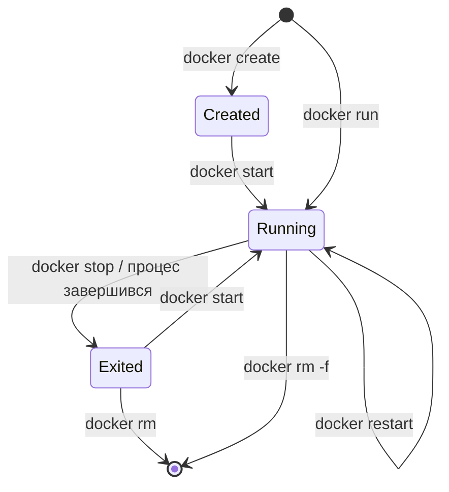

# 14. (Л) Керування Docker-контейнерами. PostgreSQL у контейнері

## Зміст лекції

1. Життєвий цикл контейнера
2. `docker run`: найважливіші параметри
3. Перегляд контейнерів: `ps`, `inspect`
4. Журнали: `docker logs`
5. Команди в працюючому контейнері: `docker exec`
6. Зупинка, перезапуск, видалення
7. Перенаправлення портів
8. Збереження даних: томи і bind mount
9. PostgreSQL у контейнері
10. Ініціалізація бази скриптами
11. Підключення з Python
12. Резервна копія і відновлення
13. Docker Compose: кілька контейнерів одним файлом
14. Прибирання: образи, контейнери, томи
15. Типові помилки

## Життєвий цикл контейнера

У лекціях 11–12 ми запускали контейнери, які виконували одну дію і завершувалися. Сервіси — вебсервер, база даних — працюють **довго**, тому ними треба керувати: запускати у фоні, дивитися журнали, зупиняти, оновлювати.



| Команда | Дія |
|---|---|
| `docker run` | створити й запустити контейнер з образу |
| `docker ps` / `docker ps -a` | працюючі / усі контейнери |
| `docker logs` | вивід головного процесу |
| `docker exec` | виконати команду в працюючому контейнері |
| `docker stop` / `docker start` | зупинити / запустити знову |
| `docker rm` | видалити зупинений контейнер |

## `docker run`: найважливіші параметри

| Параметр | Значення |
|---|---|
| `-d` | у фоні (detached), термінал звільняється |
| `--name petrenko-db` | власна назва замість випадкової |
| `-p 8080:80` | перенаправити порт хоста `8080` на порт контейнера `80` |
| `-e NAME=value` | змінна оточення |
| `--env-file .env` | змінні оточення з файлу |
| `-v name:/path` | підключити том або каталог |
| `--rm` | видалити контейнер після зупинки |
| `--restart unless-stopped` | перезапускати після збою або перезавантаження |
| `-it` | інтерактивний режим з терміналом |

```bash
docker run -d --name petrenko-web -p 8080:80 nginx:1.27
```

```text
4b2c9e7a1f30d8c6e2b5a9f7c1d3e8b0a6f4c2e9d7b5a3f1e8c6d4b2a0f9e7c5
```

У фоновому режимі `docker run` друкує лише ідентифікатор нового контейнера. Відкрийте `http://localhost:8080` — зʼявиться стартова сторінка nginx.

## Перегляд контейнерів: `ps`, `inspect`

```bash
docker ps
```

```text
CONTAINER ID   IMAGE        COMMAND                  CREATED          STATUS          PORTS                  NAMES
4b2c9e7a1f30   nginx:1.27   "/docker-entrypoint.…"   10 seconds ago   Up 9 seconds    0.0.0.0:8080->80/tcp   petrenko-web
```

`docker inspect` показує всі налаштування контейнера у JSON. Ключ `--format` витягує окреме поле:

```bash
docker inspect --format '{{.State.Status}} {{.NetworkSettings.IPAddress}}' petrenko-web
```

```text
running 172.17.0.2
```

## Журнали: `docker logs`

Усе, що головний процес виводить у stdout і stderr, Docker зберігає в журналі контейнера. Тому програма в контейнері пише журнал **у консоль**, а не у файл (модуль `logging`, лекція 26, 5 семестр):

```bash
curl -s -o /dev/null http://localhost:8080
docker logs --tail 2 petrenko-web
```

```text
2026/10/20 10:00:01 [notice] 1#1: start worker processes
172.17.0.1 - - [20/Oct/2026:10:00:15 +0000] "GET / HTTP/1.1" 200 615 "-" "curl/8.5.0" "-"
```

| Ключ | Значення |
|---|---|
| `-f` | стежити за новими рядками (як `tail -f`), вихід — Ctrl+C |
| `--tail 20` | лише останні 20 рядків |
| `--since 10m` | рядки за останні 10 хвилин |
| `-t` | додати час кожного рядка |

## Команди в працюючому контейнері: `docker exec`

`docker exec` запускає **додатковий** процес у вже працюючому контейнері — для діагностики або адміністрування:

```bash
docker exec petrenko-web nginx -v
docker exec -it petrenko-web bash
```

```text
nginx version: nginx/1.27.2
root@4b2c9e7a1f30:/# ls /usr/share/nginx/html
50x.html  index.html
root@4b2c9e7a1f30:/# exit
```

!!! warning "Зміни всередині контейнера тимчасові"
    Файл, змінений через `docker exec`, існує лише в шарі для запису **цього** контейнера. Новий контейнер з того самого образу його не матиме. Постійні зміни вносять у Dockerfile (лекція 12), а дані зберігають у томах.

## Зупинка, перезапуск, видалення

```bash
docker stop petrenko-web
docker ps -a --filter name=petrenko
docker start petrenko-web
docker rm -f petrenko-web
```

```text
petrenko-web
CONTAINER ID   IMAGE        COMMAND                  CREATED         STATUS                     PORTS   NAMES
4b2c9e7a1f30   nginx:1.27   "/docker-entrypoint.…"   5 minutes ago   Exited (0) 2 seconds ago           petrenko-web
petrenko-web
petrenko-web
```

`docker stop` надсилає головному процесу сигнал `SIGTERM` і чекає до 10 секунд, щоб програма завершилася коректно (закрила підключення, дописала файли). Якщо процес не завершився, Docker надсилає `SIGKILL`. Python-програма може обробити `SIGTERM`, щоб завершити роботу акуратно:

```python
# Program: graceful shutdown on SIGTERM (as sent by docker stop)
import os
import signal
import threading
import time

stop = threading.Event()


def on_sigterm(signum, frame):
    print("got SIGTERM, finishing current job")
    stop.set()


signal.signal(signal.SIGTERM, on_sigterm)
# Для демонстрації програма сама собі надсилає сигнал через 0.3 с
threading.Timer(0.3, os.kill, (os.getpid(), signal.SIGTERM)).start()

jobs = 0
while not stop.is_set():
    jobs += 1
    time.sleep(0.1)
print(f"done {jobs} jobs, closing connections")
```

```text
got SIGTERM, finishing current job
done 3 jobs, closing connections
```

## Перенаправлення портів

Контейнер має власну мережу, і його порти **не доступні** з хоста, доки їх не опубліковано параметром `-p ПОРТ_ХОСТА:ПОРТ_КОНТЕЙНЕРА`:


- порт контейнера визначає програма всередині (PostgreSQL завжди слухає `5432`);
- порт хоста обираєте ви; якщо на компʼютері вже працює PostgreSQL на `5432`, використовують інший — `-p 5433:5432`;
- `-p 127.0.0.1:5433:5432` відкриває порт лише для цього компʼютера, а не для всієї мережі. Для бази даних це безпечніший вибір.

## Збереження даних: томи і bind mount

Шар запису контейнера зникає разом з контейнером. Дані, що мають пережити видалення, зберігають **поза** контейнером:

| | Іменований том | Bind mount |
|---|---|---|
| синтаксис | `-v pgdata:/var/lib/postgresql/data` | `-v "$(pwd)/init:/docker-entrypoint-initdb.d"` |
| де дані | сховище Docker | вказаний каталог хоста |
| керування | `docker volume ls/rm/inspect` | звичайні команди файлової системи |
| типове використання | дані бази | код, конфігурація, скрипти ініціалізації |

```bash
docker volume create petrenko-pgdata
docker volume ls
```

```text
petrenko-pgdata
DRIVER    VOLUME NAME
local     petrenko-pgdata
```

## PostgreSQL у контейнері

Офіційний образ `postgres` налаштовується змінними оточення:

| Змінна | Значення |
|---|---|
| `POSTGRES_PASSWORD` | пароль користувача `postgres` (обовʼязкова) |
| `POSTGRES_USER` | імʼя користувача, типово `postgres` |
| `POSTGRES_DB` | база, що створюється при першому запуску |

Пароль не пишуть у команді, яка потрапить в історію оболонки чи в репозиторій. Його зберігають у файлі `.env`, доданому до `.gitignore`:

```text
# File: .env
POSTGRES_PASSWORD=secret
POSTGRES_DB=expenses_petrenko
```

```bash
docker run -d --name petrenko-db \
  --env-file .env \
  -p 127.0.0.1:5433:5432 \
  -v petrenko-pgdata:/var/lib/postgresql/data \
  postgres:15
docker logs petrenko-db 2>&1 | tail -1
```

```text
2026-10-20 10:05:12.345 UTC [1] LOG:  database system is ready to accept connections
```

Підключення через `psql`, що є всередині контейнера:

```bash
docker exec -it petrenko-db psql -U postgres -d expenses_petrenko -c "SELECT version()"
```

```text
                                         version
------------------------------------------------------------------------------------------
 PostgreSQL 15.10 (Debian 15.10-1.pgdg120+1) on x86_64-pc-linux-gnu, compiled by gcc ...
(1 row)
```

## Ініціалізація бази скриптами

Під час **першого** запуску (коли каталог даних порожній) образ `postgres` виконує в алфавітному порядку файли `*.sql` і `*.sh` з каталогу `/docker-entrypoint-initdb.d`:

```text
init/
  01_schema.sql
  02_data.sql
```

```sql
-- File: init/01_schema.sql
CREATE TABLE expenses (
    id INTEGER GENERATED ALWAYS AS IDENTITY PRIMARY KEY,
    spent_on DATE NOT NULL,
    category TEXT NOT NULL,
    amount NUMERIC(10, 2) NOT NULL CHECK (amount > 0)
);
```

```sql
-- File: init/02_data.sql
INSERT INTO expenses (spent_on, category, amount) VALUES
    ('2026-09-21', 'food', 85.50),
    ('2026-09-22', 'transport', 30.00),
    ('2026-09-25', 'fun', 315.00);
```

```bash
docker rm -f petrenko-db
docker volume rm petrenko-pgdata
docker run -d --name petrenko-db --env-file .env -p 127.0.0.1:5433:5432 \
  -v petrenko-pgdata:/var/lib/postgresql/data \
  -v "$(pwd)/init:/docker-entrypoint-initdb.d:ro" \
  postgres:15
```

Суфікс `:ro` підключає каталог лише для читання. Якщо том уже містить базу, скрипти **не виконуються** — інакше кожен перезапуск дублював би дані. Щоб повторити ініціалізацію, видаляють том.

## Підключення з Python

Для програми з хоста база в контейнері — звичайний сервер PostgreSQL на `localhost:5433`. Код з лекцій 3–9 не змінюється, змінюються лише параметри підключення:

```python
# Program: connect to PostgreSQL running in a container
import os

import psycopg2

conn = psycopg2.connect(
    host=os.environ.get("PGHOST", "localhost"),
    port=os.environ.get("PGPORT", "5433"),
    dbname=os.environ.get("PGDATABASE", "expenses_petrenko"),
    user=os.environ.get("PGUSER", "postgres"),
    password=os.environ["PGPASSWORD"],
    connect_timeout=5,
)
with conn, conn.cursor() as cur:
    cur.execute("SELECT category, SUM(amount) FROM expenses GROUP BY category ORDER BY 2 DESC")
    for category, total in cur:
        print(f"{category:<10} {total:>8}")
conn.close()
```

```text
fun          315.00
food          85.50
transport     30.00
```

```bash
export PGPASSWORD=secret
python3 report_docker.py
```

Контейнер готовий приймати підключення не одразу після `docker run`: PostgreSQL кілька секунд ініціалізує базу. Якщо програма стартує одночасно з контейнером, вона має кілька разів повторити спробу підключення:

```python
# Program: wait until the database accepts connections
import os
import time

import psycopg2


def connect_with_retry(attempts: int = 10, delay: float = 1.0):
    for attempt in range(1, attempts + 1):
        try:
            return psycopg2.connect(host="localhost", port=os.environ.get("PGPORT", "5433"), dbname="postgres",
                                    user="postgres", password=os.environ["PGPASSWORD"], connect_timeout=2)
        except psycopg2.OperationalError:
            print(f"attempt {attempt}: database is not ready")
            time.sleep(delay)
    raise SystemExit("error: database is not available")


conn = connect_with_retry()
print("connected")
conn.close()
```

```text
attempt 1: database is not ready
attempt 2: database is not ready
connected
```

## Резервна копія і відновлення

Утиліта `pg_dump` уже є в контейнері. Її вивід перенаправляють у файл на хості:

```bash
docker exec petrenko-db pg_dump -U postgres expenses_petrenko > backup.sql
docker exec petrenko-db psql -U postgres -d expenses_petrenko -c "DROP TABLE expenses"
docker exec -i petrenko-db psql -U postgres -d expenses_petrenko < backup.sql
docker exec petrenko-db psql -U postgres -d expenses_petrenko -tc "SELECT COUNT(*) FROM expenses"
```

```text
DROP TABLE
...
CREATE TABLE
COPY 3
...
     3
```

Для `psql < backup.sql` потрібен ключ `-i`: він передає stdin хоста в контейнер. Ключ `-t` тут не потрібен — термінала немає, дані йдуть з файлу.

## Docker Compose: кілька контейнерів одним файлом

Довгі команди `docker run` важко запамʼятати й повторити. **Docker Compose** описує контейнери, томи й мережі у файлі `compose.yaml` і запускає все однією командою:

```yaml
# File: compose.yaml
services:
  db:
    image: postgres:15
    env_file: .env
    ports:
      - "127.0.0.1:5433:5432"
    volumes:
      - pgdata:/var/lib/postgresql/data
      - ./init:/docker-entrypoint-initdb.d:ro
    healthcheck:
      test: ["CMD-SHELL", "pg_isready -U postgres"]
      interval: 2s
      retries: 10

volumes:
  pgdata:
```

```bash
docker compose up -d
docker compose ps
docker compose logs db --tail 1
docker compose down
```

```text
[+] Running 3/3
 ✔ Network expense-report_default  Created
 ✔ Volume "expense-report_pgdata"  Created
 ✔ Container expense-report-db-1   Started
NAME                  IMAGE         SERVICE   STATUS                    PORTS
expense-report-db-1   postgres:15   db        Up 5 seconds (healthy)    127.0.0.1:5433->5432/tcp
db-1  | 2026-10-20 10:10:03.120 UTC [1] LOG:  database system is ready to accept connections
[+] Running 2/2
 ✔ Container expense-report-db-1   Removed
 ✔ Network expense-report_default  Removed
```

`docker compose down` видаляє контейнери й мережу, але **зберігає** том. Щоб видалити й дані, додають `-v`. У лекції 30 до цього файлу додамо сервіс з Flask-застосунком.

## Прибирання: образи, контейнери, томи

Зупинені контейнери, старі образи й невикористані томи займають місце на диску:

```bash
docker system df
docker container prune -f
docker image prune -f
```

```text
TYPE            TOTAL     ACTIVE    SIZE      RECLAIMABLE
Images          6         2         1.21GB    842MB (69%)
Containers      4         1         12kB      8kB (66%)
Local Volumes   2         1         48MB      0B (0%)
Build Cache     21        0         96MB      96MB
Deleted Containers:
...
Total reclaimed space: 842MB
```

!!! danger "Обережно з томами"
    `docker volume prune` і `docker compose down -v` видаляють томи **разом з даними бази**. Перед цим зробіть резервну копію.

## Типові помилки

| Помилка | Чому погано | Як правильно |
|---|---|---|
| База в контейнері без тому | дані зникають після `docker rm` | `-v pgdata:/var/lib/postgresql/data` |
| Пароль у команді `docker run -e` | залишається в історії оболонки, потрапляє в документацію | `--env-file .env` у `.gitignore` |
| `-p 5432:5432` при працюючому локальному PostgreSQL | `port is already allocated` | інший порт хоста `5433` |
| Порт бази відкрито для всієї мережі | доступ ззовні | `-p 127.0.0.1:5433:5432` |
| Скрипти init не виконалися | том уже містить базу | видалити том і запустити знову |
| Програма падає, бо база ще стартує | гонка під час запуску | повторні спроби, `healthcheck` |
| Зміни через `docker exec` вважають постійними | новий контейнер їх не має | Dockerfile і томи |
| `docker compose down -v` без копії | втрачено дані | `pg_dump` перед видаленням |

## Підсумок

- Контейнер проходить стани `Created → Running → Exited → видалений`; ними керують `run`, `stop`, `start`, `rm`.
- `docker ps`, `logs`, `exec`, `inspect` — основні засоби спостереження й діагностики.
- `-p хост:контейнер` публікує порт; для бази — лише на `127.0.0.1`.
- Дані, що мають пережити контейнер, зберігають у **томах**; bind mount підключає каталог хоста.
- Образ `postgres` налаштовується змінними `POSTGRES_*` і скриптами з `/docker-entrypoint-initdb.d`.
- Python-програма підключається до бази в контейнері як до звичайного сервера; варто передбачити повторні спроби.
- **Docker Compose** описує всі сервіси одним файлом і запускає їх командою `docker compose up`.

## Корисні посилання

- [Docker CLI — docker container run](https://docs.docker.com/reference/cli/docker/container/run/)
- [Docker — Volumes](https://docs.docker.com/engine/storage/volumes/)
- [Docker Hub — офіційний образ postgres](https://hub.docker.com/_/postgres)
- [Docker Compose — Quickstart](https://docs.docker.com/compose/gettingstarted/)
- [PostgreSQL — pg_dump](https://www.postgresql.org/docs/current/app-pgdump.html)
