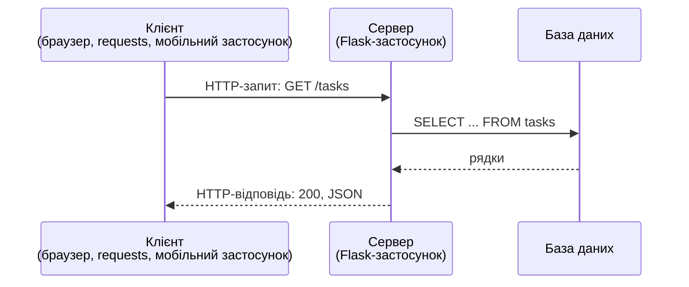
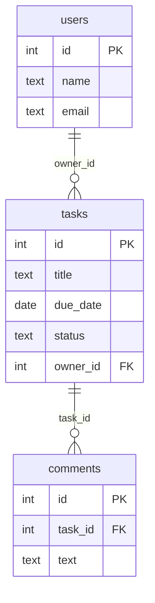

# 16. (Л) Основи HTTP та REST

## Зміст лекції

1. Клієнт і сервер у вебі
2. Протокол HTTP: запит і відповідь
3. URL: з чого складається адреса
4. Методи HTTP
5. Коди стану
6. Заголовки
7. Тіло запиту й відповіді: JSON
8. HTTP «вручну»: сервер і клієнт на Python
9. Архітектурний стиль REST
10. Ресурси та URL
11. Проєктування API системи задач
12. Безпечність та ідемпотентність методів
13. Версіонування і документування API
14. Типові помилки

## Клієнт і сервер у вебі

У лекції 37 (5 семестр) ми були **клієнтом**: бібліотека `requests` надсилала запити до API Національного банку. У цьому модулі станемо по інший бік — напишемо **сервер**, що надає власне API для системи керування навчальними задачами.



Клієнт завжди **ініціює** обмін, сервер лише **відповідає**. Сервер не знає, хто клієнт — браузер, скрипт чи інший сервер: усіх обʼєднує спільна мова, протокол HTTP.

## Протокол HTTP: запит і відповідь

**HTTP** (HyperText Transfer Protocol) — текстовий протокол прикладного рівня. Повідомлення складається з трьох частин: стартового рядка, заголовків і необовʼязкового тіла, відокремленого порожнім рядком.

Запит:

```text
POST /api/v1/tasks HTTP/1.1
Host: localhost:5000
Content-Type: application/json
Content-Length: 46

{"title": "Lab 8", "due_date": "2026-11-02"}
```

Відповідь:

```text
HTTP/1.1 201 CREATED
Content-Type: application/json
Location: /api/v1/tasks/7
Content-Length: 78

{"id": 7, "title": "Lab 8", "due_date": "2026-11-02", "status": "todo"}
```

| Частина | У запиті | У відповіді |
|---|---|---|
| стартовий рядок | метод, шлях, версія | версія, код стану, пояснення |
| заголовки | `Host`, `Content-Type`, `Authorization`, ... | `Content-Type`, `Location`, `Set-Cookie`, ... |
| тіло | дані для сервера (JSON, форма) | результат (JSON, HTML, файл) |

HTTP **не зберігає стану** (stateless): кожен запит самодостатній, сервер не «памʼятає» попередніх. Як памʼятати користувача між запитами — тема лекції 24.

## URL: з чого складається адреса

```text
https://api.example.com:443/api/v1/tasks?status=todo&page=2#top
└─┬─┘   └──────┬──────┘ └┬┘└─────┬─────┘ └───────┬───────┘ └┬┘
схема        хост      порт    шлях          параметри    фрагмент
```

Розібрати URL на частини можна модулем `urllib.parse`:

```python
# Program: split a URL into parts
from urllib.parse import parse_qs, urlsplit

url = "https://api.example.com:443/api/v1/tasks?status=todo&page=2#top"
parts = urlsplit(url)
print(parts.scheme, parts.hostname, parts.port)
print(parts.path)
print(parse_qs(parts.query))
```

```text
https api.example.com 443
/api/v1/tasks
{'status': ['todo'], 'page': ['2']}
```

- **шлях** визначає, *який ресурс* потрібен (`/api/v1/tasks/7`);
- **параметри запиту** (query string) уточнюють запит: фільтр, сортування, сторінка (`?status=todo&page=2`).

## Методи HTTP

Метод показує, **що зробити** з ресурсом:

| Метод | Дія | Тіло запиту | Приклад |
|---|---|---|---|
| `GET` | отримати | немає | `GET /tasks/7` |
| `POST` | створити новий ресурс | є | `POST /tasks` |
| `PUT` | замінити ресурс повністю | є | `PUT /tasks/7` |
| `PATCH` | змінити частину полів | є | `PATCH /tasks/7` `{"status": "done"}` |
| `DELETE` | видалити | немає | `DELETE /tasks/7` |

Ці пʼять методів відповідають операціям **CRUD** (Create, Read, Update, Delete), які ми виконували SQL-командами в модулі 1:

| CRUD | HTTP | SQL |
|---|---|---|
| Create | `POST` | `INSERT` |
| Read | `GET` | `SELECT` |
| Update | `PUT` / `PATCH` | `UPDATE` |
| Delete | `DELETE` | `DELETE` |

## Коди стану

Код стану — тризначне число, що коротко повідомляє результат. Перша цифра визначає клас:

| Клас | Значення | Часті коди |
|---|---|---|
| `1xx` | інформаційні | рідко трапляються в API |
| `2xx` | успіх | `200 OK`, `201 Created`, `204 No Content` |
| `3xx` | перенаправлення | `301 Moved Permanently`, `304 Not Modified` |
| `4xx` | помилка **клієнта** | `400 Bad Request`, `401 Unauthorized`, `403 Forbidden`, `404 Not Found`, `409 Conflict`, `422 Unprocessable Content` |
| `5xx` | помилка **сервера** | `500 Internal Server Error`, `503 Service Unavailable` |

Стандартна бібліотека містить усі коди в переліку `http.HTTPStatus`:

```python
# Program: HTTP status codes from the standard library
from http import HTTPStatus

for code in (200, 201, 204, 400, 401, 404, 409, 500):
    status = HTTPStatus(code)
    print(code, status.phrase)
print(HTTPStatus.NOT_FOUND.value, HTTPStatus.NOT_FOUND.description)
```

```text
200 OK
201 Created
204 No Content
400 Bad Request
401 Unauthorized
404 Not Found
409 Conflict
500 Internal Server Error
404 Nothing matches the given URI
```

!!! tip "Як обрати код"
    `4xx` означає «клієнте, виправ запит»: неправильні дані, немає доступу, немає ресурсу. `5xx` означає «проблема на сервері, запит, можливо, був правильний». Якщо ваш сервер відповідає `500` на неправильні дані користувача — це помилка в сервері: такі дані треба перевіряти і відповідати `400`.

## Заголовки

| Заголовок | Напрям | Значення |
|---|---|---|
| `Host` | запит | імʼя сервера (на одній IP-адресі може бути багато сайтів) |
| `Content-Type` | обидва | формат тіла: `application/json`, `text/html; charset=utf-8` |
| `Accept` | запит | які формати відповіді прийме клієнт |
| `Authorization` | запит | облікові дані: `Bearer <token>` |
| `Location` | відповідь | адреса створеного ресурсу (з кодом `201`) |
| `Set-Cookie` / `Cookie` | відповідь / запит | cookie (лекція 24) |

## Тіло запиту й відповіді: JSON

Для API найпоширеніший формат тіла — **JSON** (лекція 35, 5 семестр). Сервер позначає його заголовком `Content-Type: application/json`. Помилки теж повертають у JSON — в одному форматі для всього API:

```json
{
  "error": "validation_failed",
  "message": "field 'title' is required",
  "fields": {"title": "required"}
}
```

## HTTP «вручну»: сервер і клієнт на Python

Щоб побачити HTTP без бібліотек-«обгорток», запустимо найпростіший сервер зі стандартної бібліотеки (`http.server`) і звернемося до нього клієнтом `urllib`:

```python
# Program: a tiny HTTP server and a client in one script
import json
import threading
import urllib.error
import urllib.request
from http.server import BaseHTTPRequestHandler, HTTPServer

TASKS = {1: {"id": 1, "title": "Lab 8", "status": "todo"}}


class Handler(BaseHTTPRequestHandler):
    def do_GET(self):
        if self.path == "/tasks":
            self.send_json(200, list(TASKS.values()))
        else:
            self.send_json(404, {"error": "not_found", "path": self.path})

    def send_json(self, status, data):
        body = json.dumps(data).encode("utf-8")
        self.send_response(status)
        self.send_header("Content-Type", "application/json")
        self.send_header("Content-Length", str(len(body)))
        self.end_headers()
        self.wfile.write(body)

    def log_message(self, format, *args):
        pass  # не друкувати журнал запитів у консоль


server = HTTPServer(("127.0.0.1", 0), Handler)  # порт 0 — будь-який вільний
threading.Thread(target=server.serve_forever, daemon=True).start()
base = f"http://127.0.0.1:{server.server_port}"

with urllib.request.urlopen(base + "/tasks") as response:
    print(response.status, response.headers["Content-Type"])
    print(json.load(response))

try:
    urllib.request.urlopen(base + "/users")
except urllib.error.HTTPError as error:
    print(error.code, json.load(error))
server.shutdown()
```

```text
200 application/json
[{'id': 1, 'title': 'Lab 8', 'status': 'todo'}]
404 {'error': 'not_found', 'path': '/users'}
```

Сервер сам розбирає шлях, обирає відповідь, формує заголовки й тіло. Для справжнього API це забагато ручної роботи: маршрути з параметрами, розбір JSON, помилки, тести. Цю роботу бере на себе **вебфреймворк** Flask (лекція 18).

## Архітектурний стиль REST

**REST** (Representational State Transfer) — набір принципів побудови API поверх HTTP, описаний Роєм Філдінгом у 2000 році. Основні з них:

| Принцип | Що означає на практиці |
|---|---|
| клієнт-сервер | клієнт і сервер розвиваються незалежно, спілкуються лише через API |
| відсутність стану | кожен запит містить усе потрібне (зокрема токен доступу) |
| єдиний інтерфейс | ресурси мають URL, дії виражаються методами HTTP |
| представлення | клієнт отримує не сам ресурс, а його представлення (JSON) |
| кешування | відповіді `GET` можна кешувати, якщо сервер це дозволяє |

API, що дотримується цих принципів, називають **RESTful**.

## Ресурси та URL

**Ресурс** — будь-яка сутність, з якою працює API: задача, користувач, коментар. URL називає ресурс **іменником у множині**, а дію задає метод:

| Добре (REST) | Погано |
|---|---|
| `GET /tasks` | `GET /getAllTasks` |
| `POST /tasks` | `POST /createTask` |
| `GET /tasks/7` | `GET /task?id=7` |
| `PATCH /tasks/7` | `POST /tasks/7/update` |
| `DELETE /tasks/7` | `GET /deleteTask/7` |
| `GET /tasks/7/comments` | `GET /commentsForTask?task=7` |
| `GET /tasks?status=done` | `GET /doneTasks` |

Вкладений URL (`/tasks/7/comments`) показує звʼязок «коментарі належать задачі».

## Проєктування API системи задач

У роботах П8–П15 ви створите API системи керування навчальними задачами. Його ресурси:



| Метод | URL | Дія | Успіх | Помилки |
|---|---|---|---|---|
| `GET` | `/api/v1/tasks` | список задач (фільтр `?status=`) | `200` | `400` |
| `POST` | `/api/v1/tasks` | створити задачу | `201` + `Location` | `400`, `422` |
| `GET` | `/api/v1/tasks/<id>` | одна задача | `200` | `404` |
| `PATCH` | `/api/v1/tasks/<id>` | змінити поля | `200` | `400`, `404` |
| `DELETE` | `/api/v1/tasks/<id>` | видалити | `204` | `404` |
| `GET` | `/api/v1/tasks/<id>/comments` | коментарі задачі | `200` | `404` |
| `POST` | `/api/v1/tasks/<id>/comments` | додати коментар | `201` | `400`, `404` |

Таку таблицю складають **до** написання коду: вона є договором між командою сервера й командою клієнта.

## Безпечність та ідемпотентність методів

| Метод | Безпечний | Ідемпотентний |
|---|---|---|
| `GET` | так | так |
| `PUT` | ні | так |
| `DELETE` | ні | так |
| `PATCH` | ні | не гарантовано |
| `POST` | ні | ні |

- **Безпечний** метод не змінює дані на сервері. Тому `GET /deleteTask/7` — небезпечна помилка: пошукові роботи й браузери вільно виконують `GET`-запити (наприклад, попередньо завантажують посилання).
- **Ідемпотентний** метод, повторений кілька разів, дає той самий стан, що й один раз. Два однакові `DELETE /tasks/7` залишають задачу видаленою, а два однакові `POST /tasks` створюють **дві** задачі. Тому клієнт може безпечно повторити `PUT` чи `DELETE` після обриву мережі, а `POST` — ні.

## Версіонування і документування API

Коли API вже використовують клієнти, змінювати формат відповіді не можна: їхні програми зламаються. Тому до шляху додають **версію** — `/api/v1/...`. Несумісні зміни виходять як `/api/v2/...`, а `v1` ще деякий час працює.

API документують: опис маршрутів, полів, кодів відповіді й прикладів. Стандартний формат опису — **OpenAPI** (раніше Swagger): за ним генерують інтерактивну документацію і навіть код клієнтів.

## Типові помилки

| Помилка | Чому погано | Як правильно |
|---|---|---|
| Дієслово в URL: `/createTask` | дублює метод, API непослідовне | іменник: `POST /tasks` |
| `GET` змінює дані | роботи й кеш виконають зміну | `POST`/`PATCH`/`DELETE` |
| Завжди `200`, помилка лише в тілі | клієнт не розпізнає помилку за кодом | `400`, `404`, `409` ... |
| `500` на неправильні дані користувача | помилку клієнта видано за збій сервера | перевірка даних і `400`/`422` |
| `200` у відповідь на створення | клієнт не знає адреси нового ресурсу | `201` і заголовок `Location` |
| Різний формат помилок у різних маршрутах | клієнту важко обробляти помилки | єдиний JSON `{"error", "message"}` |
| Відповідь без `Content-Type` | клієнт не знає, як розібрати тіло | `application/json` |
| API без версії | неможливо змінити формат | `/api/v1/` |

## Підсумок

- **HTTP** — текстовий протокол «запит — відповідь» без збереження стану; повідомлення має стартовий рядок, заголовки й тіло.
- URL складається зі схеми, хоста, порту, шляху й параметрів запиту.
- Методи `GET`, `POST`, `PUT`, `PATCH`, `DELETE` відповідають операціям CRUD.
- Коди стану: `2xx` — успіх, `4xx` — помилка клієнта, `5xx` — помилка сервера.
- **REST** — стиль, у якому ресурси названі іменниками в URL, а дії — методами HTTP; дані передаються у JSON.
- `GET` безпечний, `PUT` і `DELETE` ідемпотентні, `POST` — ні.
- API проєктують таблицею маршрутів до написання коду, версіонують (`/api/v1`) і документують (OpenAPI).

## Корисні посилання

- [MDN — An overview of HTTP](https://developer.mozilla.org/en-US/docs/Web/HTTP/Overview)
- [MDN — HTTP response status codes](https://developer.mozilla.org/en-US/docs/Web/HTTP/Status)
- [RFC 9110 — HTTP Semantics](https://www.rfc-editor.org/rfc/rfc9110)
- [Модуль `http.server` — довідник](https://docs.python.org/3/library/http.server.html)
- [OpenAPI Specification](https://spec.openapis.org/oas/latest.html)
