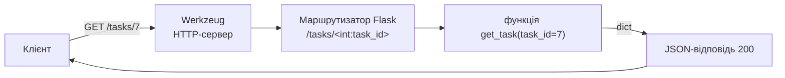

# 18. (Л) Flask: створення простого API. Маршрутизація

## Зміст лекції

1. Що таке вебфреймворк
2. Встановлення Flask
3. Мінімальний застосунок
4. Запуск сервера і режим налагодження
5. Маршрути і функції-обробники
6. Методи HTTP у маршрутах
7. Змінні в URL і конвертери
8. Що може повернути обробник
9. `abort` і обробники помилок
10. Код 405 і заголовок `Allow`
11. `url_for`: адреси за назвою обробника
12. Тестовий клієнт: запити без сервера
13. Blueprint: маршрути в окремих модулях
14. Фабрика застосунку `create_app`
15. Типові помилки

## Що таке вебфреймворк

У лекції 16 ми написали сервер на `http.server`: самі розбирали шлях, формували заголовки, перетворювали дані в JSON. **Вебфреймворк** бере цю рутину на себе. Програміст лише пише функції, що відповідають на запити до певних адрес.

**Flask** — «мікрофреймворк» для Python. Ядро невелике: маршрутизація, запит і відповідь, шаблони. Усе інше (база даних, авторизація) додають за потреби. Тому Flask зручний для API і для навчання: видно, як усе працює.



## Встановлення Flask

```bash
python3 -m venv .venv
source .venv/bin/activate
python3 -m pip install flask
python3 -m flask --version
```

```text
Python 3.12.7
Flask 3.1.3
Werkzeug 3.1.3
```

Разом з Flask встановлюється **Werkzeug** — бібліотека, що реалізує HTTP: розбирає запити, формує відповіді, містить сервер для розробки.

## Мінімальний застосунок

```python
# File: app.py
from flask import Flask

app = Flask(__name__)


@app.get("/health")
def health():
    return {"status": "ok"}


if __name__ == "__main__":
    app.run(debug=True)
```

- `Flask(__name__)` створює обʼєкт застосунку; `__name__` допомагає Flask знайти файли поруч з модулем;
- декоратор `@app.get("/health")` (декоратор — функція, що «обгортає» іншу функцію) реєструє функцію як **обробник** запиту `GET /health`;
- обробник повертає словник, і Flask сам перетворює його на JSON з заголовком `Content-Type: application/json`.

## Запуск сервера і режим налагодження

```bash
python3 app.py
```

```text
 * Serving Flask app 'app'
 * Debug mode: on
 * Running on http://127.0.0.1:5000
Press CTRL+C to quit
 * Restarting with stat
 * Debugger is active!
```

В іншому терміналі:

```bash
curl -i http://127.0.0.1:5000/health
```

```text
HTTP/1.1 200 OK
Server: Werkzeug/3.1.3 Python/3.12.7
Date: Tue, 20 Oct 2026 10:00:00 GMT
Content-Type: application/json
Content-Length: 16
Connection: close

{"status":"ok"}
```

Той самий застосунок запускає команда `flask --app app run --debug`. Режим налагодження (`debug=True`):

- перезапускає сервер після кожного збереження файлу;
- показує в браузері інтерактивну сторінку з трасуванням помилки.

!!! danger "Debug — лише на компʼютері розробника"
    Інтерактивний налагоджувач дозволяє виконати **будь-який Python-код** на сервері. На робочому сервері режим `debug` вимикають, а замість вбудованого сервера Werkzeug використовують gunicorn (лекція 30).

## Маршрути і функції-обробники

**Маршрут** (route) — відповідність «метод + шаблон URL → функція». Для стислості в цьому модулі пишемо шляхи без префікса версії (`/tasks` замість `/api/v1/tasks`):

```python
# Program: a list of tasks in memory and two routes
from flask import Flask

app = Flask(__name__)

TASKS = [
    {"id": 1, "title": "Lab 9: Flask routes", "subject": "Programming", "status": "todo"},
    {"id": 2, "title": "Essay on history", "subject": "History", "status": "done"},
]


@app.get("/tasks")
def list_tasks():
    return TASKS


@app.get("/")
def index():
    return "Tasks API. See /tasks"


with app.test_client() as client:
    response = client.get("/tasks")
    print(response.status_code, response.content_type)
    print(response.get_json()[0]["title"])
    response = client.get("/")
    print(response.status_code, response.content_type, response.text)
    print(client.get("/users").status_code)
```

```text
200 application/json
Lab 9: Flask routes
200 text/html; charset=utf-8 Tasks API. See /tasks
404
```

Список Flask також перетворює на JSON. Рядок повертається як HTML. На адресу, для якої немає маршруту, Flask сам відповідає `404 Not Found`.

Тут і далі запити виконує **тестовий клієнт** (докладніше — нижче): так приклад запускається одним файлом, без окремого сервера й `curl`.

## Методи HTTP у маршрутах

Скорочені декоратори відповідають методам HTTP:

| Декоратор | Еквівалент |
|---|---|
| `@app.get(path)` | `@app.route(path, methods=["GET"])` |
| `@app.post(path)` | `@app.route(path, methods=["POST"])` |
| `@app.put(path)` | `@app.route(path, methods=["PUT"])` |
| `@app.patch(path)` | `@app.route(path, methods=["PATCH"])` |
| `@app.delete(path)` | `@app.route(path, methods=["DELETE"])` |

Один шлях може мати кілька обробників для різних методів:

```python
# Program: one URL, different methods
from flask import Flask

app = Flask(__name__)
TASKS = []


@app.get("/tasks")
def list_tasks():
    return TASKS


@app.post("/tasks")
def create_task():
    # читання тіла запиту — у лекції 20, поки що фіксовані дані
    task = {"id": len(TASKS) + 1, "title": f"Task {len(TASKS) + 1}", "status": "todo"}
    TASKS.append(task)
    return task, 201


with app.test_client() as client:
    print(client.post("/tasks").status_code, client.post("/tasks").get_json())
    print(len(client.get("/tasks").get_json()))
```

```text
201 {'id': 2, 'status': 'todo', 'title': 'Task 2'}
2
```

Flask сортує ключі JSON за алфавітом, тому порядок полів у відповіді може відрізнятися від порядку в словнику.

## Змінні в URL і конвертери

Частину шляху можна зробити змінною: `<task_id>`. Flask передає її в обробник **іменованим аргументом**. **Конвертер** перед імʼям перевіряє і перетворює значення:

| Конвертер | Приймає | Тип у Python |
|---|---|---|
| `string` (типово) | будь-який текст без `/` | `str` |
| `int` | невідʼємне ціле | `int` |
| `float` | дробове число | `float` |
| `path` | текст разом з `/` | `str` |
| `uuid` | рядок UUID | `uuid.UUID` |

```python
# Program: URL variables with converters
from flask import Flask

app = Flask(__name__)
TASKS = {1: {"id": 1, "title": "Lab 9"}, 2: {"id": 2, "title": "Essay"}}


@app.get("/tasks/<int:task_id>")
def get_task(task_id: int):
    task = TASKS.get(task_id)
    if task is None:
        return {"error": "task not found"}, 404
    return task


@app.get("/subjects/<name>/tasks")
def subject_tasks(name: str):
    return {"subject": name, "type": type(name).__name__}


with app.test_client() as client:
    for url in ["/tasks/1", "/tasks/999", "/tasks/abc", "/subjects/History/tasks"]:
        response = client.get(url)
        print(f"{url:<24} {response.status_code} {response.get_json()}")
```

```text
/tasks/1                 200 {'id': 1, 'title': 'Lab 9'}
/tasks/999               404 {'error': 'task not found'}
/tasks/abc               404 None
/subjects/History/tasks  200 {'subject': 'History', 'type': 'str'}
```

`/tasks/abc` не відповідає конвертеру `int`, тому маршрут не спрацював зовсім: це стандартна HTML-сторінка 404 від Flask, а не наш JSON (тому `get_json()` повертає `None`). Обробник для такого випадку налаштуємо нижче.

## Що може повернути обробник

| Повернене значення | Відповідь |
|---|---|
| `str` | HTML, код `200` |
| `dict` або `list` | JSON, код `200` |
| `(body, status)` | тіло з вказаним кодом |
| `(body, status, headers)` | плюс заголовки |
| `("", 204)` | порожня відповідь |
| `jsonify(...)` | обʼєкт `Response` з JSON |
| `make_response(...)` | обʼєкт `Response`, який можна змінити перед поверненням |

```python
# Program: status codes and headers in the return value
from flask import Flask, jsonify, make_response

app = Flask(__name__)


@app.post("/tasks")
def create_task():
    task = {"id": 7, "title": "Lab 9"}
    return task, 201, {"Location": "/tasks/7"}


@app.delete("/tasks/<int:task_id>")
def delete_task(task_id: int):
    return "", 204


@app.get("/export")
def export():
    response = make_response(jsonify([{"id": 7}]))
    response.headers["Content-Disposition"] = "attachment; filename=tasks.json"
    return response


with app.test_client() as client:
    response = client.post("/tasks")
    print(response.status_code, response.headers["Location"])
    response = client.delete("/tasks/7")
    print(response.status_code, repr(response.text))
    print(client.get("/export").headers["Content-Disposition"])
```

```text
201 /tasks/7
204 ''
attachment; filename=tasks.json
```

## `abort` і обробники помилок

Функція `abort(code)` перериває обробку запиту і повертає помилку з вказаним кодом. Щоб помилки API були **в одному JSON-форматі**, реєструють обробники `@app.errorhandler`:

```python
# Program: JSON for every error
from flask import Flask, abort
from werkzeug.exceptions import HTTPException

app = Flask(__name__)
TASKS = {1: {"id": 1, "title": "Lab 9"}}


def find_task(task_id: int) -> dict:
    task = TASKS.get(task_id)
    if task is None:
        abort(404, description=f"task {task_id} not found")
    return task


@app.get("/tasks/<int:task_id>")
def get_task(task_id: int):
    return find_task(task_id)


@app.get("/crash")
def crash():
    return {"result": 1 / 0}


@app.errorhandler(HTTPException)
def http_error(error: HTTPException):
    headers = [(k, v) for k, v in error.get_headers() if k != "Content-Type"]
    body = {"error": error.name.lower().replace(" ", "_"), "message": error.description}
    return body, error.code, headers


@app.errorhandler(Exception)
def server_error(error: Exception):
    app.logger.exception("unhandled error")
    return {"error": "internal_error", "message": "something went wrong"}, 500


with app.test_client() as client:
    for url in ["/tasks/1", "/tasks/5", "/tasks/abc", "/crash"]:
        response = client.get(url)
        print(response.status_code, response.get_json())
```

```text
200 {'id': 1, 'title': 'Lab 9'}
404 {'error': 'not_found', 'message': 'task 5 not found'}
404 {'error': 'not_found', 'message': 'The requested URL was not found on the server. If you entered the URL manually please check your spelling and try again.'}
500 {'error': 'internal_error', 'message': 'something went wrong'}
```

Обробник `HTTPException` копіює у відповідь заголовки винятку (`error.get_headers()`, крім `Content-Type`): деякі помилки мають важливі заголовки, наприклад `Allow` у відповіді `405`.

Обробник `Exception` повертає клієнту загальне повідомлення, а повне трасування записує в журнал сервера (`app.logger` пише його у стандартний потік помилок, тому під час запуску прикладу ви побачите в терміналі ще й `ERROR in ...: unhandled error` з трасуванням `ZeroDivisionError`). Клієнт не повинен бачити внутрішніх подробиць: шляхів до файлів, тексту SQL, версій бібліотек.

## Код 405 і заголовок `Allow`

Якщо шлях існує, але метод не підтримується, Flask відповідає `405 Method Not Allowed` і перелічує дозволені методи в заголовку `Allow`:

```python
# Program: unsupported method gives 405
from flask import Flask

app = Flask(__name__)


@app.get("/tasks")
def list_tasks():
    return []


@app.post("/tasks")
def create_task():
    return {}, 201


with app.test_client() as client:
    response = client.put("/tasks")
    print(response.status_code, sorted(response.headers["Allow"].split(", ")))
```

```text
405 ['GET', 'HEAD', 'OPTIONS', 'POST']
```

`HEAD` і `OPTIONS` Flask додає автоматично: `HEAD` — як `GET`, але без тіла, `OPTIONS` — повідомляє дозволені методи.

## `url_for`: адреси за назвою обробника

Записувати адреси рядками в коді ризиковано: після зміни маршруту доведеться шукати всі місця. `url_for` будує URL за **назвою функції-обробника**:

```python
# Program: build URLs from endpoint names
from flask import Flask, url_for

app = Flask(__name__)


@app.get("/tasks/<int:task_id>")
def get_task(task_id: int):
    return {"id": task_id}


with app.test_request_context():
    print(url_for("get_task", task_id=7))
    print(url_for("get_task", task_id=7, fields="title"))
    print(url_for("get_task", task_id=7, _external=True))
```

```text
/tasks/7
/tasks/7?fields=title
http://localhost/tasks/7
```

Аргументи, яких немає в шаблоні маршруту, `url_for` додає як параметри рядка запиту. `url_for` працює лише всередині контексту запиту, тому тут ми створили його штучно через `test_request_context()`; в обробнику контекст уже є.

## Тестовий клієнт: запити без сервера

`app.test_client()` надсилає запити **безпосередньо** застосунку, без мережі та без запуску сервера:

| Метод клієнта | Запит |
|---|---|
| `client.get(url, query_string={...})` | `GET` |
| `client.post(url, json={...})` | `POST` з JSON-тілом |
| `client.patch(...)`, `put(...)`, `delete(...)` | інші методи |

| Атрибут відповіді | Значення |
|---|---|
| `response.status_code` | код стану |
| `response.headers` | заголовки |
| `response.get_json()` | тіло, розібране з JSON |
| `response.text` | тіло рядком |

На тестовому клієнті побудовано автоматичні тести API (лекція 26).

## Blueprint: маршрути в окремих модулях

Коли маршрутів десятки, один `app.py` стає незручним. **Blueprint** групує повʼязані маршрути в окремому модулі зі спільним префіксом:

```python
# File: tasks.py
from flask import Blueprint

bp = Blueprint("tasks", __name__, url_prefix="/tasks")

TASKS = {1: {"id": 1, "title": "Lab 9"}}


@bp.get("")
def list_tasks():
    return list(TASKS.values())


@bp.get("/<int:task_id>")
def get_task(task_id: int):
    return TASKS.get(task_id) or ({"error": "task not found"}, 404)
```

## Фабрика застосунку `create_app`

**Фабрика застосунку** — функція, що створює й налаштовує обʼєкт `Flask`. Вона дозволяє створювати застосунки з різною конфігурацією: робочою, тестовою (лекція 26), для контейнера (лекція 30):

```python
# File: app.py
from flask import Flask

import tasks


def create_app(config: dict | None = None) -> Flask:
    app = Flask(__name__)
    app.config.update(TESTING=False)
    if config:
        app.config.update(config)
    app.register_blueprint(tasks.bp)

    @app.get("/health")
    def health():
        return {"status": "ok"}

    return app


if __name__ == "__main__":
    create_app().run(debug=True)
```

```python
# Program: use the factory and list registered routes
from app import create_app

app = create_app({"TESTING": True})
for rule in sorted(app.url_map.iter_rules(), key=lambda r: r.rule):
    if rule.endpoint != "static":
        print(f"{rule.rule:<22} {','.join(sorted(rule.methods - {'HEAD', 'OPTIONS'})):<6} {rule.endpoint}")
with app.test_client() as client:
    print(client.get("/tasks/1").get_json(), app.config["TESTING"])
```

```text
/health                GET    health
/tasks                 GET    tasks.list_tasks
/tasks/<int:task_id>   GET    tasks.get_task
{'id': 1, 'title': 'Lab 9'} True
```

Назва обробника з blueprint має префікс: `url_for("tasks.get_task", task_id=1)`.

```text
tasks_api/
  app.py       # create_app()
  tasks.py     # Blueprint з маршрутами /tasks
```

## Типові помилки

| Помилка | Чому погано | Як правильно |
|---|---|---|
| `debug=True` на сервері | виконання довільного коду через налагоджувач | лише локально; gunicorn у робочому середовищі |
| Обробник нічого не повертає | `TypeError: The view function did not return a valid response` | завжди `return` |
| `<task_id>` без конвертера, далі `TASKS[task_id]` | ключ-рядок `"1"` не знайдено | `<int:task_id>` |
| Два обробники з однаковою назвою функції | `AssertionError: View function mapping is overwriting...` | унікальні назви |
| Помилки у різних форматах (HTML і JSON) | клієнту важко обробляти | `@app.errorhandler` з JSON |
| Клієнту повертається трасування помилки | розкриває внутрішню будову | загальне повідомлення, трасування — в журнал |
| URL записано рядками по всьому коду | після зміни маршруту посилання ламаються | `url_for` |
| Глобальний `app` з налаштуваннями всередині модуля | неможливо створити тестовий застосунок | фабрика `create_app` |

## Підсумок

- **Flask** — мікрофреймворк, що зіставляє запити з функціями-обробниками; HTTP реалізує Werkzeug.
- Маршрут задають декораторами `@app.get`, `@app.post`, `@app.patch`, `@app.delete`.
- Змінні в URL з конвертерами (`<int:task_id>`) передаються обробнику аргументами.
- Обробник повертає `dict`/`list` (JSON), рядок (HTML) або кортеж `(тіло, код, заголовки)`.
- `abort` і `@app.errorhandler` дають помилки в єдиному JSON-форматі; Flask сам повертає `404` і `405`.
- `url_for` будує адреси за назвою обробника; тестовий клієнт виконує запити без сервера.
- Blueprint розділяє маршрути на модулі, фабрика `create_app` створює застосунок з потрібною конфігурацією.

## Корисні посилання

- [Flask — Quickstart](https://flask.palletsprojects.com/en/stable/quickstart/)
- [Flask — Application Factories](https://flask.palletsprojects.com/en/stable/patterns/appfactories/)
- [Flask — Modular Applications with Blueprints](https://flask.palletsprojects.com/en/stable/blueprints/)
- [Flask — Handling Application Errors](https://flask.palletsprojects.com/en/stable/errorhandling/)
- [Werkzeug — URL Routing (конвертери)](https://werkzeug.palletsprojects.com/en/stable/routing/)
