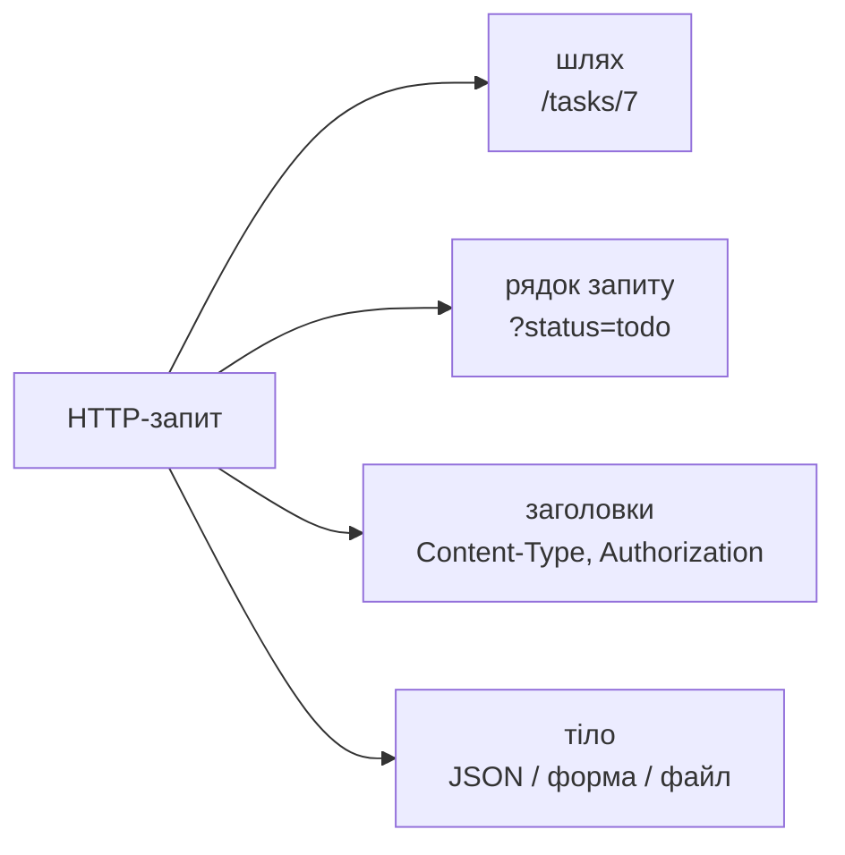

# 20. (Л) Передача даних в HTTP-запиті

## Зміст лекції

1. Звідки сервер бере дані
2. Обʼєкт `request`
3. Параметри рядка запиту: `request.args`
4. Перетворення й перевірка параметрів
5. JSON-тіло: `request.get_json`
6. Перевірка вхідних даних
7. Функція-валідатор і словник помилок
8. Складні JSON-структури
9. Дані HTML-форми: `request.form`
10. Заголовки запиту
11. Завантаження файлів: `request.files`
12. Обмеження розміру запиту
13. Типові помилки

## Звідки сервер бере дані

Клієнт може передати дані серверу в кількох місцях HTTP-запиту:

| Де | Приклад | Для чого | У Flask |
|---|---|---|---|
| шлях URL | `/tasks/7` | ідентифікатор ресурсу | аргумент обробника (лекція 18) |
| рядок запиту | `/tasks?status=todo&limit=3` | фільтри, сортування, сторінки | `request.args` |
| тіло, JSON | `{"title": "Lab 10"}` | дані нового чи зміненого ресурсу | `request.get_json()` |
| тіло, форма | `title=Lab+10&status=todo` | HTML-форми | `request.form` |
| тіло, файли | `multipart/form-data` | завантаження файлів | `request.files` |
| заголовки | `Authorization: Bearer ...` | метадані, автентифікація | `request.headers` |



## Обʼєкт `request`

`flask.request` — обʼєкт поточного запиту. Він імпортується один раз на модуль, але всередині кожного обробника містить дані **саме того запиту**, який обробляється зараз (Flask зберігає його в контексті запиту):

```python
# Program: what the request object contains
from flask import Flask, request

app = Flask(__name__)


@app.post("/echo/<int:item_id>")
def echo(item_id: int):
    return {
        "method": request.method,
        "path": request.path,
        "item_id": item_id,
        "args": request.args.to_dict(),
        "content_type": request.content_type,
        "json": request.get_json(silent=True),
        "user_agent": request.headers.get("User-Agent"),
    }


with app.test_client() as client:
    response = client.post("/echo/7?verbose=1", json={"title": "Lab 10"}, headers={"User-Agent": "demo/1.0"})
    for key, value in response.get_json().items():
        print(f"{key:<13} {value}")
```

```text
args          {'verbose': '1'}
content_type  application/json
item_id       7
json          {'title': 'Lab 10'}
method        POST
path          /echo/7
user_agent    demo/1.0
```

## Параметри рядка запиту: `request.args`

`request.args` — словникоподібний обʼєкт `MultiDict`. Усі значення в ньому — **рядки**; один ключ може повторюватися:

```python
# Program: reading query string parameters
from flask import Flask, request

app = Flask(__name__)


@app.get("/tasks")
def list_tasks():
    return {
        "status": request.args.get("status"),
        "limit": request.args.get("limit"),
        "limit_type": type(request.args.get("limit")).__name__,
        "subjects": request.args.getlist("subject"),
        "sort": request.args.get("sort", "due_date"),
    }


with app.test_client() as client:
    print(client.get("/tasks?status=todo&limit=3&subject=History&subject=Math").get_json())
    print(client.get("/tasks").get_json())
```

```text
{'limit': '3', 'limit_type': 'str', 'sort': 'due_date', 'status': 'todo', 'subjects': ['History', 'Math']}
{'limit': None, 'limit_type': 'NoneType', 'sort': 'due_date', 'status': None, 'subjects': []}
```

- `get(key)` повертає `None`, якщо параметра немає, а `get(key, default)` — значення за замовчуванням;
- `getlist(key)` повертає всі значення повтореного параметра;
- `request.args["status"]` для відсутнього ключа спричиняє помилку `400 Bad Request` — краще використовувати `get`.

## Перетворення й перевірка параметрів

Параметр `type` методу `get` перетворює рядок. Якщо перетворення не вдалося, `get` **мовчки** повертає значення за замовчуванням:

```python
# Program: type conversion with request.args.get
from flask import Flask, request

app = Flask(__name__)


@app.get("/tasks")
def list_tasks():
    return {"limit": request.args.get("limit", default=10, type=int)}


with app.test_client() as client:
    for query in ["limit=3", "limit=abc", "limit=-1", ""]:
        print(f"{query!r:<12} {client.get('/tasks?' + query).get_json()}")
```

```text
'limit=3'    {'limit': 3}
'limit=abc'  {'limit': 10}
'limit=-1'   {'limit': -1}
''           {'limit': 10}
```

Для API мовчазна заміна погана: клієнт помилився (`limit=abc`) і навіть не дізнався про це. Краще явно перевіряти значення й відповідати `400` з поясненням:

```python
# Program: strict validation of query parameters
from flask import Flask, abort, request

app = Flask(__name__)
STATUSES = ("todo", "in_progress", "done")
TASKS = [
    {"id": 1, "title": "Lab 10", "status": "todo"},
    {"id": 2, "title": "Essay", "status": "done"},
    {"id": 3, "title": "Course project", "status": "todo"},
]


def int_arg(name: str, default: int, minimum: int, maximum: int) -> int:
    raw = request.args.get(name)
    if raw is None:
        return default
    if not raw.isdigit() or not minimum <= int(raw) <= maximum:
        abort(400, description=f"{name} must be an integer from {minimum} to {maximum}")
    return int(raw)


@app.get("/tasks")
def list_tasks():
    status = request.args.get("status")
    if status is not None and status not in STATUSES:
        abort(400, description=f"status must be one of: {', '.join(STATUSES)}")
    limit = int_arg("limit", default=20, minimum=1, maximum=100)
    found = [t for t in TASKS if status is None or t["status"] == status]
    return found[:limit]


@app.errorhandler(400)
def bad_request(error):
    return {"error": "bad_request", "message": error.description}, 400


with app.test_client() as client:
    for query in ["status=todo&limit=1", "status=todo", "status=later", "limit=abc", "limit=0"]:
        response = client.get("/tasks?" + query)
        print(response.status_code, response.get_json())
```

```text
200 [{'id': 1, 'status': 'todo', 'title': 'Lab 10'}]
200 [{'id': 1, 'status': 'todo', 'title': 'Lab 10'}, {'id': 3, 'status': 'todo', 'title': 'Course project'}]
400 {'error': 'bad_request', 'message': 'status must be one of: todo, in_progress, done'}
400 {'error': 'bad_request', 'message': 'limit must be an integer from 1 to 100'}
400 {'error': 'bad_request', 'message': 'limit must be an integer from 1 to 100'}
```

## JSON-тіло: `request.get_json`

`request.get_json()` розбирає тіло запиту з JSON у обʼєкти Python. Поводження залежить від запиту і параметрів:

| Ситуація | `get_json()` | `get_json(silent=True)` |
|---|---|---|
| правильний JSON, `Content-Type: application/json` | дані | дані |
| `Content-Type` не JSON | помилка `415 Unsupported Media Type` | `None` |
| синтаксична помилка в JSON | помилка `400 Bad Request` | `None` |

```python
# Program: different bodies and get_json
from flask import Flask, request

app = Flask(__name__)


@app.post("/tasks")
def create_task():
    data = request.get_json(silent=True)
    return {"type": type(data).__name__, "data": data}


with app.test_client() as client:
    print(client.post("/tasks", json={"title": "Lab 10"}).get_json())
    print(client.post("/tasks", json=["not", "an", "object"]).get_json())
    print(client.post("/tasks", data='{"title": ', content_type="application/json").get_json())
    print(client.post("/tasks", data="title=Lab").get_json())
```

```text
{'data': {'title': 'Lab 10'}, 'type': 'dict'}
{'data': ['not', 'an', 'object'], 'type': 'list'}
{'data': None, 'type': 'NoneType'}
{'data': None, 'type': 'NoneType'}
```

Правильний JSON не обовʼязково є **обʼєктом**: це може бути список, рядок чи число. Тому перед `data.get(...)` перевіряють, що `data` — словник.

## Перевірка вхідних даних

!!! danger "Ніколи не довіряйте даним клієнта"
    Клієнтом може бути не лише ваш вебінтерфейс, а будь-яка програма, зокрема зловмисника. Сервер перевіряє **кожне** поле: наявність, тип, формат, допустимий діапазон. Перевірки на боці клієнта (у браузері) — лише для зручності користувача, вони не захищають сервер.

Що перевіряють для кожного поля:

| Перевірка | Приклад для задачі |
|---|---|
| наявність обовʼязкового поля | `title` є |
| тип | `title` — рядок, а не число чи `null` |
| формат | `due_date` у форматі `YYYY-MM-DD` |
| діапазон, довжина | `title` від 1 до 200 символів, дата не в минулому |
| допустимі значення | `status` з переліку |
| зайві поля | невідоме поле `owner` — помилка або ігнорувати |

## Функція-валідатор і словник помилок

Перевірки зручно винести в окрему функцію, яка повертає **очищені дані** і **словник помилок** — усі помилки одразу, щоб клієнт виправив їх за один раз:

```python
# Program: validate a JSON body and report all errors at once
from datetime import date

from flask import Flask, request

app = Flask(__name__)
STATUSES = {"todo", "in_progress", "done"}
TASKS = []


def validate_task(data, today: date) -> tuple[dict, dict]:
    if not isinstance(data, dict):
        return {}, {"_body": "JSON object expected"}
    errors, clean = {}, {}

    title = data.get("title")
    if not isinstance(title, str) or not title.strip():
        errors["title"] = "required non-empty string"
    elif len(title) > 200:
        errors["title"] = "at most 200 characters"
    else:
        clean["title"] = title.strip()

    status = data.get("status", "todo")
    if status not in STATUSES:
        errors["status"] = f"one of {sorted(STATUSES)}"
    else:
        clean["status"] = status

    raw_date = data.get("due_date")
    try:
        due = date.fromisoformat(raw_date)
    except (TypeError, ValueError):
        errors["due_date"] = "date in format YYYY-MM-DD"
    else:
        if due < today:
            errors["due_date"] = "must not be in the past"
        else:
            clean["due_date"] = due.isoformat()

    unknown = set(data) - {"title", "status", "due_date"}
    if unknown:
        errors["_unknown"] = sorted(unknown)
    return clean, errors


@app.post("/tasks")
def create_task():
    clean, errors = validate_task(request.get_json(silent=True), today=date(2026, 10, 20))
    if errors:
        return {"error": "validation_failed", "fields": errors}, 400
    task = {"id": len(TASKS) + 1, **clean}
    TASKS.append(task)
    return task, 201


with app.test_client() as client:
    bodies = [
        {"title": " Lab 10 ", "due_date": "2026-11-02"},
        {"title": "", "status": "later", "due_date": "02.11.2026", "owner": 5},
        {"title": "Essay", "due_date": "2026-09-01"},
        [1, 2, 3],
    ]
    for body in bodies:
        response = client.post("/tasks", json=body)
        print(response.status_code, response.get_json())
```

```text
201 {'due_date': '2026-11-02', 'id': 1, 'status': 'todo', 'title': 'Lab 10'}
400 {'error': 'validation_failed', 'fields': {'_unknown': ['owner'], 'due_date': 'date in format YYYY-MM-DD', 'status': "one of ['done', 'in_progress', 'todo']", 'title': 'required non-empty string'}}
400 {'error': 'validation_failed', 'fields': {'due_date': 'must not be in the past'}}
400 {'error': 'validation_failed', 'fields': {'_body': 'JSON object expected'}}
```

Поточна дата передається параметром `today`: так функцію легко тестувати (лекція 26), а результат не залежить від дня запуску. Для великих API перевірку описують декларативно бібліотеками **pydantic** або **marshmallow**, але принцип той самий.

## Складні JSON-структури

JSON може містити вкладені обʼєкти і списки. Їх перевіряють рекурсивно — тією самою функцією для кожного елемента:

```python
# Program: a batch of tasks with nested subtasks
from flask import Flask, request

app = Flask(__name__)


def check_subtasks(value, path: str, errors: dict) -> list[str]:
    if not isinstance(value, list) or not all(isinstance(s, str) and s for s in value):
        errors[path] = "list of non-empty strings"
        return []
    return value


@app.post("/tasks/batch")
def create_batch():
    data = request.get_json(silent=True)
    if not isinstance(data, dict) or not isinstance(data.get("tasks"), list):
        return {"error": "object with list 'tasks' expected"}, 400
    errors, created = {}, []
    for i, item in enumerate(data["tasks"]):
        if not isinstance(item, dict) or not isinstance(item.get("title"), str):
            errors[f"tasks[{i}].title"] = "required string"
            continue
        subtasks = check_subtasks(item.get("subtasks", []), f"tasks[{i}].subtasks", errors)
        created.append({"title": item["title"], "subtasks": len(subtasks)})
    if errors:
        return {"error": "validation_failed", "fields": errors}, 400
    return {"created": created}, 201


with app.test_client() as client:
    good = {"tasks": [{"title": "Course project", "subtasks": ["design", "code", "report"]}, {"title": "Essay"}]}
    bad = {"tasks": [{"title": "Lab", "subtasks": ["ok", ""]}, {"name": "no title"}]}
    for body in (good, bad):
        response = client.post("/tasks/batch", json=body)
        print(response.status_code, response.get_json())
```

```text
201 {'created': [{'subtasks': 3, 'title': 'Course project'}, {'subtasks': 0, 'title': 'Essay'}]}
400 {'error': 'validation_failed', 'fields': {'tasks[0].subtasks': 'list of non-empty strings', 'tasks[1].title': 'required string'}}
```

Шлях до поля (`tasks[1].title`) у повідомленні допомагає клієнту швидко знайти помилку в великому документі.

## Дані HTML-форми: `request.form`

Браузер надсилає HTML-форму не в JSON, а у форматі `application/x-www-form-urlencoded` — як рядок запиту в тілі: `title=Lab+10&status=todo`. Flask розбирає такі дані в `request.form`:

```html
<!-- File: form.html -->
<form method="post" action="http://127.0.0.1:5000/tasks/form">
  <input name="title" placeholder="Title" required>
  <select name="status">
    <option value="todo">todo</option>
    <option value="done">done</option>
  </select>
  <button>Create</button>
</form>
```

```python
# Program: the same data from a form and from JSON
from flask import Flask, request

app = Flask(__name__)


@app.post("/tasks/form")
def create_from_form():
    return {"source": "form", "content_type": request.content_type, "title": request.form.get("title"),
            "status": request.form.get("status", "todo")}, 201


with app.test_client() as client:
    response = client.post("/tasks/form", data={"title": "Lab 10", "status": "done"})
    print(response.status_code, response.get_json())
```

```text
201 {'content_type': 'application/x-www-form-urlencoded', 'source': 'form', 'status': 'done', 'title': 'Lab 10'}
```

У тестовому клієнті параметр `data=` зі словником імітує форму, а `json=` — JSON-тіло.

## Заголовки запиту

`request.headers` — словник заголовків без урахування регістру назв:

```python
# Program: read an API key from a header
from flask import Flask, request

app = Flask(__name__)
API_KEYS = {"k-123": "mobile-app"}


@app.get("/stats")
def stats():
    key = request.headers.get("X-API-Key")
    client_name = API_KEYS.get(key)
    if client_name is None:
        return {"error": "unknown or missing API key"}, 401
    return {"client": client_name, "accept": request.headers.get("accept")}


with app.test_client() as client:
    print(client.get("/stats").status_code)
    print(client.get("/stats", headers={"x-api-key": "k-123", "Accept": "application/json"}).get_json())
```

```text
401
{'accept': 'application/json', 'client': 'mobile-app'}
```

У справжньому застосунку ключі зберігають у базі чи змінних оточення, а не в коді.

## Завантаження файлів: `request.files`

Файли передаються у форматі `multipart/form-data`. Flask надає їх як обʼєкти `FileStorage` у `request.files`:

```python
# Program: upload a CSV file with tasks
import csv
import io

from flask import Flask, request

app = Flask(__name__)
app.config["MAX_CONTENT_LENGTH"] = 1024 * 1024  # 1 МБ


@app.post("/tasks/import")
def import_tasks():
    file = request.files.get("file")
    if file is None or not file.filename.endswith(".csv"):
        return {"error": "CSV file in field 'file' expected"}, 400
    text = io.StringIO(file.read().decode("utf-8"))
    titles = [row["title"] for row in csv.DictReader(text)]
    return {"filename": file.filename, "imported": titles}, 201


with app.test_client() as client:
    content = b"title,status\nLab 10,todo\nEssay,done\n"
    response = client.post("/tasks/import", data={"file": (io.BytesIO(content), "tasks.csv")})
    print(response.status_code, response.get_json())
    response = client.post("/tasks/import", data={"file": (io.BytesIO(b"x"), "photo.jpg")})
    print(response.status_code, response.get_json())
```

```text
201 {'filename': 'tasks.csv', 'imported': ['Lab 10', 'Essay']}
400 {'error': "CSV file in field 'file' expected"}
```

Якщо файл зберігають на диск, імʼя від клієнта **не використовують** напряму: воно може містити `../`. Функція `werkzeug.utils.secure_filename` очищує імʼя.

## Обмеження розміру запиту

Без обмеження клієнт може надіслати гігабайтне тіло і вичерпати памʼять сервера. Налаштування `MAX_CONTENT_LENGTH` (у попередньому прикладі — 1 МБ) змушує Flask відхиляти завеликі запити з кодом `413 Content Too Large`:

```python
# Program: too large request body gives 413
from flask import Flask, request

app = Flask(__name__)
app.config["MAX_CONTENT_LENGTH"] = 100


@app.post("/tasks")
def create_task():
    return {"size": len(request.get_data())}, 201


with app.test_client() as client:
    print(client.post("/tasks", data="x" * 50).status_code)
    print(client.post("/tasks", data="x" * 500).status_code)
```

```text
201
413
```

## Типові помилки

| Помилка | Чому погано | Як правильно |
|---|---|---|
| `request.args["limit"]` для відсутнього параметра | `400` без пояснення | `request.args.get("limit", default)` |
| `int(request.args.get("limit"))` | `TypeError`/`ValueError` → `500` | перевірка і `400` з повідомленням |
| `get(..., type=int)` для API | помилку клієнта мовчки замінено типовим значенням | явна перевірка |
| `request.json["title"]` без перевірок | `500` на будь-яких «неправильних» даних | `get_json(silent=True)` і валідатор |
| Перевірка лише в браузері | будь-яка програма обійде її | перевірка на сервері |
| Повідомлення про першу помилку | клієнт виправляє по одній | словник усіх помилок |
| `date.today()` всередині валідатора | тест залежить від дня запуску | дата параметром |
| Немає `MAX_CONTENT_LENGTH` | великий запит вичерпує памʼять | обмеження розміру |
| Імʼя файлу від клієнта як шлях | запис поза каталогом через `../` | `secure_filename` |

## Підсумок

- Дані запиту бувають у шляху, рядку запиту (`request.args`), тілі (`get_json`, `form`, `files`) і заголовках (`request.headers`).
- Усі значення `request.args` — рядки; їх перетворюють і перевіряють, на помилку відповідають `400`.
- `get_json(silent=True)` повертає `None` замість помилки; перед використанням перевіряють, що отримано словник.
- **Сервер перевіряє всі вхідні дані**: наявність, тип, формат, діапазон, допустимі значення.
- Валідатор повертає очищені дані і словник **усіх** помилок; вкладені структури перевіряють рекурсивно з шляхом до поля.
- Форми — `request.form`, файли — `request.files`; розмір запиту обмежує `MAX_CONTENT_LENGTH`.

## Корисні посилання

- [Flask — The Request Object](https://flask.palletsprojects.com/en/stable/api/#flask.Request)
- [Flask — Uploading Files](https://flask.palletsprojects.com/en/stable/patterns/fileuploads/)
- [Werkzeug — MultiDict](https://werkzeug.palletsprojects.com/en/stable/datastructures/#werkzeug.datastructures.MultiDict)
- [MDN — Sending form data](https://developer.mozilla.org/en-US/docs/Learn_web_development/Extensions/Forms/Sending_and_retrieving_form_data)
- [OWASP — Input Validation Cheat Sheet](https://cheatsheetseries.owasp.org/cheatsheets/Input_Validation_Cheat_Sheet.html)
