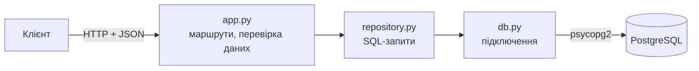
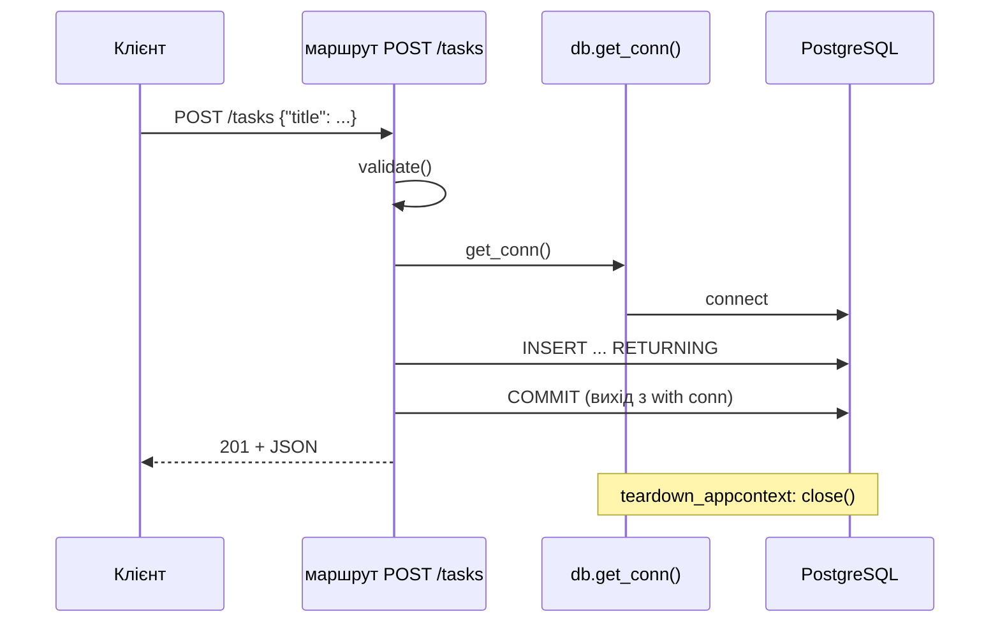

# 22. (Л) CRUD-операції REST API та робота з базою даних у Flask

## Зміст лекції

1. Від списку в памʼяті до бази даних
2. Структура проєкту
3. Схема таблиці
4. Підключення на час запиту: `flask.g` і `teardown_appcontext`
5. Репозиторій: SQL в одному модулі
6. Дати й `Decimal` у JSON
7. Маршрути CRUD
8. Транзакція на запит
9. `PUT` і `PATCH`: повна і часткова зміна
10. Помилки бази даних → коди HTTP
11. Сторінки результатів: `limit` і `offset`
12. Команда ініціалізації бази
13. Перевірка всього API
14. Типові помилки

## Від списку в памʼяті до бази даних

У лекціях 18–20 задачі зберігалися у списку `TASKS`. Після перезапуску сервера вони зникали, а кілька процесів сервера мали б різні списки. Тепер підключимо PostgreSQL і поєднаємо все вивчене:



Кожен шар відповідає за одне:

| Модуль | Відповідальність | Знає про |
|---|---|---|
| `app.py` | HTTP: маршрути, коди стану, JSON, перевірка вхідних даних | Flask, репозиторій |
| `repository.py` | SQL-запити до таблиці `tasks` | лише підключення (лекція 9) |
| `db.py` | створення й закриття підключення | Flask, psycopg2 |

## Структура проєкту

```text
lab11_crud/
  app.py          # create_app() і маршрути
  db.py           # підключення на час запиту
  repository.py   # SQL-запити
  schema.sql      # схема бази
```

```bash
python3 -m pip install flask psycopg2-binary
export PGPASSWORD=secret
```

## Схема таблиці

```sql
-- File: schema.sql
DROP TABLE IF EXISTS tasks;
CREATE TABLE tasks (
    id INTEGER GENERATED ALWAYS AS IDENTITY PRIMARY KEY,
    title TEXT NOT NULL CHECK (length(title) BETWEEN 1 AND 200),
    subject TEXT NOT NULL DEFAULT 'general',
    due_date DATE,
    status TEXT NOT NULL DEFAULT 'todo' CHECK (status IN ('todo', 'in_progress', 'done')),
    created_at TIMESTAMPTZ NOT NULL DEFAULT now()
);
```

Обмеження `CHECK` дублюють перевірки з `app.py`. Це не зайве: база — **остання лінія захисту** від неправильних даних, навіть якщо в коді API зʼявиться помилка або дані змінить інша програма.

## Підключення на час запиту: `flask.g` і `teardown_appcontext`

Відкривати нове підключення в кожній функції репозиторію дорого, а одне глобальне підключення на весь застосунок небезпечне: сервер обробляє кілька запитів одночасно. Типовий підхід — **одне підключення на запит**:

- `flask.g` — обʼєкт для даних поточного запиту; після запиту він очищується;
- функція, зареєстрована через `app.teardown_appcontext`, викликається наприкінці **кожного** запиту — навіть якщо стався виняток.

```python
# File: db.py
import os
from pathlib import Path

import psycopg2
from flask import current_app, g
from psycopg2.extras import RealDictCursor


def get_conn():
    """Return the connection of the current request, open it on first use."""
    if "conn" not in g:
        g.conn = psycopg2.connect(
            host=os.environ.get("PGHOST", "localhost"),
            dbname=current_app.config["DB_NAME"],
            user=os.environ.get("PGUSER", "postgres"),
            password=os.environ["PGPASSWORD"],
            cursor_factory=RealDictCursor,
        )
    return g.conn


def close_conn(error=None) -> None:
    conn = g.pop("conn", None)
    if conn is not None:
        conn.close()  # незафіксована транзакція скасовується


def init_db() -> None:
    schema = (Path(__file__).parent / "schema.sql").read_text(encoding="utf-8")
    conn = get_conn()
    with conn, conn.cursor() as cur:
        cur.execute(schema)


def init_app(app) -> None:
    app.teardown_appcontext(close_conn)
```

`current_app` — посилання на застосунок, що обробляє поточний запит; так `db.py` читає налаштування, не імпортуючи `app.py`. `RealDictCursor` (лекція 3) повертає рядки словниками — їх зручно віддавати як JSON.

## Репозиторій: SQL в одному модулі

```python
# File: repository.py
FIELDS = ("title", "subject", "due_date", "status")
COLUMNS = "id, title, subject, due_date, status"


def list_tasks(conn, status=None, limit=20, offset=0) -> list[dict]:
    sql = f"SELECT {COLUMNS} FROM tasks"
    params = []
    if status is not None:
        sql += " WHERE status = %s"
        params.append(status)
    sql += " ORDER BY id LIMIT %s OFFSET %s"
    params += [limit, offset]
    with conn.cursor() as cur:
        cur.execute(sql, params)
        return cur.fetchall()


def get_task(conn, task_id: int) -> dict | None:
    with conn.cursor() as cur:
        cur.execute(f"SELECT {COLUMNS} FROM tasks WHERE id = %s", (task_id,))
        return cur.fetchone()


def create_task(conn, data: dict) -> dict:
    names = [f for f in FIELDS if f in data]
    sql = (f"INSERT INTO tasks ({', '.join(names)}) VALUES ({', '.join(['%s'] * len(names))}) "
           f"RETURNING {COLUMNS}")
    with conn.cursor() as cur:
        cur.execute(sql, [data[f] for f in names])
        return cur.fetchone()


def update_task(conn, task_id: int, data: dict) -> dict | None:
    names = [f for f in FIELDS if f in data]
    if not names:
        return get_task(conn, task_id)
    assignments = ", ".join(f"{name} = %s" for name in names)
    with conn.cursor() as cur:
        cur.execute(f"UPDATE tasks SET {assignments} WHERE id = %s RETURNING {COLUMNS}",
                    [data[f] for f in names] + [task_id])
        return cur.fetchone()


def delete_task(conn, task_id: int) -> bool:
    with conn.cursor() as cur:
        cur.execute("DELETE FROM tasks WHERE id = %s", (task_id,))
        return cur.rowcount == 1
```

Назви стовпців у SQL потрапляють лише з кортежу `FIELDS`, а значення — тільки через `%s` (лекція 5). `RETURNING` повертає створений або змінений рядок, тож не потрібен окремий `SELECT`.

## Дати й `Decimal` у JSON

Стандартний JSON-кодувальник Flask перетворює `date` у формат HTTP-дати (`"Mon, 02 Nov 2026 00:00:00 GMT"`), а не в ISO. Для API зручніше `"2026-11-02"`, тому замінюємо метод `default` JSON-провайдера:

```python
# Program: dates in JSON responses
from datetime import date
from decimal import Decimal

from flask import Flask
from flask.json.provider import DefaultJSONProvider


class IsoJSONProvider(DefaultJSONProvider):
    @staticmethod
    def default(value):
        if isinstance(value, date):
            return value.isoformat()
        return DefaultJSONProvider.default(value)


app = Flask(__name__)
data = {"due_date": date(2026, 11, 2), "budget": Decimal("85.50")}
with app.app_context():
    print(app.json.dumps(data))
    app.json = IsoJSONProvider(app)
    print(app.json.dumps(data))
```

```text
{"budget": "85.50", "due_date": "Mon, 02 Nov 2026 00:00:00 GMT"}
{"budget": "85.50", "due_date": "2026-11-02"}
```

`Decimal` Flask перетворює на рядок — точність грошових сум зберігається.

## Маршрути CRUD

```python
# File: app.py
from datetime import date

import psycopg2
from flask import Flask, abort, request, url_for
from flask.json.provider import DefaultJSONProvider
from psycopg2 import errors
from werkzeug.exceptions import HTTPException

import db
import repository

STATUSES = ("todo", "in_progress", "done")


class IsoJSONProvider(DefaultJSONProvider):
    @staticmethod
    def default(value):
        if isinstance(value, date):
            return value.isoformat()
        return DefaultJSONProvider.default(value)


def validate(data, partial: bool) -> dict:
    """Check the JSON body; partial=True for PATCH. Abort with 400 on errors."""
    if not isinstance(data, dict):
        abort(400, description="JSON object expected")
    fields, clean = {}, {}
    if "title" in data or not partial:
        title = data.get("title")
        if isinstance(title, str) and title.strip():
            clean["title"] = title.strip()
        else:
            fields["title"] = "required non-empty string"
    if "subject" in data:
        if isinstance(data["subject"], str) and data["subject"].strip():
            clean["subject"] = data["subject"].strip()
        else:
            fields["subject"] = "non-empty string"
    if "status" in data:
        if data["status"] in STATUSES:
            clean["status"] = data["status"]
        else:
            fields["status"] = f"one of {list(STATUSES)}"
    if "due_date" in data:
        try:
            clean["due_date"] = None if data["due_date"] is None else date.fromisoformat(data["due_date"])
        except (TypeError, ValueError):
            fields["due_date"] = "date YYYY-MM-DD or null"
    unknown = sorted(set(data) - {"title", "subject", "status", "due_date"})
    if unknown:
        fields["_unknown"] = unknown
    if fields:
        abort(400, description=fields)
    return clean


def create_app(config: dict | None = None) -> Flask:
    app = Flask(__name__)
    app.json = IsoJSONProvider(app)
    app.config.update(DB_NAME="school")
    app.config.update(config or {})
    db.init_app(app)

    @app.get("/tasks")
    def list_tasks():
        status = request.args.get("status")
        if status is not None and status not in STATUSES:
            abort(400, description={"status": f"one of {list(STATUSES)}"})
        limit = request.args.get("limit", "20")
        offset = request.args.get("offset", "0")
        if not (limit.isdigit() and 1 <= int(limit) <= 100 and offset.isdigit()):
            abort(400, description={"limit": "1..100", "offset": ">= 0"})
        return repository.list_tasks(db.get_conn(), status, int(limit), int(offset))

    @app.get("/tasks/<int:task_id>")
    def get_task(task_id: int):
        task = repository.get_task(db.get_conn(), task_id)
        if task is None:
            abort(404, description=f"task {task_id} not found")
        return task

    @app.post("/tasks")
    def create_task():
        data = validate(request.get_json(silent=True), partial=False)
        conn = db.get_conn()
        with conn:
            task = repository.create_task(conn, data)
        return task, 201, {"Location": url_for("get_task", task_id=task["id"])}

    @app.put("/tasks/<int:task_id>")
    def replace_task(task_id: int):
        data = validate(request.get_json(silent=True), partial=False)
        full = {"subject": "general", "due_date": None, "status": "todo", **data}
        return save(task_id, full)

    @app.patch("/tasks/<int:task_id>")
    def update_task(task_id: int):
        return save(task_id, validate(request.get_json(silent=True), partial=True))

    def save(task_id: int, data: dict):
        conn = db.get_conn()
        with conn:
            task = repository.update_task(conn, task_id, data)
        if task is None:
            abort(404, description=f"task {task_id} not found")
        return task

    @app.delete("/tasks/<int:task_id>")
    def delete_task(task_id: int):
        conn = db.get_conn()
        with conn:
            deleted = repository.delete_task(conn, task_id)
        if not deleted:
            abort(404, description=f"task {task_id} not found")
        return "", 204

    @app.cli.command("init-db")
    def init_db_command():
        db.init_db()
        print("database initialized")

    @app.errorhandler(HTTPException)
    def http_error(error):
        key = "fields" if isinstance(error.description, dict) else "message"
        headers = [(k, v) for k, v in error.get_headers() if k != "Content-Type"]
        return {"error": error.name.lower().replace(" ", "_"), key: error.description}, error.code, headers

    @app.errorhandler(errors.CheckViolation)
    @app.errorhandler(errors.NotNullViolation)
    def constraint_error(error):
        app.logger.warning("constraint violated: %s", error.diag.constraint_name or error.diag.column_name)
        return {"error": "bad_request", "message": "data violates database constraints"}, 400

    @app.errorhandler(psycopg2.Error)
    def database_error(error):
        app.logger.exception("database error")
        return {"error": "internal_error", "message": "database error"}, 500

    return app


if __name__ == "__main__":
    create_app().run(debug=True)
```

| Метод | URL | Успіх | Помилки |
|---|---|---|---|
| `GET` | `/tasks?status=&limit=&offset=` | `200` | `400` |
| `GET` | `/tasks/<id>` | `200` | `404` |
| `POST` | `/tasks` | `201` + `Location` | `400` |
| `PUT` | `/tasks/<id>` | `200` | `400`, `404` |
| `PATCH` | `/tasks/<id>` | `200` | `400`, `404` |
| `DELETE` | `/tasks/<id>` | `204` | `404` |

## Транзакція на запит

Маршрути, що змінюють дані, обгортають виклики репозиторію в `with conn:` (лекція 7): успіх — `commit`, виняток — `rollback`. Маршрути читання транзакцію не фіксують: `close_conn` закриває підключення, і PostgreSQL сам завершує транзакцію з `SELECT`.



## `PUT` і `PATCH`: повна і часткова зміна

| | `PUT /tasks/7` | `PATCH /tasks/7` |
|---|---|---|
| що надсилає клієнт | **усі** поля ресурсу | лише змінювані поля |
| відсутнє поле | набуває типового значення | лишається як було |
| перевірка `title` | обовʼязковий | лише якщо передано |
| ідемпотентність | так | на практиці так, але не гарантовано |

У коді різниця лише в `partial=True/False` валідатора і в доповненні типовими значеннями для `PUT`. SQL однаковий: `UPDATE` лише для полів, що прийшли.

## Помилки бази даних → коди HTTP

Помилки psycopg2 перехоплюють **обробники помилок** застосунку, а не `try` у кожному маршруті:

| Виняток | Код | Відповідь клієнту | Журнал |
|---|---|---|---|
| `CheckViolation`, `NotNullViolation` | `400` | «data violates database constraints» | попередження з назвою обмеження |
| будь-який інший `psycopg2.Error` | `500` | «database error» | повне трасування |

Flask обирає **найконкретніший** обробник за ієрархією класів винятків (лекція 23, 5 семестр): `CheckViolation` — нащадок `psycopg2.Error`, тому для нього спрацює перший обробник. Клієнт ніколи не бачить тексту SQL-помилки.

## Сторінки результатів: `limit` і `offset`

Повертати тисячі задач однією відповіддю не можна: довго і для сервера, і для клієнта. Параметри `limit` (скільки) і `offset` (скільки пропустити) дозволяють читати список **сторінками**: `/tasks?limit=20&offset=40` — третя сторінка по 20. Обовʼязкове `ORDER BY` гарантує, що сторінки не перетинаються.

## Команда ініціалізації бази

Декоратор `@app.cli.command` додає власну команду до утиліти `flask`:

```bash
flask --app app init-db
flask --app app run --debug
```

```text
database initialized
 * Serving Flask app 'app'
 * Debug mode: on
```

## Перевірка всього API

Програма перевіряє всі маршрути тестовим клієнтом на справжній базі:

```python
# Program: exercise every CRUD route
import db
from app import create_app

app = create_app()
with app.app_context():
    db.init_db()

with app.test_client() as client:
    r = client.post("/tasks", json={"title": "Lab 11: CRUD", "subject": "Programming", "due_date": "2026-11-09"})
    print(r.status_code, r.headers["Location"], r.get_json())
    client.post("/tasks", json={"title": "Essay", "subject": "History", "status": "done"})
    client.post("/tasks", json={"title": "Exam preparation"})

    print(200, [t["title"] for t in client.get("/tasks").get_json()])
    print(200, [t["title"] for t in client.get("/tasks?status=done").get_json()])
    print(200, [t["id"] for t in client.get("/tasks?limit=2&offset=1").get_json()])

    r = client.patch("/tasks/1", json={"status": "in_progress"})
    print(r.status_code, r.get_json())
    r = client.put("/tasks/1", json={"title": "Lab 11: CRUD (final)"})
    print(r.status_code, r.get_json())

    r = client.post("/tasks", json={"title": "", "status": "later", "owner": 1})
    print(r.status_code, r.get_json())
    r = client.post("/tasks", json={"title": "x" * 300})
    print(r.status_code, r.get_json())
    r = client.get("/tasks?limit=1000")
    print(r.status_code, r.get_json())

    print(client.delete("/tasks/2").status_code, client.delete("/tasks/2").status_code)
    r = client.get("/tasks/2")
    print(r.status_code, r.get_json())
```

```text
201 /tasks/1 {'due_date': '2026-11-09', 'id': 1, 'status': 'todo', 'subject': 'Programming', 'title': 'Lab 11: CRUD'}
200 ['Lab 11: CRUD', 'Essay', 'Exam preparation']
200 ['Essay']
200 [2, 3]
200 {'due_date': '2026-11-09', 'id': 1, 'status': 'in_progress', 'subject': 'Programming', 'title': 'Lab 11: CRUD'}
200 {'due_date': None, 'id': 1, 'status': 'todo', 'subject': 'general', 'title': 'Lab 11: CRUD (final)'}
400 {'error': 'bad_request', 'fields': {'_unknown': ['owner'], 'status': "one of ['todo', 'in_progress', 'done']", 'title': 'required non-empty string'}}
400 {'error': 'bad_request', 'message': 'data violates database constraints'}
400 {'error': 'bad_request', 'fields': {'limit': '1..100', 'offset': '>= 0'}}
204 404
404 {'error': 'not_found', 'message': 'task 2 not found'}
```

Задачу з назвою з 300 символів пропустив валідатор у `app.py` (він не перевіряє довжину), але її відхилило обмеження `CHECK` у базі — і клієнт отримав `400`, а не `500`. Саме так працює «остання лінія захисту». Краще, звісно, додати перевірку довжини і у валідатор: тоді клієнт дізнається, яке саме поле неправильне.

## Типові помилки

| Помилка | Чому погано | Як правильно |
|---|---|---|
| Глобальне підключення на весь застосунок | одночасні запити заважають один одному, обрив звʼязку ламає все | підключення на запит у `flask.g` |
| Підключення не закривається | вичерпується ліміт підключень сервера | `teardown_appcontext` |
| Немає `commit` після змін | дані зникають після запиту | `with conn:` у маршрутах, що змінюють дані |
| SQL у маршрутах | важко тестувати й змінювати | модуль `repository.py` |
| Назви полів з JSON підставлені в SQL | SQL-інʼєкція через назву стовпця | білий список `FIELDS` |
| Дати у форматі HTTP-дати | клієнтам незручно | власний JSON-провайдер з `isoformat()` |
| Текст помилки SQL у відповіді | розкриває будову бази | загальне повідомлення, подробиці — в журнал |
| Список без `LIMIT` | величезні відповіді | `limit`/`offset` з обмеженням і `ORDER BY` |
| Перевірки лише в базі або лише в коді | погані повідомлення або діра в захисті | обидва рівні |

## Підсумок

- API з базою має три шари: маршрути (`app.py`), SQL (`repository.py`), підключення (`db.py`).
- Одне підключення на запит зберігають у `flask.g` і закривають у `teardown_appcontext`.
- Зміни виконують у транзакції `with conn:`; `RETURNING` повертає створений чи змінений рядок.
- `POST` — `201` з `Location`, `PUT` замінює всі поля, `PATCH` — лише передані, `DELETE` — `204`.
- Обробники помилок перетворюють винятки psycopg2 на `400`/`500` без подробиць SQL для клієнта.
- Дати у JSON віддають в ISO через власний JSON-провайдер; списки — сторінками `limit`/`offset`.

## Корисні посилання

- [Flask — Using SQLite 3 with Flask (шаблон з `g` і teardown)](https://flask.palletsprojects.com/en/stable/patterns/sqlite3/)
- [Flask tutorial — Define and Access the Database](https://flask.palletsprojects.com/en/stable/tutorial/database/)
- [Flask — JSON provider](https://flask.palletsprojects.com/en/stable/api/#flask.json.provider.DefaultJSONProvider)
- [Flask — Command Line Interface](https://flask.palletsprojects.com/en/stable/cli/)
- [psycopg2 — RealDictCursor](https://www.psycopg.org/docs/extras.html#psycopg2.extras.RealDictCursor)
