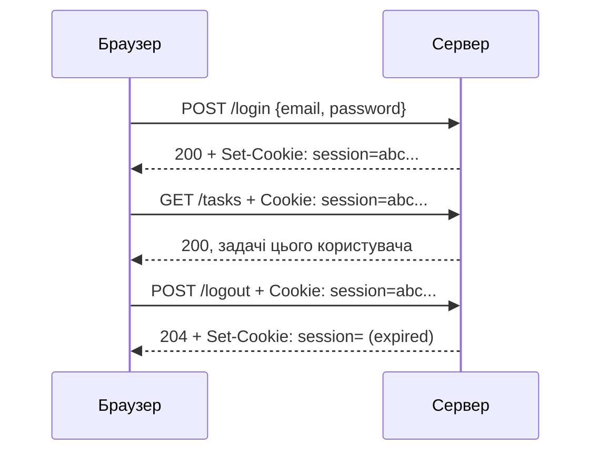
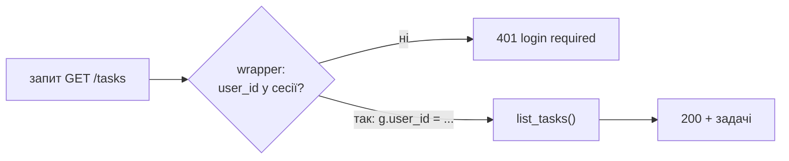

# 24. (Л) Робота з сесіями у Flask

## Зміст лекції

1. HTTP не памʼятає користувача
2. Cookie
3. Сесія у Flask: підписана cookie
4. `SECRET_KEY`
5. Що можна й чого не можна класти в сесію
6. Зберігання паролів: хеш замість пароля
7. Реєстрація
8. Вхід і вихід
9. Декоратор `login_required`
10. Кожен бачить лише свої дані
11. Налаштування безпеки cookie
12. Тривалість сесії
13. Сесії чи токени
14. Типові помилки

## HTTP не памʼятає користувача

HTTP не зберігає стану (лекція 16): кожен запит обробляється так, ніби він перший. Але в API системи задач потрібно знати, **хто** надсилає запит, — щоб показати саме його задачі. Для цього є два поняття:

| Поняття | Питання | Приклад |
|---|---|---|
| **автентифікація** | хто ви? | вхід за email і паролем |
| **авторизація** | що вам дозволено? | змінювати лише власні задачі |

Після входу сервер має «впізнавати» користувача в кожному наступному запиті. Найпростіший механізм для цього — **cookie**.

## Cookie

**Cookie** — невелика пара «назва = значення», яку сервер надсилає заголовком `Set-Cookie`, а клієнт (браузер) **автоматично** повертає заголовком `Cookie` з кожним наступним запитом до того самого сайту:



```python
# Program: set and read a plain cookie
from flask import Flask, make_response, request

app = Flask(__name__)


@app.get("/visit")
def visit():
    count = int(request.cookies.get("visits", "0")) + 1
    response = make_response({"visits": count})
    response.set_cookie("visits", str(count))
    return response


with app.test_client() as client:
    for _ in range(3):
        response = client.get("/visit")
    print(response.get_json(), response.headers["Set-Cookie"])
```

```text
{'visits': 3} visits=3; Path=/
```

Тестовий клієнт, як і браузер, зберігає cookie між запитами. Проблема: значення cookie — у руках клієнта. Користувач може записати туди будь-що, наприклад `user_id=1` — і стати іншим користувачем. Тому важливі дані в звичайних cookie не зберігають.

## Сесія у Flask: підписана cookie

Обʼєкт `flask.session` поводиться як словник, що «живе» між запитами одного клієнта. Flask зберігає його в cookie `session`, **підписаній** секретним ключем (бібліотека itsdangerous). Підпис — криптографічна контрольна сума: якщо клієнт змінить хоч один символ, підпис не збігатиметься, і Flask проігнорує таку сесію.

```python
# Program: the session cookie is signed, not encrypted
import base64
import json

from flask import Flask, session

app = Flask(__name__)
app.secret_key = "demo-only-secret"


@app.get("/remember/<name>")
def remember(name: str):
    session["name"] = name
    return {"saved": name}


@app.get("/whoami")
def whoami():
    return {"name": session.get("name")}


with app.test_client() as client:
    client.get("/remember/olena")
    print(client.get("/whoami").get_json())

    cookie = client.get_cookie("session").value
    payload = cookie.split(".")[0]
    print("payload:", base64.urlsafe_b64decode(payload + "=" * (-len(payload) % 4)).decode())

    client.set_cookie("session", cookie[:-1] + ("A" if cookie[-1] != "A" else "B"))
    print("tampered:", client.get("/whoami").get_json())
```

```text
{'name': 'olena'}
payload: {"name":"olena"}
tampered: {'name': None}
```

!!! warning "Підписана — не означає зашифрована"
    Будь-хто, хто має cookie, може **прочитати** вміст сесії: це лише закодований base64 JSON. Змінити вміст без секретного ключа не можна, а прочитати — можна. Тому паролі, номери карток та інші секрети в сесію не кладуть.

## `SECRET_KEY`

Секретний ключ підписує сесії. Хто знає ключ, той може створити сесію будь-якого користувача. Тому:

- ключ довгий і випадковий;
- ключ **не зберігають у коді й репозиторії**, а читають зі змінної оточення;
- у кожного середовища (розробка, тести, сервер) — свій ключ.

```bash
python3 -c "import secrets; print(secrets.token_hex(32))"
export SECRET_KEY=3f6c...e91a
```

```python
# Program: read SECRET_KEY from the environment
import os

from flask import Flask

app = Flask(__name__)
app.secret_key = os.environ.get("SECRET_KEY")
if not app.secret_key:
    raise SystemExit("error: SECRET_KEY environment variable is not set")
print("key length:", len(app.secret_key))
```

```text
error: SECRET_KEY environment variable is not set
```

## Що можна й чого не можна класти в сесію

| Можна | Не можна |
|---|---|
| `user_id` | пароль, хеш пароля |
| мова інтерфейсу | номер картки, токени інших сервісів |
| час входу | великі обʼєкти (розмір cookie — до 4 КБ) |
| | права доступу, якими не можна довіряти без перевірки в базі |

У сесії зберігають **мінімум** — ідентифікатор користувача. Усе інше (імʼя, роль) читають з бази за цим ідентифікатором.

## Зберігання паролів: хеш замість пароля

Паролі **ніколи** не зберігають у базі у відкритому вигляді: після витоку бази зловмисник отримає паролі, які люди часто використовують і на інших сайтах. Зберігають **хеш** — результат односторонньої функції, з якого не можна відновити пароль. Werkzeug (встановлюється з Flask) має готові функції:

```python
# Program: hash and check passwords
from werkzeug.security import check_password_hash, generate_password_hash

first = generate_password_hash("change-me-123")
second = generate_password_hash("change-me-123")
print(first.split("$")[0])
print("same hash:", first == second)
print("correct:", check_password_hash(first, "change-me-123"))
print("wrong:", check_password_hash(first, "change-me-124"))
```

```text
scrypt:32768:8:1
same hash: False
correct: True
wrong: False
```

- рядок хешу містить алгоритм (`scrypt`) і його параметри, **сіль** і сам хеш;
- **сіль** — випадкове значення, різне для кожного хешу. Тому однакові паролі мають різні хеші, і за одним хешем не можна знайти всіх користувачів з тим самим паролем;
- `scrypt` навмисно повільний: перебрати мільярди варіантів пароля стає надто дорого.

## Реєстрація

Повний приклад цієї лекції — один файл, у якому користувачі й задачі зберігаються у словниках (у практичній роботі — у таблицях `users` і `tasks` через `repository.py`). Наприкінці файлу тестовий клієнт виконує весь сценарій:

```python
# Program: register, login, protected routes, logout
import os
from functools import wraps

from flask import Flask, g, request, session
from werkzeug.security import check_password_hash, generate_password_hash

app = Flask(__name__)
app.secret_key = os.environ.get("SECRET_KEY", "dev-only-secret")
app.config.update(SESSION_COOKIE_HTTPONLY=True, SESSION_COOKIE_SAMESITE="Lax")

USERS = {}  # email -> {"id", "name", "password_hash"}
TASKS = {}  # id -> {"id", "title", "owner_id"}


@app.post("/register")
def register():
    data = request.get_json(silent=True) or {}
    email = str(data.get("email", "")).strip().lower()
    password = str(data.get("password", ""))
    if "@" not in email or len(password) < 8:
        return {"error": "valid email and password of 8+ characters required"}, 400
    if email in USERS:
        return {"error": "email already registered"}, 409
    USERS[email] = {"id": len(USERS) + 1, "name": data.get("name", email),
                    "password_hash": generate_password_hash(password)}
    return {"id": USERS[email]["id"]}, 201


@app.post("/login")
def login():
    data = request.get_json(silent=True) or {}
    user = USERS.get(str(data.get("email", "")).lower())
    if user is None or not check_password_hash(user["password_hash"], str(data.get("password", ""))):
        return {"error": "wrong email or password"}, 401
    session.clear()
    session["user_id"] = user["id"]
    return {"name": user["name"]}


@app.post("/logout")
def logout():
    session.clear()
    return "", 204


def login_required(view):
    @wraps(view)
    def wrapper(*args, **kwargs):
        user_id = session.get("user_id")
        if user_id is None:
            return {"error": "login required"}, 401
        g.user_id = user_id
        return view(*args, **kwargs)
    return wrapper


@app.get("/tasks")
@login_required
def list_tasks():
    return [t for t in TASKS.values() if t["owner_id"] == g.user_id]


@app.post("/tasks")
@login_required
def create_task():
    task = {"id": len(TASKS) + 1, "title": (request.get_json(silent=True) or {}).get("title"),
            "owner_id": g.user_id}
    TASKS[task["id"]] = task
    return task, 201


@app.get("/tasks/<int:task_id>")
@login_required
def get_task(task_id: int):
    task = TASKS.get(task_id)
    if task is None or task["owner_id"] != g.user_id:
        return {"error": "task not found"}, 404
    return task


olena = app.test_client()  # два окремі «браузери» зі своїми cookie
taras = app.test_client()
print("register:", olena.post("/register", json={"email": "olena@example.com", "password": "short"}).status_code,
      olena.post("/register", json={"email": "olena@example.com", "password": "change-me-123"}).status_code,
      olena.post("/register", json={"email": "Olena@example.com", "password": "other-pass-1"}).status_code)
taras.post("/register", json={"email": "taras@example.com", "password": "secret-pass-2"})

print("anonymous:", olena.get("/tasks").status_code)
print("wrong password:", olena.post("/login", json={"email": "olena@example.com", "password": "x"}).get_json())
print("unknown email:", olena.post("/login", json={"email": "nobody@example.com", "password": "x"}).get_json())
print("login:", olena.post("/login", json={"email": "olena@example.com", "password": "change-me-123"}).get_json())
print("cookie:", olena.post("/login", json={"email": "olena@example.com", "password": "change-me-123"})
      .headers["Set-Cookie"].split(";", 1)[1].strip())

olena.post("/tasks", json={"title": "Lab 12: sessions"})
taras.post("/login", json={"email": "taras@example.com", "password": "secret-pass-2"})
taras.post("/tasks", json={"title": "Taras private task"})

print("olena tasks:", [t["title"] for t in olena.get("/tasks").get_json()])
print("taras tasks:", [t["title"] for t in taras.get("/tasks").get_json()])
print("taras reads task 1:", taras.get("/tasks/1").status_code)

print("logout:", olena.post("/logout").status_code, "then:", olena.get("/tasks").status_code)
print("stored hash starts with:", USERS["olena@example.com"]["password_hash"][:6])
```

```text
register: 400 201 409
anonymous: 401
wrong password: {'error': 'wrong email or password'}
unknown email: {'error': 'wrong email or password'}
login: {'name': 'olena@example.com'}
cookie: HttpOnly; Path=/; SameSite=Lax
olena tasks: ['Lab 12: sessions']
taras tasks: ['Taras private task']
taras reads task 1: 404
logout: 204 then: 401
stored hash starts with: scrypt
```

Розберемо цей приклад по частинах.

Обробник `register` перевіряє email і довжину пароля, приводить email до нижнього регістру (`Olena@` і `olena@` — одна адреса) і зберігає лише **хеш**. Повторна реєстрація — `409 Conflict`. У базі унікальність email гарантує обмеження `UNIQUE`, а `UniqueViolation` (лекція 7) перетворюють на `409`.

## Вхід і вихід

- `login` шукає користувача і перевіряє пароль функцією `check_password_hash`. Для неіснуючого email і для неправильного пароля відповідь **однакова**: інакше зловмисник зможе дізнатися, які email зареєстровано.
- Перед записом `user_id` сесію очищують (`session.clear()`): старі дані попереднього користувача на тому самому пристрої не «перейдуть» до нового.
- `logout` очищує сесію; Flask надсилає cookie з минулим терміном дії, і браузер її видаляє.

## Декоратор `login_required`

Перевіряти `session.get("user_id")` у кожному маршруті — повторення коду. **Декоратор** — функція, що приймає функцію-обробник і повертає нову функцію-«обгортку»: обгортка спочатку перевіряє сесію, а потім викликає справжній обробник.



- `@wraps(view)` з модуля `functools` зберігає імʼя обробника; без нього всі захищені маршрути мали б імʼя `wrapper`, і Flask повідомив би про конфлікт назв обробників;
- порядок декораторів важливий: `@app.get(...)` — **вище**, `@login_required` — нижче. Тоді Flask реєструє вже захищену функцію;
- ідентифікатор користувача записується в `flask.g`, щоб обробник не читав сесію повторно.

## Кожен бачить лише свої дані

Автентифікація не дає права на **будь-які** дані. Кожен запит до задачі перевіряє власника. У SQL це умова в запиті:

```sql
SELECT id, title, status FROM tasks WHERE id = %s AND owner_id = %s
```

На чужу задачу API відповідає `404`, а не `403`: так сервер не підтверджує навіть **існування** задачі з таким номером. Помилка «забули перевірити власника» — одна з найпоширеніших вразливостей вебзастосунків (OWASP: *Broken Access Control*).

## Налаштування безпеки cookie

| Налаштування Flask | Атрибут cookie | Захищає від |
|---|---|---|
| `SESSION_COOKIE_HTTPONLY=True` (типово) | `HttpOnly` | JavaScript на сторінці не може прочитати cookie (крадіжка через XSS) |
| `SESSION_COOKIE_SECURE=True` | `Secure` | cookie передається лише через HTTPS |
| `SESSION_COOKIE_SAMESITE="Lax"` | `SameSite=Lax` | запити з чужих сайтів не несуть cookie (атака CSRF) |

На сервері з HTTPS вмикають усі три. Під час розробки на `http://127.0.0.1` атрибут `Secure` вимикають, інакше браузер не надсилатиме cookie.

## Тривалість сесії

Типово сесія Flask діє до закриття браузера. Щоб вона трималася певний час, позначають `session.permanent = True` і задають `PERMANENT_SESSION_LIFETIME`:

```python
# Program: a session that lives 7 days
from datetime import datetime, timedelta, timezone
from email.utils import parsedate_to_datetime

from flask import Flask, session

app = Flask(__name__)
app.secret_key = "demo-only-secret"
app.config["PERMANENT_SESSION_LIFETIME"] = timedelta(days=7)


@app.post("/login")
def login():
    session.permanent = True
    session["user_id"] = 1
    return {"ok": True}


with app.test_client() as client:
    cookie = client.post("/login").headers["Set-Cookie"]
    expires = cookie.split("Expires=")[1].split(";")[0]
    days = (parsedate_to_datetime(expires) - datetime.now(timezone.utc)).total_seconds() / 86400
    print("expires in days:", round(days))
```

```text
expires in days: 7
```

Сесію, підписану ключем, сервер не може «відкликати»: вона діє до закінчення терміну. Щоб примусово вийти з усіх пристроїв, змінюють `SECRET_KEY` (тоді недійсні **всі** сесії) або зберігають сесії на сервері (у базі чи Redis).

## Сесії чи токени

| | Сесія в cookie | Токен у заголовку `Authorization` |
|---|---|---|
| хто надсилає | браузер автоматично | клієнт додає сам: `Authorization: Bearer <token>` |
| типовий клієнт | вебсайт | мобільний застосунок, інший сервер, скрипт |
| захист від CSRF | потрібен (`SameSite`) | не потрібен |
| приклади | `flask.session` | API-ключі, JWT, OAuth 2.0 |

Для навчального API достатньо сесій. Принципи однакові для обох підходів: хеші паролів, секрети поза кодом, перевірка власника для кожного ресурсу.

## Типові помилки

| Помилка | Чому погано | Як правильно |
|---|---|---|
| Пароль у базі відкритим текстом або `md5` | після витоку бази паролі відомі | `generate_password_hash` (scrypt) |
| `SECRET_KEY` у коді | будь-хто з доступом до репозиторію підробить сесію | змінна оточення |
| Секрети в `session` | вміст сесії читається з cookie | лише `user_id` |
| Різні повідомлення «немає email» і «неправильний пароль» | можна перевірити, хто зареєстрований | одне повідомлення |
| Немає перевірки власника | будь-хто читає чужі задачі за номером | `WHERE owner_id = %s`, відповідь `404` |
| `@login_required` над `@app.get` | Flask реєструє незахищену функцію | `@app.get` зверху |
| Декоратор без `@wraps` | конфлікт назв обробників | `functools.wraps` |
| `Secure` вимкнено на сервері з HTTPS | cookie можна перехопити | `SESSION_COOKIE_SECURE=True` |

## Підсумок

- HTTP не зберігає стану; щоб «памʼятати» користувача, сервер передає клієнту **cookie**.
- `flask.session` — словник, збережений у cookie, **підписаній** `SECRET_KEY`: клієнт не може його змінити, але може прочитати.
- `SECRET_KEY` читають зі змінної оточення; у сесії зберігають лише `user_id`.
- Паролі зберігають як **хеш із сіллю** (`generate_password_hash`) і перевіряють `check_password_hash`.
- Декоратор `login_required` захищає маршрути (`401`), перевірка власника — дані інших користувачів (`404`).
- Cookie захищають атрибутами `HttpOnly`, `Secure`, `SameSite`; тривалість задає `PERMANENT_SESSION_LIFETIME`.

## Корисні посилання

- [Flask — Sessions](https://flask.palletsprojects.com/en/stable/quickstart/#sessions)
- [Flask — Security Considerations](https://flask.palletsprojects.com/en/stable/web-security/)
- [Werkzeug — security helpers](https://werkzeug.palletsprojects.com/en/stable/utils/#module-werkzeug.security)
- [MDN — Using HTTP cookies](https://developer.mozilla.org/en-US/docs/Web/HTTP/Cookies)
- [OWASP — Password Storage Cheat Sheet](https://cheatsheetseries.owasp.org/cheatsheets/Password_Storage_Cheat_Sheet.html)
