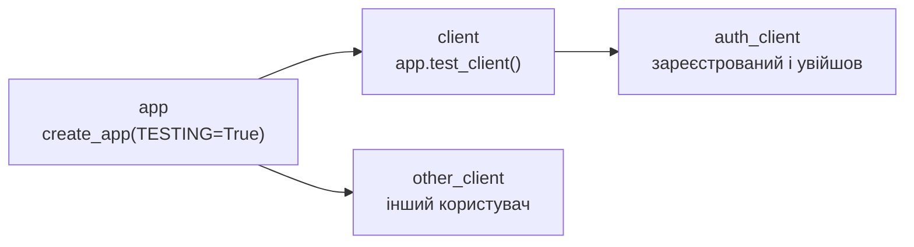

# 26. (Л) Тестування REST API

## Зміст лекції

1. Навіщо автоматично тестувати API
2. Що саме перевіряти
3. Застосунок для тестування
4. Тестовий клієнт Flask
5. Фікстури `app`, `client`, `auth_client`
6. Позитивні сценарії
7. Помилкові сценарії
8. Параметризація: багато некоректних запитів
9. Тести доступу: 401 і чужі дані
10. Тести з базою даних
11. Покриття коду: `pytest-cov`
12. Ручне тестування: `curl` і HTTPie
13. Типові помилки

## Навіщо автоматично тестувати API

API з лекцій 18–24 має десяток маршрутів, кожен з кількома кодами відповіді. Перевіряти їх вручну через `curl` після кожної зміни — довго, і щось обовʼязково забудеться. Автоматичні тести:

- виконують сотні запитів за секунди;
- ловлять **регресії** — коли нова зміна ламає те, що працювало;
- є документацією: тест показує, як API має поводитися;
- дозволяють сміливо змінювати код: якщо тести зелені, поведінка збереглася.

| Рівень | Що перевіряє | Приклад |
|---|---|---|
| модульні тести | окрему функцію | `validate()` повертає помилку для порожнього `title` (лекція 33, 5 семестр) |
| тести репозиторію | SQL на тестовій базі | `create_task` вставляє рядок (лекція 9) |
| **тести API** | HTTP-запит → відповідь | `POST /tasks` повертає `201` і задачу |
| наскрізні (end-to-end) | увесь застосунок разом з клієнтом | браузер відкриває сторінку, натискає кнопку |

Сьогодні — тести API: вони перевіряють застосунок «ззовні», як його бачить клієнт.

## Що саме перевіряти

Для кожного маршруту перевіряють:

| Що | Приклад |
|---|---|
| код стану | `201`, `400`, `404` |
| тіло відповіді | поля, значення, типи |
| важливі заголовки | `Location`, `Content-Type` |
| побічний ефект | після `DELETE` задача справді зникла |
| помилкові дані | кожне поле з неправильним значенням |
| доступ | без входу — `401`, чужа задача — `404` |

!!! tip "Перевіряйте і код, і вміст"
    Тест `assert response.status_code == 200` пройде навіть тоді, коли API поверне порожній список замість задач. Добрий тест перевіряє і код стану, і **вміст** відповіді.

## Застосунок для тестування

Візьмемо застосунок з фабрикою `create_app` (лекція 18). Щоб приклади запускалися без бази даних, задачі зберігаються у словнику **всередині** кожного створеного застосунку: кожен тест отримує свій застосунок і свої дані. У практичній роботі той самий підхід застосовують до застосунку з базою (розділ «Тести з базою даних»).

```python
# File: app.py
import os
from functools import wraps

from flask import Flask, abort, g, request, session
from werkzeug.exceptions import HTTPException
from werkzeug.security import check_password_hash, generate_password_hash

STATUSES = ("todo", "in_progress", "done")


def create_app(config: dict | None = None) -> Flask:
    app = Flask(__name__)
    app.config.update(SECRET_KEY=os.environ.get("SECRET_KEY"), TESTING=False)
    app.config.update(config or {})
    users = {}  # email -> user
    tasks = {}  # id -> task
    next_id = {"task": 1}

    def login_required(view):
        @wraps(view)
        def wrapper(*args, **kwargs):
            if "user_id" not in session:
                abort(401, description="login required")
            g.user_id = session["user_id"]
            return view(*args, **kwargs)
        return wrapper

    def own_task(task_id: int) -> dict:
        task = tasks.get(task_id)
        if task is None or task["owner_id"] != g.user_id:
            abort(404, description=f"task {task_id} not found")
        return task

    def validate(data, partial: bool) -> dict:
        if not isinstance(data, dict):
            abort(400, description="JSON object expected")
        clean = {}
        if "title" in data or not partial:
            title = data.get("title")
            if not isinstance(title, str) or not title.strip() or len(title) > 200:
                abort(400, description="title: non-empty string up to 200 characters")
            clean["title"] = title.strip()
        if "status" in data:
            if data["status"] not in STATUSES:
                abort(400, description=f"status: one of {', '.join(STATUSES)}")
            clean["status"] = data["status"]
        return clean

    @app.get("/health")
    def health():
        return {"status": "ok"}

    @app.post("/register")
    def register():
        data = request.get_json(silent=True) or {}
        email, password = str(data.get("email", "")).lower(), str(data.get("password", ""))
        if "@" not in email or len(password) < 8:
            abort(400, description="valid email and password of 8+ characters required")
        if email in users:
            abort(409, description="email already registered")
        users[email] = {"id": len(users) + 1, "password_hash": generate_password_hash(password)}
        return {"id": users[email]["id"]}, 201

    @app.post("/login")
    def login():
        data = request.get_json(silent=True) or {}
        user = users.get(str(data.get("email", "")).lower())
        if user is None or not check_password_hash(user["password_hash"], str(data.get("password", ""))):
            abort(401, description="wrong email or password")
        session.clear()
        session["user_id"] = user["id"]
        return {"id": user["id"]}

    @app.get("/tasks")
    @login_required
    def list_tasks():
        status = request.args.get("status")
        return [t for t in tasks.values() if t["owner_id"] == g.user_id and status in (None, t["status"])]

    @app.post("/tasks")
    @login_required
    def create_task():
        data = validate(request.get_json(silent=True), partial=False)
        task = {"id": next_id["task"], "status": "todo", **data, "owner_id": g.user_id}
        tasks[task["id"]] = task
        next_id["task"] += 1
        return task, 201, {"Location": f"/tasks/{task['id']}"}

    @app.get("/tasks/<int:task_id>")
    @login_required
    def get_task(task_id: int):
        return own_task(task_id)

    @app.patch("/tasks/<int:task_id>")
    @login_required
    def update_task(task_id: int):
        task = own_task(task_id)
        task.update(validate(request.get_json(silent=True), partial=True))
        return task

    @app.delete("/tasks/<int:task_id>")
    @login_required
    def delete_task(task_id: int):
        del tasks[own_task(task_id)["id"]]
        return "", 204

    @app.errorhandler(HTTPException)
    def http_error(error):
        headers = [(k, v) for k, v in error.get_headers() if k != "Content-Type"]  # зокрема Allow для 405
        body = {"error": error.name.lower().replace(" ", "_"), "message": error.description}
        return body, error.code, headers

    return app


if __name__ == "__main__":
    create_app().run(debug=True)
```

## Тестовий клієнт Flask

`app.test_client()` (лекція 18) надсилає запити безпосередньо застосунку. Налаштування `TESTING=True` вмикає режим тестування: винятки в обробниках не ховаються за відповіддю `500`, а потрапляють у тест — так легше знайти причину.

| Виклик | Що надсилає |
|---|---|
| `client.get("/tasks", query_string={"status": "done"})` | `GET /tasks?status=done` |
| `client.post("/tasks", json={...})` | JSON-тіло з `Content-Type: application/json` |
| `client.post("/tasks", data="{bad", content_type="application/json")` | довільне «сире» тіло |
| `client.get("/x", headers={"X-API-Key": "k"})` | власні заголовки |

## Фікстури `app`, `client`, `auth_client`

Фікстури (лекція 33, 5 семестр; лекція 9) збирають у файлі `tests/conftest.py`. Кожна наступна фікстура будується на попередній:



```python
# File: tests/conftest.py
import pytest

from app import create_app

PASSWORD = "test-password-1"


@pytest.fixture
def app():
    return create_app({"TESTING": True, "SECRET_KEY": "test-only-secret"})


@pytest.fixture
def client(app):
    return app.test_client()


def logged_in(app, email: str):
    client = app.test_client()
    assert client.post("/register", json={"email": email, "password": PASSWORD}).status_code == 201
    assert client.post("/login", json={"email": email, "password": PASSWORD}).status_code == 200
    return client


@pytest.fixture
def auth_client(app):
    return logged_in(app, "student@example.com")


@pytest.fixture
def other_client(app):
    return logged_in(app, "other@example.com")
```

Зверніть увагу на обробник `http_error` у `app.py`: він переносить у JSON-відповідь заголовки винятку (`error.get_headers()`). Без цього відповідь `405` втратила б заголовок `Allow` — і тест `test_method_not_allowed` нижче виявив би саме таку помилку.

Фікстура `app` без `scope` створюється **для кожного тесту** заново, тож тести не впливають один на одного. `SECRET_KEY` для тестів задано прямо в коді — це не секрет: ключ діє лише в тестовому застосунку.

## Позитивні сценарії

```python
# File: tests/test_tasks.py
import pytest


def create(client, title="Lab 13: API tests", **fields):
    response = client.post("/tasks", json={"title": title, **fields})
    assert response.status_code == 201
    return response.get_json()


def test_health(client):
    response = client.get("/health")
    assert response.status_code == 200
    assert response.get_json() == {"status": "ok"}


def test_create_task(auth_client):
    response = auth_client.post("/tasks", json={"title": "  Lab 13: API tests  "})
    assert response.status_code == 201
    task = response.get_json()
    assert task["title"] == "Lab 13: API tests"
    assert task["status"] == "todo"
    assert response.headers["Location"] == f"/tasks/{task['id']}"


def test_list_tasks_with_filter(auth_client):
    create(auth_client, "Lab 13")
    create(auth_client, "Essay", status="done")
    assert [t["title"] for t in auth_client.get("/tasks").get_json()] == ["Lab 13", "Essay"]
    done = auth_client.get("/tasks", query_string={"status": "done"}).get_json()
    assert [t["title"] for t in done] == ["Essay"]


def test_get_one_task(auth_client):
    task = create(auth_client)
    response = auth_client.get(f"/tasks/{task['id']}")
    assert response.status_code == 200
    assert response.get_json() == task


def test_update_status(auth_client):
    task = create(auth_client)
    response = auth_client.patch(f"/tasks/{task['id']}", json={"status": "done"})
    assert response.status_code == 200
    assert response.get_json()["status"] == "done"
    assert response.get_json()["title"] == task["title"]


def test_delete_task(auth_client):
    task = create(auth_client)
    response = auth_client.delete(f"/tasks/{task['id']}")
    assert response.status_code == 204
    assert response.data == b""
    assert auth_client.get(f"/tasks/{task['id']}").status_code == 404
```

Допоміжна функція `create` прибирає повторення: тест на видалення не мусить знову перевіряти створення в подробицях — для цього є окремий тест.

## Помилкові сценарії

Помилкових сценаріїв зазвичай **більше**, ніж успішних, і саме в них ховаються помилки:

```python
# File: tests/test_errors.py
import pytest


def test_unknown_task_gives_404(auth_client):
    response = auth_client.get("/tasks/999")
    assert response.status_code == 404
    assert response.get_json() == {"error": "not_found", "message": "task 999 not found"}


def test_method_not_allowed(auth_client):
    response = auth_client.put("/tasks")
    assert response.status_code == 405
    assert "POST" in response.headers["Allow"]


def test_body_is_not_json(auth_client):
    response = auth_client.post("/tasks", data="{bad json", content_type="application/json")
    assert response.status_code == 400


def test_duplicate_email_gives_409(client):
    body = {"email": "a@example.com", "password": "long-enough-1"}
    assert client.post("/register", json=body).status_code == 201
    assert client.post("/register", json=body).status_code == 409


@pytest.mark.parametrize(
    "body, message_part",
    [
        ({}, "title"),
        ({"title": ""}, "title"),
        ({"title": "   "}, "title"),
        ({"title": 42}, "title"),
        ({"title": "x" * 201}, "200 characters"),
        ({"title": "Lab", "status": "later"}, "status"),
        ([1, 2], "JSON object"),
    ],
)
def test_invalid_task_gives_400(auth_client, body, message_part):
    response = auth_client.post("/tasks", json=body)
    assert response.status_code == 400
    assert message_part in response.get_json()["message"]
```

## Параметризація: багато некоректних запитів

Декоратор `@pytest.mark.parametrize` запускає тест `test_invalid_task_gives_400` сім разів — для кожного некоректного тіла. У звіті кожен запуск має власний ідентифікатор, тож одразу видно, який саме варіант не пройшов. Важливі **межові** значення: `title` з 200 символів має пройти, з 201 — ні.

## Тести доступу: 401 і чужі дані

Найнебезпечніші помилки API — помилки доступу. Їх перевіряють окремими тестами:

```python
# File: tests/test_access.py
import pytest


@pytest.mark.parametrize("method, url", [("get", "/tasks"), ("post", "/tasks"), ("get", "/tasks/1"),
                                         ("patch", "/tasks/1"), ("delete", "/tasks/1")])
def test_anonymous_gets_401(client, method, url):
    response = getattr(client, method)(url, json={})
    assert response.status_code == 401


def test_wrong_password_gives_401(client):
    client.post("/register", json={"email": "a@example.com", "password": "long-enough-1"})
    response = client.post("/login", json={"email": "a@example.com", "password": "wrong-password"})
    assert response.status_code == 401


def test_other_user_can_not_see_task(auth_client, other_client):
    task = auth_client.post("/tasks", json={"title": "Private"}).get_json()
    assert other_client.get(f"/tasks/{task['id']}").status_code == 404
    assert other_client.patch(f"/tasks/{task['id']}", json={"status": "done"}).status_code == 404
    assert other_client.delete(f"/tasks/{task['id']}").status_code == 404
    assert other_client.get("/tasks").get_json() == []
    assert auth_client.get(f"/tasks/{task['id']}").get_json()["status"] == "todo"
```

Останній рядок важливий: перевіряємо не лише відповідь `404`, а й те, що задача **справді не змінилася**.

Запуск усіх тестів:

```bash
python3 -m pytest -q
```

```text
........................                                                 [100%]
24 passed in 0.62s
```

## Тести з базою даних

Для застосунку з PostgreSQL (лекція 22) фікстура `app` створює застосунок з тестовою базою, а після тесту очищає таблиці:

```python
# File: tests/conftest.py (variant with PostgreSQL)
import os

import psycopg2
import pytest

from app import create_app


@pytest.fixture
def app():
    name = os.environ.get("PGDATABASE_TEST", "tasks_test")
    if not name.endswith("_test"):
        pytest.exit(f"refusing to run tests on database {name!r}")
    app = create_app({"TESTING": True, "SECRET_KEY": "test-only-secret", "DB_NAME": name})
    yield app
    conn = psycopg2.connect(host="localhost", dbname=name, user="postgres", password=os.environ["PGPASSWORD"])
    with conn, conn.cursor() as cur:
        cur.execute("TRUNCATE tasks, users RESTART IDENTITY CASCADE")
    conn.close()
```

На відміну від тестів репозиторію (лекція 9), тут не вийде скасувати зміни одним `rollback`: маршрути API самі фіксують транзакції. Тому таблиці очищають `TRUNCATE` після кожного тесту. У лекції 28 таку тестову базу автоматично створюватиме GitHub Actions.

## Покриття коду: `pytest-cov`

**Покриття** (coverage) показує, які рядки коду виконувалися під час тестів. Непокриті рядки — код, що не перевірений жодним тестом:

```bash
python3 -m pip install pytest-cov
python3 -m pytest --cov=app --cov-report=term-missing -q
```

```text
........................                                                 [100%]
---------- coverage: platform linux, python 3.12.7 -----------
Name     Stmts   Miss  Cover   Missing
--------------------------------------
app.py      98      2    98%   59, 118
--------------------------------------
TOTAL       98      2    98%

24 passed in 0.81s
```

Рядок `118` — `create_app().run(debug=True)`: він виконується лише при запуску файлу, а не в тестах. А рядок `59` — справжня прогалина: жоден тест не перевіряє реєстрацію з коротким паролем чи email без `@`. Допишемо тест:

```python
# File: tests/test_register.py
import pytest


@pytest.mark.parametrize("email, password", [("no-at-sign", "long-enough-1"), ("a@example.com", "short")])
def test_invalid_registration_gives_400(client, email, password):
    response = client.post("/register", json={"email": email, "password": password})
    assert response.status_code == 400
    assert "8+ characters" in response.get_json()["message"]
```

Після цього непокритим лишається лише рядок `118`.

Покриття — корисний орієнтир, але не мета: 100 % покриття не гарантує правильності, якщо тести не перевіряють вміст відповідей.

## Ручне тестування: `curl` і HTTPie

Для швидкої перевірки під час розробки зручні консольні клієнти:

```bash
curl -i -X POST http://127.0.0.1:5000/register \
  -H "Content-Type: application/json" \
  -d '{"email": "olena@example.com", "password": "change-me-123"}'
curl -i -c cookies.txt -X POST http://127.0.0.1:5000/login \
  -H "Content-Type: application/json" \
  -d '{"email": "olena@example.com", "password": "change-me-123"}'
curl -i -b cookies.txt http://127.0.0.1:5000/tasks
```

| Ключ `curl` | Значення |
|---|---|
| `-i` | показати код стану і заголовки |
| `-X POST` | метод |
| `-H` | заголовок |
| `-d` | тіло запиту |
| `-c file` / `-b file` | зберегти / надіслати cookie |

HTTPie (`pip install httpie`) — те саме коротше: `http POST :5000/tasks title="Lab 13"`. Ручні перевірки не замінюють автоматичних тестів: їх не повториш автоматично після кожної зміни.

## Типові помилки

| Помилка | Чому погано | Як правильно |
|---|---|---|
| Перевіряють лише код стану | неправильний вміст лишається непоміченим | код + тіло + побічний ефект |
| Тести залежать один від одного | падають при іншому порядку | новий `app` для кожного тесту |
| Тести лише успішних сценаріїв | помилки в обробці некоректних даних | `400`, `401`, `404`, `405`, `409` |
| Немає тестів доступу до чужих даних | витік даних інших користувачів | тест з `other_client` |
| Тести працюють з робочою базою | втрата даних | окрема база `*_test` |
| Секрет робочого середовища у тестах | розголошення ключа | тестовий `SECRET_KEY` |
| Копіювання підготовки в кожному тесті | довгі, важкі для змін тести | фікстури й допоміжні функції |
| Мета — 100 % покриття | тести «для цифри» без перевірок | покриття як орієнтир |

## Підсумок

- Тести API перевіряють застосунок «ззовні»: запит → код стану, тіло, заголовки, побічні ефекти.
- Тестовий клієнт Flask виконує запити без сервера; фабрика `create_app` створює окремий застосунок для кожного тесту.
- Фікстури `app` → `client` → `auth_client` будуються одна на одній у `conftest.py`.
- Помилкових сценаріїв більше, ніж успішних; `parametrize` перевіряє багато некоректних запитів одним тестом.
- Обовʼязкові тести доступу: без входу — `401`, чужі дані — `404` і без змін.
- `pytest-cov` показує неперевірені рядки; `curl` і HTTPie — для ручних перевірок.

## Корисні посилання

- [Flask — Testing Flask Applications](https://flask.palletsprojects.com/en/stable/testing/)
- [pytest — How to use fixtures](https://docs.pytest.org/en/stable/how-to/fixtures.html)
- [pytest — Parametrizing tests](https://docs.pytest.org/en/stable/how-to/parametrize.html)
- [pytest-cov](https://pytest-cov.readthedocs.io/)
- [HTTPie](https://httpie.io/docs/cli)
