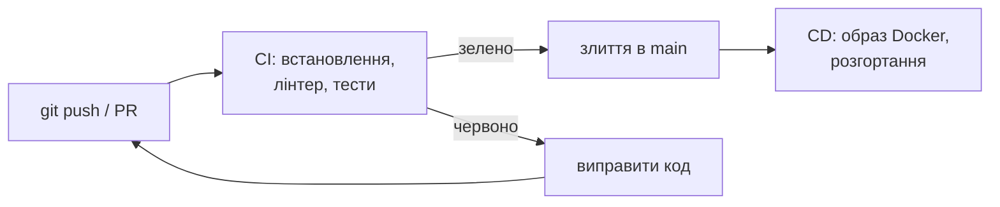
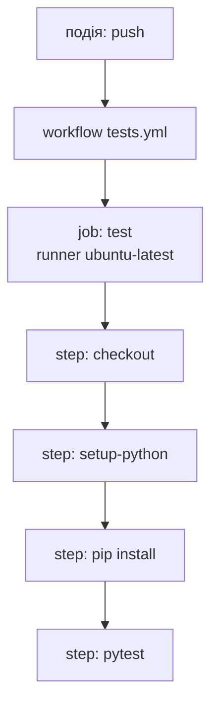
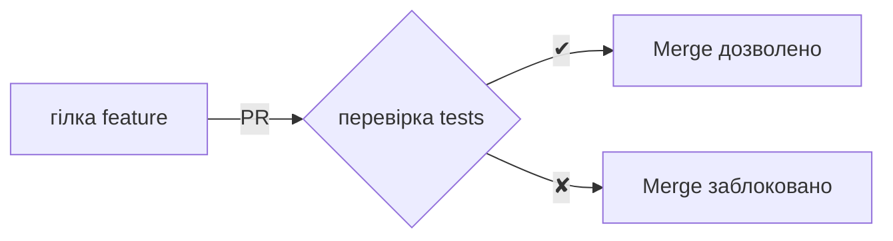

# 28. (Л) Неперервна інтеграція (CI). GitHub Actions

## Зміст лекції

1. Проблема: «у мене тести проходять»
2. Неперервна інтеграція і неперервна доставка
3. GitHub Actions: основні поняття
4. Перший workflow
5. Синтаксис YAML коротко
6. Події: коли запускати
7. Кроки: `uses` і `run`
8. Тестова база даних: `services`
9. Змінні оточення й секрети
10. Матриця версій Python
11. Кешування залежностей
12. Перевірка стилю коду
13. Захист гілки: PR лише з зеленими перевірками
14. Читання журналу невдалого запуску
15. Типові помилки

## Проблема: «у мене тести проходять»

У лекції 26 ми написали тести API. Але вони корисні лише тоді, коли їх **запускають**. У команді часто буває так:

- розробник забув запустити тести перед push;
- тести проходять лише на його компʼютері: там є файл, змінна оточення чи бібліотека, яких немає в репозиторії;
- рецензент pull request (лекція 12, 5 семестр) не може перевірити, чи зміна нічого не зламала.

Розвʼязання — запускати тести **автоматично** на чистому сервері при кожній зміні в репозиторії.

## Неперервна інтеграція і неперервна доставка

| Практика | Що означає |
|---|---|
| **CI** — Continuous Integration, неперервна інтеграція | кожна зміна автоматично збирається і перевіряється тестами; зміни часто зливаються в основну гілку |
| **CD** — Continuous Delivery / Deployment, неперервна доставка / розгортання | перевірена зміна автоматично готується до випуску або одразу розгортається на сервері |



Сам цей курс використовує CD: сайт з лекціями автоматично публікується на GitHub Pages після кожного push у `main`.

## GitHub Actions: основні поняття

**GitHub Actions** — вбудована в GitHub система CI/CD. Для публічних репозиторіїв вона безкоштовна.

| Поняття | Значення |
|---|---|
| **workflow** | автоматизований процес, описаний YAML-файлом у `.github/workflows/` |
| **event** (подія) | що запускає workflow: `push`, `pull_request`, розклад, ручний запуск |
| **job** (завдання) | набір кроків, що виконуються на одній віртуальній машині |
| **runner** | віртуальна машина, що виконує job (`ubuntu-latest`) |
| **step** (крок) | окрема команда (`run`) або готова дія (`uses`) |
| **action** | повторно використовуваний крок з GitHub Marketplace: `actions/checkout`, `actions/setup-python` |



Кожен запуск job починається на **чистій** віртуальній машині: немає ні вашого коду, ні бібліотек, ні файлів з попередніх запусків. Саме тому CI виявляє проблему «у мене працює».

## Перший workflow

```yaml
# File: .github/workflows/tests.yml
name: tests

on:
  push:
  pull_request:

jobs:
  test:
    runs-on: ubuntu-latest
    steps:
      - uses: actions/checkout@v4
      - uses: actions/setup-python@v5
        with:
          python-version: "3.12"
      - run: pip install -r requirements.txt
      - run: pytest -v
```

Щоб workflow спрацював, у репозиторії мають бути `requirements.txt` з `flask` і `pytest` та тести з лекції 26. Після push відкрийте вкладку **Actions** репозиторію: зʼявиться запуск, а біля коміту — жовта (виконується), зелена (успіх) або червона (помилка) позначка.

## Синтаксис YAML коротко

**YAML** — формат конфігурації, у якому структуру задають **відступи** (лише пробіли, не табуляція):

| YAML | Python-аналог |
|---|---|
| `name: tests` | `{"name": "tests"}` |
| вкладений блок з відступом | вкладений словник |
| `- item` | елемент списку |
| `python-version: "3.12"` | рядок `"3.12"` |
| `python-version: 3.10` | **число** `3.1` |

Прочитаємо workflow засобами Python, щоб побачити його структуру (бібліотека PyYAML: `pip install pyyaml`):

```python
# Program: how a YAML workflow looks as Python data
import yaml

text = """
name: tests
on:
  push:
jobs:
  test:
    runs-on: ubuntu-latest
    strategy:
      matrix:
        python-version: [3.10, "3.12"]
    steps:
      - uses: actions/checkout@v4
      - run: pytest -v
"""
data = yaml.safe_load(text)
print(data["name"], list(data["jobs"]))
print(data["jobs"]["test"]["strategy"]["matrix"]["python-version"])
print([list(step.items())[0] for step in data["jobs"]["test"]["steps"]])
print(data[True])
```

```text
tests ['test']
[3.1, '3.12']
[('uses', 'actions/checkout@v4'), ('run', 'pytest -v')]
{'push': None}
```

Два сюрпризи YAML:

- `3.10` без лапок — це число `3.1`, і GitHub встановив би Python 3.1. Версії **завжди** беруть у лапки;
- ключ `on` за правилами YAML 1.1 — це логічне `True`. GitHub читає його правильно, але інші інструменти можуть ні.

## Події: коли запускати

```yaml
on:
  push:
    branches: [main]
  pull_request:
  schedule:
    - cron: "0 6 * * 1"   # щопонеділка о 06:00 UTC
  workflow_dispatch:      # кнопка ручного запуску у вкладці Actions
```

| Подія | Коли |
|---|---|
| `push` | після push у будь-яку (або вказану) гілку |
| `pull_request` | при створенні та оновленні pull request |
| `schedule` | за розкладом у форматі cron |
| `workflow_dispatch` | вручну |

Фільтр `paths` запускає workflow лише при зміні певних файлів: наприклад, не запускати тести, коли змінився лише `README.md`.

## Кроки: `uses` і `run`

- `uses: owner/repo@version` — готова дія. `actions/checkout@v4` завантажує код репозиторію, `actions/setup-python@v5` встановлює Python;
- `run:` — команда оболонки. Кілька команд записують блоком з `|`:

```yaml
      - name: Install dependencies
        run: |
          python -m pip install --upgrade pip
          pip install -r requirements.txt
```

`name` дає кроку зрозумілу назву в журналі. Версію дії (`@v4`) вказують завжди: без неї workflow може зламатися після оновлення дії.

## Тестова база даних: `services`

Тести репозиторію (лекція 9) і API з базою (лекція 26) потребують PostgreSQL. Розділ `services` запускає контейнер (лекції 11–14) поруч з job:

```yaml
# File: .github/workflows/tests.yml
name: tests

on:
  push:
  pull_request:

jobs:
  test:
    runs-on: ubuntu-latest
    services:
      postgres:
        image: postgres:16
        env:
          POSTGRES_PASSWORD: postgres
          POSTGRES_DB: tasks_test
        ports:
          - 5432:5432
        options: >-
          --health-cmd pg_isready
          --health-interval 5s
          --health-retries 10
    env:
      PGHOST: localhost
      PGUSER: postgres
      PGPASSWORD: postgres
      PGDATABASE_TEST: tasks_test
      SECRET_KEY: test-only-secret
    steps:
      - uses: actions/checkout@v4
      - uses: actions/setup-python@v5
        with:
          python-version: "3.12"
      - run: pip install -r requirements.txt
      - run: psql -h localhost -U postgres -d tasks_test -f schema.sql
      - run: pytest -v
```

- `options` з `--health-cmd pg_isready` змушує GitHub чекати, доки база почне приймати підключення, — не потрібні повторні спроби в коді (лекція 14);
- `env` на рівні job задає змінні оточення для всіх кроків; код тестів читає їх так само, як локально;
- пароль `postgres` тут не секрет: це тимчасова база, що існує лише кілька хвилин усередині запуску.

## Змінні оточення й секрети

Справжні секрети (токен для публікації образу, ключ доступу до сервера) **не пишуть у YAML**: файл лежить у репозиторії. Їх додають у налаштуваннях репозиторію: *Settings → Secrets and variables → Actions*, а у workflow звертаються через `secrets`:

```yaml
    steps:
      - name: Log in to the registry
        run: echo "${{ secrets.REGISTRY_TOKEN }}" | docker login ghcr.io -u "${{ github.actor }}" --password-stdin
```

GitHub приховує значення секретів у журналі (`***`) і не передає їх у workflow, запущені з pull request від сторонніх форків.

Код застосунку однаково читає налаштування зі змінних оточення — і локально, і в CI, і в контейнері:

```python
# Program: one configuration source for local runs, CI and Docker
import os

DEFAULTS = {"PGHOST": "localhost", "PGUSER": "postgres", "PGDATABASE_TEST": "tasks_test"}


def settings() -> dict:
    config = {name: os.environ.get(name, default) for name, default in DEFAULTS.items()}
    config["CI"] = os.environ.get("CI") == "true"  # GitHub Actions задає CI=true
    missing = [name for name in ("PGPASSWORD", "SECRET_KEY") if not os.environ.get(name)]
    if missing:
        raise SystemExit(f"error: set environment variables: {', '.join(missing)}")
    return config


os.environ.update(PGPASSWORD="postgres", SECRET_KEY="test-only-secret", CI="true")
print(settings())
```

```text
{'PGHOST': 'localhost', 'PGUSER': 'postgres', 'PGDATABASE_TEST': 'tasks_test', 'CI': True}
```

## Матриця версій Python

**Матриця** запускає той самий job з різними параметрами — наприклад, на кількох версіях Python паралельно:

```yaml
jobs:
  test:
    runs-on: ubuntu-latest
    strategy:
      fail-fast: false
      matrix:
        python-version: ["3.11", "3.12", "3.13"]
    steps:
      - uses: actions/checkout@v4
      - uses: actions/setup-python@v5
        with:
          python-version: ${{ matrix.python-version }}
      - run: pip install -r requirements.txt
      - run: pytest -q
```

GitHub створить три job: `test (3.11)`, `test (3.12)`, `test (3.13)`. `fail-fast: false` дозволяє решті job завершитися, навіть якщо одна впала, — видно, на яких саме версіях проблема. Наприклад, тип `int | None` в анотаціях не працює на Python 3.9.

## Кешування залежностей

Щоразу завантажувати всі пакети довго. `setup-python` вміє кешувати завантажені пакети pip за вмістом `requirements.txt`:

```yaml
      - uses: actions/setup-python@v5
        with:
          python-version: "3.12"
          cache: pip
```

Поки `requirements.txt` не змінився, пакети беруться з кешу, і встановлення триває секунди.

## Перевірка стилю коду

Крім тестів, CI зазвичай перевіряє **стиль і типові помилки** коду лінтером. Популярний швидкий лінтер для Python — **Ruff**:

```yaml
      - run: pip install ruff
      - run: ruff check .
```

```text
app.py:3:8: F401 [*] `json` imported but unused
tests/test_tasks.py:1:8: F401 [*] `pytest` imported but unused
Found 2 errors.
[*] 2 fixable with the `--fix` option.
```

Лінтер знаходить невикористані імпорти, невизначені імена, підозрілі порівняння ще **до** запуску тестів. Ненульовий код завершення будь-якої команди `run` робить крок і весь job червоним.

## Захист гілки: PR лише з зеленими перевірками

У налаштуваннях репозиторію (*Settings → Branches → Branch protection rules* або *Rulesets*) для гілки `main` вмикають:

- **Require a pull request before merging** — зміни потрапляють у `main` лише через pull request;
- **Require status checks to pass** — злиття заблоковано, доки job `test` не стане зеленим.



Так у `main` ніколи не потрапляє код, що ламає тести.

## Читання журналу невдалого запуску

Червона позначка — не катастрофа, а інформація. У вкладці Actions відкрийте запуск → job → крок, що впав. Для `pytest` наприкінці журналу є коротке зведення:

```text
FAILED tests/test_tasks.py::test_update_status - assert 'todo' == 'done'
========================= 1 failed, 25 passed in 1.42s =========================
Error: Process completed with exit code 1.
```

Порядок дій:

1. Знайти назву тесту і рядок `assert`, що не виконався.
2. Відтворити помилку **локально**: `pytest tests/test_tasks.py::test_update_status -v`.
3. Виправити код (або тест, якщо змінилася вимога) і зробити push у ту саму гілку — workflow запуститься знову, а pull request оновиться.

Якщо тест падає лише в CI, а локально проходить, причина зазвичай в оточенні: відсутній файл (не доданий у git), змінна оточення, інша версія Python, залежність від часового поясу чи порядку тестів.

## Типові помилки

| Помилка | Чому погано | Як правильно |
|---|---|---|
| Workflow не в `.github/workflows/` | GitHub його не бачить | правильний шлях, розширення `.yml` |
| Табуляція у YAML | помилка розбору файлу | лише пробіли |
| `python-version: 3.10` без лапок | встановлюється Python 3.1 | `"3.10"` |
| Пакет є локально, але не в `requirements.txt` | `ModuleNotFoundError` у CI | `pip freeze` або ручний список залежностей |
| Секрети прямо в YAML | видно всім, хто має доступ до репозиторію | `secrets.NAME` |
| Тести не чекають бази | випадкові падіння | `--health-cmd pg_isready` |
| Дії без версії: `actions/checkout` | зламається після оновлення | `actions/checkout@v4` |
| Злиття PR з червоною перевіркою | у `main` потрапляє зламаний код | захист гілки |
| «Лагодять» CI, вимикаючи тести | помилка лишається | знайти й виправити причину |

## Підсумок

- **CI** — автоматична перевірка кожної зміни на чистому сервері; **CD** — автоматичний випуск перевіреної зміни.
- GitHub Actions виконує **workflow** (YAML у `.github/workflows/`) за **подіями**; workflow складається з **jobs**, а ті — з **steps** (`uses` або `run`).
- `services` запускає PostgreSQL-контейнер для тестів; `env` задає змінні оточення, `secrets` — справжні секрети.
- Матриця перевіряє кілька версій Python, `cache: pip` пришвидшує встановлення, лінтер Ruff ловить помилки до тестів.
- Захист гілки не дає злити pull request з червоними перевірками.
- Невдалий запуск читають з журналу і відтворюють локально.

## Корисні посилання

- [GitHub Actions — документація](https://docs.github.com/en/actions)
- [GitHub — Building and testing Python](https://docs.github.com/en/actions/use-cases-and-examples/building-and-testing/building-and-testing-python)
- [GitHub — Creating PostgreSQL service containers](https://docs.github.com/en/actions/use-cases-and-examples/using-containerized-services/creating-postgresql-service-containers)
- [actions/setup-python](https://github.com/actions/setup-python)
- [Ruff — документація](https://docs.astral.sh/ruff/)
