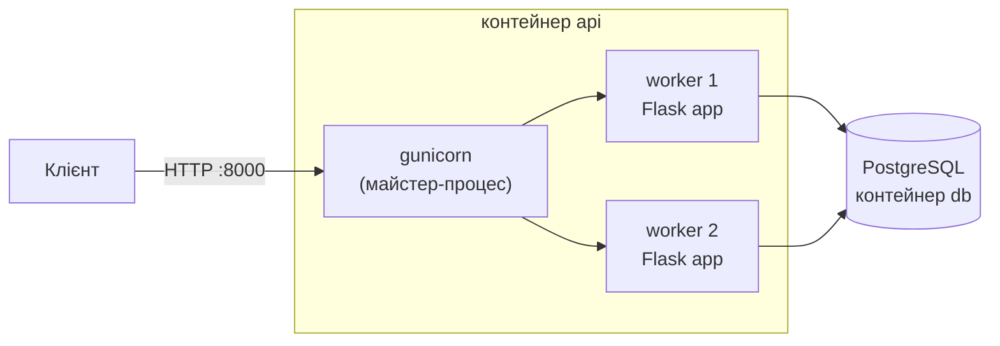
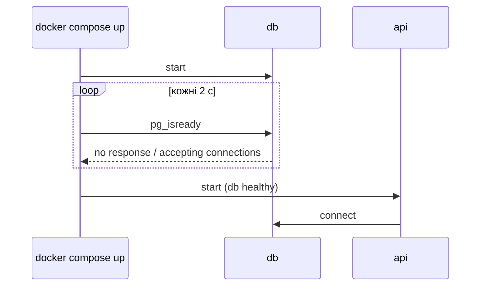

# 30. (Л) Розгортання Flask REST API у Docker

## Зміст лекції

1. Від сервера розробки до робочого сервера
2. WSGI і gunicorn
3. Запуск застосунку в gunicorn
4. Конфігурація зі змінних оточення
5. Перевірка стану: `/health`
6. Журнали в контейнері
7. Dockerfile для Flask API
8. Збирання і запуск контейнера
9. Docker Compose: API і база даних
10. Мережа Compose: імʼя сервісу як адреса
11. Порядок запуску: `depends_on` і `healthcheck`
12. Оновлення застосунку
13. Контрольний список розгортання
14. Типові помилки

## Від сервера розробки до робочого сервера

У лекціях 18–28 ми запускали API командою `flask run` або `app.run(debug=True)`. Flask попереджає при кожному запуску:

```text
WARNING: This is a development server. Do not use it in a production deployment. Use a production WSGI server instead.
```

Вбудований сервер Werkzeug зручний для розробки, але не розрахований на робоче навантаження: він не керує процесами-обробниками, не перезапускає їх після збою і не налаштований на безпеку. Сьогодні підготуємо API до **розгортання**: запустимо його в gunicorn усередині Docker-контейнера разом з PostgreSQL.



## WSGI і gunicorn

**WSGI** (Web Server Gateway Interface, PEP 3333) — стандартний інтерфейс між вебсервером і Python-застосунком. WSGI-застосунок — це обʼєкт, який можна викликати з двома аргументами: словником даних запиту і функцією для початку відповіді. Обʼєкт `Flask` є саме таким застосунком:

```python
# Program: a Flask app is a WSGI callable
from flask import Flask

app = Flask(__name__)


@app.get("/health")
def health():
    return {"status": "ok"}


def start_response(status, headers):
    print("status:", status)
    print("content-type:", dict(headers)["Content-Type"])


environ = {"REQUEST_METHOD": "GET", "PATH_INFO": "/health", "SERVER_NAME": "localhost", "SERVER_PORT": "8000",
           "wsgi.url_scheme": "http", "wsgi.input": None}
body = app(environ, start_response)
print("body:", b"".join(body))
```

```text
status: 200 OK
content-type: application/json
body: b'{"status":"ok"}\n'
```

Будь-який WSGI-сервер може запускати будь-який WSGI-застосунок. **gunicorn** — популярний WSGI-сервер для Linux:

- запускає кілька **процесів-обробників** (workers), тож обробляє кілька запитів одночасно;
- перезапускає процес, що завис або впав;
- коректно завершує роботу за сигналом `SIGTERM` від `docker stop` (лекція 14).

## Запуск застосунку в gunicorn

```bash
python3 -m pip install gunicorn
gunicorn --bind 0.0.0.0:8000 --workers 2 "app:create_app()"
```

```text
[2026-10-20 10:00:00 +0000] [12] [INFO] Starting gunicorn 23.0.0
[2026-10-20 10:00:00 +0000] [12] [INFO] Listening at: http://0.0.0.0:8000 (12)
[2026-10-20 10:00:00 +0000] [12] [INFO] Using worker: sync
[2026-10-20 10:00:00 +0000] [13] [INFO] Booting worker with pid: 13
[2026-10-20 10:00:00 +0000] [14] [INFO] Booting worker with pid: 14
```

| Параметр | Значення |
|---|---|
| `"app:create_app()"` | модуль `app`, викликати фабрику `create_app()` (лекція 18) |
| `--bind 0.0.0.0:8000` | слухати всі мережеві інтерфейси, порт `8000` |
| `--workers 2` | кількість процесів-обробників; типово `2 × ядра + 1` |
| `--access-logfile -` | журнал запитів у stdout |
| `--timeout 30` | перезапустити обробник, що не відповів за 30 с |

!!! warning "`0.0.0.0` усередині контейнера"
    Адреса `127.0.0.1` усередині контейнера — це сам контейнер. Якщо сервер слухає лише її, запити з хоста через `-p 8000:8000` до нього не дійдуть. У контейнері сервер має слухати `0.0.0.0`.

## Конфігурація зі змінних оточення

Той самий образ запускають на компʼютері розробника, у CI і на сервері. Відрізняються лише налаштування — їх передають змінними оточення (принцип *The Twelve-Factor App*). Фабрика застосунку читає їх і **одразу** повідомляє, чого бракує:

```python
# File: config.py
import os

REQUIRED = ("SECRET_KEY", "PGPASSWORD")


def from_env(environ=os.environ) -> dict:
    missing = [name for name in REQUIRED if not environ.get(name)]
    if missing:
        raise RuntimeError(f"missing environment variables: {', '.join(missing)}")
    return {
        "SECRET_KEY": environ["SECRET_KEY"],
        "DB_HOST": environ.get("PGHOST", "localhost"),
        "DB_PORT": int(environ.get("PGPORT", "5432")),
        "DB_NAME": environ.get("PGDATABASE", "tasks"),
        "DB_USER": environ.get("PGUSER", "postgres"),
        "DB_PASSWORD": environ["PGPASSWORD"],
        "SESSION_COOKIE_SECURE": environ.get("COOKIE_SECURE", "1") == "1",
    }
```

```python
# Program: configuration from different environments
from config import from_env

print(from_env({"SECRET_KEY": "s", "PGPASSWORD": "p", "PGHOST": "db", "COOKIE_SECURE": "0"}))
try:
    from_env({"PGHOST": "db"})
except RuntimeError as error:
    print("error:", error)
```

```text
{'SECRET_KEY': 's', 'DB_HOST': 'db', 'DB_PORT': 5432, 'DB_NAME': 'tasks', 'DB_USER': 'postgres', 'DB_PASSWORD': 'p', 'SESSION_COOKIE_SECURE': False}
error: missing environment variables: SECRET_KEY, PGPASSWORD
```

Застосунок, що не стартує через відсутній `SECRET_KEY`, краще за застосунок, що стартує з порожнім ключем і непомітно працює небезпечно.

## Перевірка стану: `/health`

Docker, Compose, балансувальники навантаження й системи моніторингу періодично звертаються до застосунку, щоб дізнатися, чи він працює. Для цього роблять маршрут `/health`, який перевіряє й залежності — підключення до бази:

```python
# File: app.py
import logging
import os

import psycopg2
from flask import Flask

import config


def create_app(settings: dict | None = None) -> Flask:
    app = Flask(__name__)
    app.config.update(settings if settings is not None else config.from_env())
    logging.basicConfig(level=logging.INFO, format="%(asctime)s %(levelname)s %(name)s: %(message)s")

    def connect():
        return psycopg2.connect(host=app.config["DB_HOST"], port=app.config["DB_PORT"],
                                dbname=app.config["DB_NAME"], user=app.config["DB_USER"],
                                password=app.config["DB_PASSWORD"], connect_timeout=3)

    @app.get("/health")
    def health():
        try:
            conn = connect()
            with conn, conn.cursor() as cur:
                cur.execute("SELECT 1")
            conn.close()
        except psycopg2.OperationalError:
            app.logger.exception("database is not available")
            return {"status": "error", "database": "unavailable"}, 503
        return {"status": "ok", "database": "ok"}

    app.logger.info("application created, database host %s", app.config["DB_HOST"])
    return app


if __name__ == "__main__":
    create_app().run(debug=True)
```

```python
# Program: /health reports database problems with 503
import os

from app import create_app

base = {"SECRET_KEY": "test", "DB_HOST": "localhost", "DB_PORT": 5432, "DB_NAME": "school",
        "DB_USER": "postgres", "DB_PASSWORD": os.environ.get("PGPASSWORD", "")}
for port in (5432, 5999):
    client = create_app({**base, "DB_PORT": port}).test_client()
    response = client.get("/health")
    print(port, response.status_code, response.get_json())
```

```text
5432 200 {'database': 'ok', 'status': 'ok'}
5999 503 {'database': 'unavailable', 'status': 'error'}
```

Код `503 Service Unavailable` означає «сервіс тимчасово не може обробляти запити» — саме так варто відповідати, коли недоступна база. Повне трасування помилки потрапляє в журнал.

## Журнали в контейнері

У контейнері журнал пишуть у **stdout/stderr**, а не у файли (лекція 26, 5 семестр): Docker збирає їх і показує командою `docker logs`. Для gunicorn додають `--access-logfile -` (журнал запитів у stdout), а для Python — змінну `PYTHONUNBUFFERED=1`, щоб записи зʼявлялися одразу (лекція 12).

## Dockerfile для Flask API

```dockerfile
# File: Dockerfile
FROM python:3.12-slim

ENV PYTHONDONTWRITEBYTECODE=1 \
    PYTHONUNBUFFERED=1

WORKDIR /app

COPY requirements.txt .
RUN pip install --no-cache-dir -r requirements.txt

RUN useradd --create-home --uid 1000 appuser
COPY --chown=appuser:appuser . .
USER appuser

EXPOSE 8000
CMD ["gunicorn", "--bind", "0.0.0.0:8000", "--workers", "2", "--access-logfile", "-", "app:create_app()"]
```

```text
# File: requirements.txt
flask==3.1.3
psycopg2-binary==2.9.10
gunicorn==23.0.0
```

```text
# File: .dockerignore
.git
.venv
__pycache__
.pytest_cache
.env
tests
```

Усі прийоми з лекції 12: залежності встановлюються до копіювання коду (кеш шарів), процес працює від звичайного користувача, секрети не потрапляють в образ, `CMD` в exec-формі.

## Збирання і запуск контейнера

```bash
docker build -t petrenko-tasks-api:1.0 .
docker run -d --name petrenko-api -p 8000:8000 \
  -e SECRET_KEY="$SECRET_KEY" -e PGPASSWORD="$PGPASSWORD" \
  -e PGHOST=host.docker.internal -e PGDATABASE=school -e COOKIE_SECURE=0 \
  petrenko-tasks-api:1.0
curl -s http://localhost:8000/health
docker logs --tail 3 petrenko-api
```

```text
{"database":"ok","status":"ok"}
[2026-10-20 10:05:01 +0000] [8] [INFO] Booting worker with pid: 8
2026-10-20 10:05:01,412 INFO app: application created, database host host.docker.internal
172.17.0.1 - - [20/Oct/2026:10:05:09 +0000] "GET /health HTTP/1.1" 200 32 "-" "curl/8.5.0"
```

`host.docker.internal` — імʼя хоста з погляду контейнера в Docker Desktop (на Linux його вмикають параметром `--add-host=host.docker.internal:host-gateway`). Зручніше запускати базу теж у контейнері — і описати обидва сервіси в Compose.

## Docker Compose: API і база даних

```yaml
# File: compose.yaml
services:
  db:
    image: postgres:16
    environment:
      POSTGRES_PASSWORD: ${DB_PASSWORD}
      POSTGRES_DB: tasks
    volumes:
      - pgdata:/var/lib/postgresql/data
      - ./schema.sql:/docker-entrypoint-initdb.d/schema.sql:ro
    healthcheck:
      test: ["CMD-SHELL", "pg_isready -U postgres -d tasks"]
      interval: 2s
      retries: 15

  api:
    build: .
    ports:
      - "8000:8000"
    environment:
      PGHOST: db
      PGDATABASE: tasks
      PGUSER: postgres
      PGPASSWORD: ${DB_PASSWORD}
      SECRET_KEY: ${SECRET_KEY}
      COOKIE_SECURE: "0"
    depends_on:
      db:
        condition: service_healthy
    restart: unless-stopped
    healthcheck:
      test: ["CMD", "python", "-c", "import urllib.request; urllib.request.urlopen('http://127.0.0.1:8000/health')"]
      interval: 10s
      retries: 3

volumes:
  pgdata:
```

Значення `${DB_PASSWORD}` і `${SECRET_KEY}` Compose бере з файлу `.env` поруч з `compose.yaml` (він у `.gitignore`):

```text
# File: .env
DB_PASSWORD=change-me-db
SECRET_KEY=change-me-long-random-string
```

```bash
docker compose up -d --build
docker compose ps
curl -s http://localhost:8000/health
```

```text
[+] Running 4/4
 ✔ Network lab15_flask_docker_default  Created
 ✔ Volume "lab15_flask_docker_pgdata"  Created
 ✔ Container lab15_flask_docker-db-1   Healthy
 ✔ Container lab15_flask_docker-api-1  Started
NAME                       IMAGE                    SERVICE   STATUS                    PORTS
lab15_flask_docker-api-1   lab15_flask_docker-api   api       Up 12 seconds (healthy)   0.0.0.0:8000->8000/tcp
lab15_flask_docker-db-1    postgres:16              db        Up 14 seconds (healthy)   5432/tcp
{"database":"ok","status":"ok"}
```

## Мережа Compose: імʼя сервісу як адреса

Compose створює для проєкту окрему мережу, у якій контейнери знаходять один одного **за іменем сервісу**. Тому `PGHOST: db`: для контейнера `api` база доступна за адресою `db:5432`.

| Хто підключається | Адреса бази |
|---|---|
| контейнер `api` в тій самій мережі Compose | `db:5432` |
| програма на хості (якщо опубліковано `ports: "5433:5432"`) | `localhost:5433` |

Порт бази в прикладі **не опубліковано** на хост: до неї має доступ лише API. Це безпечніше — менше відкритих портів.

## Порядок запуску: `depends_on` і `healthcheck`

`depends_on` без умови лише запускає `db` **раніше** за `api`, але не чекає, доки PostgreSQL буде готовий приймати підключення. `condition: service_healthy` змушує Compose чекати, доки `healthcheck` бази (`pg_isready`) не стане успішним:



`restart: unless-stopped` перезапускає API після збою або перезавантаження сервера; `healthcheck` для `api` дозволяє бачити в `docker compose ps`, чи API справді відповідає.

## Оновлення застосунку

```bash
git pull
docker compose up -d --build api
docker compose logs -f api
```

Compose перебудує образ (шари залежностей — з кешу) і перестворить лише контейнер `api`. Том `pgdata` з даними лишається. Якщо оновлення змінює схему бази, перед ним роблять резервну копію (`pg_dump`, лекція 14) і виконують скрипт зміни схеми — **міграцію**.

## Контрольний список розгортання

| Пункт | Як перевірити |
|---|---|
| `debug` вимкнено, працює gunicorn | `docker logs` показує `Starting gunicorn` |
| секрети лише в змінних оточення | `docker history` образу не містить паролів |
| `SECRET_KEY` довгий і випадковий | `secrets.token_hex(32)` |
| процес не від `root` | `docker compose exec api whoami` → `appuser` |
| дані бази в томі | `docker volume ls` |
| база не опублікована назовні | немає `ports` у сервісі `db` |
| `/health` перевіряє базу | зупиніть `db` → `/health` дає `503` |
| журнали в stdout | `docker compose logs api` |
| тести пройшли в CI | зелена позначка GitHub Actions (лекція 28) |

## Типові помилки

| Помилка | Чому погано | Як правильно |
|---|---|---|
| `flask run` / `debug=True` у контейнері | сервер розробки, налагоджувач відкритий | gunicorn |
| gunicorn слухає `127.0.0.1` | запити з хоста не доходять | `--bind 0.0.0.0:8000` |
| `PGHOST=localhost` у контейнері `api` | `localhost` — це сам контейнер | імʼя сервісу `db` |
| `depends_on` без `condition` | API стартує раніше за базу і падає | `condition: service_healthy` |
| Пароль бази в `compose.yaml` | потрапляє в git | `${DB_PASSWORD}` з `.env` |
| Порт бази відкрито назовні | атаки на базу з мережі | лише внутрішня мережа Compose |
| `/health` завжди `200` | не видно, що база недоступна | перевірка залежностей, `503` |
| `docker compose down -v` при оновленні | видалено дані | `down` без `-v`, резервна копія |

## Підсумок

- Сервер розробки Flask не для робочого середовища; застосунок запускають у **WSGI-сервері** gunicorn: `gunicorn --bind 0.0.0.0:8000 "app:create_app()"`.
- Налаштування й секрети приходять зі змінних оточення; застосунок не стартує без обовʼязкових.
- Маршрут `/health` перевіряє залежності й відповідає `503`, якщо база недоступна.
- Dockerfile для API поєднує прийоми лекції 12: кеш шарів, користувач без root, exec-форма `CMD`.
- **Docker Compose** запускає `api` і `db` разом: контейнери знаходять один одного за іменем сервісу, `depends_on` з `service_healthy` задає порядок запуску, том зберігає дані.

## Корисні посилання

- [Flask — Deploying to Production](https://flask.palletsprojects.com/en/stable/deploying/)
- [Flask — Gunicorn](https://flask.palletsprojects.com/en/stable/deploying/gunicorn/)
- [gunicorn — Settings](https://docs.gunicorn.org/en/stable/settings.html)
- [Docker Compose — Control startup order](https://docs.docker.com/compose/how-tos/startup-order/)
- [The Twelve-Factor App](https://12factor.net)
