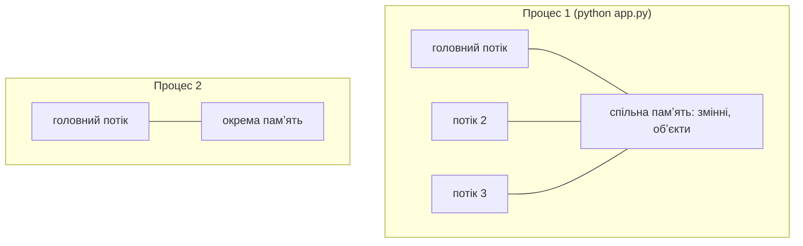
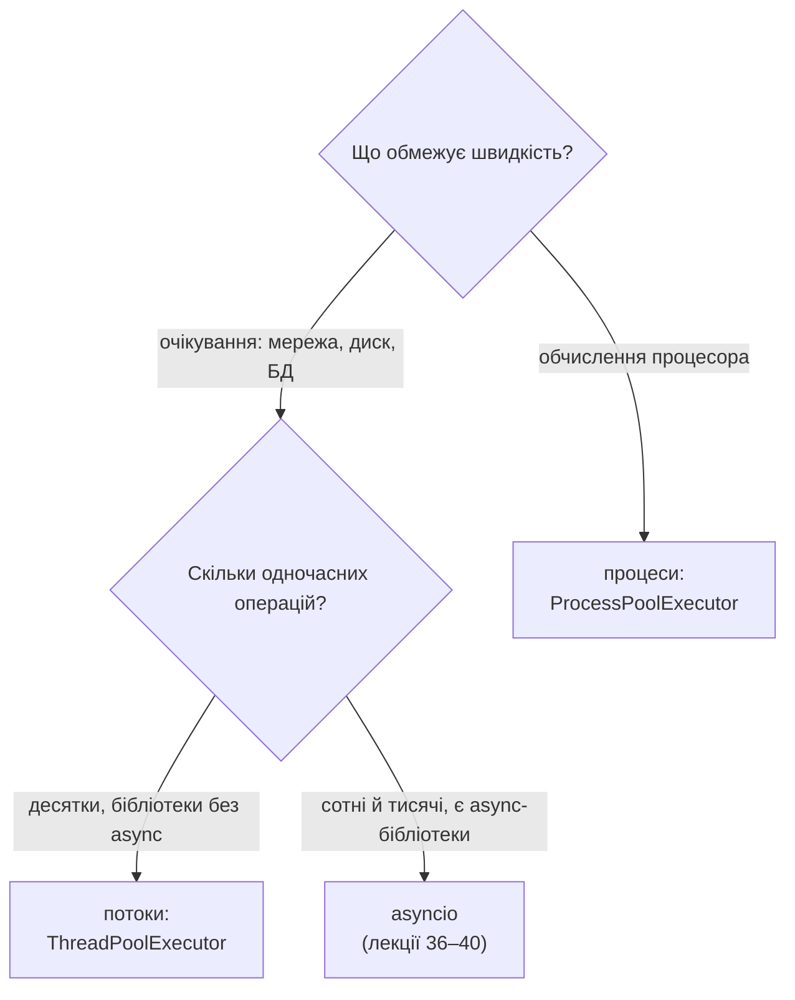

# 32. (Л) Основи асинхронного програмування та конкурентності в Python

## Зміст лекції

1. Чому програма чекає
2. Задачі, що чекають, і задачі, що рахують
3. Конкурентність і паралелізм
4. Процес і потік
5. Три моделі виконання в Python
6. Потоки: модуль `threading`
7. Пул потоків: `ThreadPoolExecutor`
8. Процеси: `ProcessPoolExecutor`
9. Спільні дані і стан гонитви
10. `Lock`: взаємне виключення
11. Вимірювання часу
12. Яку модель обрати
13. Типові помилки

## Чому програма чекає

У лекції 37 (5 семестр) програма завантажувала курс валюти з API НБУ. Один запит триває близько 0,2–0,5 с, і майже весь цей час програма **нічого не робить**: чекає відповіді з мережі. Якщо потрібні курси за 30 днів, послідовна програма чекає 30 разів поспіль:

```mermaid
gantt
    title Послідовне виконання: 4 запити по 1 с
    dateFormat s
    axisFormat %S
    section Програма
    запит 1 :a1, 0, 1s
    запит 2 :a2, after a1, 1s
    запит 3 :a3, after a2, 1s
    запит 4 :a4, after a3, 1s
```



Поки програма чекає першої відповіді, вона могла б уже надіслати решту запитів. Тоді 4 запити зайняли б близько 1 с замість 4.

```mermaid
gantt
    title Конкурентне виконання: 4 запити разом
    dateFormat s
    axisFormat %S
    section Запити
    запит 1 :0, 1s
    запит 2 :0, 1s
    запит 3 :0, 1s
    запит 4 :0, 1s
```



Цей модуль — про те, як змусити програму робити корисну роботу, поки вона чекає.

## Задачі, що чекають, і задачі, що рахують

| | Обмежені вводом-виводом (I/O-bound) | Обмежені процесором (CPU-bound) |
|---|---|---|
| що обмежує швидкість | очікування мережі, диска, бази даних | обчислення процесора |
| процесор під час роботи | майже вільний | завантажений на 100 % |
| приклади | HTTP-запити, читання файлів, запити до PostgreSQL, вебсервер | пошук простих чисел, обробка зображень, стиснення, машинне навчання |
| що допоможе | потоки або asyncio | кілька процесів |

Визначити тип задачі — перший крок: від нього залежить, яку модель виконання обрати.

## Конкурентність і паралелізм

Ці поняття часто плутають:

- **конкурентність** (concurrency) — кілька задач **перебувають у процесі виконання** одночасно, але в кожен момент може виконуватися лише одна: виконавець перемикається між ними;
- **паралелізм** (parallelism) — кілька задач **виконуються буквально одночасно** на різних ядрах процесора.

Аналогія з кухнею. Один кухар ставить воду на вогонь, поки вона закипає — ріже овочі, потім помішує суп: це **конкурентність**, бо один виконавець перемикається між справами під час очікування. Три кухарі готують три страви одночасно — це **паралелізм**.

| | Конкурентність | Паралелізм |
|---|---|---|
| виконавців | може бути один | кілька (ядра процесора) |
| виграш | використання часу очікування | більше обчислень за той самий час |
| для задач | I/O-bound | CPU-bound |

Паралелізм завжди конкурентний, але конкурентність не завжди паралельна.

## Процес і потік

**Процес** — запущена програма: власна памʼять, власний інтерпретатор Python, власні відкриті файли. Операційна система ізолює процеси один від одного.

**Потік** (thread) — послідовність виконання **всередині** процесу. Усі потоки процесу мають **спільну памʼять**: ті самі змінні, обʼєкти, підключення.



| | Процес | Потік |
|---|---|---|
| памʼять | окрема | спільна з іншими потоками процесу |
| створення | повільне, багато памʼяті | швидке, мало памʼяті |
| обмін даними | через черги, канали, файли | через спільні змінні (обережно!) |
| збій | не зачіпає інші процеси | може зламати весь процес |

```python
# Program: the current process and thread
import os
import threading

print("process id:", os.getpid() > 0)
print("thread:", threading.current_thread().name)
print("cpu cores:", os.cpu_count() > 0)
```

```text
process id: True
thread: MainThread
cpu cores: True
```

## Три моделі виконання в Python

| Модель | Модуль | Хто перемикає задачі | Паралелізм на кількох ядрах |
|---|---|---|---|
| потоки | `threading`, `concurrent.futures` | операційна система, будь-коли | ні для коду Python (GIL, лекція 34) |
| процеси | `multiprocessing`, `concurrent.futures` | операційна система | так |
| asyncio | `asyncio` | сама програма, у точках `await` | ні, один потік |

Сьогодні — потоки й процеси, у лекціях 34–40 — asyncio.

## Потоки: модуль `threading`

Імітуємо завантаження функцією `time.sleep`: як і очікування мережі, вона не навантажує процесор.

```python
# Program: sequential run and threads for waiting tasks
import threading
import time


finished = []


def download(name: str) -> None:
    time.sleep(1)  # імітація очікування відповіді сервера
    finished.append(name)


start = time.perf_counter()
for name in ("a", "b", "c", "d"):
    download(name)
print(f"sequential: {time.perf_counter() - start:.1f} s, finished {finished}")
finished.clear()

start = time.perf_counter()
threads = [threading.Thread(target=download, args=(name,)) for name in ("a", "b", "c", "d")]
for thread in threads:
    thread.start()
for thread in threads:
    thread.join()
print(f"threads: {time.perf_counter() - start:.1f} s, finished {sorted(finished)}")
```

```text
sequential: 4.0 s, finished ['a', 'b', 'c', 'd']
threads: 1.0 s, finished ['a', 'b', 'c', 'd']
```

- `Thread(target=f, args=(...))` створює потік, що виконає `f(*args)`;
- `start()` запускає потік — функція виконується **паралельно** з головним потоком;
- `join()` чекає завершення потоку. Без `join` головний потік пішов би далі, не дочекавшись результатів.

У варіанті з потоками порядок елементів у списку `finished` може змінюватися від запуску до запуску: усі потоки «прокидаються» майже одночасно, і порядок обирає операційна система. Тому список виводимо відсортованим.

## Пул потоків: `ThreadPoolExecutor`

Створювати потік на кожну задачу незручно: важко повернути результат і обмежити кількість потоків (1000 запитів — не означає 1000 потоків). Модуль `concurrent.futures` має **пул** — набір потоків, що по черзі виконують задачі:

```python
# Program: thread pool with results
import time
from concurrent.futures import ThreadPoolExecutor


def get_rate(day: int) -> tuple[int, float]:
    time.sleep(0.5)  # імітація HTTP-запиту
    return day, 41.0 + day / 100


start = time.perf_counter()
with ThreadPoolExecutor(max_workers=4) as pool:
    results = list(pool.map(get_rate, range(1, 9)))
print(results[:3])
print(f"8 tasks, 4 workers: {time.perf_counter() - start:.1f} s")
```

```text
[(1, 41.01), (2, 41.02), (3, 41.03)]
8 tasks, 4 workers: 1.0 s
```

- `pool.map(f, items)` повертає результати **в порядку** вхідних даних;
- 8 задач по 0,5 с у 4 потоках — дві «хвилі» по 0,5 с, разом близько 1 с;
- `with` чекає завершення всіх задач і закриває пул.

`pool.submit(f, arg)` повертає обʼєкт `Future` — «обіцянку» результату. `as_completed` віддає задачі **в міру завершення**:

```python
# Program: results in completion order with submit and as_completed
import time
from concurrent.futures import ThreadPoolExecutor, as_completed


def work(seconds: float) -> float:
    time.sleep(seconds)
    if seconds == 0.2:
        raise ValueError("bad input 0.2")
    return seconds


with ThreadPoolExecutor(max_workers=4) as pool:
    futures = {pool.submit(work, s): s for s in (0.3, 0.1, 0.2, 0.4)}
    for future in as_completed(futures):
        try:
            print("finished", future.result())
        except ValueError as error:
            print("failed", futures[future], error)
```

```text
finished 0.1
failed 0.2 bad input 0.2
finished 0.3
finished 0.4
```

Виняток у потоці не губиться: `future.result()` генерує його повторно в головному потоці.

## Процеси: `ProcessPoolExecutor`

Для **обчислень** потоки Python не дають прискорення (причина — GIL, лекція 34). Обчислювальні задачі розподіляють між **процесами**: кожен має власний інтерпретатор і працює на своєму ядрі.

```python
# Program: CPU-bound work in threads and in processes
import time
from concurrent.futures import ProcessPoolExecutor, ThreadPoolExecutor


def count_primes(limit: int) -> int:
    count = 0
    for n in range(2, limit):
        if all(n % d for d in range(2, int(n ** 0.5) + 1)):
            count += 1
    return count


def measure(title: str, run) -> None:
    start = time.perf_counter()
    results = run()
    print(f"{title:<10} {sum(results)} primes, {time.perf_counter() - start:.2f} s")


if __name__ == "__main__":
    limits = [150_000] * 4
    measure("sequential", lambda: [count_primes(n) for n in limits])
    with ThreadPoolExecutor(max_workers=4) as pool:
        measure("threads", lambda: list(pool.map(count_primes, limits)))
    with ProcessPoolExecutor(max_workers=4) as pool:
        measure("processes", lambda: list(pool.map(count_primes, limits)))
```

Результат на компʼютері з 4 ядрами (час на вашому компʼютері буде іншим):

```text
sequential 55392 primes, 1.62 s
threads    55392 primes, 1.66 s
processes  55392 primes, 0.47 s
```

!!! warning "`if __name__ == \"__main__\":` для процесів"
    Новий процес імпортує ваш модуль заново. Без перевірки `__name__` кожен дочірній процес знову створював би пул процесів. На macOS і Windows це призводить до помилки `RuntimeError`, тому код запуску процесів завжди розміщують під `if __name__ == "__main__":`.

Аргументи й результати передаються між процесами **серіалізацією** (модуль `pickle`). Тому функція має бути визначена на рівні модуля (не `lambda` і не вкладена), а великі дані передавати дорого.

## Спільні дані і стан гонитви

Потоки мають спільну памʼять — це зручно і небезпечно. Операція `counter += 1` складається з кількох кроків: прочитати значення, додати 1, записати. Якщо операційна система перемкне потік між цими кроками, два потоки прочитають однакове значення, і одне збільшення загубиться. Така ситуація називається **станом гонитви** (race condition):

| Крок | Потік A | Потік B | `counter` |
|---|---|---|---|
| 1 | читає `5` | | 5 |
| 2 | | читає `5` | 5 |
| 3 | записує `6` | | 6 |
| 4 | | записує `6` | 6 — одне збільшення втрачено |

```python
# Program: a race condition and its fix with Lock
import threading
import time

counter = 0
lock = threading.Lock()


def unsafe(times: int) -> None:
    global counter
    for _ in range(times):
        value = counter
        time.sleep(0)  # дає змогу іншому потоку втрутитися між читанням і записом
        counter = value + 1


def safe(times: int) -> None:
    global counter
    for _ in range(times):
        with lock:
            value = counter
            time.sleep(0)
            counter = value + 1


for worker in (unsafe, safe):
    counter = 0
    threads = [threading.Thread(target=worker, args=(1000,)) for _ in range(4)]
    for t in threads:
        t.start()
    for t in threads:
        t.join()
    print(f"{worker.__name__}: correct result: {counter == 4000}, lost updates: {counter < 4000}")
```

```text
unsafe: correct result: False, lost updates: True
safe: correct result: True, lost updates: False
```

Без блокування лічильник менший за 4000 (наприклад, 1131), і значення змінюється від запуску до запуску. Найнебезпечніше в станах гонитви саме те, що помилка проявляється **не завжди**: тести можуть пройти, а збій трапиться на сервері.

## `Lock`: взаємне виключення

`threading.Lock` — замок, який у кожен момент може тримати лише один потік. Блок `with lock:` захоплює замок на вході й звільняє на виході (навіть при винятку). Інші потоки чекають на вході в блок.

| Правило | Чому |
|---|---|
| тримати замок якомога коротше | інші потоки чекають, конкурентність зменшується |
| не виконувати під замком довгих операцій (мережа, диск) | інакше потоки виконуються по черзі |
| захоплювати кілька замків завжди в одному порядку | інакше взаємоблокування (deadlock) |
| краще уникати спільних змінних зовсім | `pool.map` повертає результати без спільного стану |

Найпростіший спосіб уникнути гонитви — **не мати спільного стану**: кожна задача повертає результат, а головний потік їх збирає (як у прикладах з `ThreadPoolExecutor`).

## Вимірювання часу

Для вимірювання тривалості використовують `time.perf_counter()` — найточніший монотонний годинник: він не змінюється, коли користувач чи система переводять годинник. `time.time()` для цього не підходить.

```python
# Program: a reusable timer context manager
import time
from contextlib import contextmanager


@contextmanager
def timer(title: str):
    start = time.perf_counter()
    yield
    print(f"{title}: {time.perf_counter() - start:.1f} s")


with timer("two waits"):
    time.sleep(0.3)
    time.sleep(0.2)
```

```text
two waits: 0.5 s
```

Час кожного запуску трохи відрізняється, тому для порівняння варіантів виконують кілька запусків і порівнюють середнє або найменше значення.

## Яку модель обрати



| Модель | Переваги | Недоліки |
|---|---|---|
| потоки | прості, працюють зі звичайними бібліотеками (`requests`, `psycopg2`) | стани гонитви, не прискорюють обчислення, кожен потік займає памʼять |
| процеси | справжній паралелізм обчислень | дорогі в створенні, дані передаються серіалізацією |
| asyncio | тисячі одночасних операцій в одному потоці, явні точки перемикання | потрібні async-бібліотеки, один блокуючий виклик зупиняє все |

## Типові помилки

| Помилка | Чому погано | Як правильно |
|---|---|---|
| Потоки для обчислень | прискорення немає | `ProcessPoolExecutor` |
| Немає `join()` або `with` для пулу | програма йде далі без результатів | `join()`, `with ThreadPoolExecutor()` |
| Спільна змінна без замка | втрачені оновлення, рідкісні збої | `Lock` або результати замість спільного стану |
| Довга операція під замком | потоки виконуються по черзі | під замком лише коротка зміна даних |
| Пул процесів без `if __name__ == "__main__"` | рекурсивний запуск, `RuntimeError` | код запуску під перевіркою |
| `lambda` у `ProcessPoolExecutor` | `PicklingError` | функція на рівні модуля |
| 1000 потоків для 1000 запитів | багато памʼяті, сервер може заблокувати | пул з обмеженою кількістю потоків |
| Час вимірюють `time.time()` | годинник може змінитися | `time.perf_counter()` |

## Підсумок

- Задачі бувають **I/O-bound** (чекають мережу чи диск) і **CPU-bound** (навантажують процесор).
- **Конкурентність** — перемикання між задачами під час очікування; **паралелізм** — одночасне виконання на кількох ядрах.
- **Процес** має власну памʼять, **потоки** одного процесу мають спільну.
- `ThreadPoolExecutor` прискорює задачі з очікуванням, `ProcessPoolExecutor` — обчислення.
- Спільні дані потоків захищають `Lock`, а ще краще — уникають спільного стану.
- Вибір моделі залежить від типу задачі; для тисяч одночасних мережевих операцій — asyncio.

## Корисні посилання

- [Модуль `threading` — довідник](https://docs.python.org/3/library/threading.html)
- [Модуль `concurrent.futures` — довідник](https://docs.python.org/3/library/concurrent.futures.html)
- [Модуль `multiprocessing` — довідник](https://docs.python.org/3/library/multiprocessing.html)
- [Real Python — Speed Up Your Python Program With Concurrency](https://realpython.com/python-concurrency/)
- Fowler M. Python Concurrency with asyncio. — Manning, 2022. — Розділ 1.
