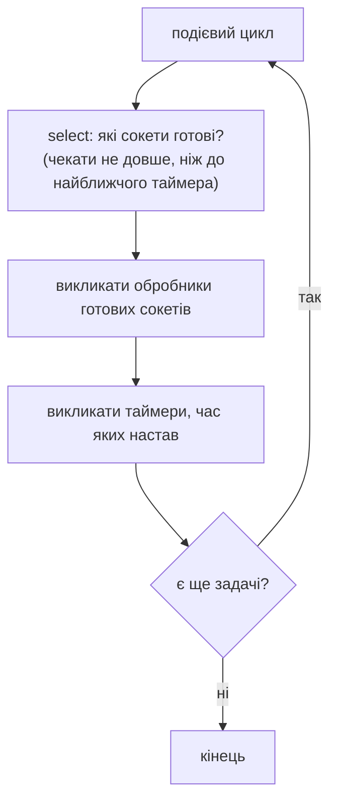

# 34. (Л) Асинхронність усередині Python: GIL, подієвий цикл і сокети

## Зміст лекції

1. Загадка з лекції 32
2. GIL — глобальне блокування інтерпретатора
3. Навіщо Python має GIL
4. Коли GIL звільняється
5. Блокуючий і неблокуючий ввід-вивід
6. Сокет — «труба» для мережевих даних
7. Неблокуючий сокет
8. `select`: хто з сокетів готовий
9. Подієвий цикл
10. Генератори: функції, що вміють призупинятися
11. Власний мініподієвий цикл
12. Від генераторів до `async`/`await`
13. Типові помилки

## Загадка з лекції 32

У лекції 32 ми бачили дивну річ:

| Задача | 4 потоки замість послідовного виконання |
|---|---|
| 4 «завантаження» з `time.sleep(1)` | у 4 рази швидше |
| 4 підрахунки простих чисел | **не швидше** |

Компʼютер має кілька ядер, потоки створено — чому обчислення не прискорилися? Відповідь — **GIL**.

## GIL — глобальне блокування інтерпретатора

**GIL** (Global Interpreter Lock) — замок усередині інтерпретатора CPython. Байт-код Python у процесі може виконувати лише **один потік у кожен момент часу** — той, що тримає GIL. Інші потоки чекають своєї черги.

```mermaid
gantt
    title 3 потоки з обчисленнями: GIL передається по черзі
    dateFormat x
    axisFormat %L
    section Потік 1
    рахує :0, 5
    чекає GIL :5, 15
    рахує :15, 20
    section Потік 2
    чекає GIL :0, 5
    рахує :5, 10
    чекає GIL :10, 20
    section Потік 3
    чекає GIL :0, 10
    рахує :10, 15
    чекає GIL :15, 20
```



Інтерпретатор періодично змушує потік віддати GIL, щоб інші теж могли виконуватися. Інтервал перемикання можна подивитися:

```python
# Program: the GIL switch interval
import sys

print(f"switch interval: {sys.getswitchinterval() * 1000:.0f} ms")
```

```text
switch interval: 5 ms
```

Тож потоки з обчисленнями виконуються **по черзі**, а не паралельно: сумарний час той самий, що й послідовно (а через перемикання — навіть трохи більший).

## Навіщо Python має GIL

CPython керує памʼяттю за допомогою **лічильників посилань**: кожен обʼєкт знає, скільки змінних на нього посилається, і знищується, коли лічильник стає нулем.

```python
# Program: reference counting
import sys

data = [1, 2, 3]
print(sys.getrefcount(data))  # +1 тимчасове посилання — аргумент самої функції
alias = data
print(sys.getrefcount(data))
del alias
print(sys.getrefcount(data))
```

```text
2
3
2
```

Якби два потоки одночасно змінювали лічильник одного обʼєкта, відбувся б стан гонитви (лекція 32) — і обʼєкт міг би бути знищений, поки ним ще користуються. Захищати замком **кожен** обʼєкт — повільно. Один глобальний замок — простий і швидкий для однопотокових програм, а такими є більшість програм на Python.

!!! note "Python без GIL"
    Починаючи з Python 3.13, існує експериментальна збірка *free-threaded* (`python3.13t`), у якій GIL можна вимкнути. Вона ще не є стандартною, і не всі бібліотеки її підтримують. У цьому курсі ми працюємо зі звичайним CPython з GIL.

## Коли GIL звільняється

GIL заважає лише **виконанню байт-коду Python**. Потік **віддає** GIL, коли:

- чекає вводу-виводу: мережа (`socket.recv`), файли, `time.sleep`;
- викликає код на C, що звільняє GIL: стиснення `zlib`, хешування `hashlib`, обчислення NumPy (7 семестр).

```python
# Program: threads overlap while waiting, not while computing
import threading
import time


def wait():
    time.sleep(0.5)


def compute():
    total = 0
    for n in range(3_000_000):
        total += n


def run_threads(target, count=4) -> float:
    threads = [threading.Thread(target=target) for _ in range(count)]
    start = time.perf_counter()
    for t in threads:
        t.start()
    for t in threads:
        t.join()
    return time.perf_counter() - start


start = time.perf_counter()
compute()
one = time.perf_counter() - start
print(f"4 waits in threads: {run_threads(wait):.1f} s (one wait 0.5 s)")
print(f"4 computations in threads take about 4x one: {run_threads(compute) / one > 3}")
```

```text
4 waits in threads: 0.5 s (one wait 0.5 s)
4 computations in threads take about 4x one: True
```

Звідси правило з лекції 32: **потоки — для очікування, процеси — для обчислень**. Кожен процес має власний інтерпретатор і власний GIL.

## Блокуючий і неблокуючий ввід-вивід

Коли програма викликає `response = requests.get(url)`, потік **блокується**: операційна система «присипляє» його, доки не прийдуть дані. Поки потік спить, він нічого іншого зробити не може. Потоки розвʼязують це так: заблокований потік спить, інший працює.

Є й інший шлях — **неблокуючий** ввід-вивід. Програма просить операційну систему: «не присипляй мене; якщо даних ще немає — одразу скажи». Тоді **один** потік може обслуговувати багато зʼєднань: перевіряти, де вже є дані, і обробляти лише їх. Саме так працює asyncio.

| | Блокуючий | Неблокуючий |
|---|---|---|
| даних ще немає | потік спить | виклик одразу повертає «немає даних» |
| одночасних зʼєднань на потік | одне | багато |
| складність коду | проста | потрібен цикл, що перевіряє готовність |

## Сокет — «труба» для мережевих даних

**Сокет** (socket) — обʼєкт операційної системи, через який програма надсилає й отримує дані мережею. За кожним HTTP-запитом, підключенням до PostgreSQL, повідомленням месенджера — сокет. Мережеві протоколи й сокети детально розглянемо в модулі 4 (лекції 42–53); зараз нам достатньо, що сокет має операції `send` і `recv`.

Функція `socket.socketpair()` створює два зʼєднані між собою сокети в одному процесі — зручно для експериментів без мережі:

```python
# Program: a pair of connected sockets
import socket

left, right = socket.socketpair()
left.sendall(b"hello")
print(right.recv(1024))
right.sendall(b"hi back")
print(left.recv(1024))
left.close()
right.close()
```

```text
b'hello'
b'hi back'
```

Сокети передають **байти** (`bytes`), а не рядки: текст кодують `encode()` і декодують `decode()`.

## Неблокуючий сокет

Що буде, якщо викликати `recv`, коли даних немає? Блокуючий сокет чекатиме вічно. Неблокуючий — одразу згенерує `BlockingIOError`:

```python
# Program: a non-blocking socket does not wait
import socket

left, right = socket.socketpair()
right.setblocking(False)
try:
    right.recv(1024)
except BlockingIOError:
    print("no data yet, can do something else")
left.sendall(b"now there is data")
print(right.recv(1024))
left.close()
right.close()
```

```text
no data yet, can do something else
b'now there is data'
```

Але постійно перепитувати всі сокети в циклі («є дані? а тепер?») — марна трата процесора. Потрібен спосіб дізнатися, **які** сокети вже готові.

## `select`: хто з сокетів готовий

Операційна система вміє чекати **одразу на багато** сокетів і повідомляти, які з них готові до читання чи запису. У Python для цього є модуль `selectors` (детально — лекція 51):

```python
# Program: wait for several sockets at once
import selectors
import socket

selector = selectors.DefaultSelector()
pairs = [socket.socketpair() for _ in range(3)]
for number, (_, receiver) in enumerate(pairs):
    receiver.setblocking(False)
    selector.register(receiver, selectors.EVENT_READ, data=f"conn-{number}")

pairs[2][0].sendall(b"third")
pairs[0][0].sendall(b"first")

ready = selector.select(timeout=1)
for key, _ in sorted(ready, key=lambda item: item[0].data):  # порядок select не гарантовано
    print(key.data, key.fileobj.recv(1024))

for sender, receiver in pairs:
    selector.unregister(receiver)
    sender.close()
    receiver.close()
```

```text
conn-0 b'first'
conn-2 b'third'
```

`selector.select()` блокує потік, доки хоча б один сокет не стане готовим, і повертає **лише готові**. Сокет `conn-1` даних не отримав — його не повернуто. Один потік обслуговує всі три зʼєднання.

## Подієвий цикл

**Подієвий цикл** (event loop) — нескінченний цикл, що:

1. запитує в операційної системи, які сокети готові (`select`);
2. для кожного готового сокета викликає функцію-обробник, що чекала на нього;
3. виконує таймери, час яких настав;
4. повторює.



Обробники мають бути **короткими**: поки виконується один, решта чекає. Довга операція (обчислення чи блокуючий `time.sleep`) зупиняє весь цикл. Це головне правило асинхронного програмування.

## Генератори: функції, що вміють призупинятися

Залишилося питання: як написати «чекай даних із сокета, а потім продовж звідси» без купи окремих функцій-обробників? Python має функції, які вміють **призупинятися й продовжуватися** — генератори. Ключове слово `yield` віддає значення і заморожує функцію разом з її локальними змінними; `next()` продовжує її з того самого місця:

```python
# Program: a generator pauses at yield and resumes later
def chore(name: str, steps: int):
    print(f"{name}: start")
    for step in range(1, steps + 1):
        yield f"{name} step {step}"  # пауза: керування повертається викликачу
    print(f"{name}: done")


gen = chore("tea", 2)
print(type(gen).__name__)
print(next(gen))
print("caller does something else")
print(next(gen))
try:
    next(gen)
except StopIteration:
    print("generator finished")
```

```text
generator
tea: start
tea step 1
caller does something else
tea step 2
tea: done
generator finished
```

Виклик `chore("tea", 2)` не виконує тіла функції — він лише створює обʼєкт-генератор. Тіло виконується частинами при кожному `next()`.

## Власний мініподієвий цикл

Поєднаємо ідеї: кожна задача — генератор, що через `yield` повідомляє циклу, скільки секунд хоче «поспати». Цикл зберігає задачі в черзі за часом пробудження і продовжує ту, чий час настав:

```python
# Program: a tiny event loop built on generators
import heapq
import time


def chore(name: str, *durations: float):
    for number, seconds in enumerate(durations, 1):
        print(f"{time.perf_counter() - START:.1f}s {name}: step {number} for {seconds}s")
        yield seconds  # «поспати» seconds, не блокуючи інші задачі
    print(f"{time.perf_counter() - START:.1f}s {name}: done")


def run(tasks) -> None:
    queue = [(0.0, i, task) for i, task in enumerate(tasks)]  # (час пробудження, номер, задача)
    heapq.heapify(queue)
    while queue:
        wake_at, i, task = heapq.heappop(queue)
        delay = wake_at - (time.perf_counter() - START)
        if delay > 0:
            time.sleep(delay)  # спимо, лише коли всі задачі чекають
        try:
            seconds = next(task)
        except StopIteration:
            continue
        heapq.heappush(queue, (time.perf_counter() - START + seconds, i, task))


START = time.perf_counter()
run([chore("kettle", 0.4), chore("sandwich", 0.1, 0.2), chore("backpack", 0.2)])
print(f"total: {time.perf_counter() - START:.1f}s")
```

```text
0.0s kettle: step 1 for 0.4s
0.0s sandwich: step 1 for 0.1s
0.0s backpack: step 1 for 0.2s
0.1s sandwich: step 2 for 0.2s
0.2s backpack: done
0.3s sandwich: done
0.4s kettle: done
total: 0.4s
```

Три задачі сумарно «чекали» 0,9 с, а все завершилося за 0,4 с — тривалість найдовшої задачі. Задачі виконувалися **конкурентно** в одному потоці, без замків і станів гонитви, бо перемикання відбувається лише в точках `yield`.

Справжній подієвий цикл asyncio влаштований так само, лише замість «поспати N секунд» задача може чекати на сокет (через `selectors`), на іншу задачу, на чергу тощо.

## Від генераторів до `async`/`await`

Історично asyncio з'явився в Python 3.4 саме на генераторах (`yield from`). У Python 3.5 додали спеціальний синтаксис:

| Мініцикл цієї лекції | asyncio (лекція 36) |
|---|---|
| функція-генератор з `yield` | корутина: `async def` |
| `yield seconds` | `await asyncio.sleep(seconds)` |
| `run([...])` | `asyncio.run(main())` |
| черга задач за часом | подієвий цикл asyncio з таймерами і `selectors` |

```python
# Program: the same chores with asyncio
import asyncio
import time


async def chore(name: str, *durations: float) -> None:
    for seconds in durations:
        await asyncio.sleep(seconds)
    print(f"{time.perf_counter() - START:.1f}s {name}: done")


async def main() -> None:
    await asyncio.gather(chore("kettle", 0.4), chore("sandwich", 0.1, 0.2), chore("backpack", 0.2))


START = time.perf_counter()
asyncio.run(main())
```

```text
0.2s backpack: done
0.3s sandwich: done
0.4s kettle: done
```

## Типові помилки

| Помилка | Чому погано | Як правильно |
|---|---|---|
| «Потоки завжди прискорюють програму» | для обчислень заважає GIL | процеси для обчислень |
| «GIL робить потоки безпечними» | перемикання можливе між будь-якими байт-кодами, `+=` не атомарний | `Lock` для спільних даних |
| Довга операція в обробнику подієвого циклу | зупиняє всі задачі | короткі обробники, обчислення — в окремий потік чи процес |
| `time.sleep` у асинхронній задачі | блокує весь цикл | `await asyncio.sleep` |
| Рядки в `sock.send` | `TypeError: a bytes-like object is required` | `text.encode()` |
| Цикл, що постійно опитує неблокуючі сокети | 100 % процесора на очікування | `selectors` |

## Підсумок

- **GIL** дозволяє лише одному потоку виконувати байт-код Python у кожен момент; тому потоки не прискорюють обчислень.
- GIL існує через лічильники посилань CPython; він звільняється під час вводу-виводу і в багатьох C-бібліотеках.
- **Блокуючий** ввід-вивід присипляє потік; **неблокуючий** дозволяє одному потоку обслуговувати багато сокетів.
- `selectors` повідомляє, які сокети готові; **подієвий цикл** у циклі обробляє готові сокети і таймери.
- Генератори вміють призупинятися на `yield` — на цій ідеї побудовано корутини `async`/`await` і asyncio.
- Головне правило: код у подієвому циклі не повинен блокувати.

## Корисні посилання

- [Python Glossary — GIL](https://docs.python.org/3/glossary.html#term-global-interpreter-lock)
- [Модуль `selectors` — довідник](https://docs.python.org/3/library/selectors.html)
- [Модуль `socket` — довідник](https://docs.python.org/3/library/socket.html)
- [PEP 703 — Making the Global Interpreter Lock Optional](https://peps.python.org/pep-0703/)
- Fowler M. Python Concurrency with asyncio. — Manning, 2022. — Розділ 1.
