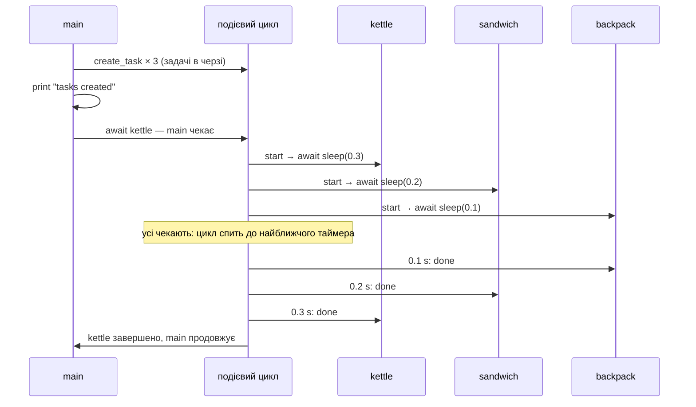
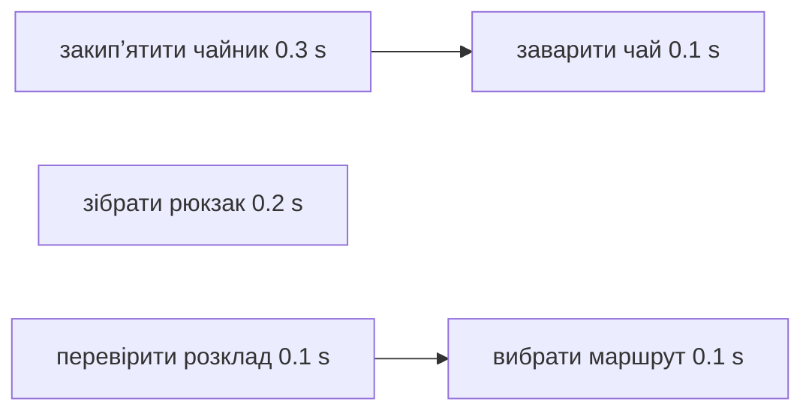

# 36. (Л) Основи asyncio. Корутини, затримки та виконання задач

## Зміст лекції

1. asyncio: конкурентність в одному потоці
2. Корутина: `async def`
3. `await`: дочекатися результату
4. `asyncio.run`: точка входу
5. `asyncio.sleep` — неблокуюча затримка
6. Послідовне виконання корутин
7. Задачі: `asyncio.create_task`
8. Порядок виконання задач
9. Результати задач
10. Залежні дії
11. Обʼєкти, які можна чекати
12. Три типові помилки
13. Ранкові справи: повний приклад
14. Типові помилки

## asyncio: конкурентність в одному потоці

У лекції 34 ми побудували мініподієвий цикл на генераторах: задачі призупинялися на `yield`, а цикл продовжував ту, чий час настав. Модуль **asyncio** зі стандартної бібліотеки — повноцінна реалізація цієї ідеї:

- **подієвий цикл** керує задачами, таймерами й сокетами;
- **корутини** (`async def`) — функції, що вміють призупинятися;
- **`await`** — точка, у якій корутина віддає керування циклу, поки чекає.

| | Потоки (лекція 32) | asyncio |
|---|---|---|
| хто перемикає | ОС, у будь-який момент | програма, лише в точках `await` |
| потоків | багато | один |
| стани гонитви | часті, потрібні замки | рідкісні: між `await` код виконується без перерв |
| одночасних операцій | десятки–сотні | тисячі |
| бібліотеки | звичайні (`requests`) | асинхронні (`aiohttp`, `asyncpg`) |

## Корутина: `async def`

Функція, оголошена через `async def`, — **корутинна функція**. Її виклик **не виконує** тіла, а лише створює обʼєкт-**корутину** — так само, як виклик генераторної функції створює генератор:

```python
# Program: calling an async function creates a coroutine object
import asyncio


async def greet(name: str) -> str:
    print(f"hello, {name}")
    return name.upper()


coro = greet("olena")
print(type(coro).__name__)
print(asyncio.iscoroutine(coro))
result = asyncio.run(coro)
print("result:", result)
```

```text
coroutine
True
hello, olena
result: OLENA
```

Рядок `hello, olena` надруковано лише після `asyncio.run(coro)`: тіло корутини виконав подієвий цикл.

## `await`: дочекатися результату

`await` можна писати лише всередині `async def`. Вираз `await coro` запускає корутину, **чекає** її завершення і повертає її результат. Поки корутина чекає (наприклад, мережі), подієвий цикл виконує інші задачі.

```python
# Program: await returns the result of another coroutine
import asyncio


async def get_rate(currency: str) -> float:
    await asyncio.sleep(0.1)  # імітація запиту до API
    return {"USD": 41.25, "EUR": 44.80}[currency]


async def main() -> None:
    usd = await get_rate("USD")
    eur = await get_rate("EUR")
    print(f"USD {usd}, EUR {eur}, EUR/USD {eur / usd:.4f}")


asyncio.run(main())
```

```text
USD 41.25, EUR 44.8, EUR/USD 1.0861
```

## `asyncio.run`: точка входу

`asyncio.run(main())`:

1. створює новий подієвий цикл;
2. запускає в ньому корутину `main()` і чекає її завершення;
3. скасовує задачі, що лишилися, і закриває цикл;
4. повертає результат `main()`.

Типова структура асинхронної програми — одна корутина `main()` і один виклик `asyncio.run` наприкінці файлу:

```python
# Program: the usual structure of an asyncio program
import asyncio


async def main() -> int:
    print("work inside the event loop")
    await asyncio.sleep(0)
    return 0


if __name__ == "__main__":
    code = asyncio.run(main())
    print("exit code:", code)
```

```text
work inside the event loop
exit code: 0
```

`await asyncio.sleep(0)` — «віддати керування циклу без затримки»: дати шанс виконатися іншим задачам.

## `asyncio.sleep` — неблокуюча затримка

`time.sleep(1)` присипляє **весь потік**, а отже, і подієвий цикл. `await asyncio.sleep(1)` присипляє лише **поточну корутину**: цикл ставить таймер і тим часом виконує інші задачі.

У навчальних прикладах `asyncio.sleep` імітує очікування мережі, бази даних, диска — як `time.sleep` у лекції 32. У справжніх програмах на цьому місці стоять `await session.get(url)` (лекція 38), `await reader.read()` (лекція 53) тощо.

## Послідовне виконання корутин

```python
# Program: awaiting coroutines one by one runs them sequentially
import asyncio
import time


async def chore(name: str, seconds: float) -> str:
    print(f"{time.perf_counter() - START:.1f}s start {name}")
    await asyncio.sleep(seconds)
    print(f"{time.perf_counter() - START:.1f}s done  {name}")
    return name


async def main() -> None:
    await chore("kettle", 0.3)
    await chore("sandwich", 0.2)
    await chore("backpack", 0.1)


START = time.perf_counter()
asyncio.run(main())
print(f"total {time.perf_counter() - START:.1f}s")
```

```text
0.0s start kettle
0.3s done  kettle
0.3s start sandwich
0.5s done  sandwich
0.5s start backpack
0.6s done  backpack
total 0.6s
```

Самі по собі `async` і `await` **не роблять** програму конкурентною: `main` чекає кожну справу до кінця, перш ніж почати наступну. Загальний час — сума тривалостей. Щоб справи виконувалися одночасно, їх треба запустити як **задачі**.

## Задачі: `asyncio.create_task`

`asyncio.create_task(coro)` загортає корутину в **задачу** (`Task`) і планує її виконання в подієвому циклі **одразу**, не чекаючи `await`. Задача почне виконуватися, щойно поточна корутина віддасть керування циклу.

```python
# Program: tasks run concurrently
import asyncio
import time


async def chore(name: str, seconds: float) -> str:
    print(f"{time.perf_counter() - START:.1f}s start {name}")
    await asyncio.sleep(seconds)
    print(f"{time.perf_counter() - START:.1f}s done  {name}")
    return name


async def main() -> None:
    tasks = [
        asyncio.create_task(chore("kettle", 0.3)),
        asyncio.create_task(chore("sandwich", 0.2)),
        asyncio.create_task(chore("backpack", 0.1)),
    ]
    print(f"{time.perf_counter() - START:.1f}s tasks created")
    for task in tasks:
        await task


START = time.perf_counter()
asyncio.run(main())
print(f"total {time.perf_counter() - START:.1f}s")
```

```text
0.0s tasks created
0.0s start kettle
0.0s start sandwich
0.0s start backpack
0.1s done  backpack
0.2s done  sandwich
0.3s done  kettle
total 0.3s
```

Загальний час — тривалість **найдовшої** справи.

## Порядок виконання задач

Розберемо вивід крок за кроком:



- `create_task` лише **планує** задачі; `tasks created` друкується першим, бо `main` ще не віддавала керування;
- на першому `await` `main` призупиняється, і цикл по черзі запускає задачі до їхнього першого `await`;
- усі рядки `start` виводяться **до** першого `done`;
- задачі завершуються в порядку тривалості, а не створення.

## Результати задач

`await task` повертає результат корутини. Якщо корутина згенерувала виняток, `await task` генерує його повторно:

```python
# Program: task results and exceptions
import asyncio


async def divide(a: float, b: float) -> float:
    await asyncio.sleep(0.1)
    return a / b


async def main() -> None:
    good = asyncio.create_task(divide(10, 4))
    bad = asyncio.create_task(divide(1, 0))
    print("good:", await good)
    try:
        await bad
    except ZeroDivisionError as error:
        print("bad:", type(error).__name__, error)
    print("done():", good.done(), bad.done())


asyncio.run(main())
```

```text
good: 2.5
bad: ZeroDivisionError division by zero
done(): True True
```

Зручніше чекати кілька задач однією функцією `asyncio.gather` — її розглянемо в лекції 38.

## Залежні дії

Не всі справи можна виконувати одночасно: бутерброд з чаєм можна зробити, лише коли закипить чайник. Залежні кроки записують послідовно **всередині** однієї корутини, а незалежні ланцюжки запускають задачами:



```python
# Program: dependent steps inside a chain, independent chains as tasks
import asyncio
import time


async def step(name: str, seconds: float) -> None:
    await asyncio.sleep(seconds)
    print(f"{time.perf_counter() - START:.1f}s {name}")


async def tea() -> None:
    await step("kettle boiled", 0.3)
    await step("tea brewed", 0.1)


async def route() -> None:
    await step("schedule checked", 0.1)
    await step("route chosen", 0.1)


async def main() -> None:
    chains = [asyncio.create_task(tea()), asyncio.create_task(step("backpack packed", 0.2)),
              asyncio.create_task(route())]
    for chain in chains:
        await chain


START = time.perf_counter()
asyncio.run(main())
print(f"total {time.perf_counter() - START:.1f}s (longest chain 0.3 + 0.1)")
```

```text
0.1s schedule checked
0.2s backpack packed
0.2s route chosen
0.3s kettle boiled
0.4s tea brewed
total 0.4s (longest chain 0.3 + 0.1)
```

Загальний час дорівнює **найдовшому ланцюжку** залежних дій — як критичний шлях у плануванні проєкту.

## Обʼєкти, які можна чекати

`await` приймає **awaitable** — обʼєкт, який можна чекати:

| Тип | Що це | Як отримати |
|---|---|---|
| корутина | результат виклику `async def` | `chore("tea", 1)` |
| задача (`Task`) | корутина, запланована в циклі | `asyncio.create_task(coro)` |
| `Future` | низькорівнева «обіцянка» результату | створюють бібліотеки; у прикладному коді рідко |

Різниця між корутиною і задачею важлива: корутина почне виконуватися лише тоді, коли її почнуть чекати, а задача — одразу після створення.

## Три типові помилки

**1. Корутина без `await`.** Виклик створює обʼєкт, але не виконує код:

```python
# Program: forgot await - the coroutine never runs
import asyncio


async def save_report() -> None:
    print("report saved")


async def main() -> None:
    # помилка: немає await
    save_report()
    print("main finished")


asyncio.run(main())
```

```text
main finished
/home/student/forgot_await.py:11: RuntimeWarning: coroutine 'save_report' was never awaited
  save_report()
RuntimeWarning: Enable tracemalloc to get the object allocation traceback
```

Звіт не збережено, а Python лише попереджає. Виправлення: `await save_report()`.

**2. `time.sleep` у корутині.** Блокує весь цикл — конкурентність зникає:

```python
# Program: time.sleep blocks the whole event loop
import asyncio
import time


async def blocking(name: str) -> None:
    time.sleep(0.2)  # помилка: блокує подієвий цикл


async def friendly(name: str) -> None:
    await asyncio.sleep(0.2)


async def run_three(chore) -> float:
    start = time.perf_counter()
    tasks = [asyncio.create_task(chore(n)) for n in ("a", "b", "c")]
    for task in tasks:
        await task
    return time.perf_counter() - start


async def main() -> None:
    print(f"time.sleep:    {await run_three(blocking):.1f}s")
    print(f"asyncio.sleep: {await run_three(friendly):.1f}s")


asyncio.run(main())
```

```text
time.sleep:    0.6s
asyncio.sleep: 0.2s
```

Те саме стосується будь-якого блокуючого виклику: `requests.get`, `psycopg2`, читання великого файлу, довгих обчислень. Як запускати такий код в асинхронній програмі — лекція 40.

**3. `asyncio.run` усередині корутини.** Цикл уже працює, другий запустити не можна:

```python
# Program: asyncio.run can not be called from a running loop
import asyncio


async def inner() -> int:
    return 1


async def main() -> None:
    try:
        asyncio.run(inner())
    except RuntimeError as error:
        print("error:", error)
    print("correct:", await inner())


asyncio.run(main())
```

```text
error: asyncio.run() cannot be called from a running event loop
correct: 1
```

Python ще попередить `coroutine 'inner' was never awaited` для першої, незапущеної корутини. Усередині корутин завжди пишуть `await`, а `asyncio.run` викликають один раз — у точці входу програми.

## Ранкові справи: повний приклад

```python
# File: morning.py
import asyncio
import time

CHORES = {"boil the kettle": 3, "make a sandwich": 2, "pack the backpack": 2, "check the schedule": 1}
SPEED = 0.1  # 1 «хвилина» справи = 0.1 с реального часу, щоб приклад виконувався швидко


async def chore(name: str, minutes: int) -> int:
    print(f"start {name}")
    await asyncio.sleep(minutes * SPEED)
    print(f"done  {name} ({minutes} min)")
    return minutes


async def sequential() -> int:
    return sum([await chore(name, minutes) for name, minutes in CHORES.items()])


async def concurrent() -> int:
    tasks = [asyncio.create_task(chore(name, minutes)) for name, minutes in CHORES.items()]
    return sum([await task for task in tasks])


async def main() -> None:
    for variant in (sequential, concurrent):
        print(f"--- {variant.__name__}")
        start = time.perf_counter()
        work = await variant()
        elapsed = (time.perf_counter() - start) / SPEED
        print(f"work {work} min, elapsed {elapsed:.0f} min")


if __name__ == "__main__":
    asyncio.run(main())
```

```text
--- sequential
start boil the kettle
done  boil the kettle (3 min)
start make a sandwich
done  make a sandwich (2 min)
start pack the backpack
done  pack the backpack (2 min)
start check the schedule
done  check the schedule (1 min)
work 8 min, elapsed 8 min
--- concurrent
start boil the kettle
start make a sandwich
start pack the backpack
start check the schedule
done  check the schedule (1 min)
done  make a sandwich (2 min)
done  pack the backpack (2 min)
done  boil the kettle (3 min)
work 8 min, elapsed 3 min
```

## Типові помилки

| Помилка | Чому погано | Як правильно |
|---|---|---|
| Виклик корутини без `await` | код не виконується, лише попередження | `await coro()` або `create_task` |
| `await` поза `async def` | `SyntaxError: 'await' outside async function` | лише всередині корутин |
| Послідовні `await` замість задач | немає конкурентності | `create_task` / `gather` |
| `time.sleep`, `requests.get` у корутині | блокують увесь цикл | `asyncio.sleep`, `aiohttp`, `to_thread` |
| `asyncio.run` усередині корутини | `RuntimeError` | `await` |
| Задачу створено, але не дочекалися | задачу скасують при виході з `asyncio.run` | `await task` |
| Очікування, що задачі завершаться в порядку створення | порядок визначає тривалість | обробка результатів за задачами |

## Підсумок

- **asyncio** — конкурентність в одному потоці: подієвий цикл перемикає корутини в точках `await`.
- `async def` створює корутинну функцію; її виклик дає обʼєкт-корутину, який треба чекати.
- `await` чекає результату й віддає керування циклу; `asyncio.run(main())` — єдина точка входу.
- `await asyncio.sleep()` не блокує цикл, `time.sleep()` — блокує.
- Послідовні `await` виконуються по черзі; `asyncio.create_task` запускає корутини конкурентно.
- Загальний час конкурентних задач — тривалість найдовшої (найдовшого ланцюжка залежних дій).

## Корисні посилання

- [asyncio — Coroutines and Tasks](https://docs.python.org/3/library/asyncio-task.html)
- [asyncio — довідник модуля](https://docs.python.org/3/library/asyncio.html)
- [Real Python — Async IO in Python: A Complete Walkthrough](https://realpython.com/async-io-python/)
- [PEP 492 — Coroutines with async and await syntax](https://peps.python.org/pep-0492/)
- Fowler M. Python Concurrency with asyncio. — Manning, 2022. — Розділ 2.
