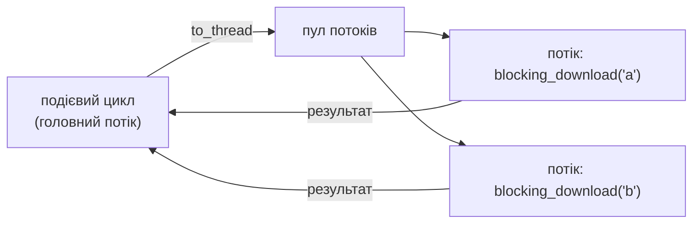

# 40. (Л) Проблеми виконання асинхронного коду, ручне керування подієвим циклом та налагодження asyncio

## Зміст лекції

1. Чому асинхронні помилки підступні
2. Режим налагодження asyncio
3. Корутина, яку забули дочекатися
4. Повільні кроки: блокування циклу
5. Блокуючий код в асинхронній програмі: `to_thread`, `run_in_executor`
6. Обчислення: пул процесів
7. Незавершені задачі і назви задач
8. Виняток у задачі, який ніхто не отримав
9. Журнал asyncio і налагоджувальний вивід
10. Подієвий цикл вручну
11. Колбеки: `call_soon`, `call_later`
12. Що робить `asyncio.run`
13. Контрольний список налагодження
14. Типові помилки

## Чому асинхронні помилки підступні

Звичайна помилка в Python закінчується трасуванням і зупинкою програми. Асинхронні помилки часто **мовчазні**:

| Симптом | Можлива причина |
|---|---|
| частина роботи «не виконалася», помилок немає | корутину викликали без `await` |
| програма працює, але повільно, як послідовна | у корутині блокуючий виклик |
| виняток зʼявляється наприкінці, далеко від причини | задача впала, але її результат ніхто не перевірив |
| попередження `Task was destroyed but it is pending` | програма завершилася, не дочекавшись задач |
| програма «зависла» | `await` на операції без таймауту |

Сьогодні — інструменти, що роблять ці помилки помітними.

## Режим налагодження asyncio

У режимі налагодження asyncio виконує додаткові перевірки:

- повідомляє про корутини, яких не дочекалися, і показує, **де** їх створено;
- попереджає про кроки, що виконувалися довше `0.1 с` і блокували цикл;
- перевіряє, що методи циклу викликаються з правильного потоку.

Увімкнути його можна трьома способами:

```bash
PYTHONASYNCIODEBUG=1 python3 app.py
python3 -X dev app.py
```

```python
# Program: the debug argument of asyncio.run
import asyncio


async def main() -> None:
    loop = asyncio.get_running_loop()
    print("debug mode:", loop.get_debug())


asyncio.run(main(), debug=True)
```

```text
debug mode: True
```

Режим налагодження сповільнює програму, тому його вмикають під час розробки й пошуку помилок, а не на робочому сервері.

## Корутина, яку забули дочекатися

```python
# File: forgot.py
import asyncio
import time


async def save_report() -> None:
    await asyncio.sleep(0.1)
    print("report saved")


async def slow_step() -> None:
    time.sleep(0.7)  # блокуючий виклик — розглянемо далі


async def main() -> None:
    save_report()
    await slow_step()
    print("main finished")


if __name__ == "__main__":
    asyncio.run(main(), debug=True)
```

```text
/home/student/forgot.py:16: RuntimeWarning: coroutine 'save_report' was never awaited
Coroutine created at (most recent call last)
  File "/home/student/forgot.py", line 22, in <module>
    asyncio.run(main(), debug=True)
  ...
  File "/home/student/forgot.py", line 16, in main
    save_report()
  save_report()
RuntimeWarning: Enable tracemalloc to get the object allocation traceback
main finished
Executing <Task finished name='Task-1' coro=<main() done, defined at /home/student/forgot.py:15> result=None created at ...> took 0.707 seconds
```

Два попередження:

1. `coroutine 'save_report' was never awaited` — і, завдяки режиму налагодження, **рядок, де корутину створено**: `forgot.py`, рядок 16. Попередження зʼявляється одразу: на корутину не лишилося посилань, і Python знищив її, так і не запустивши.
2. `Executing <Task ...> took 0.707 seconds` — один крок задачі (від одного `await` до наступного) тривав 0,7 с. Весь цей час цикл не міг виконувати інші задачі.

Виправлення першої помилки — `await save_report()` або `asyncio.create_task(save_report())` з подальшим `await`.

## Повільні кроки: блокування циклу

Поріг попередження задає атрибут `loop.slow_callback_duration` (типово `0.1` с). Типові причини повільних кроків:

| Причина | Приклад |
|---|---|
| блокуючий сон | `time.sleep(1)` |
| блокуючий ввід-вивід | `requests.get(url)`, `psycopg2.connect(...)`, `open(...).read()` великого файлу |
| обчислення | цикл на мільйони ітерацій, обробка зображення |
| синхронне очікування | `future.result()`, `thread.join()` у корутині |

```python
# Program: lower the slow callback threshold and catch a blocking step
import asyncio
import logging
import time

logging.basicConfig(level=logging.WARNING, format="%(levelname)s %(name)s: %(message)s")


async def parse_big_file() -> int:
    time.sleep(0.06)  # імітація важкої синхронної роботи
    return 42


async def main() -> None:
    asyncio.get_running_loop().slow_callback_duration = 0.05
    print("result:", await parse_big_file())


asyncio.run(main(), debug=True)
```

```text
result: 42
WARNING asyncio: Executing <Task finished name='Task-1' coro=<main() done, defined at ...> result=None created at ...> took 0.061 seconds
```

asyncio пише попередження через модуль `logging` у журнал з назвою `asyncio` (журнали — лекція 26, 5 семестр).

## Блокуючий код в асинхронній програмі: `to_thread`, `run_in_executor`

Не для кожної бібліотеки є асинхронна версія: `psycopg2`, `requests`, робота з файлами, старі SDK. Такий код запускають **в окремому потоці**, а корутина асинхронно чекає результату:

| Спосіб | Запис |
|---|---|
| `asyncio.to_thread` (Python 3.9+) | `await asyncio.to_thread(func, *args)` |
| `loop.run_in_executor` | `await loop.run_in_executor(None, func, *args)` — `None` означає типовий пул потоків |

```python
# Program: three ways to call a blocking function from asyncio
import asyncio
import time


def blocking_download(name: str) -> str:
    time.sleep(0.3)  # як requests.get: блокує потік
    return name


async def measure(title: str, make_call) -> None:
    start = time.perf_counter()
    results = await asyncio.gather(*(make_call(name) for name in ("a", "b", "c")))
    print(f"{title:<16} {results} {time.perf_counter() - start:.1f}s")


async def direct(name: str) -> str:
    return blocking_download(name)  # помилка: блокує цикл


async def via_to_thread(name: str) -> str:
    return await asyncio.to_thread(blocking_download, name)


async def via_executor(name: str) -> str:
    loop = asyncio.get_running_loop()
    return await loop.run_in_executor(None, blocking_download, name)


async def main() -> None:
    await measure("direct", direct)
    await measure("to_thread", via_to_thread)
    await measure("run_in_executor", via_executor)


asyncio.run(main())
```

```text
direct           ['a', 'b', 'c'] 0.9s
to_thread        ['a', 'b', 'c'] 0.3s
run_in_executor  ['a', 'b', 'c'] 0.3s
```



Поки потоки чекають, подієвий цикл вільний і обслуговує інші задачі.

## Обчислення: пул процесів

Для обчислень потоки не допоможуть (GIL, лекція 34). У `run_in_executor` можна передати **пул процесів**:

```python
# Program: CPU-bound work in a process pool from asyncio
import asyncio
import time
from concurrent.futures import ProcessPoolExecutor


def count_primes(limit: int) -> int:
    return sum(all(n % d for d in range(2, int(n ** 0.5) + 1)) for n in range(2, limit))


async def heartbeat(stop: asyncio.Event) -> int:
    beats = 0
    while not stop.is_set():
        beats += 1
        await asyncio.sleep(0.05)
    return beats


async def main() -> None:
    loop = asyncio.get_running_loop()
    stop = asyncio.Event()
    beat_task = asyncio.create_task(heartbeat(stop))
    with ProcessPoolExecutor() as pool:
        counts = await asyncio.gather(*(loop.run_in_executor(pool, count_primes, 100_000) for _ in range(4)))
    stop.set()
    print("primes:", counts)
    print("event loop stayed responsive:", await beat_task > 1)


if __name__ == "__main__":
    asyncio.run(main())
```

```text
primes: [9592, 9592, 9592, 9592]
event loop stayed responsive: True
```

Задача `heartbeat` продовжувала «битися», поки процеси рахували: цикл не був заблокований.

## Незавершені задачі і назви задач

Задачі, створені без `await`, скасовуються при виході з `asyncio.run`. Щоб знайти такі задачі, допомагають **назви** і функція `asyncio.all_tasks()`:

```python
# Program: list pending tasks by name
import asyncio


async def job(seconds: float) -> None:
    await asyncio.sleep(seconds)


async def main() -> None:
    asyncio.create_task(job(0.1), name="send-email")
    asyncio.create_task(job(5), name="sync-calendar")
    asyncio.create_task(job(5), name="upload-backup")
    await asyncio.sleep(0.2)
    current = asyncio.current_task()
    pending = sorted(t.get_name() for t in asyncio.all_tasks() if t is not current)
    print("current:", current.get_name())
    print("still running:", pending)


asyncio.run(main())
```

```text
current: Task-1
still running: ['sync-calendar', 'upload-backup']
```

`asyncio.run` скасує `sync-calendar` і `upload-backup`, і їхня робота не буде виконана. Виправлення — дочекатися задач (`gather`, `TaskGroup`) або явно скасувати їх і дочекатися скасування (лекція 38).

!!! warning "Посилання на задачі"
    Подієвий цикл зберігає лише **слабкі** посилання на задачі. Задачу, на яку не лишилося посилань у вашому коді, збирач сміття може знищити посеред виконання — з повідомленням `Task was destroyed but it is pending!`. Зберігайте створені задачі у змінних, списках чи `TaskGroup`.

## Виняток у задачі, який ніхто не отримав

Якщо задача впала, а її результат ніхто не запитав (`await task`), виняток не потрапляє в код. Asyncio повідомить про нього лише тоді, коли задачу буде знищено, — часто наприкінці програми:

```python
# Program: an exception nobody retrieved
import asyncio
import gc


async def fail() -> None:
    raise ValueError("lost error")


async def main() -> None:
    task = asyncio.create_task(fail(), name="report")
    await asyncio.sleep(0.1)
    print("task done:", task.done())
    del task
    gc.collect()
    print("main continues as if nothing happened")


asyncio.run(main())
```

```text
task done: True
Task exception was never retrieved
future: <Task finished name='report' coro=<fail() done, defined at ...> exception=ValueError('lost error')>
Traceback (most recent call last):
  ...
ValueError: lost error
main continues as if nothing happened
```

Правило: кожну задачу хтось має **дочекатися**. Для фонових задач, які живуть довго, додають колбек, що записує помилку в журнал:

```python
# Program: log errors of background tasks with a done callback
import asyncio
import logging

logging.basicConfig(level=logging.INFO, format="%(levelname)s %(message)s")
background = set()


def report_result(task: asyncio.Task) -> None:
    background.discard(task)
    if not task.cancelled() and task.exception() is not None:
        logging.error("task %s failed: %r", task.get_name(), task.exception())


def start_background(coro, name: str) -> None:
    task = asyncio.create_task(coro, name=name)
    background.add(task)  # сильне посилання до завершення
    task.add_done_callback(report_result)


async def cleanup() -> None:
    await asyncio.sleep(0.05)
    raise OSError("disk is full")


async def main() -> None:
    start_background(cleanup(), "cleanup")
    await asyncio.sleep(0.1)
    print("background tasks left:", len(background))


asyncio.run(main())
```

```text
ERROR task cleanup failed: OSError('disk is full')
background tasks left: 0
```

## Журнал asyncio і налагоджувальний вивід

Корисні прийоми під час пошуку помилки:

| Прийом | Що дає |
|---|---|
| `logging.basicConfig(level=logging.DEBUG)` | повідомлення журналу `asyncio` |
| `task.get_name()`, `name=` у `create_task` | зрозумілі назви в повідомленнях |
| `task.print_stack()` | де зараз «стоїть» задача |
| `asyncio.all_tasks()` | усі незавершені задачі |
| `python3 -X dev` | режим розробки: налагодження asyncio + додаткові попередження |

```python
# Program: where is a task waiting right now
import asyncio
import io


async def wait_for_reply() -> None:
    await asyncio.sleep(10)


async def main() -> None:
    task = asyncio.create_task(wait_for_reply(), name="reply")
    await asyncio.sleep(0.05)
    stack = io.StringIO()
    task.print_stack(file=stack)
    print([line.strip() for line in stack.getvalue().splitlines() if "line" in line][-1].split(", ")[-1])
    task.cancel()


asyncio.run(main())
```

```text
in wait_for_reply
```

## Подієвий цикл вручну

`asyncio.run` приховує роботу з циклом. Інколи цикл треба створити вручну — в інтеграції зі старим кодом, у тестах, у графічних застосунках (7 семестр). Основні методи:

| Метод | Дія |
|---|---|
| `asyncio.new_event_loop()` | створити цикл |
| `asyncio.set_event_loop(loop)` | зробити його поточним для потоку |
| `loop.run_until_complete(coro)` | виконати корутину до завершення |
| `loop.run_forever()` / `loop.stop()` | працювати, доки не зупинять |
| `loop.call_soon(f, *args)` | викликати звичайну функцію на наступній ітерації |
| `loop.call_later(delay, f, *args)` | викликати через `delay` секунд |
| `loop.close()` | закрити цикл, звільнити ресурси |

```python
# Program: create, use and close an event loop manually
import asyncio
import time

START = time.perf_counter()


def log(message: str) -> None:
    print(f"{time.perf_counter() - START:.1f}s {message}")


async def work() -> str:
    log("work started")
    await asyncio.sleep(0.3)
    log("work finished")
    return "result"


loop = asyncio.new_event_loop()
asyncio.set_event_loop(loop)
try:
    loop.call_soon(log, "call_soon callback")
    loop.call_later(0.1, log, "call_later callback")
    result = loop.run_until_complete(work())
    log(f"run_until_complete returned {result!r}")
finally:
    loop.run_until_complete(loop.shutdown_asyncgens())
    loop.close()
    asyncio.set_event_loop(None)
print("closed:", loop.is_closed())
```

```text
0.0s call_soon callback
0.0s work started
0.1s call_later callback
0.3s work finished
0.3s run_until_complete returned 'result'
closed: True
```

## Колбеки: `call_soon`, `call_later`

**Колбек** — звичайна (не `async`) функція, яку цикл викличе пізніше. На колбеках побудовано весь asyncio: коли корутина пише `await asyncio.sleep(0.3)`, усередині створюється `Future`, а цикл через `call_later` позначає його завершеним через 0,3 с — і корутина продовжується.

`call_soon` у прикладі спрацював **раніше** за `work started`: колбек потрапив у чергу першим, а задача для `work()` — другою.

```python
# Program: a callback that completes a future
import asyncio


async def main() -> None:
    loop = asyncio.get_running_loop()
    future = loop.create_future()
    loop.call_later(0.1, future.set_result, "data from callback")
    print("waiting for the future")
    print(await future)


asyncio.run(main())
```

```text
waiting for the future
data from callback
```

## Що робить `asyncio.run`

`asyncio.run(main())` — це скорочення для:

1. `loop = asyncio.new_event_loop()`, `asyncio.set_event_loop(loop)`;
2. `loop.run_until_complete(main())`;
3. скасування всіх задач, що лишилися, і очікування їх скасування;
4. `loop.shutdown_asyncgens()` і `loop.shutdown_default_executor()` — завершення асинхронних генераторів і пулу потоків `to_thread`;
5. `loop.close()`, `asyncio.set_event_loop(None)`.

Ручне керування потрібне рідко. Якщо його використовують, пункти 3–5 легко забути — і отримати попередження про незакриті ресурси. Тому для звичайних програм — `asyncio.run`.

## Контрольний список налагодження

| Крок | Як |
|---|---|
| увімкнути режим налагодження | `PYTHONASYNCIODEBUG=1` або `debug=True` |
| знайти корутини без `await` | попередження `was never awaited` з місцем створення |
| знайти блокуючі кроки | попередження `Executing ... took N seconds` |
| перенести блокуючий код | `to_thread`, `run_in_executor` |
| дати задачам назви | `create_task(..., name="...")` |
| перевірити незавершені задачі | `asyncio.all_tasks()` |
| не губити винятки | `await` кожної задачі, `TaskGroup`, колбек з журналом |
| обмежити очікування | таймаути на всі мережеві операції |

## Типові помилки

| Помилка | Чому погано | Як правильно |
|---|---|---|
| Пошук асинхронних помилок без режиму налагодження | попередження без місця створення | `debug=True` |
| Блокуючий виклик у корутині | цикл стоїть, інші задачі чекають | `asyncio.to_thread` |
| Обчислення в `to_thread` | GIL — немає прискорення | пул процесів у `run_in_executor` |
| Задача без збереженого посилання | може бути знищена посеред роботи | змінна, множина, `TaskGroup` |
| Виняток задачі ніхто не отримує | помилка «губиться» | `await task` або `add_done_callback` |
| Ручний цикл без `close()` | незакриті ресурси, попередження | `try/finally` з `loop.close()` або `asyncio.run` |
| `debug=True` на робочому сервері | сповільнення | лише під час розробки |

## Підсумок

- Асинхронні помилки часто мовчазні: корутина без `await`, блокуючий виклик, «загублений» виняток задачі.
- Режим налагодження (`debug=True`, `PYTHONASYNCIODEBUG=1`, `-X dev`) показує місце створення корутин і повільні кроки.
- Блокуючі функції запускають через `asyncio.to_thread` або `run_in_executor`; обчислення — у пулі процесів.
- Задачам дають назви, зберігають посилання на них і обовʼязково дочікуються; для фонових — колбек з журналом помилок.
- Подієвий цикл можна створити вручну (`new_event_loop`, `run_until_complete`, `call_soon`, `call_later`, `close`), але `asyncio.run` робить усе це правильно автоматично.

## Корисні посилання

- [asyncio — Developing with asyncio (налагодження)](https://docs.python.org/3/library/asyncio-dev.html)
- [asyncio — Event Loop](https://docs.python.org/3/library/asyncio-eventloop.html)
- [asyncio — `to_thread`](https://docs.python.org/3/library/asyncio-task.html#asyncio.to_thread)
- [Python Development Mode (`-X dev`)](https://docs.python.org/3/library/devmode.html)
- Fowler M. Python Concurrency with asyncio. — Manning, 2022. — Розділи 7, 14.
