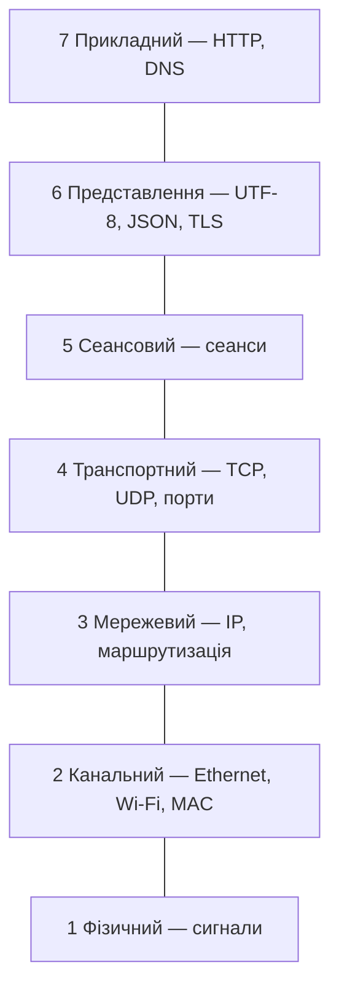
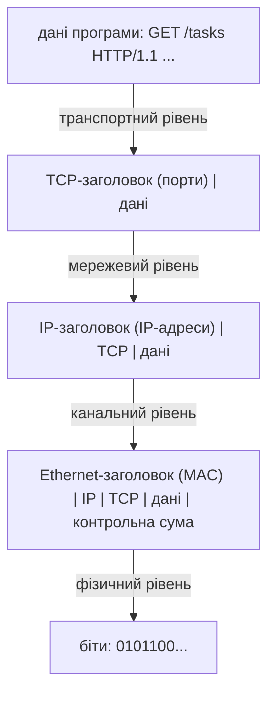
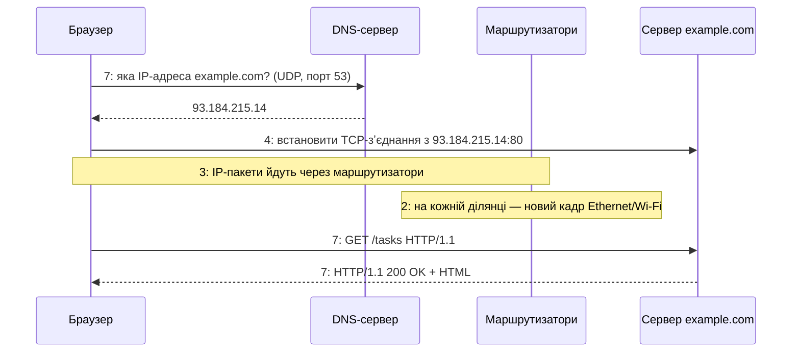

# 42. (Л) Знайомство з моделлю OSI

## Зміст лекції

1. Що відбувається, коли програма надсилає запит
2. Навіщо мережі потрібні рівні
3. Сім рівнів моделі OSI
4. Інкапсуляція: конверт у конверті
5. Одиниці даних на різних рівнях
6. Модель TCP/IP
7. Шлях HTTP-запиту через рівні
8. Адреси на різних рівнях
9. Рівні з погляду Python-програміста
10. Інструменти для дослідження мережі
11. Типові помилки

## Що відбувається, коли програма надсилає запит

У модулях 2 і 3 ми писали `requests.get(url)`, `session.get(url)`, `psycopg2.connect(host=...)`, і дані «самі» потрапляли на інший компʼютер. Цей модуль — про те, що відбувається всередині: як байти програми перетворюються на електричні сигнали чи радіохвилі, знаходять потрібний компʼютер серед мільярдів інших і потрапляють саме до потрібної програми.

Розуміння мережі потрібне, щоб:

- писати власні мережеві сервери (лекції 46–53);
- розуміти помилки `Connection refused`, `Connection reset by peer`, `Name or service not known`, `timed out`;
- обирати протокол (TCP чи UDP) під задачу;
- налагоджувати проблеми з портами, Docker-мережами, брандмауерами.

## Навіщо мережі потрібні рівні

Передати дані між програмами на різних континентах — величезна задача. Її розбивають на **рівні**: кожен рівень розвʼязує одну частину задачі й користується послугами рівня під ним, не знаючи його подробиць.

Аналогія — пошта. Автор листа пише текст і вказує адресу. Він не знає, яким літаком полетить лист. Поштове відділення не читає лист, а лише сортує конверти за індексом. Пілот не знає ні адрес, ні змісту — лише везе мішки до аеропорту.

| Переваги рівнів | Приклад |
|---|---|
| кожен рівень можна замінити окремо | Wi-Fi замість кабелю — програма не змінюється |
| стандарти для кожного рівня | різні виробники обладнання сумісні |
| простіше налагоджувати | «кабель працює, IP-адреса є, порт закритий» |

## Сім рівнів моделі OSI

**Модель OSI** (Open Systems Interconnection) — еталонна модель, затверджена ISO у 1984 році. Вона описує мережеву взаємодію сімома рівнями:

| № | Рівень | Що робить | Приклади |
|---|---|---|---|
| 7 | **прикладний** (application) | протоколи програм | HTTP, DNS, SMTP, SSH, протокол PostgreSQL |
| 6 | **представлення** (presentation) | формат, кодування, шифрування даних | UTF-8, JSON, TLS (частково) |
| 5 | **сеансовий** (session) | встановлення й підтримка сеансів | TLS-сеанс, сеанси RPC |
| 4 | **транспортний** (transport) | доставка між **програмами**, порти | TCP, UDP |
| 3 | **мережевий** (network) | доставка між **компʼютерами** через багато мереж, маршрутизація | IP, ICMP |
| 2 | **канальний** (data link) | передача в межах **однієї** мережі, MAC-адреси | Ethernet, Wi-Fi (802.11) |
| 1 | **фізичний** (physical) | біти як сигнали | кабель, оптоволокно, радіохвилі |

Мнемоніка англійською, знизу вгору: *Please Do Not Throw Sausage Pizza Away* — Physical, Data link, Network, Transport, Session, Presentation, Application.



## Інкапсуляція: конверт у конверті

Коли програма надсилає дані, кожен рівень **додає власний заголовок** зі службовою інформацією і передає результат нижче. Цей процес називається **інкапсуляцією**. На стороні отримувача кожен рівень знімає «свій» заголовок і передає вміст вище — **декапсуляція**.



Змоделюємо інкапсуляцію на Python. Заголовки справжніх протоколів — це байти у фіксованому форматі; модуль `struct` пакує числа в байти так само, як це роблять мережеві протоколи:

```python
# Program: a toy model of encapsulation with struct
import struct

payload = b"GET /tasks HTTP/1.1\r\nHost: example.com\r\n\r\n"

# транспортний рівень: порт відправника, порт отримувача, довжина
segment = struct.pack("!HHH", 51000, 80, len(payload)) + payload
# мережевий рівень: IP-адреси відправника й отримувача (4 байти кожна)
packet = bytes([192, 168, 1, 10]) + bytes([93, 184, 215, 14]) + segment
# канальний рівень: MAC-адреси (6 байтів кожна)
frame = bytes.fromhex("aabbccddeeff") + bytes.fromhex("112233445566") + packet

print("payload:", len(payload), "bytes")
print("segment:", len(segment), "packet:", len(packet), "frame:", len(frame))

# отримувач знімає заголовки у зворотному порядку
packet_in = frame[12:]
src_ip = ".".join(str(b) for b in packet_in[:4])
segment_in = packet_in[8:]
src_port, dst_port, length = struct.unpack("!HHH", segment_in[:6])
print(f"from {src_ip}:{src_port} to port {dst_port}")
print(segment_in[6:6 + length].split(b"\r\n")[0].decode())
```

```text
payload: 42 bytes
segment: 48 packet: 56 frame: 68
from 192.168.1.10:51000 to port 80
GET /tasks HTTP/1.1
```

Формат `"!HHH"` означає: мережевий порядок байтів (`!`, старший байт першим) і три беззнакові 16-бітні числа (`H`). Справжні заголовки TCP та IP складніші, але принцип той самий.

## Одиниці даних на різних рівнях

Шматок даних на кожному рівні має свою назву — **PDU** (Protocol Data Unit):

| Рівень | PDU | Головне в заголовку |
|---|---|---|
| прикладний | повідомлення (message) | метод, шлях, заголовки HTTP |
| транспортний | **сегмент** (TCP) / **датаграма** (UDP) | порти, номери послідовності |
| мережевий | **пакет** | IP-адреси, TTL |
| канальний | **кадр** (frame) | MAC-адреси, контрольна сума |
| фізичний | біти | — |

## Модель TCP/IP

OSI — еталонна модель для навчання й опису. Інтернет насправді побудовано на простішій моделі **TCP/IP** з чотирма рівнями:

| TCP/IP | OSI | Протоколи |
|---|---|---|
| прикладний | 7, 6, 5 | HTTP, DNS, TLS, SSH |
| транспортний | 4 | TCP, UDP |
| міжмережевий (internet) | 3 | IP, ICMP |
| мережевого доступу (link) | 2, 1 | Ethernet, Wi-Fi |

Коли інженери кажуть «проблема на третьому рівні» чи «балансувальник сьомого рівня», вони використовують нумерацію OSI.

## Шлях HTTP-запиту через рівні

Що відбувається, коли браузер відкриває `http://example.com/tasks`:



1. **DNS** (прикладний рівень) перетворює імʼя `example.com` на IP-адресу.
2. **TCP** (транспортний) встановлює зʼєднання з портом `80` сервера.
3. **IP** (мережевий) доставляє пакети через десятки маршрутизаторів; кожен обирає наступний крок за IP-адресою отримувача.
4. На кожній ділянці шляху (Wi-Fi вдома, оптика провайдера) кадри **канального** рівня мають свої MAC-адреси.
5. На сервері рівні знімають заголовки, і HTTP-запит отримує програма, що слухає порт `80`.

## Адреси на різних рівнях

| Рівень | Адреса | Приклад | Що ідентифікує |
|---|---|---|---|
| прикладний | доменне імʼя, URL | `bank.gov.ua` | сервіс для людини |
| транспортний | **порт** (0–65535) | `443`, `5432` | програму на компʼютері |
| мережевий | **IP-адреса** | `192.168.1.10`, `2001:db8::1` | мережевий інтерфейс компʼютера |
| канальний | **MAC-адреса** | `aa:bb:cc:dd:ee:ff` | мережеву карту в межах однієї мережі |

Модуль `ipaddress` зі стандартної бібліотеки розуміє IP-адреси й мережі:

```python
# Program: IP addresses and networks with the ipaddress module
import ipaddress

for text in ("192.168.1.10", "8.8.8.8", "127.0.0.1", "2001:db8::1"):
    ip = ipaddress.ip_address(text)
    print(f"{text:<14} IPv{ip.version} private={ip.is_private} loopback={ip.is_loopback}")

network = ipaddress.ip_network("192.168.1.0/24")
print(network.num_addresses, "addresses in", network)
print(ipaddress.ip_address("192.168.1.10") in network, ipaddress.ip_address("192.168.2.10") in network)
```

```text
192.168.1.10   IPv4 private=True loopback=False
8.8.8.8        IPv4 private=False loopback=False
127.0.0.1      IPv4 private=True loopback=True
2001:db8::1    IPv6 private=True loopback=False
256 addresses in 192.168.1.0/24
True False
```

- **приватні** адреси (`192.168.x.x`, `10.x.x.x`, `172.16–31.x.x`) використовують у домашніх і офісних мережах; в інтернет вони виходять через маршрутизатор (NAT);
- **loopback** `127.0.0.1` (`localhost`) — «петля»: пакети не виходять за межі компʼютера. Саме цю адресу ми використовували для Flask і PostgreSQL;
- `/24` — довжина префікса мережі: перші 24 біти однакові для всіх адрес мережі.

Перетворення імені на адресу — функція `socket.getaddrinfo`:

```python
# Program: resolve a host name and a service to addresses and ports
import socket

for family, kind, _, _, address in socket.getaddrinfo("localhost", "https", type=socket.SOCK_STREAM):
    print(family.name, kind.name, address[:2])
print(socket.getservbyname("postgresql"), socket.getservbyname("ssh"))
```

```text
AF_INET6 SOCK_STREAM ('::1', 443)
AF_INET SOCK_STREAM ('127.0.0.1', 443)
5432 22
```

## Рівні з погляду Python-програміста

| Рівень | Що робить ваш код | Інструменти Python |
|---|---|---|
| 7 прикладний | формує запити й відповіді | `requests`, `aiohttp`, Flask, `psycopg2`, `json` |
| 6 представлення | кодує текст, шифрує | `str.encode("utf-8")`, `ssl` |
| 4 транспортний | відкриває зʼєднання, надсилає байти на порт | **`socket`**, `asyncio` streams (лекції 46–53) |
| 3 і нижче | — робить операційна система | `ipaddress` для роботи з адресами |

Модуль `socket` — межа між вашою програмою й операційною системою: програма передає байти й адресу (IP + порт), а все нижче транспортного рівня робить ОС.

## Інструменти для дослідження мережі

| Команда (Linux, macOS) | Рівень | Що показує |
|---|---|---|
| `ip addr` / `ifconfig` | 2–3 | інтерфейси, MAC- та IP-адреси |
| `ping 8.8.8.8` | 3 | чи досяжний компʼютер (ICMP) і затримку |
| `traceroute bank.gov.ua` | 3 | маршрутизатори на шляху |
| `dig bank.gov.ua` / `nslookup` | 7 | DNS-запис |
| `ss -tlnp` / `lsof -i :5000` | 4 | які програми слухають які порти |
| `nc host port` | 4 | ручне TCP/UDP-зʼєднання |
| `curl -v` | 7 | HTTP-запит з подробицями |
| Wireshark, `tcpdump` | 2–7 | усі пакети з розбором кожного рівня |

```bash
ping -c 2 127.0.0.1
```

```text
PING 127.0.0.1 (127.0.0.1) 56(84) bytes of data.
64 bytes from 127.0.0.1: icmp_seq=1 ttl=64 time=0.045 ms
64 bytes from 127.0.0.1: icmp_seq=2 ttl=64 time=0.061 ms
```

**Wireshark** — графічний аналізатор трафіку: показує кожен кадр з розгорнутими заголовками всіх рівнів. Це найкращий спосіб побачити інкапсуляцію на власні очі.

## Типові помилки

| Помилка | Чому погано | Як правильно |
|---|---|---|
| Плутають IP-адресу і порт | «підключитися до 5432» без адреси | адреса = IP + порт |
| Вважають `localhost` адресою в мережі | інші компʼютери й контейнери не бачать вашого `127.0.0.1` | `0.0.0.0` для сервера, справжня IP-адреса для клієнтів |
| Плутають TCP/IP-модель і OSI | різна кількість рівнів | OSI — 7 рівнів, TCP/IP — 4 |
| «Сайт не працює» без діагностики | невідомо, на якому рівні проблема | `ping` → `dig` → `nc` → `curl -v` |
| Рядки замість байтів у мережевому коді | мережа передає байти | `encode()` / `decode()` |
| Вважають приватну адресу доступною з інтернету | `192.168.x.x` не маршрутизується в інтернеті | публічна адреса або перенаправлення портів |

## Підсумок

- Мережеву взаємодію розбивають на **рівні**; кожен розвʼязує свою частину задачі.
- **Модель OSI** має 7 рівнів: фізичний, канальний, мережевий, транспортний, сеансовий, представлення, прикладний.
- **Інкапсуляція**: кожен рівень додає свій заголовок; отримувач знімає їх у зворотному порядку.
- PDU: кадр (2), пакет (3), сегмент чи датаграма (4), повідомлення (7).
- Інтернет працює на моделі **TCP/IP** з 4 рівнями.
- Адреси: MAC (канальний), IP (мережевий), порт (транспортний), доменне імʼя (прикладний).
- Python-програміст працює з прикладним рівнем і з транспортним через модуль `socket`; нижчі рівні реалізує ОС.

## Корисні посилання

- [Cloudflare — What is the OSI model?](https://www.cloudflare.com/learning/ddos/glossary/open-systems-interconnection-model-osi/)
- [MDN — How does the Internet work?](https://developer.mozilla.org/en-US/docs/Learn_web_development/Howto/Web_mechanics/How_does_the_Internet_work)
- [Модуль `ipaddress` — довідник](https://docs.python.org/3/library/ipaddress.html)
- [Модуль `struct` — довідник](https://docs.python.org/3/library/struct.html)
- [Wireshark — User's Guide](https://www.wireshark.org/docs/wsug_html_chunked/)
