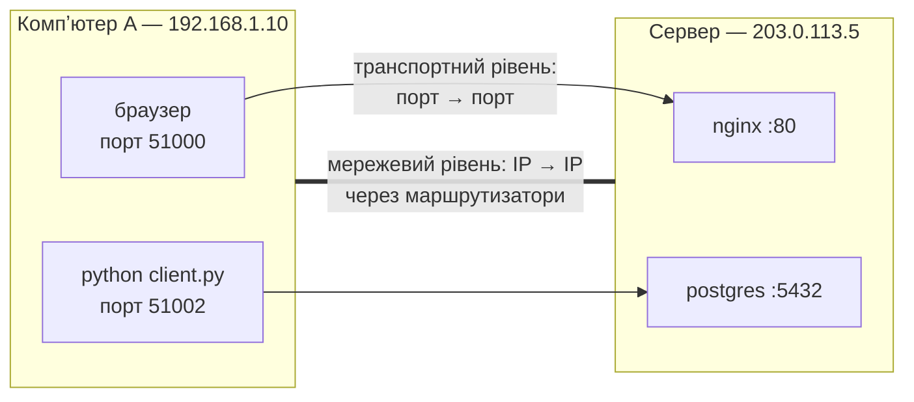
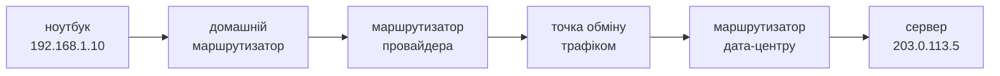
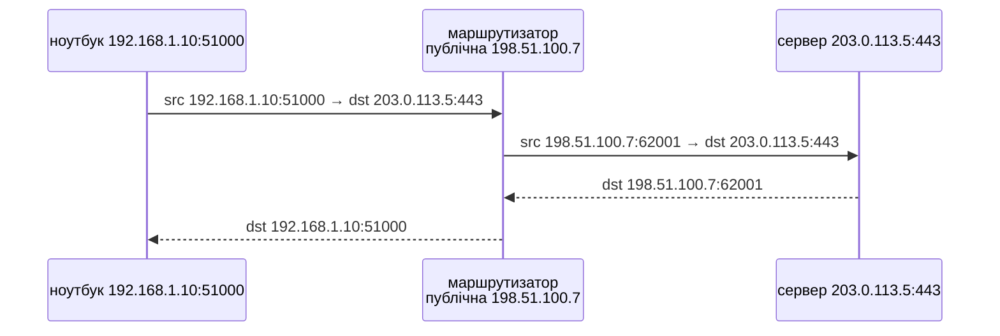

# 43. (Л) Мережевий та транспортний рівні — роль у мережевій взаємодії

## Зміст лекції

1. Два рівні, з якими працює програміст
2. Мережевий рівень: доставка між компʼютерами
3. IP-пакет і його заголовок
4. Маршрутизація
5. TTL і ICMP
6. IPv4, IPv6 і NAT
7. Транспортний рівень: доставка між програмами
8. Порти
9. Сокет-адреса і зʼєднання як пʼятірка значень
10. Мультиплексування: багато програм на одній IP-адресі
11. Помилки мережевого й транспортного рівнів у Python
12. Порівняння двох рівнів
13. Типові помилки

## Два рівні, з якими працює програміст

У лекції 42 ми побачили, що програма на Python працює з прикладним рівнем і через модуль `socket` — з транспортним. Але більшість мережевих помилок (`Connection refused`, `No route to host`, `timed out`) повідомляють саме мережевий і транспортний рівні. Сьогодні розберемо, за що вони відповідають.



- **мережевий** рівень доставляє пакет до потрібного **компʼютера** (IP-адреса);
- **транспортний** — до потрібної **програми** на ньому (порт).

## Мережевий рівень: доставка між компʼютерами

**IP** (Internet Protocol) — основний протокол мережевого рівня. Його задача — доставити пакет від IP-адреси відправника до IP-адреси отримувача, можливо, через десятки проміжних мереж.

IP працює за принципом **best effort** («найкраща спроба»):

| IP гарантує | IP не гарантує |
|---|---|
| пакет має адресу відправника й отримувача | що пакет дійде |
| маршрутизатори спробують його доставити | що пакети прийдуть у тому самому порядку |
| пошкоджений заголовок буде виявлено | що пакет не продублюється |

Надійність, якщо вона потрібна, додає транспортний рівень (TCP, лекція 45).

## IP-пакет і його заголовок

Головні поля заголовка IPv4 (20 байтів без опцій):

| Поле | Розмір | Значення |
|---|---|---|
| Version | 4 біти | `4` для IPv4 |
| Total Length | 16 біт | розмір пакета разом із заголовком |
| TTL | 8 біт | скільки маршрутизаторів ще може пройти пакет |
| Protocol | 8 біт | що всередині: `6` — TCP, `17` — UDP, `1` — ICMP |
| Source Address | 32 біти | IP відправника |
| Destination Address | 32 біти | IP отримувача |

Розберемо справжній заголовок IPv4 модулем `struct`:

```python
# Program: parse an IPv4 header
import ipaddress
import struct

header = bytes.fromhex("45000054a6f2400040011c46c0a8010ac0a80101")

version_ihl, _, total_length, _, _, ttl, protocol, _, src, dst = struct.unpack("!BBHHHBBH4s4s", header)
names = {1: "ICMP", 6: "TCP", 17: "UDP"}
print("version:", version_ihl >> 4, "header bytes:", (version_ihl & 0x0F) * 4)
print("total length:", total_length, "ttl:", ttl, "protocol:", names[protocol])
print("from", ipaddress.IPv4Address(src), "to", ipaddress.IPv4Address(dst))
```

```text
version: 4 header bytes: 20
total length: 84 ttl: 64 protocol: ICMP
from 192.168.1.10 to 192.168.1.1
```

Це заголовок пакета команди `ping` (ICMP) з домашнього компʼютера до маршрутизатора.

## Маршрутизація

**Маршрутизатор** (router) — пристрій, що зʼєднує мережі й пересилає пакети між ними. Кожен маршрутизатор має **таблицю маршрутизації**: для кожної мережі-призначення — куди передати пакет далі. Маршрутизатор не знає всього шляху: він обирає лише **наступний крок**.



Таблицю маршрутизації вашого компʼютера показує команда `ip route` (Linux) або `netstat -rn` (macOS):

```bash
ip route
```

```text
default via 192.168.1.1 dev wlan0 proto dhcp metric 600
192.168.1.0/24 dev wlan0 proto kernel scope link src 192.168.1.10 metric 600
```

- адреси з мережі `192.168.1.0/24` доступні напряму через інтерфейс `wlan0`;
- усе інше (`default`) надсилається маршрутизатору `192.168.1.1`.

Логіку вибору маршруту можна змоделювати: обирається маршрут з **найдовшим** префіксом, що містить адресу.

```python
# Program: longest prefix match in a routing table
import ipaddress

ROUTES = {
    "0.0.0.0/0": "192.168.1.1 (default gateway)",
    "192.168.1.0/24": "direct via wlan0",
    "10.8.0.0/16": "vpn tunnel tun0",
    "10.8.5.0/24": "office printer network",
}


def next_hop(address: str) -> str:
    ip = ipaddress.ip_address(address)
    matches = [ipaddress.ip_network(net) for net in ROUTES if ip in ipaddress.ip_network(net)]
    best = max(matches, key=lambda net: net.prefixlen)
    return ROUTES[str(best)]


for address in ("192.168.1.20", "10.8.5.7", "10.8.1.1", "8.8.8.8"):
    print(f"{address:<13} -> {next_hop(address)}")
```

```text
192.168.1.20  -> direct via wlan0
10.8.5.7      -> office printer network
10.8.1.1      -> vpn tunnel tun0
8.8.8.8       -> 192.168.1.1 (default gateway)
```

## TTL і ICMP

Через помилку в налаштуваннях пакет може «ходити по колу» між маршрутизаторами. Щоб такі пакети не жили вічно, кожен маршрутизатор зменшує поле **TTL** (Time To Live) на 1. Коли TTL стає нулем, пакет знищують і повідомляють відправника.

Повідомлення про помилки й службові повідомлення мережевого рівня передає протокол **ICMP**:

| Повідомлення ICMP | Коли надсилається | Де ви його бачите |
|---|---|---|
| Echo Request / Echo Reply | перевірка досяжності | `ping` |
| Time Exceeded | TTL став нулем | `traceroute` |
| Destination Unreachable | немає маршруту або порт UDP закритий | `No route to host`, `Connection refused` для UDP |

`traceroute` використовує TTL хитро: надсилає пакети з TTL = 1, 2, 3, … і отримує Time Exceeded від кожного маршрутизатора на шляху — так видно весь маршрут.

## IPv4, IPv6 і NAT

| | IPv4 | IPv6 |
|---|---|---|
| довжина адреси | 32 біти | 128 біт |
| кількість адрес | ≈ 4,3 млрд | ≈ 3,4 × 10³⁸ |
| запис | `192.168.1.10` | `2001:db8::1` |
| loopback | `127.0.0.1` | `::1` |

Адрес IPv4 давно не вистачає на всі пристрої. Тому домашні й офісні мережі використовують **приватні** адреси (лекція 42), а маршрутизатор виконує **NAT** (Network Address Translation): підміняє приватну адресу відправника своєю публічною, запамʼятовує відповідність і повертає відповіді потрібному компʼютеру.



Наслідок: компʼютер за NAT може підключатися до серверів в інтернеті, але ззовні до нього підключитися не можна без налаштування **перенаправлення портів** (port forwarding) — так само, як контейнер Docker недоступний без `-p` (лекція 14).

## Транспортний рівень: доставка між програмами

IP доставив пакет на компʼютер. Але на ньому працюють десятки мережевих програм: браузер, PostgreSQL, Flask, месенджер. Транспортний рівень визначає, **якій програмі** віддати дані, і, залежно від протоколу, додає надійність:

| | UDP (лекція 44) | TCP (лекція 45) |
|---|---|---|
| зʼєднання | немає | встановлюється перед обміном |
| доставка | без гарантій | гарантована, з повторною передачею |
| порядок | не гарантовано | збережено |
| одиниця даних | датаграма з межами | потік байтів без меж |
| приклади | DNS, відео, ігри | HTTP, PostgreSQL, SSH |

## Порти

**Порт** — 16-бітне число (0–65535), що ідентифікує програму на компʼютері в межах протоколу (TCP-порт 53 і UDP-порт 53 — різні).

| Діапазон | Назва | Приклади |
|---|---|---|
| 0–1023 | системні (well-known) | 22 SSH, 53 DNS, 80 HTTP, 443 HTTPS |
| 1024–49151 | зареєстровані | 5432 PostgreSQL, 5000 Flask, 8000 gunicorn |
| 49152–65535 | динамічні (ephemeral) | тимчасові порти клієнтів |

- **сервер** слухає **відомий** порт, щоб клієнти знали, куди підключатися;
- **клієнту** операційна система видає **тимчасовий** порт автоматично;
- порти нижче 1024 на Linux може відкрити лише `root`. Тому навчальні сервери використовують `5000`, `8000`, `8888`.

```python
# Program: the OS picks an ephemeral port for the client
import socket

server = socket.create_server(("127.0.0.1", 0))  # порт 0: ОС обере вільний
host, port = server.getsockname()
print("server listens on a free port:", 1024 < port < 65536)

client = socket.create_connection((host, port))
conn, client_address = server.accept()
print("client local port is ephemeral:", client.getsockname()[1] >= 32768)
print("server sees the same client port:", client_address == client.getsockname())
for s in (conn, client, server):
    s.close()
```

```text
server listens on a free port: True
client local port is ephemeral: True
server sees the same client port: True
```

## Сокет-адреса і зʼєднання як пʼятірка значень

**Сокет-адреса** — пара (IP-адреса, порт), наприклад `("127.0.0.1", 5432)`. Кожне TCP-зʼєднання однозначно визначається **пʼятіркою** значень (5-tuple):

| Протокол | IP клієнта | порт клієнта | IP сервера | порт сервера |
|---|---|---|---|---|
| TCP | 192.168.1.10 | 51000 | 203.0.113.5 | 443 |
| TCP | 192.168.1.10 | 51001 | 203.0.113.5 | 443 |
| TCP | 192.168.1.22 | 51000 | 203.0.113.5 | 443 |

Усі три — різні зʼєднання з тим самим сервером: досить, щоб відрізнялося хоча б одне значення. Тому сервер на одному порту `443` обслуговує тисячі клієнтів одночасно.

## Мультиплексування: багато програм на одній IP-адресі

**Мультиплексування** — передача даних багатьох програм через один мережевий інтерфейс; **демультиплексування** — розподіл вхідних даних між програмами за номером порту. Перевіримо: два сервери на одному компʼютері, розрізняються лише портом:

```python
# Program: two servers on one IP address, told apart by port
import socket
import threading


def serve_once(server: socket.socket, name: bytes) -> None:
    conn, _ = server.accept()
    with conn:
        conn.sendall(name)


servers = {name: socket.create_server(("127.0.0.1", 0)) for name in (b"tasks-api", b"database")}
for name, server in servers.items():
    threading.Thread(target=serve_once, args=(server, name), daemon=True).start()

for name, server in servers.items():
    port = server.getsockname()[1]
    with socket.create_connection(("127.0.0.1", port)) as client:
        print(f"port {'A' if name == b'tasks-api' else 'B'} answers:", client.recv(100).decode())
for server in servers.values():
    server.close()
```

```text
port A answers: tasks-api
port B answers: database
```

## Помилки мережевого й транспортного рівнів у Python

| Виняток / повідомлення | Рівень | Причина |
|---|---|---|
| `socket.gaierror: Name or service not known` | 7 (DNS) | імʼя не знайдено |
| `OSError: [Errno 101] Network is unreachable` | 3 | немає маршруту до мережі |
| `TimeoutError: timed out` | 3–4 | пакети губляться або брандмауер мовчки відкидає їх |
| `ConnectionRefusedError: [Errno 111] Connection refused` | 4 | компʼютер досяжний, але порт ніхто не слухає |
| `OSError: [Errno 98] Address already in use` | 4 | порт уже зайнятий іншою програмою |
| `ConnectionResetError: Connection reset by peer` | 4 | інша сторона аварійно закрила зʼєднання |

```python
# Program: typical network errors and what they mean
import socket

try:
    socket.getaddrinfo("no-such-host.invalid", 80)
except socket.gaierror as error:
    print("dns:", type(error).__name__)

free = socket.create_server(("127.0.0.1", 0))
port = free.getsockname()[1]
free.close()  # порт звільнено — тепер його ніхто не слухає
try:
    socket.create_connection(("127.0.0.1", port), timeout=2)
except ConnectionRefusedError as error:
    print("transport:", type(error).__name__)

first = socket.create_server(("127.0.0.1", 0))
second = socket.socket()
try:
    second.bind(first.getsockname())
except OSError as error:
    print("bind:", error.strerror)
second.close()
first.close()
```

```text
dns: gaierror
transport: ConnectionRefusedError
bind: Address already in use
```

Діагностика «знизу вгору»: `ping` (мережевий рівень) → `nc -vz host port` (транспортний) → `curl -v` (прикладний).

## Порівняння двох рівнів

| | Мережевий рівень | Транспортний рівень |
|---|---|---|
| основний протокол | IP | TCP, UDP |
| адреса | IP-адреса | порт |
| доставляє до | компʼютера (інтерфейсу) | програми (сокета) |
| хто обробляє | маршрутизатори на всьому шляху | лише кінцеві компʼютери |
| надійність | best effort | UDP — немає, TCP — гарантована |
| PDU | пакет | сегмент / датаграма |
| службові повідомлення | ICMP | прапорці TCP (лекція 45) |

## Типові помилки

| Помилка | Чому погано | Як правильно |
|---|---|---|
| Сервер на порту < 1024 без прав | `PermissionError` | порт ≥ 1024 або зворотний проксі |
| Два сервери на одному порту | `Address already in use` | різні порти; зупинити старий процес |
| `Connection refused` вважають проблемою мережі | компʼютер досяжний, не запущено сервер або він слухає іншу адресу | перевірити `ss -tlnp`, адресу `0.0.0.0` |
| Тайм-аут вважають «сервер вимкнено» | часто це брандмауер | перевірити правила брандмауера, `traceroute` |
| Очікують, що IP гарантує доставку | пакети губляться | TCP або власні підтвердження поверх UDP |
| Підключення ззовні до компʼютера за NAT | неможливо без налаштувань | перенаправлення портів |

## Підсумок

- **Мережевий рівень** (IP) доставляє пакети між компʼютерами за IP-адресами через маршрутизатори за принципом best effort.
- Маршрутизатор обирає наступний крок за таблицею маршрутизації (найдовший префікс); TTL захищає від зациклення, ICMP повідомляє про помилки.
- NAT дозволяє багатьом пристроям з приватними адресами використовувати одну публічну.
- **Транспортний рівень** доставляє дані між програмами за **портами**; сервер слухає відомий порт, клієнт отримує тимчасовий.
- Зʼєднання визначається пʼятіркою: протокол, IP і порт клієнта, IP і порт сервера.
- Мережеві помилки в Python вказують на рівень проблеми: `gaierror` — DNS, `ConnectionRefusedError` — порт, `TimeoutError` — втрата пакетів.

## Корисні посилання

- [Cloudflare — What is the network layer?](https://www.cloudflare.com/learning/network-layer/what-is-the-network-layer/)
- [Cloudflare — What is a computer port?](https://www.cloudflare.com/learning/network-layer/what-is-a-computer-port/)
- [IANA — Service Name and Transport Protocol Port Number Registry](https://www.iana.org/assignments/service-names-port-numbers/service-names-port-numbers.xhtml)
- [Модуль `socket` — довідник](https://docs.python.org/3/library/socket.html)
- [RFC 791 — Internet Protocol](https://www.rfc-editor.org/rfc/rfc791)
