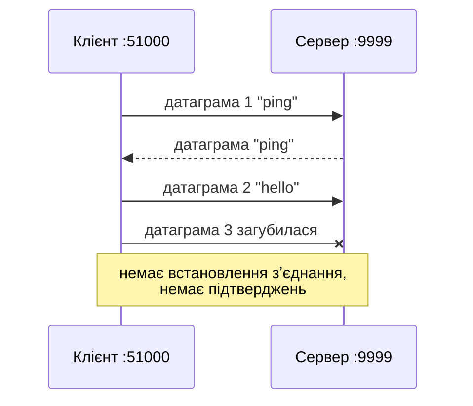

# 44. (Л) Огляд протоколу транспортного рівня UDP

## Зміст лекції

1. UDP — найпростіший транспортний протокол
2. Заголовок UDP
3. Властивості: що UDP робить і чого не робить
4. Де використовують UDP
5. UDP-сокет у Python
6. Сервер і клієнт: `sendto` і `recvfrom`
7. Межі повідомлень зберігаються
8. Втрата датаграм і тайм-аути
9. Повторні спроби
10. «Зʼєднаний» UDP-сокет і закритий порт
11. Розмір датаграми
12. Власний протокол поверх UDP
13. Типові помилки

## UDP — найпростіший транспортний протокол

**UDP** (User Datagram Protocol, RFC 768, 1980 рік) додає до IP лише дві речі: **порти** (щоб знайти програму) і **контрольну суму** (щоб виявити пошкодження). Усе інше — як в IP (лекція 43): без зʼєднання, без гарантій доставки й порядку.

Аналогія — листівка: її просто кидають у поштову скриньку. Немає підтвердження, що її отримали; дві листівки можуть прийти в будь-якому порядку; одна може загубитися. Зате це швидко і просто.



## Заголовок UDP

Заголовок UDP займає лише **8 байтів** — чотири 16-бітні поля:

| Поле | Байти | Значення |
|---|---|---|
| Source Port | 2 | порт відправника |
| Destination Port | 2 | порт отримувача |
| Length | 2 | довжина заголовка + даних |
| Checksum | 2 | контрольна сума |

```python
# Program: build and parse a UDP header
import struct

payload = b"ping"
header = struct.pack("!HHHH", 51000, 9999, 8 + len(payload), 0)
datagram = header + payload
print(len(header), "byte header,", len(datagram), "byte datagram")
src, dst, length, checksum = struct.unpack("!HHHH", datagram[:8])
print(f"src={src} dst={dst} length={length} data={datagram[8:]!r}")
```

```text
8 byte header, 12 byte datagram
src=51000 dst=9999 length=12 data=b'ping'
```

Для порівняння: заголовок TCP — щонайменше 20 байтів (лекція 45).

## Властивості: що UDP робить і чого не робить

| Властивість | UDP |
|---|---|
| встановлення зʼєднання | **немає** — можна одразу надсилати |
| гарантія доставки | **немає** |
| порядок | **не гарантовано** |
| дублікати | можливі |
| межі повідомлень | **зберігаються**: одна `sendto` — одна датаграма — одна `recvfrom` |
| контроль швидкості | немає — відправник може «залити» мережу |
| накладні витрати | мінімальні: 8 байтів, жодних службових обмінів |
| розсилка багатьом (broadcast, multicast) | так |

## Де використовують UDP

| Застосування | Чому UDP |
|---|---|
| **DNS** (порт 53) | запит і відповідь — по одній малій датаграмі; повторити простіше, ніж встановлювати зʼєднання |
| голосові й відеодзвінки | запізнілий пакет уже не потрібен; краще пропустити, ніж чекати |
| онлайн-ігри | важливе лише останнє положення гравця |
| потокове відео, IPTV | швидкість важливіша за кожен кадр |
| **QUIC / HTTP/3** | власна надійність поверх UDP, швидше встановлення зʼєднання |
| DHCP, NTP, SNMP | короткі службові повідомлення |

Загальне правило: UDP обирають, коли **затримка важливіша за надійність** або коли програма сама реалізує потрібні гарантії.

## UDP-сокет у Python

Сокет створюють функцією `socket.socket(family, type)`:

| Параметр | Значення |
|---|---|
| `socket.AF_INET` | IPv4 (`AF_INET6` — IPv6) |
| `socket.SOCK_DGRAM` | датаграми — **UDP** |
| `socket.SOCK_STREAM` | потік — TCP (лекція 45) |

| Метод | Дія |
|---|---|
| `sock.bind((host, port))` | привʼязати сокет до адреси — сервер «займає» порт |
| `sock.sendto(data, (host, port))` | надіслати датаграму на адресу |
| `sock.recvfrom(bufsize)` | отримати датаграму: `(data, address)` |
| `sock.settimeout(seconds)` | чекати не довше `seconds` |
| `sock.close()` | закрити сокет |

## Сервер і клієнт: `sendto` і `recvfrom`

UDP-сервер не «приймає зʼєднань»: він просто отримує датаграми від будь-кого і відповідає на адресу відправника. Сервер у прикладі працює в окремому потоці, щоб сервер і клієнт уміщалися в одному файлі:

```python
# Program: a UDP echo server and client in one script
import socket
import threading


def echo_server(sock: socket.socket) -> None:
    while True:
        data, address = sock.recvfrom(1024)
        if data == b"stop":
            break
        sock.sendto(data.upper(), address)


server = socket.socket(socket.AF_INET, socket.SOCK_DGRAM)
server.bind(("127.0.0.1", 0))
server_address = server.getsockname()
thread = threading.Thread(target=echo_server, args=(server,))
thread.start()

client = socket.socket(socket.AF_INET, socket.SOCK_DGRAM)
client.settimeout(1)
for message in (b"ping", b"hello udp"):
    client.sendto(message, server_address)
    reply, from_address = client.recvfrom(1024)
    print(reply, "from server:", from_address == server_address)
client.sendto(b"stop", server_address)
thread.join()
client.close()
server.close()
```

```text
b'PING' from server: True
b'HELLO UDP' from server: True
```

Окремий сервер слухає фіксований порт, і з ним можна поговорити утилітою `nc` (netcat):

```python
# File: udp_echo.py
import socket

HOST, PORT = "127.0.0.1", 9999

with socket.socket(socket.AF_INET, socket.SOCK_DGRAM) as sock:
    sock.bind((HOST, PORT))
    print(f"udp echo on {HOST}:{PORT}")
    while True:
        data, address = sock.recvfrom(1024)
        print(f"{address[0]}:{address[1]} -> {data!r}")
        sock.sendto(data, address)
```

```bash
python3 udp_echo.py
# в іншому терміналі:
nc -u 127.0.0.1 9999
```

```text
udp echo on 127.0.0.1:9999
127.0.0.1:53712 -> b'hello\n'
127.0.0.1:53712 -> b'second line\n'
```

Сервер зупиняють клавішами Ctrl+C.

## Межі повідомлень зберігаються

Кожен виклик `sendto` створює окрему датаграму, і `recvfrom` отримує її **цілою** — або не отримує зовсім. Повідомлення не склеюються і не розриваються:

```python
# Program: one sendto is one recvfrom
import socket

receiver = socket.socket(socket.AF_INET, socket.SOCK_DGRAM)
receiver.bind(("127.0.0.1", 0))
sender = socket.socket(socket.AF_INET, socket.SOCK_DGRAM)
for message in (b"first", b"second", b"third"):
    sender.sendto(message, receiver.getsockname())

receiver.settimeout(1)
for _ in range(3):
    print(receiver.recvfrom(1024)[0])

sender.sendto(b"0123456789", receiver.getsockname())
print("small buffer:", receiver.recvfrom(4)[0])
sender.close()
receiver.close()
```

```text
b'first'
b'second'
b'third'
small buffer: b'0123'
```

Якщо буфер `recvfrom` менший за датаграму, **решта даних губиться** (на Linux — мовчки). Тому буфер беруть з запасом. У TCP навпаки: межі повідомлень **не зберігаються**, і програма має розділяти потік байтів сама (лекції 45–48).

## Втрата датаграм і тайм-аути

Датаграма може не дійти, і UDP про це не повідомить. Якщо клієнт просто викличе `recvfrom`, він чекатиме вічно. Тому клієнт **завжди** встановлює тайм-аут:

```python
# Program: a client does not hang when nobody answers
import socket
import time

silent = socket.socket(socket.AF_INET, socket.SOCK_DGRAM)
silent.bind(("127.0.0.1", 0))  # сокет існує, але ніхто не відповідає

client = socket.socket(socket.AF_INET, socket.SOCK_DGRAM)
client.settimeout(0.3)
client.sendto(b"is anybody there?", silent.getsockname())
start = time.perf_counter()
try:
    client.recvfrom(1024)
except TimeoutError:
    print(f"no reply after {time.perf_counter() - start:.1f}s")
client.close()
silent.close()
```

```text
no reply after 0.3s
```

## Повторні спроби

Надійність поверх UDP програма додає сама: надсилає запит, чекає відповіді з тайм-аутом, у разі тиші — повторює. Так працює, наприклад, DNS-клієнт. Змоделюємо мережу, що губить кожну другу датаграму:

```python
# Program: retries over a lossy UDP "network"
import socket
import threading


def lossy_server(sock: socket.socket) -> None:
    received = 0
    while True:
        data, address = sock.recvfrom(1024)
        if data == b"stop":
            break
        received += 1
        if received % 2 == 1:
            continue  # імітація втрати: кожна непарна датаграма «губиться»
        sock.sendto(b"ok " + data, address)


def request(client: socket.socket, address, data: bytes, attempts: int = 3) -> bytes | None:
    for attempt in range(1, attempts + 1):
        client.sendto(data, address)
        try:
            reply, _ = client.recvfrom(1024)
            print(f"{data.decode()}: attempt {attempt} -> {reply.decode()}")
            return reply
        except TimeoutError:
            print(f"{data.decode()}: attempt {attempt} timed out")
    return None


server = socket.socket(socket.AF_INET, socket.SOCK_DGRAM)
server.bind(("127.0.0.1", 0))
thread = threading.Thread(target=lossy_server, args=(server,))
thread.start()

client = socket.socket(socket.AF_INET, socket.SOCK_DGRAM)
client.settimeout(0.2)
for name in ("query-1", "query-2"):
    request(client, server.getsockname(), name.encode())
client.sendto(b"stop", server.getsockname())
thread.join()
client.close()
server.close()
```

```text
query-1: attempt 1 timed out
query-1: attempt 2 -> ok query-1
query-2: attempt 1 timed out
query-2: attempt 2 -> ok query-2
```

!!! warning "Повтор може виконати дію двічі"
    Якщо загубилася не запит, а **відповідь**, сервер отримає повторений запит і виконає його ще раз. Для запитів «прочитати» це не страшно, а для «списати 100 грн» — небезпечно. Тому в протоколах поверх UDP запити мають **ідентифікатор**, і сервер відкидає дублікати — та сама ідея ідемпотентності, що й у HTTP (лекція 16).

## «Зʼєднаний» UDP-сокет і закритий порт

Метод `connect` для UDP-сокета не встановлює зʼєднання. Він лише запамʼятовує адресу отримувача: далі можна писати `send`/`recv` замість `sendto`/`recvfrom`, а сокет прийматиме датаграми лише з цієї адреси. Додатковий ефект: якщо порт отримувача закритий, ОС отримує ICMP «Port Unreachable» (лекція 43) і повідомляє про це наступним викликом:

```python
# Program: a connected UDP socket learns that the port is closed
import socket

probe = socket.socket(socket.AF_INET, socket.SOCK_DGRAM)
probe.bind(("127.0.0.1", 0))
closed_address = probe.getsockname()
probe.close()  # тепер цей порт ніхто не слухає

client = socket.socket(socket.AF_INET, socket.SOCK_DGRAM)
client.settimeout(1)
client.connect(closed_address)
client.send(b"hello?")
try:
    client.recv(1024)
except ConnectionRefusedError:
    print("ConnectionRefusedError: the port is closed (ICMP port unreachable)")
except TimeoutError:
    print("timeout: ICMP message was not delivered")
client.close()
```

```text
ConnectionRefusedError: the port is closed (ICMP port unreachable)
```

У реальній мережі брандмауери часто відкидають ICMP, і клієнт отримає лише тайм-аут. Покладатися на `ConnectionRefusedError` для UDP не можна.

## Розмір датаграми

| Обмеження | Значення |
|---|---|
| максимум за заголовком UDP | 65 507 байтів даних (IPv4) |
| MTU типової мережі Ethernet | 1500 байтів на кадр |
| безпечний розмір в інтернеті | ≈ 1200–1400 байтів |

Датаграма, більша за MTU, ділиться мережевим рівнем на **фрагменти**. Якщо загубиться хоча б один фрагмент, загубиться вся датаграма. Тому протоколи поверх UDP надсилають невеликі повідомлення: DNS-відповідь зазвичай до 512 байтів, QUIC — до ≈ 1200.

## Власний протокол поверх UDP

Повідомлення UDP — байти, їхній формат визначає програма. Зручно передавати JSON (лекція 35, 5 семестр) з полями типу і ідентифікатора:

```python
# Program: a tiny JSON request-response protocol over UDP
import json
import socket
import threading


def calc_server(sock: socket.socket) -> None:
    while True:
        raw, address = sock.recvfrom(2048)
        message = json.loads(raw)
        if message["type"] == "stop":
            break
        if message["type"] == "sum":
            reply = {"id": message["id"], "ok": True, "result": sum(message["numbers"])}
        else:
            reply = {"id": message["id"], "ok": False, "error": f"unknown type {message['type']}"}
        sock.sendto(json.dumps(reply).encode(), address)


server = socket.socket(socket.AF_INET, socket.SOCK_DGRAM)
server.bind(("127.0.0.1", 0))
thread = threading.Thread(target=calc_server, args=(server,))
thread.start()

client = socket.socket(socket.AF_INET, socket.SOCK_DGRAM)
client.settimeout(1)
for request_id, request in enumerate([{"type": "sum", "numbers": [85.5, 30, 315]}, {"type": "avg"}], 1):
    client.sendto(json.dumps({"id": request_id, **request}).encode(), server.getsockname())
    print(json.loads(client.recvfrom(2048)[0]))
client.sendto(json.dumps({"type": "stop", "id": 0}).encode(), server.getsockname())
thread.join()
client.close()
server.close()
```

```text
{'id': 1, 'ok': True, 'result': 430.5}
{'id': 2, 'ok': False, 'error': 'unknown type avg'}
```

## Типові помилки

| Помилка | Чому погано | Як правильно |
|---|---|---|
| `recvfrom` без тайм-ауту | клієнт «зависає» назавжди при втраті | `settimeout` |
| Очікують, що датаграма дійде | UDP не гарантує доставки | повторні спроби з тайм-аутом |
| Повтор неідемпотентних запитів без id | дія виконується двічі | ідентифікатор запиту, відкидання дублікатів |
| Малий буфер `recvfrom` | хвіст датаграми губиться | буфер з запасом (наприклад, 65535) |
| Великі датаграми | фрагментація, більше втрат | повідомлення до ≈ 1200 байтів |
| `sendto` рядка | `TypeError: a bytes-like object is required` | `text.encode()` |
| Покладаються на `ConnectionRefusedError` | ICMP часто блокують | тайм-аути |
| UDP для передачі файлів «бо швидше» | втрати й переставлення пакетів | TCP |

## Підсумок

- **UDP** додає до IP порти й контрольну суму: заголовок 8 байтів, без зʼєднання, без гарантій доставки й порядку.
- UDP **зберігає межі повідомлень**: одна `sendto` — одна `recvfrom`.
- UDP обирають, коли важлива мала затримка (DNS, голос, ігри, QUIC).
- У Python: `socket.socket(AF_INET, SOCK_DGRAM)`, сервер — `bind` + `recvfrom` + `sendto` на адресу відправника.
- Клієнт обовʼязково встановлює тайм-аут і, за потреби, повторює запит; повтори потребують ідентифікаторів запитів.
- Датаграми мають бути невеликими, щоб уникнути фрагментації.

## Корисні посилання

- [RFC 768 — User Datagram Protocol](https://www.rfc-editor.org/rfc/rfc768)
- [Cloudflare — What is UDP?](https://www.cloudflare.com/learning/ddos/glossary/user-datagram-protocol-udp/)
- [Модуль `socket` — довідник](https://docs.python.org/3/library/socket.html)
- [Python Socket Programming HOWTO](https://docs.python.org/3/howto/sockets.html)
- Fowler M. Python Concurrency with asyncio. — Manning, 2022. — Розділ 3.
