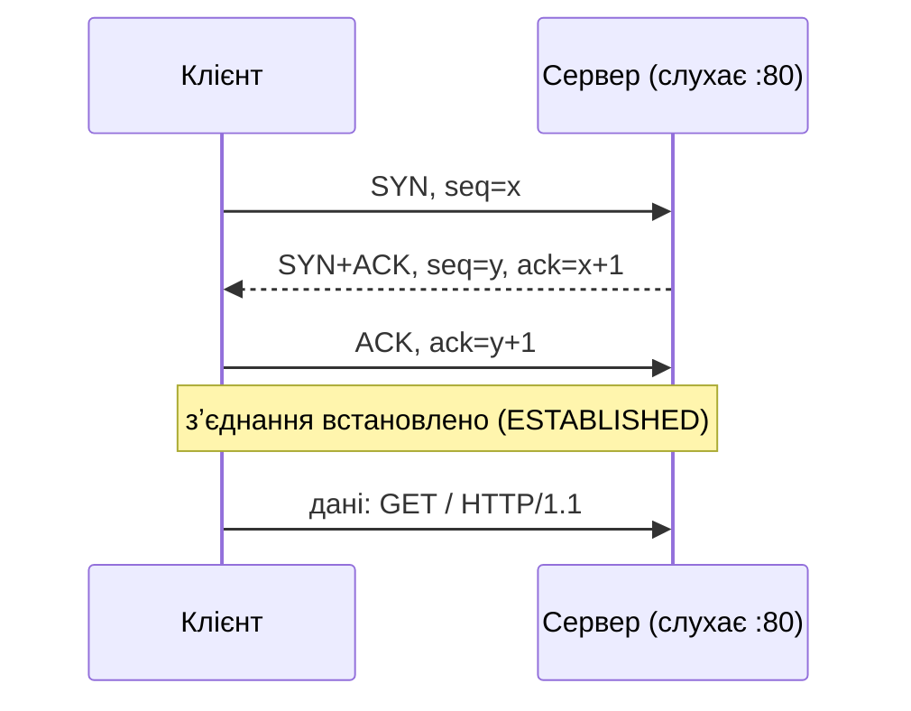
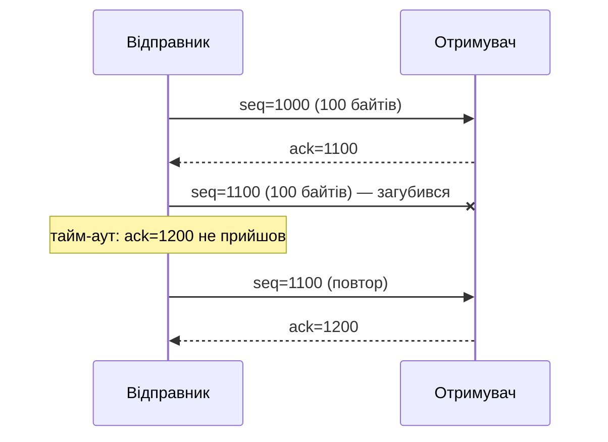
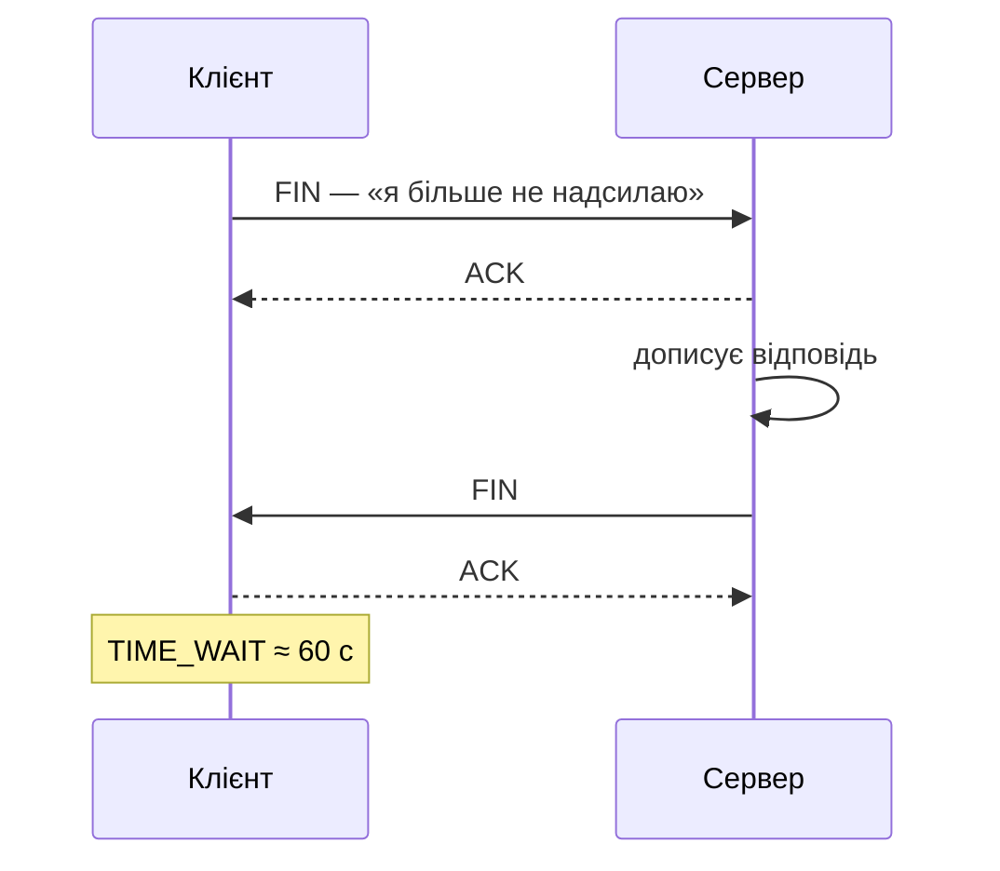

# 45. (Л) Огляд протоколу транспортного рівня TCP

## Зміст лекції

1. TCP — надійний потік байтів
2. Заголовок TCP
3. Встановлення зʼєднання: трикрокове рукостискання
4. Номери послідовності й підтвердження
5. Повторна передача
6. Керування потоком: вікно
7. Керування перевантаженням
8. Завершення зʼєднання: `FIN`, `RST`, `TIME_WAIT`
9. Стани зʼєднання
10. TCP — потік, а не повідомлення
11. Розмітка повідомлень: роздільник і довжина
12. TCP-сокет у Python: перший погляд
13. TCP чи UDP
14. Типові помилки

## TCP — надійний потік байтів

**TCP** (Transmission Control Protocol, RFC 9293) працює поверх ненадійного IP (лекція 43), але надає програмам **надійний упорядкований потік байтів**:

| Гарантія | Як досягається |
|---|---|
| дані дійдуть | підтвердження (ACK) і повторна передача |
| у тому самому порядку | номери послідовності |
| без дублікатів | номери послідовності |
| без пошкоджень | контрольна сума |
| відправник не «заллє» отримувача | керування потоком (вікно) |
| не перевантажить мережу | керування перевантаженням |

Аналогія — телефонна розмова: спочатку дзвінок і «алло», потім розмова, де співрозмовник перепитує, якщо щось не почув, наприкінці — «до побачення». На HTTP, PostgreSQL, SSH, SMTP — усьому, де важлива кожна буква, — працює TCP.

## Заголовок TCP

Мінімальний заголовок TCP — **20 байтів** (порівняйте з 8 у UDP):

| Поле | Розмір | Значення |
|---|---|---|
| Source Port, Destination Port | 2 + 2 байти | порти, як у UDP |
| Sequence Number | 4 байти | номер першого байта даних у цьому сегменті |
| Acknowledgment Number | 4 байти | номер наступного байта, який очікує отримувач |
| Flags | 9 біт | `SYN`, `ACK`, `FIN`, `RST`, `PSH`, ... |
| Window Size | 2 байти | скільки байтів ще може прийняти отримувач |
| Checksum | 2 байти | контрольна сума |

```python
# Program: parse a TCP header and its flags
import struct

header = bytes.fromhex("c738005000000000000000005002faf000000000")
src, dst, seq, ack, offset_flags, window, checksum, urgent = struct.unpack("!HHIIHHHH", header)
names = ["FIN", "SYN", "RST", "PSH", "ACK", "URG"]
flags = [name for bit, name in enumerate(names) if offset_flags & (1 << bit)]
print(f"{src} -> {dst}, seq={seq}, header {(offset_flags >> 12) * 4} bytes")
print("flags:", flags, "window:", window)
```

```text
51000 -> 80, seq=0, header 20 bytes
flags: ['SYN'] window: 64240
```

Це перший сегмент нового зʼєднання — із прапорцем `SYN`.

## Встановлення зʼєднання: трикрокове рукостискання

Перш ніж передавати дані, клієнт і сервер обмінюються трьома сегментами — **three-way handshake**:



1. **SYN** — клієнт: «хочу зʼєднатися, мій початковий номер послідовності x».
2. **SYN+ACK** — сервер: «згоден, мій номер y, твій x отримав».
3. **ACK** — клієнт: «твій y отримав».

Рукостискання займає один «кругообіг» мережі (RTT) до першого байта даних. Тому для коротких запитів TCP повільніший за UDP, а повторне використання зʼєднань (як `ClientSession` в aiohttp, лекція 38) дає помітне прискорення.

Якщо на порту ніхто не слухає, сервер відповідає на `SYN` сегментом `RST` — у Python це `ConnectionRefusedError` (лекція 43).

## Номери послідовності й підтвердження

TCP нумерує **кожен байт** потоку. Сегмент несе номер свого першого байта, а отримувач у підтвердженні вказує номер **наступного** очікуваного байта:

| Сегмент | seq | Даних | Підтвердження отримувача |
|---|---|---|---|
| 1 | 1000 | 100 байтів | `ack=1100` |
| 2 | 1100 | 100 байтів | `ack=1200` |
| 3 | 1200 | 50 байтів | `ack=1250` |

Якщо сегменти прийшли не по порядку (2 раніше за 1), отримувач за номерами розставить їх правильно, перш ніж віддати програмі.

## Повторна передача

Відправник зберігає надіслані дані, доки не отримає підтвердження. Якщо підтвердження не прийшло вчасно (**RTO**, тайм-аут повторної передачі) — сегмент надсилається знову:



Програма про втрати не дізнається: `recv` просто поверне дані трохи пізніше. Саме тому в TCP-програмах не пишуть повторних спроб на рівні окремих повідомлень, як для UDP (лекція 44).

## Керування потоком: вікно

Отримувач має буфер обмеженого розміру. У полі **Window** кожного сегмента він повідомляє, скільки байтів ще може прийняти. Якщо програма-отримувач не встигає читати (`recv`), вікно зменшується до нуля, і відправник **призупиняється**.

Для програміста це означає: `sendall` може **блокуватися**, якщо інша сторона не читає дані. Ця властивість важлива для неблокуючих серверів (лекція 49).

## Керування перевантаженням

Окрім отримувача, перевантажитися може сама мережа — маршрутизатори на шляху. TCP починає передачу повільно (**slow start**), поступово збільшує швидкість і різко зменшує її при втратах. Завдяки цьому мільйони TCP-зʼєднань в інтернеті ділять канали відносно справедливо. UDP такого механізму не має.

## Завершення зʼєднання: `FIN`, `RST`, `TIME_WAIT`

Кожна сторона закриває **свій напрям** передачі окремо сегментом `FIN`:



| Ситуація | Що бачить програма |
|---|---|
| інша сторона закрила зʼєднання (`FIN`) | `recv` повертає `b""` — порожні байти |
| аварійне закриття (`RST`) | `ConnectionResetError: Connection reset by peer` |
| запис у закрите зʼєднання | `BrokenPipeError` |

Сторона, що закрила зʼєднання першою, ще деякий час тримає його у стані **`TIME_WAIT`**, щоб запізнілі сегменти старого зʼєднання не потрапили в нове. Через це перезапущений сервер може отримати `Address already in use`; параметр сокета `SO_REUSEADDR` (лекція 46) дозволяє одразу знову зайняти порт.

## Стани зʼєднання

| Стан | Значення |
|---|---|
| `LISTEN` | сервер чекає зʼєднань |
| `SYN-SENT` / `SYN-RECEIVED` | рукостискання в процесі |
| `ESTABLISHED` | зʼєднання встановлено, йде обмін даними |
| `FIN-WAIT`, `CLOSE-WAIT`, `LAST-ACK` | закриття в процесі |
| `TIME-WAIT` | очікування після закриття |

```bash
ss -tan | head -5
```

```text
State      Recv-Q Send-Q   Local Address:Port    Peer Address:Port
LISTEN     0      128          127.0.0.1:5432         0.0.0.0:*
LISTEN     0      128            0.0.0.0:8000         0.0.0.0:*
ESTAB      0      0            127.0.0.1:43122      127.0.0.1:5432
TIME-WAIT  0      0            127.0.0.1:8000       127.0.0.1:51874
```

На macOS аналогічну інформацію показує `netstat -an -p tcp`. Багато зʼєднань у стані `CLOSE-WAIT` — ознака помилки в програмі: вона не закриває сокети, які закрила інша сторона.

## TCP — потік, а не повідомлення

Найважливіша для програміста відмінність від UDP: TCP передає **потік байтів без меж**. Три виклики `send` можуть прийти одним `recv`, а один `send` — кількома:

```python
# Program: TCP does not keep message boundaries
import socket
import time

server = socket.create_server(("127.0.0.1", 0))
client = socket.create_connection(server.getsockname())
conn, _ = server.accept()

for message in (b"first", b"second", b"third"):
    client.sendall(message)
client.close()

time.sleep(0.1)  # даємо всім даним дійти
print("one recv:", conn.recv(1024))
print("after the peer closed:", conn.recv(1024))
conn.close()
server.close()
```

```text
one recv: b'firstsecondthird'
after the peer closed: b''
```

Три повідомлення злилися в одне, і отримувач не може дізнатися, де закінчувалося кожне. А порожній результат `b""` означає, що інша сторона закрила зʼєднання.

## Розмітка повідомлень: роздільник і довжина

Межі повідомлень програма задає сама — **протоколом прикладного рівня**. Два поширені способи:

| Спосіб | Приклад | Де використовують |
|---|---|---|
| роздільник | кожне повідомлення закінчується `\n` | Redis, SMTP, заголовки HTTP, ехо-сервери |
| префікс довжини | 4 байти довжини + дані | протокол PostgreSQL, бінарні протоколи |

```python
# Program: newline-delimited and length-prefixed framing
import socket
import struct


def read_lines(sock: socket.socket):
    buffer = b""
    while True:
        chunk = sock.recv(4)  # навмисно малий буфер: повідомлення приходять шматками
        if not chunk:
            return
        buffer += chunk
        while b"\n" in buffer:
            line, buffer = buffer.split(b"\n", 1)
            yield line


def recv_exactly(sock: socket.socket, size: int) -> bytes:
    data = b""
    while len(data) < size:
        chunk = sock.recv(size - len(data))
        if not chunk:
            raise ConnectionError("connection closed in the middle of a message")
        data += chunk
    return data


def send_message(sock: socket.socket, payload: bytes) -> None:
    sock.sendall(struct.pack("!I", len(payload)) + payload)


def recv_message(sock: socket.socket) -> bytes:
    (length,) = struct.unpack("!I", recv_exactly(sock, 4))
    return recv_exactly(sock, length)


server = socket.create_server(("127.0.0.1", 0))

client = socket.create_connection(server.getsockname())
conn, _ = server.accept()
client.sendall(b"first\nsecond line\nthird\n")
client.close()
print("lines:", list(read_lines(conn)))
conn.close()

client = socket.create_connection(server.getsockname())
conn, _ = server.accept()
for payload in (b"short", b"a much longer message", b""):
    send_message(client, payload)
print("messages:", [recv_message(conn) for _ in range(3)])
client.close()
conn.close()
server.close()
```

```text
lines: [b'first', b'second line', b'third']
messages: [b'short', b'a much longer message', b'']
```

- `read_lines` накопичує байти в буфері й віддає повідомлення лише тоді, коли знайдено роздільник;
- `recv_exactly` викликає `recv`, доки не отримає рівно потрібну кількість байтів: один `recv` може повернути менше, ніж попросили;
- префікс довжини дозволяє передавати будь-які байти, зокрема `\n` всередині повідомлення, і навіть порожні повідомлення.

## TCP-сокет у Python: перший погляд

| Сервер | Клієнт |
|---|---|
| `sock = socket.socket(AF_INET, SOCK_STREAM)` | `sock = socket.socket(AF_INET, SOCK_STREAM)` |
| `sock.bind((host, port))` | |
| `sock.listen()` — стан `LISTEN` | |
| `conn, addr = sock.accept()` — новий сокет для клієнта | `sock.connect((host, port))` — рукостискання |
| `conn.recv()` / `conn.sendall()` | `sock.sendall()` / `sock.recv()` |
| `conn.close()` | `sock.close()` — `FIN` |

Скорочення `socket.create_server(addr)` і `socket.create_connection(addr)` виконують кілька кроків одразу. Докладно — у лекції 46.

## TCP чи UDP

| Критерій | TCP | UDP |
|---|---|---|
| зʼєднання | рукостискання, стан на обох сторонах | немає |
| доставка й порядок | гарантовані | ні |
| межі повідомлень | немає — потрібна розмітка | є |
| затримка першого байта | +1 RTT на рукостискання | одразу |
| реакція на втрати | повтор, затримка всього потоку | втрачене просто відсутнє |
| керування швидкістю | потоком і перевантаженням | немає |
| заголовок | ≥ 20 байтів | 8 байтів |
| приклади | HTTP/1.1, HTTP/2, PostgreSQL, SSH, пошта | DNS, VoIP, ігри, HTTP/3 (QUIC) |

Якщо сумніваєтеся — обирайте TCP: він розвʼязує більшість проблем надійності за вас.

## Типові помилки

| Помилка | Чому погано | Як правильно |
|---|---|---|
| Один `send` = один `recv` | повідомлення злипаються або розриваються | роздільник або префікс довжини |
| `recv(n)` повертає рівно `n` байтів | може повернути менше | цикл `recv_exactly` |
| Не перевіряють `b""` | нескінченний цикл після закриття клієнтом | `if not data: break` |
| `send` замість `sendall` | `send` може надіслати лише частину | `sendall` |
| Не закривають сокети | зʼєднання в `CLOSE-WAIT`, витік дескрипторів | `close()`, `with` |
| Повторні спроби окремих повідомлень у TCP | дублікати; TCP і так повторює | тайм-аут на рівні операції, перепідключення |
| Нове зʼєднання на кожне повідомлення | рукостискання щоразу | тримати зʼєднання відкритим |

## Підсумок

- **TCP** надає надійний упорядкований **потік байтів** поверх ненадійного IP.
- Зʼєднання встановлюється **трикроковим рукостисканням** `SYN` → `SYN+ACK` → `ACK` і закривається обміном `FIN`.
- Номери послідовності й підтвердження забезпечують порядок і повторну передачу; вікно — керування потоком; slow start — керування перевантаженням.
- `recv` повертає `b""`, коли інша сторона закрила зʼєднання; `RST` дає `ConnectionResetError`.
- TCP **не зберігає меж повідомлень**: програма розмічає їх роздільником або префіксом довжини.
- TCP — для даних, де важливий кожен байт; UDP — коли важливіша затримка.

## Корисні посилання

- [RFC 9293 — Transmission Control Protocol](https://www.rfc-editor.org/rfc/rfc9293)
- [Cloudflare — What is TCP/IP?](https://www.cloudflare.com/learning/ddos/glossary/tcp-ip/)
- [Python Socket Programming HOWTO](https://docs.python.org/3/howto/sockets.html)
- [Модуль `socket` — довідник](https://docs.python.org/3/library/socket.html)
- Fowler M. Python Concurrency with asyncio. — Manning, 2022. — Розділ 3.
