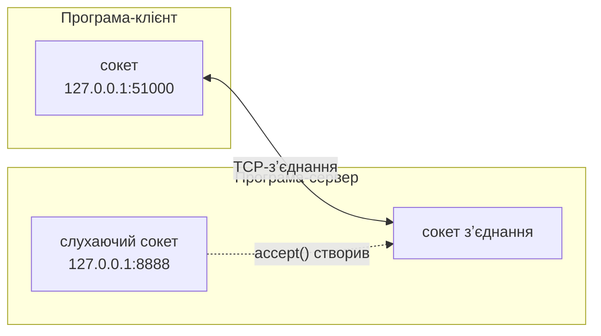
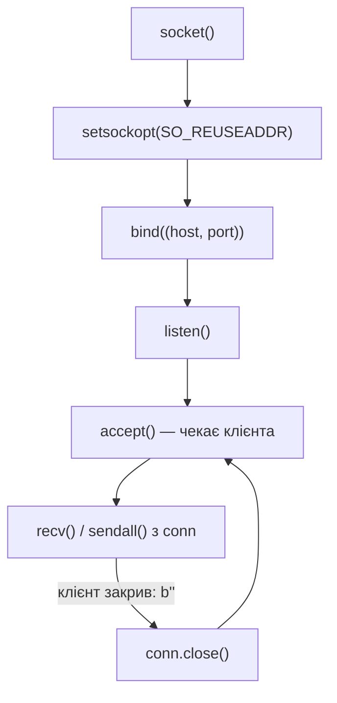

# 46. (Л) Основи сокетів та блокуючий режим роботи

## Зміст лекції

1. Що таке сокет
2. Сокет як файловий дескриптор
3. Життєвий цикл TCP-сервера
4. `bind`, `listen`, `accept`
5. Слухаючий сокет і сокет зʼєднання
6. Життєвий цикл TCP-клієнта
7. Отримання і надсилання: `recv`, `send`, `sendall`
8. Блокуючий режим: де програма чекає
9. Тайм-аути
10. Параметри сокета: `SO_REUSEADDR`
11. Закриття: `close`, `shutdown`, `with`
12. Перший ехо-сервер
13. Клієнт для ехо-сервера
14. Скорочення: `create_server`, `create_connection`
15. Типові помилки

## Що таке сокет

**Сокет** (англ. socket — «розетка») — кінцева точка двостороннього звʼязку між програмами. Програма створює сокет, привʼязує його до адреси (IP + порт) і через нього обмінюється байтами з іншою програмою — на тому самому компʼютері або на іншому континенті.

Інтерфейс сокетів (Berkeley sockets) зʼявився в BSD Unix у 1983 році і став стандартом: його підтримують усі операційні системи й мови. Модуль `socket` у Python — тонка обгортка над системними викликами ОС, тому назви методів (`bind`, `listen`, `accept`, `recv`) однакові в C, Python, Go чи Java.



## Сокет як файловий дескриптор

Для операційної системи сокет — такий самий ресурс, як відкритий файл: він має **файловий дескриптор** — невелике ціле число. Кількість дескрипторів процесу обмежена (`ulimit -n`, часто 1024), тому незакриті сокети — витік ресурсу, як незакриті файли (лекція 21, 5 семестр).

```python
# Program: a socket is a file descriptor
import socket

with socket.socket(socket.AF_INET, socket.SOCK_STREAM) as sock:
    print("family:", sock.family.name, "type:", sock.type.name)
    print("file descriptor is a small integer:", isinstance(sock.fileno(), int) and sock.fileno() > 2)
print("after with, fileno:", sock.fileno())
```

```text
family: AF_INET type: SOCK_STREAM
file descriptor is a small integer: True
after with, fileno: -1
```

Дескриптори 0, 1, 2 зайняті стандартними потоками (stdin, stdout, stderr), тому номер сокета більший. Після закриття `fileno()` повертає `-1`.

## Життєвий цикл TCP-сервера



## `bind`, `listen`, `accept`

| Виклик | Що робить |
|---|---|
| `sock.bind(("127.0.0.1", 8888))` | привʼязує сокет до адреси; порт стає зайнятим |
| `sock.listen(backlog)` | переводить сокет у стан `LISTEN`; `backlog` — довжина черги зʼєднань, що ще не прийняті |
| `conn, address = sock.accept()` | **чекає** клієнта; повертає **новий** сокет для цього зʼєднання і адресу клієнта |

Адреса для `bind`:

| Адреса | Хто може підключитися |
|---|---|
| `"127.0.0.1"` | лише програми на цьому компʼютері |
| `"0.0.0.0"` | будь-хто, хто має мережевий доступ до компʼютера (усі інтерфейси) |
| `"192.168.1.10"` | клієнти через конкретний інтерфейс |
| порт `0` | ОС обере вільний порт (зручно для тестів) |

Під час розробки сервер привʼязують до `127.0.0.1`; `0.0.0.0` використовують у контейнерах (лекція 30) і коли до сервера справді мають підключатися з мережі.

## Слухаючий сокет і сокет зʼєднання

Слухаючий сокет **не передає даних**: він лише приймає нові зʼєднання. Кожен виклик `accept()` створює окремий сокет для кожного клієнта:

```python
# Program: one listening socket, a new socket per client
import socket

server = socket.socket(socket.AF_INET, socket.SOCK_STREAM)
server.bind(("127.0.0.1", 0))
server.listen()
address = server.getsockname()

clients = [socket.create_connection(address) for _ in range(2)]
for client in clients:
    conn, peer = server.accept()
    print("server", conn.getsockname() == address, "| peer is the client:", peer == client.getsockname())
    conn.sendall(b"welcome")
    print("client got:", client.recv(100))
    conn.close()
for client in clients:
    client.close()
server.close()
```

```text
server True | peer is the client: True
client got: b'welcome'
server True | peer is the client: True
client got: b'welcome'
```

Усі сокети зʼєднань мають ту саму локальну адресу, що й слухаючий сокет: зʼєднання різняться адресами клієнтів (пʼятірка, лекція 43).

## Життєвий цикл TCP-клієнта

```python
# Program: the client side step by step
import socket
import threading

server = socket.create_server(("127.0.0.1", 0))


def answer_once() -> None:
    conn, _ = server.accept()
    with conn:
        conn.sendall(b"hello, " + conn.recv(100))


threading.Thread(target=answer_once).start()

client = socket.socket(socket.AF_INET, socket.SOCK_STREAM)
client.connect(server.getsockname())       # трикрокове рукостискання
client.sendall(b"student")                 # надіслати
print(client.recv(1024))                   # отримати
client.close()                             # FIN
server.close()
```

```text
b'hello, student'
```

Клієнт не викликає `bind`: локальну адресу й тимчасовий порт ОС призначає під час `connect`.

## Отримання і надсилання: `recv`, `send`, `sendall`

| Метод | Повертає | Особливості |
|---|---|---|
| `recv(bufsize)` | від 1 до `bufsize` байтів; `b""` — інша сторона закрила зʼєднання | чекає, доки не прийде хоч один байт |
| `send(data)` | скільки байтів **реально** надіслано | може надіслати лише частину |
| `sendall(data)` | `None` | надсилає все, повторюючи `send` |

`bufsize` — максимум, а не точна кількість: `recv(1024)` може повернути 5 байтів. Межі повідомлень визначає протокол (лекція 45): роздільник `\n` або префікс довжини.

## Блокуючий режим: де програма чекає

За замовчуванням сокети **блокуючі**: виклик не повертається, доки операція не стане можливою. Потік у цей час спить і нічого іншого не робить.

| Виклик | Блокується, доки… |
|---|---|
| `accept()` | не підключиться клієнт |
| `connect()` | не завершиться рукостискання (або помилка) |
| `recv()` | не прийде хоча б один байт або не закриється зʼєднання |
| `sendall()` | усі дані не потраплять у буфер ОС (якщо інша сторона не читає — може чекати довго) |

```python
# Program: recv blocks until data arrives
import socket
import threading
import time

server = socket.create_server(("127.0.0.1", 0))
client = socket.create_connection(server.getsockname())
conn, _ = server.accept()

threading.Timer(0.5, client.sendall, (b"late data",)).start()  # дані прийдуть через 0.5 с
start = time.perf_counter()
data = conn.recv(1024)
print(f"recv waited {time.perf_counter() - start:.1f}s and got {data!r}")
for s in (conn, client, server):
    s.close()
```

```text
recv waited 0.5s and got b'late data'
```

Пів секунди потік нічого не робив. Для сервера з одним потоком це означає: поки він чекає `recv` від одного клієнта, інші не обслуговуються (лекція 47).

## Тайм-аути

Тайм-аут обмежує блокування: якщо операція не завершилася за вказаний час — `TimeoutError`:

| Виклик | Режим |
|---|---|
| `sock.settimeout(None)` | блокуючий без обмеження (типово) |
| `sock.settimeout(2.5)` | блокуючий з тайм-аутом 2,5 с |
| `sock.settimeout(0)` або `setblocking(False)` | неблокуючий (лекція 49) |

```python
# Program: a timeout limits waiting
import socket

server = socket.create_server(("127.0.0.1", 0))
client = socket.create_connection(server.getsockname())
conn, _ = server.accept()
conn.settimeout(0.2)
try:
    conn.recv(1024)
except TimeoutError:
    print("no data within 0.2s, the connection is still open:", conn.fileno() != -1)
for s in (conn, client, server):
    s.close()
```

```text
no data within 0.2s, the connection is still open: True
```

Тайм-аут на клієнтських сокетах обовʼязковий: без нього програма може назавжди «зависнути» через проблему в мережі.

## Параметри сокета: `SO_REUSEADDR`

Після зупинки сервера порт ще деякий час зайнятий зʼєднаннями в стані `TIME_WAIT` (лекція 45), і повторний запуск дасть `Address already in use`. Параметр `SO_REUSEADDR` дозволяє одразу знову привʼязатися до порту:

```python
# Program: SO_REUSEADDR is set before bind
import socket

sock = socket.socket(socket.AF_INET, socket.SOCK_STREAM)
sock.setsockopt(socket.SOL_SOCKET, socket.SO_REUSEADDR, 1)
sock.bind(("127.0.0.1", 0))
print("SO_REUSEADDR:", sock.getsockopt(socket.SOL_SOCKET, socket.SO_REUSEADDR) != 0)
sock.close()
```

```text
SO_REUSEADDR: True
```

`SO_REUSEADDR` встановлюють **до** `bind`. Він не дозволяє двом працюючим серверам слухати один порт — лише прибирає очікування після перезапуску. `socket.create_server` встановлює його автоматично.

## Закриття: `close`, `shutdown`, `with`

| Виклик | Дія |
|---|---|
| `sock.close()` | закрити сокет, звільнити дескриптор; інша сторона отримає `FIN` |
| `sock.shutdown(socket.SHUT_WR)` | закрити лише напрям запису: «я все надіслав», але ще можна читати відповідь |
| `with socket.socket(...) as sock:` | `close()` автоматично, навіть при винятку |

## Перший ехо-сервер

**Ехо-сервер** повертає клієнту все, що отримав. Це «hello world» мережевого програмування: на ньому зручно вивчати будь-яку модель сервера — блокуючу, неблокуючу, asyncio.

```python
# File: echo_server.py
import socket

HOST, PORT = "127.0.0.1", 8888


def handle(conn: socket.socket, address) -> None:
    print(f"connected {address[0]}:{address[1]}")
    with conn:
        while True:
            data = conn.recv(1024)  # блокується, доки клієнт щось не надішле
            if not data:
                break  # клієнт закрив зʼєднання
            conn.sendall(data)
    print(f"disconnected {address[0]}:{address[1]}")


def main() -> None:
    with socket.socket(socket.AF_INET, socket.SOCK_STREAM) as server:
        server.setsockopt(socket.SOL_SOCKET, socket.SO_REUSEADDR, 1)
        server.bind((HOST, PORT))
        server.listen()
        print(f"echo server on {HOST}:{PORT}")
        while True:
            conn, address = server.accept()  # блокується, доки не підключиться клієнт
            handle(conn, address)


if __name__ == "__main__":
    try:
        main()
    except KeyboardInterrupt:
        print("stopped")
```

```bash
python3 echo_server.py
# в іншому терміналі
nc 127.0.0.1 8888
```

```text
echo server on 127.0.0.1:8888
connected 127.0.0.1:52344
disconnected 127.0.0.1:52344
^Cstopped
```

## Клієнт для ехо-сервера

Клієнт надсилає кілька рядків і читає відповіді. Оскільки TCP — потік, клієнт читає, доки не отримає стільки байтів, скільки надіслав:

```python
# File: echo_client.py
import socket

HOST, PORT = "127.0.0.1", 8888


def echo(sock: socket.socket, message: bytes) -> bytes:
    sock.sendall(message)
    received = b""
    while len(received) < len(message):
        chunk = sock.recv(1024)
        if not chunk:
            raise ConnectionError("server closed the connection")
        received += chunk
    return received


def main() -> None:
    with socket.create_connection((HOST, PORT), timeout=5) as sock:
        for line in ("hello\n", "how are you?\n", "bye\n"):
            reply = echo(sock, line.encode())
            print("sent", repr(line), "got", reply)


if __name__ == "__main__":
    try:
        main()
    except ConnectionRefusedError:
        print(f"error: nobody listens on {HOST}:{PORT}, start echo_server.py first")
```

```text
sent 'hello\n' got b'hello\n'
sent 'how are you?\n' got b'how are you?\n'
sent 'bye\n' got b'bye\n'
```

Обидві програми разом можна перевірити одним скриптом: сервер — у потоці, клієнт — у головному потоці:

```python
# Program: run the echo server and client together
import socket
import threading

import echo_client
import echo_server

server = socket.create_server(("127.0.0.1", 0))
echo_client.PORT = server.getsockname()[1]


def serve_one() -> None:
    conn, address = server.accept()
    echo_server.handle(conn, address)


thread = threading.Thread(target=serve_one)
thread.start()
echo_client.main()
thread.join()
server.close()
```

```text
connected 127.0.0.1:...
sent 'hello\n' got b'hello\n'
sent 'how are you?\n' got b'how are you?\n'
sent 'bye\n' got b'bye\n'
disconnected 127.0.0.1:...
```

Замість `...` — тимчасовий порт клієнта, щоразу інший.

## Скорочення: `create_server`, `create_connection`

| Скорочення | Що робить |
|---|---|
| `socket.create_server(("127.0.0.1", 8888))` | `socket` + `SO_REUSEADDR` + `bind` + `listen` |
| `socket.create_server(addr, family=socket.AF_INET6, dualstack_ipv6=True)` | сервер для IPv4 і IPv6 одночасно |
| `socket.create_connection(("example.com", 80), timeout=5)` | DNS + перебір адрес + `connect` з тайм-аутом |

У навчальних прикладах ми використовуємо обидва варіанти: повний — щоб бачити кроки, скорочений — коли кроки вже зрозумілі.

## Типові помилки

| Помилка | Чому погано | Як правильно |
|---|---|---|
| Дані надсилають через слухаючий сокет | `OSError: Transport endpoint is not connected` | `conn` з `accept()` |
| Немає перевірки `if not data` | нескінченний цикл після відключення клієнта | `break` на `b""` |
| `recv(1024)` вважають «повідомленням» | частини або склеєні повідомлення | протокол розмітки |
| `send` замість `sendall` | частина даних не надіслана | `sendall` |
| Рядки замість байтів | `TypeError` | `encode()` / `decode()` |
| Немає `SO_REUSEADDR` | `Address already in use` після перезапуску | `setsockopt` або `create_server` |
| Клієнт без тайм-ауту | вічне очікування | `timeout=` |
| Сокети не закриваються | вичерпуються дескриптори | `with`, `close()` |
| `bind("0.0.0.0")` без потреби | сервер доступний з мережі | `127.0.0.1` для розробки |

## Підсумок

- **Сокет** — кінцева точка звʼязку; для ОС це файловий дескриптор, який треба закривати.
- Сервер: `socket` → `SO_REUSEADDR` → `bind` → `listen` → `accept`; клієнт: `socket` → `connect`.
- Слухаючий сокет лише приймає зʼєднання; `accept()` повертає окремий сокет для кожного клієнта.
- `recv` повертає від 1 до `bufsize` байтів або `b""` після закриття; `sendall` надсилає все.
- У **блокуючому** режимі `accept`, `connect`, `recv`, `sendall` присипляють потік до завершення операції; тайм-аут обмежує очікування.
- Ехо-сервер — базова модель для вивчення мережевих серверів.

## Корисні посилання

- [Python Socket Programming HOWTO](https://docs.python.org/3/howto/sockets.html)
- [Модуль `socket` — довідник](https://docs.python.org/3/library/socket.html)
- [Real Python — Socket Programming in Python](https://realpython.com/python-sockets/)
- [Beej's Guide to Network Programming](https://beej.us/guide/bgnet/)
- Fowler M. Python Concurrency with asyncio. — Manning, 2022. — Розділ 3.
