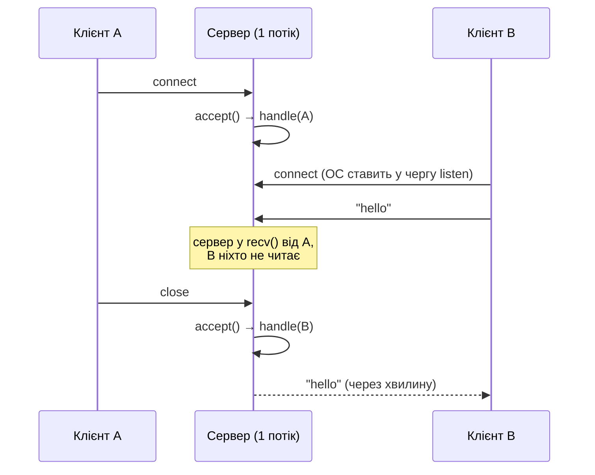
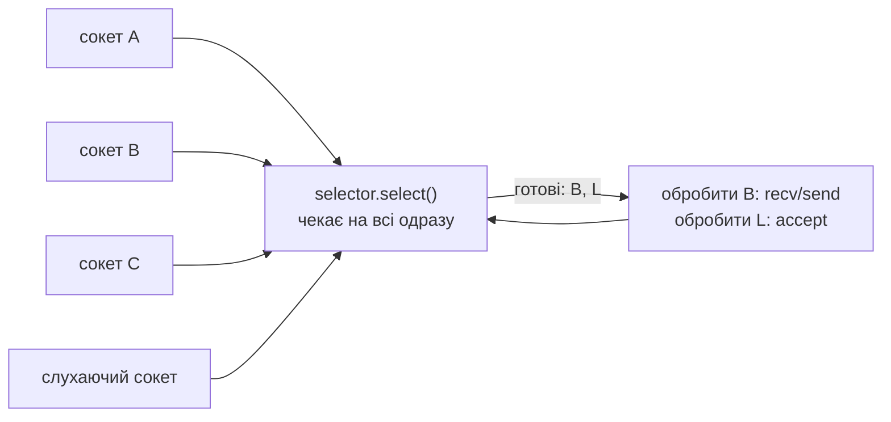

# 47. (Л) Обмеження блокуючих сокетів та підходи до їх подолання

## Зміст лекції

1. Один клієнт — і всі інші чекають
2. Демонстрація: другий клієнт не отримує відповіді
3. Чому так відбувається
4. Підхід 1: потік на клієнта
5. Підхід 2: пул потоків
6. Підхід 3: процеси
7. `socketserver`: готові блокуючі сервери
8. Ціна потоків: памʼять і перемикання
9. Проблема C10K
10. Підхід 4: неблокуючі сокети і мультиплексування
11. Підхід 5: asyncio
12. Порівняння підходів
13. Типові помилки

## Один клієнт — і всі інші чекають

Ехо-сервер з лекції 46 має фатальну ваду: поки він обслуговує одного клієнта, функція `handle` крутиться в циклі `recv`. До `accept()` наступного клієнта сервер повернеться лише тоді, коли перший відключиться.



Для чату, гри чи вебсервера це неприйнятно.

## Демонстрація: другий клієнт не отримує відповіді

```python
# Program: a blocking server serves clients one by one
import socket
import threading
import time


def handle(conn: socket.socket) -> None:
    with conn:
        while data := conn.recv(1024):
            conn.sendall(data)


def blocking_server(server: socket.socket, clients: int) -> None:
    for _ in range(clients):
        conn, _ = server.accept()
        handle(conn)


server = socket.create_server(("127.0.0.1", 0))
threading.Thread(target=blocking_server, args=(server, 2), daemon=True).start()

first = socket.create_connection(server.getsockname())
first.sendall(b"A")
print("first:", first.recv(10))

second = socket.create_connection(server.getsockname())  # зʼєднання встановлено ОС
second.sendall(b"B")
second.settimeout(0.5)
try:
    second.recv(10)
except TimeoutError:
    print("second: no answer while the first client is connected")

first.close()
second.settimeout(2)
start = time.perf_counter()
print("second:", second.recv(10), f"after the first left ({time.perf_counter() - start:.1f}s)")
second.close()
server.close()
```

```text
first: b'A'
second: no answer while the first client is connected
second: b'B' after the first left (0.0s)
```

Цікава деталь: `create_connection` для другого клієнта **успішно** повернувся. Рукостискання TCP виконує операційна система, а зʼєднання чекає в черзі `listen`, доки програма не викличе `accept()`. Клієнт «підключений», але його ніхто не обслуговує.

## Чому так відбувається

Сервер має **один потік**, а кожен блокуючий виклик зупиняє його цілком:

| Сервер чекає в | Хто через це страждає |
|---|---|
| `accept()` | клієнт, що вже підключений і надсилає дані |
| `recv()` від A | усі інші клієнти й нові підключення |
| `sendall()` до повільного A | усі інші |

Потрібно, щоб сервер міг **одночасно чекати** на багато подій. Є два принципово різні шляхи:

1. **Більше виконавців**: кожен клієнт — у своєму потоці чи процесі, і кожен блокується сам по собі.
2. **Не блокуватися**: один потік питає ОС, які сокети готові, і обробляє лише їх.

## Підхід 1: потік на клієнта

Найпростіше виправлення: після `accept()` запускати `handle` в **окремому потоці**. Головний потік одразу повертається до `accept()`:

```python
# File: threaded_echo.py
import socket
import threading

HOST, PORT = "127.0.0.1", 8888


def handle(conn: socket.socket, address) -> None:
    with conn:
        while data := conn.recv(1024):
            conn.sendall(data)


def serve(server: socket.socket) -> None:
    while True:
        conn, address = server.accept()
        threading.Thread(target=handle, args=(conn, address), daemon=True).start()


if __name__ == "__main__":
    with socket.create_server((HOST, PORT)) as server:
        print(f"threaded echo on {HOST}:{PORT}")
        try:
            serve(server)
        except KeyboardInterrupt:
            print("stopped")
```

```python
# Program: three clients are served at the same time
import socket
import threading
import time

import threaded_echo

server = socket.create_server(("127.0.0.1", 0))
threading.Thread(target=threaded_echo.serve, args=(server,), daemon=True).start()

clients = [socket.create_connection(server.getsockname(), timeout=1) for _ in range(3)]
start = time.perf_counter()
for number, client in enumerate(clients):
    client.sendall(f"client {number}".encode())
print([client.recv(100) for client in clients])
print(f"all answered in {time.perf_counter() - start:.1f}s, threads alive: {threading.active_count() - 2}")
for client in clients:
    client.close()
server.close()
```

```text
[b'client 0', b'client 1', b'client 2']
all answered in 0.0s, threads alive: 3
```

`daemon=True` означає, що потоки-обробники не заважають програмі завершитися. Активних потоків — 3 обробники (від загальної кількості віднімаємо головний потік і потік `serve`).

## Підхід 2: пул потоків

Потік на клієнта без обмежень небезпечний: 10 000 клієнтів — 10 000 потоків, і сервер може вичерпати памʼять. **Пул** обмежує кількість одночасних обробників (лекція 32):

```python
# Program: a thread pool limits concurrent clients
import socket
import threading
import time
from concurrent.futures import ThreadPoolExecutor


def handle(conn: socket.socket) -> None:
    with conn:
        while data := conn.recv(1024):
            time.sleep(0.2)  # імітація роботи з кожним повідомленням
            conn.sendall(data)


def serve(server: socket.socket, pool: ThreadPoolExecutor) -> None:
    while True:
        try:
            conn, _ = server.accept()
        except OSError:
            return  # слухаючий сокет закрито
        pool.submit(handle, conn)


server = socket.create_server(("127.0.0.1", 0))
pool = ThreadPoolExecutor(max_workers=2)
threading.Thread(target=serve, args=(server, pool), daemon=True).start()

start = time.perf_counter()
clients = [socket.create_connection(server.getsockname(), timeout=3) for _ in range(4)]
for client in clients:
    client.sendall(b"x")
for number, client in enumerate(clients):
    client.recv(10)
    print(f"client {number} answered at {time.perf_counter() - start:.1f}s")
    client.close()
server.close()
pool.shutdown()
```

```text
client 0 answered at 0.2s
client 1 answered at 0.2s
client 2 answered at 0.4s
client 3 answered at 0.4s
```

Два обробники — два клієнти одночасно; третій і четвертий чекають, доки звільниться потік. Для коротких запитів (HTTP: запит → відповідь → закриття) пул працює добре. Для довгих зʼєднань (чат, ігри) клієнт займає потік на весь час зʼєднання — і пул швидко закінчується.

## Підхід 3: процеси

Замість потоків можна запускати **процеси** — `multiprocessing` або `os.fork()`. Так працював класичний вебсервер Apache (prefork) і так працює gunicorn із синхронними обробниками (лекція 30): кілька процесів, у кожному свій блокуючий цикл.

| Плюси | Мінуси |
|---|---|
| збій одного процесу не зачіпає інші | процес займає десятки мегабайтів |
| немає GIL — обчислення паралельні | обмін даними між процесами складний |
| | кількість процесів — десятки, не тисячі |

## `socketserver`: готові блокуючі сервери

Стандартна бібліотека має модуль `socketserver` з готовими класами серверів. Програміст пише лише обробник:

```python
# Program: a threaded echo server with socketserver
import socket
import socketserver
import threading


class EchoHandler(socketserver.StreamRequestHandler):
    def handle(self) -> None:
        for line in self.rfile:  # файлоподібний обʼєкт: читаємо рядками
            self.wfile.write(b"echo: " + line)


with socketserver.ThreadingTCPServer(("127.0.0.1", 0), EchoHandler) as server:
    threading.Thread(target=server.serve_forever, daemon=True).start()
    with socket.create_connection(server.server_address, timeout=1) as client:
        with client.makefile("rwb") as file:  # файл тримає зʼєднання — його теж закриваємо
            for text in (b"hello\n", b"world\n"):
                file.write(text)
                file.flush()
                print(file.readline())
    server.shutdown()
```

```text
b'echo: hello\n'
b'echo: world\n'
```

| Клас | Модель |
|---|---|
| `TCPServer`, `UDPServer` | один клієнт за раз |
| `ThreadingTCPServer` | потік на клієнта |
| `ForkingTCPServer` | процес на клієнта (Unix) |

`StreamRequestHandler` надає `self.rfile` і `self.wfile` — сокет, загорнутий у файлоподібний обʼєкт, який сам розбиває потік на рядки (`makefile`). Обʼєкт `makefile` на клієнті тримає власне посилання на зʼєднання: якщо його не закрити, зʼєднання лишиться відкритим, обробник на сервері чекатиме далі, а `ThreadingTCPServer` під час закриття чекатиме завершення обробника.

## Ціна потоків: памʼять і перемикання

Кожен потік має власний **стек** — область памʼяті для локальних змінних і викликів функцій. ОС резервує для нього мегабайти віртуальної памʼяті, а кожне перемикання між потоками коштує процесорного часу.

```python
# Program: how long it takes to start many idle threads
import threading
import time


def wait(event: threading.Event) -> None:
    event.wait()


for count in (100, 1000):
    stop = threading.Event()
    start = time.perf_counter()
    threads = [threading.Thread(target=wait, args=(stop,)) for _ in range(count)]
    for t in threads:
        t.start()
    started = time.perf_counter() - start
    stop.set()
    for t in threads:
        t.join()
    print(f"{count} threads started in under a second: {started < 1}")
print("default thread stack size (0 means OS default):", threading.stack_size())
```

```text
100 threads started in under a second: True
1000 threads started in under a second: True
default thread stack size (0 means OS default): 0
```

Тисячу потоків створити можна. Проблеми починаються на десятках тисяч: памʼять під стеки, час на перемикання, ліміти ОС на кількість потоків. А більшість цих потоків просто **спить** у `recv`, чекаючи на повільних клієнтів.

## Проблема C10K

У 1999 році Ден Кегел сформулював **проблему C10K**: як обслуговувати 10 000 одночасних клієнтів на одному сервері? Відповідь, до якої прийшла індустрія: **не виділяти виконавця на кожне зʼєднання**. Більшість зʼєднань більшість часу нічого не роблять — вони чекають. Потрібен механізм, який дозволяє одному потоку чекати на тисячі сокетів одночасно і прокидатися, лише коли з кимось щось сталося.

Сьогодні nginx, Node.js, Redis, asyncio, Go-сервери обслуговують сотні тисяч зʼєднань саме так.

## Підхід 4: неблокуючі сокети і мультиплексування

Ідея з лекції 34:

1. Перевести всі сокети в **неблокуючий** режим: `recv` без даних одразу повертає помилку `BlockingIOError` замість очікування (лекція 49).
2. Попросити ОС стежити за всіма сокетами одночасно й повідомити, які готові: системні виклики `select`, `poll`, `epoll` (Linux), `kqueue` (macOS) — у Python модуль `selectors` (лекція 51).
3. В одному потоці в циклі обробляти лише готові сокети — **подієвий цикл**.



## Підхід 5: asyncio

Писати подієвий цикл вручну складно: доводиться зберігати стан кожного клієнта (що прочитано, що треба надіслати) і розбивати логіку на шматки. **asyncio** робить усе це за нас: усередині — той самий цикл на `selectors`, а код обробника виглядає майже як блокуючий, лише з `await` (лекція 53):

```python
# Program: the same echo server with asyncio streams
import asyncio


async def handle(reader: asyncio.StreamReader, writer: asyncio.StreamWriter) -> None:
    while data := await reader.read(1024):
        writer.write(data)
        await writer.drain()
    writer.close()
    await writer.wait_closed()


async def main() -> None:
    server = await asyncio.start_server(handle, "127.0.0.1", 0)
    port = server.sockets[0].getsockname()[1]
    connections = [await asyncio.open_connection("127.0.0.1", port) for _ in range(3)]
    for number, (_, writer) in enumerate(connections):
        writer.write(f"client {number}".encode())
    print([await reader.read(100) for reader, _ in connections])
    for _, writer in connections:
        writer.close()
    server.close()
    await server.wait_closed()


asyncio.run(main())
```

```text
[b'client 0', b'client 1', b'client 2']
```

Три клієнти обслуговуються одночасно в **одному** потоці.

## Порівняння підходів

| Підхід | Одночасних клієнтів | Памʼять | Складність коду | Де використовують |
|---|---|---|---|---|
| один потік, блокуючі сокети | 1 | мінімум | найпростіший | навчальні приклади, утиліти |
| потік на клієнта | сотні–тисячі | стек на потік | простий + замки | невеликі сервери, `ThreadingTCPServer` |
| пул потоків | розмір пулу | обмежена | простий | короткі запити (HTTP) |
| процеси | десятки | десятки МБ на процес | середній | gunicorn sync, Apache prefork |
| неблокуючі сокети + `selectors` | десятки тисяч | мінімум | складний: стан вручну | бібліотеки, фреймворки |
| asyncio | десятки тисяч | мінімум | середній: `async`/`await` | сучасні мережеві сервіси |

## Типові помилки

| Помилка | Чому погано | Як правильно |
|---|---|---|
| Блокуючий сервер з одним потоком для кількох клієнтів | клієнти чекають один одного | потоки, пул, asyncio |
| Необмежена кількість потоків | вичерпання памʼяті при навалі клієнтів | пул з `max_workers` |
| Спільні дані між потоками-обробниками без замка | стани гонитви | `Lock` (лекція 32) або asyncio |
| Довгі зʼєднання на пулі потоків | пул закінчується, нові клієнти чекають | asyncio або потік на клієнта |
| `accept()` вважають доказом обслуговування | клієнт підключений, але чекає в черзі | вимірювати час відповіді |
| Потоки-обробники без `daemon=True` або без завершення | програма не завершується | `daemon=True`, коректне закриття |
| Обчислення в asyncio-обробнику | блокує всіх клієнтів | пул процесів (лекція 40) |

## Підсумок

- Блокуючий однопотоковий сервер обслуговує **одного клієнта за раз**: решта «підключені», але чекають у черзі `listen`.
- **Потік на клієнта** розвʼязує проблему для сотень клієнтів; **пул** обмежує ресурси; **процеси** дають ізоляцію й паралелізм.
- `socketserver.ThreadingTCPServer` — готовий багатопотоковий сервер зі стандартної бібліотеки.
- Потоки коштують памʼяті й перемикань; на тисячах зʼєднань виникає **проблема C10K**.
- Масштабоване рішення — **неблокуючі сокети + мультиплексування** (`selectors`) в одному потоці; asyncio робить цей підхід зручним.

## Корисні посилання

- [Модуль `socketserver` — довідник](https://docs.python.org/3/library/socketserver.html)
- [The C10K problem (Dan Kegel)](http://www.kegel.com/c10k.html)
- [Модуль `selectors` — довідник](https://docs.python.org/3/library/selectors.html)
- [asyncio — Streams](https://docs.python.org/3/library/asyncio-stream.html)
- Fowler M. Python Concurrency with asyncio. — Manning, 2022. — Розділ 3.
