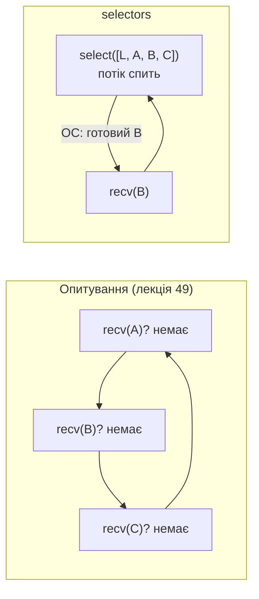
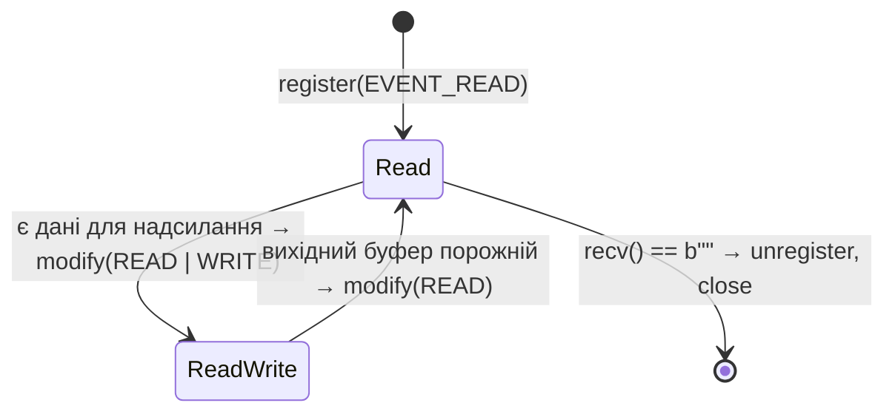

# 51. (Л) Побудова сокетного подієвого циклу з використанням модуля selectors

## Зміст лекції

1. Від опитування до очікування подій
2. Системні виклики `select`, `poll`, `epoll`, `kqueue`
3. Модуль `selectors`
4. Реєстрація сокетів і події
5. `select()`: готові сокети
6. Подія запису: коли сокет готовий надсилати
7. Колбеки в полі `data`
8. Подієвий цикл: ехо-сервер на selectors
9. Стан клієнта і вихідний буфер
10. Таймери в подієвому циклі
11. UDP у тому самому циклі
12. Від власного циклу до asyncio
13. Типові помилки

## Від опитування до очікування подій

У лекції 49 сервер з опитуванням обслуговував багатьох клієнтів одним потоком, але безперервно перебирав усі сокети й займав 100 % процесора. Правильний підхід: передати ОС **список сокетів** і заснути, доки хоча б один з них не стане готовим. ОС розбудить програму й скаже, **які саме** сокети готові.



## Системні виклики `select`, `poll`, `epoll`, `kqueue`

ОС має кілька механізмів **мультиплексування вводу-виводу**:

| Механізм | ОС | Особливість |
|---|---|---|
| `select` | усі | найстаріший; ліміт ≈ 1024 дескрипторів; щоразу перевіряє весь список |
| `poll` | Unix | без ліміту 1024, але так само перевіряє весь список |
| `epoll` | Linux | ОС сама памʼятає список; час не залежить від кількості сокетів |
| `kqueue` | macOS, BSD | аналог `epoll` |

Для 10 сокетів різниці немає; для 10 000 `epoll`/`kqueue` у сотні разів ефективніші. Саме на них працюють nginx, Redis, Node.js і asyncio.

## Модуль `selectors`

Модуль `selectors` дає **один інтерфейс** для всіх механізмів. `selectors.DefaultSelector` автоматично обирає найкращий для поточної ОС:

```python
# Program: the best selector for this OS
import selectors

selector = selectors.DefaultSelector()
print(type(selector).__name__)
selector.close()
```

```text
EpollSelector
```

На macOS вивід буде `KqueueSelector`.

| Метод | Дія |
|---|---|
| `register(fileobj, events, data=None)` | почати стежити за сокетом |
| `modify(fileobj, events, data=None)` | змінити, на які події чекати |
| `unregister(fileobj)` | перестати стежити (перед `close`) |
| `select(timeout=None)` | чекати подій; повертає список `(key, mask)` |
| `get_map()` | усі зареєстровані сокети |
| `close()` | закрити селектор |

## Реєстрація сокетів і події

| Подія | Коли настає |
|---|---|
| `selectors.EVENT_READ` | є що читати: нові дані, новий клієнт для `accept`, або закриття зʼєднання |
| `selectors.EVENT_WRITE` | у буфері надсилання є місце — `send` не заблокує |

Події можна поєднувати: `EVENT_READ | EVENT_WRITE`. Для слухаючого сокета «готовий до читання» означає, що в черзі є клієнт і `accept()` не заблокує.

## `select()`: готові сокети

`select()` повертає список пар `(key, mask)`:

| Поле | Значення |
|---|---|
| `key.fileobj` | сам сокет |
| `key.fd` | файловий дескриптор |
| `key.events` | на які події зареєстровано |
| `key.data` | довільні дані, передані в `register` |
| `mask` | які події **настали** (`EVENT_READ`, `EVENT_WRITE` або обидві) |

```python
# Program: select returns only ready sockets
import selectors
import socket

selector = selectors.DefaultSelector()
server = socket.create_server(("127.0.0.1", 0))
server.setblocking(False)
selector.register(server, selectors.EVENT_READ, data="listening")

print("nothing ready:", selector.select(timeout=0.1))
client = socket.create_connection(server.getsockname())
for key, mask in selector.select(timeout=1):
    print("ready:", key.data, "read" if mask & selectors.EVENT_READ else "", key.fileobj is server)
conn, _ = server.accept()
for s in (conn, client):
    s.close()
selector.unregister(server)
server.close()
selector.close()
```

```text
nothing ready: []
ready: listening read True
```

Без `timeout` (`None`) `select` чекає вічно; `timeout=0` — лише перевіряє і одразу повертається.

## Подія запису: коли сокет готовий надсилати

Сокет зʼєднання майже завжди готовий до запису: буфер надсилання порожній. Тому на `EVENT_WRITE` реєструють **лише тоді, коли є що надсилати**, і знімають підписку, щойно вихідний буфер спорожнів. Інакше `select` повертатиметься миттєво щоразу — і ми знову отримаємо 100 % процесора.



## Колбеки в полі `data`

Поле `data` може містити будь-що. Зручний прийом: зберігати там **функцію-обробник** (колбек). Тоді цикл стає універсальним: для кожного готового сокета він просто викликає його колбек:

```python
# Program: callbacks stored in the selector key
import selectors
import socket

selector = selectors.DefaultSelector()
left, right = socket.socketpair()
right.setblocking(False)


def on_message(sock: socket.socket) -> None:
    print("callback got", sock.recv(100))


selector.register(right, selectors.EVENT_READ, data=on_message)
left.sendall(b"ping")
for key, _ in selector.select(timeout=1):
    callback = key.data
    callback(key.fileobj)
selector.unregister(right)
for s in (left, right):
    s.close()
selector.close()
```

```text
callback got b'ping'
```

Саме так влаштовано подієвий цикл asyncio: для кожного сокета зберігається колбек, який цикл викликає, коли ОС повідомить про готовність.

## Подієвий цикл: ехо-сервер на selectors

```python
# File: selectors_echo.py
import selectors
import socket

HOST, PORT = "127.0.0.1", 8888


class EchoServer:
    def __init__(self, server: socket.socket) -> None:
        self.selector = selectors.DefaultSelector()
        self.server = server
        self.server.setblocking(False)
        self.outbox: dict[socket.socket, bytes] = {}
        self.selector.register(server, selectors.EVENT_READ, data=self.on_accept)

    def on_accept(self, server: socket.socket) -> None:
        conn, address = server.accept()
        conn.setblocking(False)
        self.outbox[conn] = b""
        self.selector.register(conn, selectors.EVENT_READ, data=self.on_ready)
        print(f"connected, clients: {len(self.outbox)}")

    def on_ready(self, conn: socket.socket, mask: int) -> None:
        if mask & selectors.EVENT_READ:
            try:
                data = conn.recv(4096)
            except ConnectionResetError:
                data = b""
            if not data:
                self.close(conn)
                return
            self.outbox[conn] += data
        if self.outbox[conn]:
            try:
                sent = conn.send(self.outbox[conn])
                self.outbox[conn] = self.outbox[conn][sent:]
            except BlockingIOError:
                pass
        events = selectors.EVENT_READ | (selectors.EVENT_WRITE if self.outbox[conn] else 0)
        self.selector.modify(conn, events, data=self.on_ready)

    def close(self, conn: socket.socket) -> None:
        self.selector.unregister(conn)
        del self.outbox[conn]
        conn.close()
        print(f"disconnected, clients: {len(self.outbox)}")

    def run(self, stop_after: float | None = None) -> None:
        while True:
            events = self.selector.select(timeout=stop_after)
            if not events and stop_after is not None:
                break  # нічого не відбувалося stop_after секунд — завершуємо (для демонстрації)
            for key, mask in events:
                if key.fileobj is self.server:
                    key.data(key.fileobj)
                else:
                    key.data(key.fileobj, mask)


if __name__ == "__main__":
    with socket.create_server((HOST, PORT)) as srv:
        print(f"selectors echo on {HOST}:{PORT}")
        try:
            EchoServer(srv).run()
        except KeyboardInterrupt:
            print("stopped")
```

```python
# Program: many clients and a big message through the selectors echo server
import socket
import threading

from selectors_echo import EchoServer

server = socket.create_server(("127.0.0.1", 0))
thread = threading.Thread(target=EchoServer(server).run, kwargs={"stop_after": 0.5})
thread.start()

clients = [socket.create_connection(server.getsockname(), timeout=2) for _ in range(3)]
for number, client in enumerate(clients):
    client.sendall(f"hello from {number}".encode())
print([client.recv(100) for client in clients])

big = b"z" * 3_000_000
clients[0].sendall(big[:10])
received = clients[0].recv(10)
writer = threading.Thread(target=clients[0].sendall, args=(big[10:],))
writer.start()
while len(received) < len(big):
    received += clients[0].recv(65536)
writer.join()
print("big message echoed correctly:", received == big)

for client in clients:
    client.close()
thread.join()
server.close()
```

```text
connected, clients: 1
connected, clients: 2
connected, clients: 3
[b'hello from 0', b'hello from 1', b'hello from 2']
big message echoed correctly: True
disconnected, clients: 2
disconnected, clients: 1
disconnected, clients: 0
```

3 МБ даних пройшли через сервер, хоча буфер ОС значно менший: сервер дописував вихідний буфер частинами, щоразу коли сокет ставав готовим до запису, і **ніколи не блокувався**. Тим часом інші клієнти могли обмінюватися повідомленнями.

## Стан клієнта і вихідний буфер

Що відбувається з одним клієнтом:

| Подія | Дія сервера |
|---|---|
| `EVENT_READ` на слухаючому сокеті | `accept`, `register(conn, EVENT_READ)` |
| `EVENT_READ` на `conn`, дані | дописати в `outbox`, спробувати `send` |
| частина `outbox` не надіслалася | `modify(conn, READ | WRITE)` |
| `EVENT_WRITE` на `conn` | дописати решту `outbox` |
| `outbox` порожній | `modify(conn, READ)` |
| `EVENT_READ` на `conn`, `b""` | `unregister`, `close` |

!!! warning "Спочатку `unregister`, потім `close`"
    Після `close()` дескриптор сокета стає недійсним, і `unregister` може не знайти його в механізмі ОС. Порядок завжди: `selector.unregister(sock)`, потім `sock.close()`.

## Таймери в подієвому циклі

Серверу потрібні не лише події сокетів, а й **таймери**: закрити неактивного клієнта через 60 с, надіслати «пінг», записати статистику. `select(timeout=...)` дозволяє поєднати обидва: цикл спить **до найближчого таймера** або до першої події сокета — що настане раніше:

```python
# Program: an event loop with sockets and timers
import heapq
import selectors
import socket
import time

selector = selectors.DefaultSelector()
timers: list[tuple[float, int, callable]] = []
START = time.monotonic()


def call_later(delay: float, callback) -> None:
    heapq.heappush(timers, (time.monotonic() + delay, len(timers), callback))


def log(message: str) -> None:
    print(f"{time.monotonic() - START:.1f}s {message}")


left, right = socket.socketpair()
right.setblocking(False)
selector.register(right, selectors.EVENT_READ, data=lambda s: log(f"socket: {s.recv(100)!r}"))
call_later(0.2, lambda: left.sendall(b"data"))
call_later(0.1, lambda: log("timer 0.1"))
call_later(0.3, lambda: log("timer 0.3"))

deadline = time.monotonic() + 0.4
while time.monotonic() < deadline:
    timeout = max(0.0, timers[0][0] - time.monotonic()) if timers else deadline - time.monotonic()
    for key, _ in selector.select(timeout=timeout):
        key.data(key.fileobj)
    while timers and timers[0][0] <= time.monotonic():
        heapq.heappop(timers)[2]()

selector.unregister(right)
for s in (left, right):
    s.close()
selector.close()
```

```text
0.1s timer 0.1
0.2s socket: b'data'
0.3s timer 0.3
```

Це вже справжній мініподієвий цикл: сокети + таймери + колбеки. У лекції 34 ми будували цикл на генераторах лише з таймерами; asyncio поєднує обидві ідеї.

## UDP у тому самому циклі

UDP-сокет реєструється так само; `EVENT_READ` означає, що прийшла датаграма. Оскільки UDP не має зʼєднань, один сокет обслуговує всіх клієнтів (лекція 44):

```python
# Program: a UDP echo handled by selectors
import selectors
import socket

selector = selectors.DefaultSelector()
udp = socket.socket(socket.AF_INET, socket.SOCK_DGRAM)
udp.bind(("127.0.0.1", 0))
udp.setblocking(False)


def on_datagram(sock: socket.socket) -> None:
    data, address = sock.recvfrom(2048)
    sock.sendto(b"udp echo: " + data, address)


selector.register(udp, selectors.EVENT_READ, data=on_datagram)

clients = [socket.socket(socket.AF_INET, socket.SOCK_DGRAM) for _ in range(2)]
for number, client in enumerate(clients):
    client.settimeout(1)
    client.sendto(f"from {number}".encode(), udp.getsockname())
for key, _ in selector.select(timeout=1):
    key.data(key.fileobj)
for key, _ in selector.select(timeout=1):
    key.data(key.fileobj)
print(sorted(client.recvfrom(100)[0] for client in clients))
for client in clients:
    client.close()
selector.unregister(udp)
udp.close()
selector.close()
```

```text
[b'udp echo: from 0', b'udp echo: from 1']
```

Якщо за час між двома `select` прийшло кілька датаграм, сокет лишається «готовим», і наступний `select` поверне його знову. Тому достатньо обробляти одну датаграму за подію.

Один селектор може одночасно стежити за TCP- і UDP-сокетами — це завдання практичної роботи П23.

## Від власного циклу до asyncio

| Наш цикл | asyncio |
|---|---|
| `selectors.DefaultSelector()` | той самий селектор усередині `asyncio` |
| колбек у `key.data` | колбеки транспортів і протоколів |
| `heapq` з таймерами | `loop.call_later` (лекція 40) |
| словник `outbox` | буфер `StreamWriter` |
| `modify(READ | WRITE)` | `writer.write()` + `await writer.drain()` |
| розбиття логіки на колбеки | корутини з `await reader.read()` |

Головна незручність власного циклу — логіку обробки клієнта доводиться розбивати на колбеки, а стан зберігати вручну. asyncio дозволяє писати обробник як звичайну послідовну корутину, а цикл під капотом робить усе, що ми сьогодні написали вручну (лекція 53).

## Типові помилки

| Помилка | Чому погано | Як правильно |
|---|---|---|
| Постійна підписка на `EVENT_WRITE` | `select` повертається миттєво, 100 % процесора | `EVENT_WRITE` лише при непорожньому `outbox` |
| Блокуючі сокети в селекторі | `recv` чи `accept` зупиняє цикл | `setblocking(False)` для всіх |
| `close` до `unregister` | помилки в селекторі | `unregister`, потім `close` |
| Довга робота в колбеку | інші клієнти чекають | короткі колбеки |
| Не обробляють `b""` і `ConnectionResetError` | «мертві» сокети в селекторі | закрити й зняти з реєстрації |
| `select()` без тайм-ауту при таймерах | таймери не спрацьовують | тайм-аут до найближчого таймера |
| `select.select` з тисячами сокетів | ліміт 1024 і повільність | `selectors.DefaultSelector` |

## Підсумок

- ОС уміє чекати на багато сокетів одночасно (`select`, `poll`, `epoll`, `kqueue`); модуль `selectors` дає єдиний інтерфейс, `DefaultSelector` обирає найкращий механізм.
- Сокет реєструють на `EVENT_READ` і, лише коли є що надсилати, на `EVENT_WRITE`.
- `select()` повертає лише готові сокети; у полі `data` зручно зберігати колбек.
- Подієвий цикл на `selectors` обслуговує тисячі клієнтів одним потоком без активного очікування; стан і вихідні буфери клієнтів зберігаються явно.
- Тайм-аут `select` до найближчого таймера поєднує події сокетів і таймери.
- asyncio побудований на тих самих принципах, але дозволяє писати логіку корутинами.

## Корисні посилання

- [Модуль `selectors` — довідник](https://docs.python.org/3/library/selectors.html)
- [Модуль `select` — довідник](https://docs.python.org/3/library/select.html)
- [man 7 epoll](https://man7.org/linux/man-pages/man7/epoll.7.html)
- [Real Python — Multi-Connection Server with selectors](https://realpython.com/python-sockets/#multi-connection-server)
- Fowler M. Python Concurrency with asyncio. — Manning, 2022. — Розділ 3.
