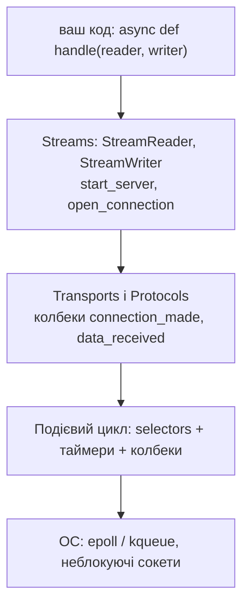
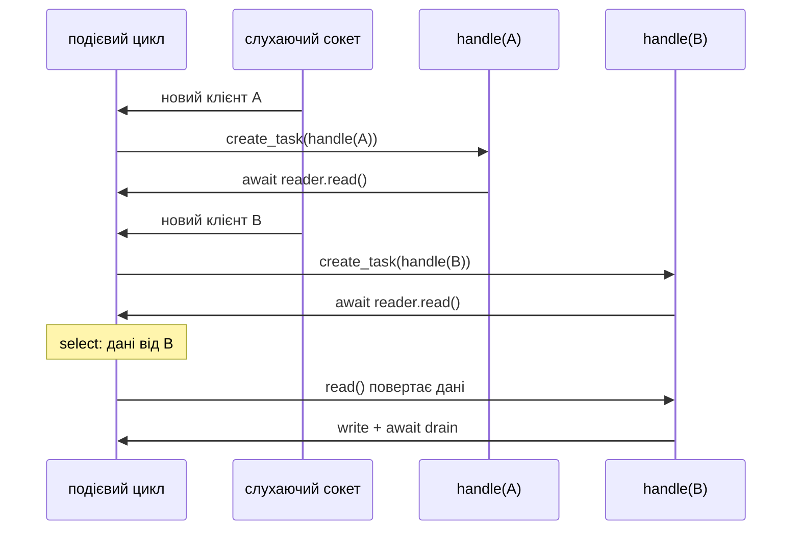

# 53. (Л) Архітектура та принципи роботи echo-сервера в контексті подієвого циклу asyncio

## Зміст лекції

1. Що asyncio бере на себе
2. Рівні мережевого API asyncio
3. Транспорти і протоколи
4. Потоки (streams): `start_server`
5. Обробник клієнта — окрема задача
6. `StreamReader`: `read`, `readline`, `readexactly`
7. `StreamWriter`: `write` і `drain`
8. Клієнт: `open_connection`
9. Ехо-сервер з командами
10. Спільний стан: чат на кількох клієнтах
11. Тайм-аут неактивного клієнта
12. Навантажувальний тест: 100 клієнтів
13. Коректне завершення (graceful shutdown)
14. Порівняння з власним циклом на selectors
15. Типові помилки

## Що asyncio бере на себе

У лекції 51 ми вручну написали подієвий цикл: селектор, колбеки, вихідні буфери, таймери. Код вийшов довгим, а логіку клієнта довелося розбити на шматки. asyncio містить той самий механізм, але приховує його за корутинами:

| Ручний цикл (лекція 51) | asyncio |
|---|---|
| `selector.register` / `modify` / `unregister` | автоматично |
| вихідний буфер `outbox` | буфер `StreamWriter` |
| колбек при готовності сокета | `await reader.read()` повертається, коли є дані |
| стан клієнта в словнику | локальні змінні корутини-обробника |
| `heapq` з таймерами | `asyncio.sleep`, `asyncio.timeout` |

## Рівні мережевого API asyncio



| Рівень | Коли використовувати |
|---|---|
| **streams** | прикладні сервери й клієнти — зазвичай саме він |
| транспорти й протоколи | бібліотеки, максимальна продуктивність, UDP |
| методи циклу (`loop.sock_recv`, `sock_accept`) | робота з уже створеними сокетами |

## Транспорти і протоколи

Низькорівневий API нагадує наш цикл на selectors: **транспорт** відповідає за сокет і буферизацію, **протокол** — клас з колбеками, які цикл викликає при подіях:

```python
# Program: an echo server with the transport and protocol API
import asyncio


class EchoProtocol(asyncio.Protocol):
    def connection_made(self, transport: asyncio.Transport) -> None:
        self.transport = transport
        print("connection made")

    def data_received(self, data: bytes) -> None:
        self.transport.write(data.upper())  # write не блокує: дані йдуть у буфер транспорту

    def connection_lost(self, exc) -> None:
        print("connection lost")


async def main() -> None:
    loop = asyncio.get_running_loop()
    server = await loop.create_server(EchoProtocol, "127.0.0.1", 0)
    port = server.sockets[0].getsockname()[1]
    reader, writer = await asyncio.open_connection("127.0.0.1", port)
    writer.write(b"protocol level")
    print(await reader.read(100))
    writer.close()
    await writer.wait_closed()
    await asyncio.sleep(0.05)
    server.close()
    await server.wait_closed()


asyncio.run(main())
```

```text
connection made
b'PROTOCOL LEVEL'
connection lost
```

Колбеки `data_received` — це не корутини: у них не можна писати `await`. Для більшості задач зручніший рівень **streams**.

## Потоки (streams): `start_server`

`asyncio.start_server(handler, host, port)` створює слухаючий сокет і для **кожного** нового клієнта запускає корутину `handler(reader, writer)` як окрему задачу:

```python
# File: async_echo.py
import asyncio

HOST, PORT = "127.0.0.1", 8888


async def handle(reader: asyncio.StreamReader, writer: asyncio.StreamWriter) -> None:
    address = writer.get_extra_info("peername")
    print(f"connected {address[0]}")
    try:
        while data := await reader.read(1024):
            writer.write(data)
            await writer.drain()
    except ConnectionResetError:
        pass
    finally:
        writer.close()
        await writer.wait_closed()
        print(f"disconnected {address[0]}")


async def main() -> None:
    server = await asyncio.start_server(handle, HOST, PORT)
    print(f"async echo on {HOST}:{PORT}")
    async with server:
        await server.serve_forever()


if __name__ == "__main__":
    try:
        asyncio.run(main())
    except KeyboardInterrupt:
        print("stopped")
```

Порівняйте з блокуючим `handle` з лекції 46: код майже однаковий, лише `await` перед операціями очікування. Але тепер, поки один обробник чекає `reader.read()`, цикл обслуговує інших.

## Обробник клієнта — окрема задача



Кожен обробник — задача (лекція 36) зі своїми локальними змінними. Стан клієнта не треба зберігати у словнику: він живе в корутині між `await`.

## `StreamReader`: `read`, `readline`, `readexactly`

| Метод | Повертає | Коли використовувати |
|---|---|---|
| `await reader.read(n)` | до `n` байтів; `b""` — клієнт закрив зʼєднання | довільний потік байтів |
| `await reader.readline()` | рядок до `\n` включно; `b""` наприкінці | текстові протоколи |
| `await reader.readexactly(n)` | рівно `n` байтів або `IncompleteReadError` | префікс довжини (лекція 45) |
| `await reader.readuntil(b";")` | до роздільника | власний роздільник |

```python
# Program: StreamReader handles message framing for us
import asyncio
import struct


async def handle(reader: asyncio.StreamReader, writer: asyncio.StreamWriter) -> None:
    line = await reader.readline()
    (length,) = struct.unpack("!I", await reader.readexactly(4))
    payload = await reader.readexactly(length)
    writer.write(f"line={line!r} payload={payload!r}\n".encode())
    await writer.drain()
    writer.close()


async def main() -> None:
    server = await asyncio.start_server(handle, "127.0.0.1", 0)
    port = server.sockets[0].getsockname()[1]
    reader, writer = await asyncio.open_connection("127.0.0.1", port)
    message = b"framed data"
    for chunk in (b"hel", b"lo\n", struct.pack("!I", len(message)), message[:4], message[4:]):
        writer.write(chunk)  # навмисно шматками
        await writer.drain()
        await asyncio.sleep(0.01)
    print((await reader.readline()).decode().strip())
    writer.close()
    server.close()
    await server.wait_closed()


asyncio.run(main())
```

```text
line=b'hello\n' payload=b'framed data'
```

Дані прийшли пʼятьма шматками, але `readline` і `readexactly` самі зібрали повні повідомлення — те, що в лекції 49 ми робили буфером `inbox` вручну.

## `StreamWriter`: `write` і `drain`

`writer.write(data)` **не чекає**: він кладе дані в буфер і одразу повертається. Якщо клієнт читає повільно, буфер росте, і сервер може вичерпати памʼять. `await writer.drain()` призупиняє обробник, доки буфер не зменшиться до прийнятного розміру. Це **зворотний тиск** (backpressure): повільний клієнт сповільнює лише свій обробник, а не весь сервер.

| Метод | Дія |
|---|---|
| `writer.write(data)` | додати в буфер (без `await`) |
| `await writer.drain()` | дочекатися, доки буфер спорожніє достатньо |
| `writer.close()` | почати закриття |
| `await writer.wait_closed()` | дочекатися закриття |
| `writer.get_extra_info("peername")` | адреса клієнта |

Правило: після `write` — `await drain()`.

## Клієнт: `open_connection`

`asyncio.open_connection(host, port)` повертає пару `(reader, writer)` для клієнта. Перевіримо `async_echo.py` трьома одночасними клієнтами:

```python
# Program: three async clients against async_echo.handle
import asyncio

import async_echo


async def client(port: int, name: str) -> bytes:
    reader, writer = await asyncio.open_connection("127.0.0.1", port)
    writer.write(f"hello from {name}".encode())
    await writer.drain()
    reply = await reader.read(100)
    writer.close()
    await writer.wait_closed()
    return reply


async def main() -> None:
    server = await asyncio.start_server(async_echo.handle, "127.0.0.1", 0)
    port = server.sockets[0].getsockname()[1]
    replies = await asyncio.gather(*(client(port, name) for name in ("A", "B", "C")))
    await asyncio.sleep(0.05)  # даємо обробникам завершитися
    print(replies)
    server.close()
    await server.wait_closed()


asyncio.run(main())
```

```text
connected 127.0.0.1
connected 127.0.0.1
connected 127.0.0.1
disconnected 127.0.0.1
disconnected 127.0.0.1
disconnected 127.0.0.1
[b'hello from A', b'hello from B', b'hello from C']
```

## Ехо-сервер з командами

Додамо текстовий протокол: кожен рядок — команда. Обробник читає рядки і відповідає за допомогою словника команд:

```python
# File: command_server.py
import asyncio
from datetime import datetime

COMMANDS = {"time", "upper", "count", "quit"}


async def handle(reader: asyncio.StreamReader, writer: asyncio.StreamWriter) -> None:
    count = 0  # стан цього клієнта — звичайна локальна змінна
    writer.write(b"welcome to the echo server, commands: time, upper TEXT, count, quit\n")
    while line := await reader.readline():
        command, _, argument = line.decode().strip().partition(" ")
        count += 1
        if command == "time":
            reply = datetime.now().strftime("%H:%M:%S")
        elif command == "upper":
            reply = argument.upper()
        elif command == "count":
            reply = f"you sent {count} messages"
        elif command == "quit":
            writer.write(b"bye\n")
            break
        else:
            reply = f"echo: {line.decode().strip()}"
        writer.write(reply.encode() + b"\n")
        await writer.drain()
    await writer.drain()
    writer.close()
    await writer.wait_closed()
```

```python
# Program: talk to the command server
import asyncio

import command_server


async def main() -> None:
    server = await asyncio.start_server(command_server.handle, "127.0.0.1", 0)
    port = server.sockets[0].getsockname()[1]
    reader, writer = await asyncio.open_connection("127.0.0.1", port)
    print((await reader.readline()).decode().strip())
    for line in ("upper hello", "something else", "count", "quit"):
        writer.write(line.encode() + b"\n")
        await writer.drain()
        print(f"> {line:<15} < {(await reader.readline()).decode().strip()}")
    writer.close()
    server.close()
    await server.wait_closed()


asyncio.run(main())
```

```text
welcome to the echo server, commands: time, upper TEXT, count, quit
> upper hello     < HELLO
> something else  < echo: something else
> count           < you sent 3 messages
> quit            < bye
```

## Спільний стан: чат на кількох клієнтах

Обробники виконуються в одному потоці, тому спільну структуру даних (множину підключених клієнтів) можна використовувати без замків: між `await` код не переривається:

```python
# Program: a tiny chat - every message goes to all other clients
import asyncio

clients: set[asyncio.StreamWriter] = set()


async def broadcast(message: bytes, sender: asyncio.StreamWriter) -> None:
    for writer in list(clients):
        if writer is not sender:
            writer.write(message)
            await writer.drain()


async def handle(reader: asyncio.StreamReader, writer: asyncio.StreamWriter) -> None:
    name = (await reader.readline()).decode().strip()
    clients.add(writer)
    await broadcast(f"* {name} joined\n".encode(), writer)
    try:
        while line := await reader.readline():
            await broadcast(f"{name}: {line.decode()}".encode(), writer)
    finally:
        clients.discard(writer)
        await broadcast(f"* {name} left\n".encode(), writer)
        writer.close()


async def join(port: int, name: str):
    reader, writer = await asyncio.open_connection("127.0.0.1", port)
    writer.write(f"{name}\n".encode())
    await writer.drain()
    await asyncio.sleep(0.05)
    return reader, writer


async def main() -> None:
    server = await asyncio.start_server(handle, "127.0.0.1", 0)
    port = server.sockets[0].getsockname()[1]
    olena_r, olena_w = await join(port, "olena")
    taras_r, taras_w = await join(port, "taras")
    olena_w.write(b"hi everyone\n")
    await olena_w.drain()
    await asyncio.sleep(0.05)
    taras_w.close()
    await asyncio.sleep(0.05)
    olena_w.close()
    print("olena saw:", (await olena_r.read(1000)).decode().splitlines())
    print("taras saw:", (await taras_r.read(1000)).decode().splitlines())
    server.close()
    await server.wait_closed()


asyncio.run(main())
```

```text
olena saw: ['* taras joined', '* taras left']
taras saw: ['olena: hi everyone']
```

## Тайм-аут неактивного клієнта

Клієнт, що підключився й мовчить, займає ресурси. `asyncio.timeout` (лекція 38) закриває таких клієнтів:

```python
# Program: disconnect clients that are silent for too long
import asyncio

IDLE_SECONDS = 0.2


async def handle(reader: asyncio.StreamReader, writer: asyncio.StreamWriter) -> None:
    try:
        while True:
            async with asyncio.timeout(IDLE_SECONDS):
                line = await reader.readline()
            if not line:
                break
            writer.write(line)
            await writer.drain()
    except TimeoutError:
        writer.write(b"idle timeout, bye\n")
        await writer.drain()
    writer.close()


async def main() -> None:
    server = await asyncio.start_server(handle, "127.0.0.1", 0)
    port = server.sockets[0].getsockname()[1]
    reader, writer = await asyncio.open_connection("127.0.0.1", port)
    writer.write(b"still here\n")
    print(await reader.readline())
    print(await reader.readline())  # мовчимо довше за IDLE_SECONDS
    print("connection closed by server:", await reader.read() == b"")
    server.close()
    await server.wait_closed()


asyncio.run(main())
```

```text
b'still here\n'
b'idle timeout, bye\n'
connection closed by server: True
```

## Навантажувальний тест: 100 клієнтів

```python
# Program: 100 concurrent clients, each waits 0.1 s on the server side
import asyncio
import time


async def slow_echo(reader: asyncio.StreamReader, writer: asyncio.StreamWriter) -> None:
    data = await reader.readline()
    await asyncio.sleep(0.1)  # імітація роботи: запит до бази чи іншого сервісу
    writer.write(data)
    await writer.drain()
    writer.close()


async def client(port: int, number: int) -> bool:
    reader, writer = await asyncio.open_connection("127.0.0.1", port)
    writer.write(f"{number}\n".encode())
    await writer.drain()
    ok = await reader.readline() == f"{number}\n".encode()
    writer.close()
    return ok


async def main() -> None:
    server = await asyncio.start_server(slow_echo, "127.0.0.1", 0, backlog=200)
    port = server.sockets[0].getsockname()[1]
    start = time.perf_counter()
    results = await asyncio.gather(*(client(port, n) for n in range(100)))
    elapsed = time.perf_counter() - start
    print(f"{sum(results)} of 100 correct, {elapsed:.1f}s (one by one it would take 10 s)")
    server.close()
    await server.wait_closed()


asyncio.run(main())
```

```text
100 of 100 correct, 0.1s (one by one it would take 10 s)
```

100 клієнтів, кожен «займає» сервер на 0,1 с, — і всі обслужені за 0,1 с в одному потоці. Блокуючому серверу з лекції 46 знадобилося б 10 с.

## Коректне завершення (graceful shutdown)

Сервер не повинен «обривати» клієнтів посеред обміну. Коректне завершення:

1. перестати приймати нових клієнтів — `server.close()`;
2. повідомити підключених клієнтів;
3. дочекатися або скасувати задачі-обробники;
4. закрити всі зʼєднання — `await server.wait_closed()`.

На Unix сигнали `SIGINT` (Ctrl+C) і `SIGTERM` (`docker stop`, лекція 14) перехоплюють `loop.add_signal_handler`:

```python
# File: graceful_server.py
import asyncio
import signal

HOST, PORT = "127.0.0.1", 8888
handlers: set[asyncio.Task] = set()


async def handle(reader: asyncio.StreamReader, writer: asyncio.StreamWriter) -> None:
    handlers.add(asyncio.current_task())
    try:
        while line := await reader.readline():
            writer.write(line)
            await writer.drain()
    except asyncio.CancelledError:
        writer.write(b"server is shutting down\n")
        await writer.drain()
    finally:
        handlers.discard(asyncio.current_task())
        writer.close()


async def main() -> None:
    stop = asyncio.Event()
    loop = asyncio.get_running_loop()
    for sig in (signal.SIGINT, signal.SIGTERM):
        loop.add_signal_handler(sig, stop.set)
    server = await asyncio.start_server(handle, HOST, PORT)
    print(f"serving on {HOST}:{PORT}, press Ctrl+C to stop")
    await stop.wait()
    print(f"stopping, clients connected: {len(handlers)}")
    server.close()
    for task in list(handlers):
        task.cancel()
    await asyncio.gather(*handlers, return_exceptions=True)
    await server.wait_closed()
    print("shutdown")


if __name__ == "__main__":
    asyncio.run(main())
```

```text
serving on 127.0.0.1:8888, press Ctrl+C to stop
^Cstopping, clients connected: 2
shutdown
```

- `add_signal_handler` замінює стандартну реакцію на Ctrl+C (`KeyboardInterrupt`) викликом `stop.set()`;
- кожен обробник запамʼятовує свою задачу в множині `handlers`, тож сервер може скасувати всі;
- обробник ловить `CancelledError`, щоб попрощатися з клієнтом, і завершується без трасувань;
- у Python 3.13+ замість ручного скасування можна викликати `server.close_clients()`.

Перевіримо ту саму логіку без Ctrl+C: подію `stop` встановить таймер:

```python
# Program: graceful shutdown that works on Python 3.12
import asyncio

handlers: set[asyncio.Task] = set()


async def handle(reader: asyncio.StreamReader, writer: asyncio.StreamWriter) -> None:
    handlers.add(asyncio.current_task())
    try:
        while line := await reader.readline():
            writer.write(line)
            await writer.drain()
    except asyncio.CancelledError:
        writer.write(b"server is shutting down\n")
        await writer.drain()
    finally:
        handlers.discard(asyncio.current_task())
        writer.close()


async def main() -> None:
    stop = asyncio.Event()
    server = await asyncio.start_server(handle, "127.0.0.1", 0)
    port = server.sockets[0].getsockname()[1]
    connections = [await asyncio.open_connection("127.0.0.1", port) for _ in range(2)]
    await asyncio.sleep(0.05)
    asyncio.get_running_loop().call_later(0.1, stop.set)  # замість Ctrl+C у прикладі

    await stop.wait()
    print(f"stopping, clients connected: {len(handlers)}")
    server.close()
    for task in list(handlers):
        task.cancel()
    await asyncio.gather(*handlers, return_exceptions=True)
    await server.wait_closed()
    for reader, _ in connections:
        print("client got:", await reader.readline())
    print("shutdown")


asyncio.run(main())
```

```text
stopping, clients connected: 2
client got: b'server is shutting down\n'
client got: b'server is shutting down\n'
shutdown
```

## Порівняння з власним циклом на selectors

| | selectors (лекція 51) | asyncio streams |
|---|---|---|
| рядків коду ехо-сервера | ≈ 60 | ≈ 15 |
| стан клієнта | словник, вручну | локальні змінні корутини |
| розмітка повідомлень | буфер вручну | `readline`, `readexactly` |
| зворотний тиск | `EVENT_WRITE` вручну | `await drain()` |
| таймери й тайм-аути | `heapq` вручну | `asyncio.timeout`, `sleep` |
| завершення | вручну | `server.close()`, `cancel`, `wait_closed` |
| продуктивність | та сама модель | та сама модель |

Обидва варіанти працюють за однією моделлю — неблокуючі сокети + мультиплексування в одному потоці. asyncio просто ховає механіку за зручними корутинами.

## Типові помилки

| Помилка | Чому погано | Як правильно |
|---|---|---|
| `write` без `await drain()` | буфер росте без меж для повільних клієнтів | `await writer.drain()` |
| Блокуючі виклики в обробнику (`time.sleep`, `requests`, `psycopg2`) | зупиняють усіх клієнтів | `await asyncio.sleep`, асинхронні бібліотеки, `to_thread` |
| `read(n)` як «повідомлення» | склеєні та розірвані повідомлення | `readline`, `readexactly` |
| Не обробляють `b""` | нескінченний цикл | `while line := await reader.readline()` |
| `writer.close()` без `wait_closed` наприкінці програми | попередження про незакриті транспорти | `await writer.wait_closed()` |
| Немає тайм-аутів неактивних клієнтів | «мовчуни» займають ресурси | `asyncio.timeout` |
| Ctrl+C обриває всі зʼєднання | клієнти втрачають дані | обробка сигналів і коректне завершення |
| «Ковтають» `CancelledError` у довгому циклі | сервер не завершується | після прибирання — `raise` або вихід з обробника |

## Підсумок

- asyncio містить подієвий цикл на `selectors`; мережевий API має рівні **транспортів/протоколів** і зручніших **streams**.
- `asyncio.start_server(handle, host, port)` запускає `handle(reader, writer)` окремою задачею для кожного клієнта; стан клієнта — локальні змінні корутини.
- `StreamReader` сам розмічає повідомлення (`readline`, `readexactly`); `StreamWriter.write` + `await drain()` дають зворотний тиск.
- Спільний стан обробників не потребує замків; тайм-аути закривають неактивних клієнтів.
- Один потік asyncio обслуговує сотні клієнтів одночасно.
- **Коректне завершення**: зупинити прийом, повідомити клієнтів, скасувати обробники, дочекатися закриття.

## Корисні посилання

- [asyncio — Streams](https://docs.python.org/3/library/asyncio-stream.html)
- [asyncio — Transports and Protocols](https://docs.python.org/3/library/asyncio-protocol.html)
- [asyncio — `loop.add_signal_handler`](https://docs.python.org/3/library/asyncio-eventloop.html#unix-signals)
- [asyncio — `Server.close_clients`](https://docs.python.org/3/library/asyncio-eventloop.html#asyncio.Server.close_clients)
- Fowler M. Python Concurrency with asyncio. — Manning, 2022. — Розділи 3, 8.
