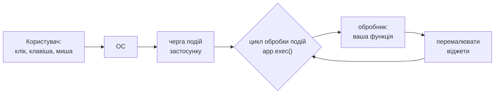
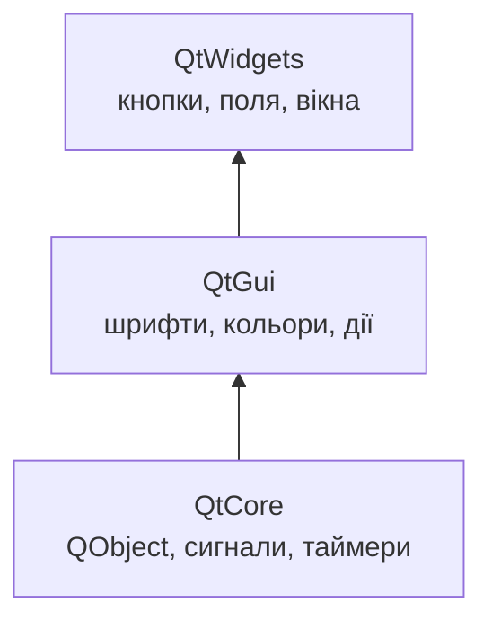
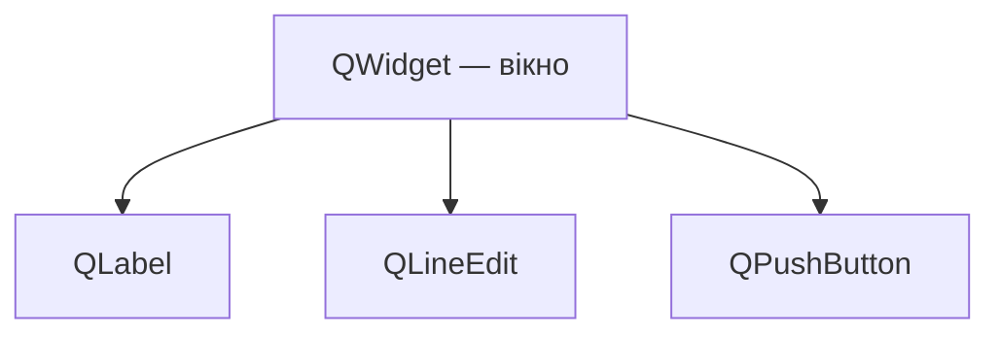

# 1. (Л) Вступ до PySide6 та архітектури Qt

## Зміст лекції

1. Від консолі до графічного інтерфейсу
2. Подієво-кероване програмування
3. Qt і PySide6
4. Встановлення
5. Модулі PySide6
6. `QApplication` і цикл обробки подій
7. Перше вікно
8. Віджети та ієрархія «батько — дитина»
9. Сигнали й слоти: перший погляд
10. Вікно як клас
11. Як шукати потрібне в документації
12. Інструменти: Qt Designer і `.ui`-файли
13. Типові помилки

## Від консолі до графічного інтерфейсу

Усі програми 5 і 6 семестрів були **консольними** або **серверними**: вони читали дані з `input()`, файлу, HTTP-запиту і писали результат у термінал чи відповідь API. Звичайний користувач працює інакше: вікна, кнопки, поля введення, меню, таблиці. Такий інтерфейс називають **графічним** (GUI — Graphical User Interface).

| | Консольна програма | GUI-застосунок |
|---|---|---|
| хто керує порядком дій | програма: «введіть число» | користувач: натискає що завгодно і коли завгодно |
| введення | `input()`, аргументи | поля, кнопки, меню, миша, клавіатура |
| виведення | `print()` | написи, таблиці, графіки, діалоги |
| структура коду | послідовна | обробники подій |

У цьому модулі ми створимо десктопний застосунок для обліку витрат — того самого, що зберігали у файлах (5 семестр) і базі даних (6 семестр).

## Подієво-кероване програмування

GUI-застосунок більшість часу **чекає**. Коли користувач натискає кнопку, рухає мишу чи змінює розмір вікна, операційна система надсилає застосунку **подію**. Застосунок обробляє її і знову чекає. Такий підхід називають **подієво-керованим програмуванням** (event-driven programming).



Знайома ідея: у модулі 3 6 семестру подієвий цикл asyncio чекав на події сокетів і викликав колбеки. Цикл Qt так само чекає на події і викликає обробники. Те саме головне правило: **обробник має завершуватися швидко** — поки він працює, вікно не перемальовується й не реагує (лекція 20).

## Qt і PySide6

**Qt** (вимовляється «к'ют») — кросплатформний фреймворк на C++ для графічних застосунків, створений у 1995 році. На Qt написано Telegram Desktop, VLC, OBS Studio, VirtualBox, Autodesk Maya, середовище KDE. Один і той самий код працює на Linux, macOS і Windows і виглядає «рідно» на кожній системі.

**PySide6** — офіційна привʼязка Qt 6 для Python від The Qt Company (проєкт *Qt for Python*). Класи й методи ті самі, що в C++, тому документація Qt застосовна напряму.

| | PySide6 | PyQt6 |
|---|---|---|
| розробник | The Qt Company (офіційна) | Riverbank Computing |
| ліцензія | LGPL — можна використовувати в закритих комерційних програмах | GPL або комерційна |
| API | майже однаковий | майже однаковий |

У курсі використовуємо PySide6.

## Встановлення

```bash
python3 -m venv .venv
source .venv/bin/activate
python3 -m pip install PySide6
python3 -c "import PySide6, PySide6.QtCore; print(PySide6.__version__, PySide6.QtCore.qVersion())"
```

```text
6.8.0.2 6.8.0
```

Пакет великий (≈ 200 МБ): він містить бібліотеки Qt, плагіни платформ, Qt Designer. У VS Code оберіть інтерпретатор з `.venv` (*Python: Select Interpreter*).

## Модулі PySide6

| Модуль | Що містить |
|---|---|
| `QtCore` | основа без графіки: `QObject`, сигнали й слоти, `QTimer`, `QThread`, `QSettings`, рядки, дати |
| `QtGui` | графіка нижнього рівня: `QFont`, `QColor`, `QIcon`, `QPixmap`, `QAction`, події клавіатури й миші |
| `QtWidgets` | віджети: `QApplication`, `QWidget`, `QPushButton`, `QLabel`, `QLineEdit`, `QMainWindow`, діалоги |
| `QtCharts`, `QtSql`, `QtNetwork`, `QtMultimedia`, … | спеціалізовані можливості |



Класи імпортують поіменно: `from PySide6.QtWidgets import QApplication, QLabel`.

## `QApplication` і цикл обробки подій

Кожен застосунок з віджетами має **рівно один** обʼєкт `QApplication`. Він:

- зʼєднується з віконною системою ОС;
- зберігає загальні налаштування (стиль, шрифт, назву застосунку);
- запускає **цикл обробки подій** методом `exec()`.

```python
# Program: QApplication exists once and owns the event loop
import sys

from PySide6.QtWidgets import QApplication

app = QApplication(sys.argv)
print("instance is the same object:", QApplication.instance() is app)
app.setApplicationName("Expenses")
print("application name:", app.applicationName())
```

```text
instance is the same object: True
application name: Expenses
```

`app.exec()` не повертається, доки застосунок працює: усередині — цикл обробки подій. Коли користувач закриває останнє вікно, цикл завершується, і `exec()` повертає **код завершення** (0 — успіх). Тому типовий кінець програми — рядок `sys.exit(app.exec())`: код завершення циклу стає кодом завершення програми.

`sys.argv` передають у `QApplication`, бо Qt розуміє власні аргументи командного рядка, наприклад `-style fusion`.

## Перше вікно

```python
# File: hello_window.py
import sys

from PySide6.QtWidgets import QApplication, QLabel

app = QApplication(sys.argv)
label = QLabel("Hello from PySide6!")
label.setWindowTitle("Ivan Petrenko, PZ-11")
label.resize(320, 120)
label.show()
sys.exit(app.exec())
```

Будь-який віджет без батька, для якого викликали `show()`, стає **окремим вікном**. Тут вікно — це сам напис `QLabel`. Без `show()` вікно не зʼявиться, а без `app.exec()` програма одразу завершиться.

Порядок завжди однаковий:

1. Створити `QApplication`.
2. Створити віджети й налаштувати їх.
3. Показати головне вікно (`show()`).
4. Запустити цикл (`app.exec()`).

## Віджети та ієрархія «батько — дитина»

**Віджет** (widget) — будь-який елемент інтерфейсу: кнопка, напис, поле, вікно. Усі віджети — нащадки класу `QWidget`, а той — нащадок `QObject`.

Віджети утворюють **дерево**: дочірні віджети розміщуються всередині батьківського. Батька передають у конструктор (`QPushButton("OK", parent)`) або він призначається автоматично, коли віджет додають у компоновку (лекція 5).



```python
# Program: parent and child widgets
import sys

from PySide6.QtWidgets import QApplication, QLabel, QPushButton, QWidget

app = QApplication(sys.argv)
window = QWidget()
label = QLabel("Total: 0 UAH", window)
button = QPushButton("Add", window)
button.move(0, 30)

print("label parent is window:", label.parent() is window)
print("children:", [type(child).__name__ for child in window.children()])
print("window is a window:", window.isWindow(), "| button is a window:", button.isWindow())
```

```text
label parent is window: True
children: ['QLabel', 'QPushButton']
window is a window: True | button is a window: False
```

Ієрархія важлива з двох причин:

- **розташування**: дочірній віджет малюється всередині батька;
- **памʼять**: коли знищується батько, Qt автоматично знищує всіх його дітей. Тому окремо видаляти кожну кнопку не потрібно.

## Сигнали й слоти: перший погляд

Як дізнатися, що користувач натиснув кнопку? У Qt обʼєкти повідомляють про події **сигналами** (signals). До сигналу підʼєднують **слот** — будь-яку функцію чи метод, що викликається, коли сигнал випромінено: `button.clicked.connect(on_click)`.

```python
# Program: signals and slots without opening a window
import sys

from PySide6.QtWidgets import QApplication, QLabel, QLineEdit, QPushButton

app = QApplication(sys.argv)
name = QLineEdit()
label = QLabel()
button = QPushButton("Greet")


def greet() -> None:
    label.setText(f"Hello, {name.text() or 'stranger'}!")


button.clicked.connect(greet)
name.returnPressed.connect(greet)  # той самий слот для клавіші Enter

button.click()  # програмно імітуємо натискання
print(label.text())
name.setText("Olena")
name.returnPressed.emit()  # або випромінюємо сигнал вручну
print(label.text())
```

```text
Hello, stranger!
Hello, Olena!
```

| Віджет | Корисні сигнали |
|---|---|
| `QPushButton` | `clicked`, `pressed`, `released` |
| `QLineEdit` | `textChanged(str)`, `returnPressed`, `editingFinished` |
| `QCheckBox` | `toggled(bool)`, `stateChanged(int)` |
| `QComboBox` | `currentIndexChanged(int)`, `currentTextChanged(str)` |
| `QSpinBox` | `valueChanged(int)` |

Сигнали можуть передавати значення: `textChanged` передає слоту новий текст. Детально — власні сигнали, `lambda` і `functools.partial` — у практичній роботі П7 (лекція 13).

## Вікно як клас

Для невеликого прикладу достатньо функцій. Реальний застосунок оформлюють **класом вікна** — нащадком `QWidget` (наслідування — лекція 43, 5 семестр): віджети створюються в `__init__`, обробники — методи класу, а стан вікна — атрибути:

```python
# File: greeter.py
import sys

from PySide6.QtWidgets import QApplication, QLabel, QLineEdit, QPushButton, QVBoxLayout, QWidget


class GreeterWindow(QWidget):
    def __init__(self) -> None:
        super().__init__()
        self.setWindowTitle("Greeter")
        self.greetings = 0

        self.name_edit = QLineEdit(placeholderText="Your name")
        self.greet_button = QPushButton("Greet")
        self.result_label = QLabel("Type your name and press Greet")

        layout = QVBoxLayout(self)
        layout.addWidget(self.name_edit)
        layout.addWidget(self.greet_button)
        layout.addWidget(self.result_label)

        self.greet_button.clicked.connect(self.greet)
        self.name_edit.returnPressed.connect(self.greet)

    def greet(self) -> None:
        self.greetings += 1
        name = self.name_edit.text().strip() or "stranger"
        self.result_label.setText(f"Hello, {name}! (greeting #{self.greetings})")


if __name__ == "__main__":
    app = QApplication(sys.argv)
    window = GreeterWindow()
    window.show()
    sys.exit(app.exec())
```

```python
# Program: test the window class without a user
import sys

from PySide6.QtWidgets import QApplication

from greeter import GreeterWindow

app = QApplication(sys.argv)
window = GreeterWindow()
window.name_edit.setText("  Taras ")
window.greet_button.click()
window.greet_button.click()
print(window.result_label.text())
```

```text
Hello, Taras! (greeting #2)
```

Обидва файли працюють разом: `greeter.py` — застосунок, а другий скрипт перевіряє вікно, «натискаючи» кнопку програмно. Так тестують GUI без користувача.

- `super().__init__()` обовʼязковий: він ініціалізує внутрішній C++-обʼєкт Qt;
- `QVBoxLayout(self)` розміщує віджети вертикально і робить вікно їхнім батьком (лекція 5);
- іменовані аргументи `placeholderText="..."` — скорочення PySide6 для виклику `setPlaceholderText(...)`.

## Як шукати потрібне в документації

Документація Qt — основне джерело знань: сотні класів і тисячі методів запамʼятати неможливо.

| Де | Що там |
|---|---|
| [doc.qt.io/qtforpython-6](https://doc.qt.io/qtforpython-6/) | документація PySide6 з прикладами на Python |
| сторінка класу, наприклад `QLineEdit` | властивості, методи, сигнали (*Signals*), слоти |
| розділ *Detailed Description* | як і навіщо використовувати клас |
| `help(QLineEdit)` у Python | список методів просто в терміналі |

Правило назв у Qt: властивість `text` читають методом `text()`, а змінюють — `setText(...)`; булеві властивості — `isEnabled()` / `setEnabled(...)`.

## Інструменти: Qt Designer і `.ui`-файли

**Qt Designer** — візуальний редактор інтерфейсів: вікно збирають мишею, а результат зберігається у файл `.ui` (XML). Запуск: `pyside6-designer`. Файл `.ui` можна завантажити в програму (`QUiLoader`) або перетворити на Python-код (`pyside6-uic form.ui -o ui_form.py`).

У курсі ми будуємо інтерфейс **кодом**: так краще видно, як працює Qt, а зміни легко порівнювати в git. Designer зручно використати пізніше для складних форм.

## Типові помилки

| Помилка | Чому погано | Як правильно |
|---|---|---|
| Немає `app.exec()` | вікно блимає і програма завершується | `sys.exit(app.exec())` наприкінці |
| Два `QApplication` | `RuntimeError: Please destroy the QApplication singleton before creating a new QApplication instance.` | один на програму |
| Віджети створено до `QApplication` | `QWidget: Must construct a QApplication before a QWidget` | спочатку `QApplication` |
| Забули `show()` | вікно не зʼявляється, програма «висить» | `window.show()` |
| `connect(self.greet())` з дужками | слот викликано одразу, підʼєднано `None` | `connect(self.greet)` |
| Немає `super().__init__()` у класі вікна | `RuntimeError` з C++-обʼєкта | завжди викликати |
| Довга операція в обробнику | вікно «зависає» | швидкі обробники; фонові задачі (лекція 20) |
| Вікно — локальна змінна функції | збирач сміття знищує вікно одразу | зберігати посилання (змінна модуля, атрибут) |

## Підсумок

- GUI-застосунок **подієво-керований**: цикл обробки подій чекає на дії користувача і викликає обробники.
- **Qt** — кросплатформний C++-фреймворк; **PySide6** — його офіційна привʼязка для Python (LGPL).
- Основні модулі: `QtCore` (обʼєкти, сигнали, таймери), `QtGui` (графіка), `QtWidgets` (віджети).
- Один `QApplication` на програму; `app.exec()` запускає цикл і повертає код завершення.
- Віджети утворюють дерево «батько — дитина»; батько розміщує і знищує дітей.
- Обʼєкти повідомляють про події **сигналами**, до яких підʼєднують **слоти**: `button.clicked.connect(handler)`.
- Реальні вікна оформлюють класами-нащадками `QWidget`.

## Корисні посилання

- [Qt for Python — документація](https://doc.qt.io/qtforpython-6/)
- [Qt for Python — Getting Started](https://doc.qt.io/qtforpython-6/gettingstarted.html)
- [Qt for Python — Signals and Slots](https://doc.qt.io/qtforpython-6/tutorials/basictutorial/signals_and_slots.html)
- [Python GUIs — PySide6 Tutorial](https://www.pythonguis.com/pyside6-tutorial/)
- Fitzpatrick M. Create GUI Applications with Python & Qt6 (PySide6 Edition). — 2023.
