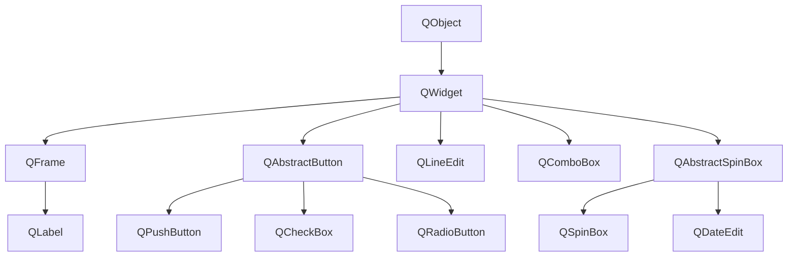

# 3. (Л) Базові віджети PySide6 (QWidget, QPushButton, QLabel, QLineEdit)

## Зміст лекції

1. `QWidget` — основа всіх віджетів
2. Спільні властивості віджетів
3. `QLabel`: текст і зображення
4. `QPushButton`: кнопки
5. `QLineEdit`: однорядкове поле
6. Валідатори й маски введення
7. Вибір значень: `QCheckBox`, `QRadioButton`, `QComboBox`
8. Числа й дати: `QSpinBox`, `QDoubleSpinBox`, `QDateEdit`
9. Багаторядковий текст: `QPlainTextEdit`
10. Форма введення витрати
11. Перевірка введення і зворотний звʼязок
12. Стилі віджетів: Qt Style Sheets
13. Типові помилки

## `QWidget` — основа всіх віджетів

`QWidget` — базовий клас усіх елементів інтерфейсу. Він уміє:

- малювати себе в прямокутній області;
- отримувати події миші й клавіатури;
- містити дочірні віджети;
- бути окремим вікном, якщо не має батька (лекція 1).



Спільний предок `QAbstractButton` пояснює, чому в `QPushButton`, `QCheckBox` і `QRadioButton` однакові методи `text()`, `isChecked()` і сигнал `clicked`.

## Спільні властивості віджетів

| Метод | Що робить |
|---|---|
| `setEnabled(False)` | вимкнути: віджет сірий і не реагує |
| `setVisible(False)` / `hide()` / `show()` | сховати / показати |
| `setToolTip("...")` | підказка при наведенні миші |
| `setFocus()` | передати фокус клавіатури |
| `setFixedSize(w, h)`, `setMinimumWidth(w)` | обмеження розміру |
| `setObjectName("name")` | імʼя для пошуку й стилів |
| `setStyleSheet("...")` | вигляд (див. нижче) |

```python
# Program: common widget properties
import sys

from PySide6.QtWidgets import QApplication, QPushButton

app = QApplication(sys.argv)
button = QPushButton("Save")
button.setToolTip("Save the expense to the file")
button.setEnabled(False)
button.setMinimumWidth(120)
print(button.text(), "| enabled:", button.isEnabled(), "| tooltip:", button.toolTip())
print("minimum width:", button.minimumWidth())
```

```text
Save | enabled: False | tooltip: Save the expense to the file
minimum width: 120
```

## `QLabel`: текст і зображення

`QLabel` показує текст або зображення; користувач його не редагує.

```python
# Program: QLabel with plain text, rich text and alignment
import sys

from PySide6.QtCore import Qt
from PySide6.QtWidgets import QApplication, QLabel

app = QApplication(sys.argv)
total = QLabel("Total: 615.50 UAH")
total.setAlignment(Qt.AlignmentFlag.AlignRight | Qt.AlignmentFlag.AlignVCenter)

warning = QLabel("<b>Over budget</b> in <i>food</i> by <span style='color:red'>275.50</span> UAH")
print(warning.textFormat() == Qt.TextFormat.AutoText, "| plain text:", total.text())

link = QLabel('<a href="https://bank.gov.ua">NBU exchange rates</a>')
link.setOpenExternalLinks(True)
print("opens links:", link.openExternalLinks())
```

```text
True | plain text: Total: 615.50 UAH
opens links: True
```

- `QLabel` сам розпізнає **HTML-розмітку** (rich text): `<b>`, `<i>`, кольори, посилання;
- вирівнювання задають прапорцями `Qt.AlignmentFlag`, поєднуючи їх через `|`;
- зображення показує `label.setPixmap(QPixmap("logo.png"))`.

!!! warning "Текст користувача і HTML"
    Якщо в `QLabel` потрапляє текст, введений користувачем, і він містить `<`, Qt може сприйняти його як розмітку. Для таких написів встановлюйте `label.setTextFormat(Qt.TextFormat.PlainText)`.

## `QPushButton`: кнопки

```python
# Program: push buttons, checkable buttons and the clicked signal
import sys

from PySide6.QtWidgets import QApplication, QPushButton

app = QApplication(sys.argv)
save = QPushButton("&Save")  # & — клавіша Alt+S
save.setDefault(True)        # спрацьовує на Enter у діалозі
save.clicked.connect(lambda: print("saved"))

dark = QPushButton("Dark mode")
dark.setCheckable(True)
dark.toggled.connect(lambda on: print("dark mode:", on))

save.click()
dark.click()
dark.click()
print("shortcut text:", save.text())
```

```text
saved
dark mode: True
dark mode: False
shortcut text: &Save
```

| Метод / сигнал | Значення |
|---|---|
| `clicked` | натиснули й відпустили |
| `setCheckable(True)`, `toggled(bool)` | кнопка-перемикач |
| `setDefault(True)` | кнопка за замовчуванням у діалозі |
| `setIcon(icon)` | значок |
| `&` у тексті | клавіша швидкого доступу з `Alt` |

`lambda` у `connect` зручна для коротких дій. Для складніших — окремий метод.

## `QLineEdit`: однорядкове поле

```python
# Program: QLineEdit options and signals
import sys

from PySide6.QtWidgets import QApplication, QLineEdit

app = QApplication(sys.argv)
comment = QLineEdit()
comment.setPlaceholderText("Comment, e.g. lunch")
comment.setMaxLength(20)
comment.setClearButtonEnabled(True)
comment.textChanged.connect(lambda text: print("changed:", repr(text)))

comment.setText("groceries and a very long text")
print("stored:", comment.text(), "| length:", len(comment.text()))

password = QLineEdit()
password.setEchoMode(QLineEdit.EchoMode.Password)
password.setText("secret")
print("password echo:", password.displayText())
```

```text
changed: 'groceries and a very'
stored: groceries and a very | length: 20
password echo: ●●●●●●
```

| Сигнал | Коли |
|---|---|
| `textChanged(str)` | після **будь-якої** зміни, зокрема програмної |
| `textEdited(str)` | лише коли змінив **користувач** |
| `returnPressed` | натиснуто Enter |
| `editingFinished` | Enter або поле втратило фокус |

## Валідатори й маски введення

**Валідатор** не дає ввести неправильне значення. Він перевіряє текст і повертає стан: `Acceptable` (правильно), `Intermediate` (може стати правильним після продовження введення) або `Invalid` (символ не приймається).

```python
# Program: validators keep the input correct
import sys

from PySide6.QtCore import QRegularExpression
from PySide6.QtGui import QDoubleValidator, QRegularExpressionValidator
from PySide6.QtWidgets import QApplication, QLineEdit

app = QApplication(sys.argv)
amount = QLineEdit()
validator = QDoubleValidator(0.01, 100000.0, 2)
validator.setNotation(QDoubleValidator.Notation.StandardNotation)
validator.setLocale(validator.locale().c())  # крапка як роздільник дробової частини
amount.setValidator(validator)

for text in ("85.50", "85.505", "-3", "abc", ""):
    state, _, _ = validator.validate(text, 0)
    print(f"{text!r:<9} {state.name}")

group = QLineEdit()
group.setValidator(QRegularExpressionValidator(QRegularExpression(r"[A-Z]{2}-\d{2}")))
group.setText("PZ-11")
print("group acceptable:", group.hasAcceptableInput())

phone = QLineEdit()
phone.setInputMask(r"+38\0 00 000 00 00;_")  # \0 — буквальний нуль, 0 — будь-яка цифра
print("empty mask:", phone.displayText())
phone.setText("671234567")
print("phone:", phone.text(), "| complete:", phone.hasAcceptableInput())
```

```text
'85.50'   Acceptable
'85.505'  Invalid
'-3'      Invalid
'abc'     Invalid
''        Intermediate
group acceptable: True
empty mask: +380 __ ___ __ __
phone: +380 67 123 45 67 | complete: True
```

- `QIntValidator`, `QDoubleValidator` — числа в діапазоні;
- `QRegularExpressionValidator` — довільний шаблон (регулярний вираз);
- `setInputMask` — маска фіксованого формату (телефон, дата): `0` — обовʼязкова цифра, `\0` — буквальний символ «0», після `;` — символ-заповнювач;
- `hasAcceptableInput()` — чи можна вже приймати значення.

Валідатор не замінює перевірки при збереженні: порожнє поле — стан `Intermediate`, і його треба перевірити окремо.

## Вибір значень: `QCheckBox`, `QRadioButton`, `QComboBox`

```python
# Program: check boxes, radio buttons and a combo box
import sys

from PySide6.QtWidgets import QApplication, QButtonGroup, QCheckBox, QComboBox, QRadioButton

app = QApplication(sys.argv)
monthly = QCheckBox("Monthly expense")
monthly.setChecked(True)

card, cash = QRadioButton("Card"), QRadioButton("Cash")
payment = QButtonGroup()
payment.addButton(card, 1)
payment.addButton(cash, 2)
cash.setChecked(True)

category = QComboBox()
category.addItems(["food", "transport", "fun", "health"])
category.currentTextChanged.connect(lambda text: print("category:", text))
category.setCurrentText("fun")
category.setEditable(True)  # дозволити власну категорію

print("monthly:", monthly.isChecked())
print("payment:", payment.checkedButton().text(), "id", payment.checkedId())
print("categories:", [category.itemText(i) for i in range(category.count())], "current index:", category.currentIndex())
```

```text
category: fun
monthly: True
payment: Cash id 2
categories: ['food', 'transport', 'fun', 'health'] current index: 2
```

Перемикачі `QRadioButton` з одним батьком автоматично взаємовиключні. `QButtonGroup` робить групу явною і дає номер (`checkedId`) обраного варіанта.

`QComboBox` може зберігати поруч з текстом **дані**: `addItem("Food", userData="food")`, а `currentData()` повертає їх. Так інтерфейс показує зрозумілу назву, а програма отримує код.

## Числа й дати: `QSpinBox`, `QDoubleSpinBox`, `QDateEdit`

```python
# Program: numbers and dates without manual parsing
import sys

from PySide6.QtCore import QDate
from PySide6.QtWidgets import QApplication, QDateEdit, QDoubleSpinBox, QSpinBox

app = QApplication(sys.argv)
amount = QDoubleSpinBox()
amount.setRange(0.01, 100000)
amount.setDecimals(2)
amount.setSuffix(" UAH")
amount.setValue(85.5)

people = QSpinBox()
people.setRange(1, 20)
people.setValue(25)  # більше за максимум — буде обмежено

day = QDateEdit()
day.setCalendarPopup(True)
day.setDisplayFormat("yyyy-MM-dd")
day.setDate(QDate(2026, 9, 21))

print(amount.value(), "|", amount.text())
print("people:", people.value())
print("date:", day.date().toString("yyyy-MM-dd"), "| python:", day.date().toPython())
```

```text
85.5 | 85.50 UAH
people: 20
date: 2026-09-21 | python: 2026-09-21
```

Спеціалізовані віджети кращі за `QLineEdit` для чисел і дат: користувач не може ввести неправильне значення, а програма отримує `float`, `int` чи `datetime.date` без розбору рядка. `toPython()` перетворює `QDate` на `datetime.date`.

## Багаторядковий текст: `QPlainTextEdit`

| Віджет | Для чого |
|---|---|
| `QPlainTextEdit` | звичайний багаторядковий текст: нотатки, журнал, код |
| `QTextEdit` | форматований текст (жирний, кольори, таблиці, зображення) |

```python
# Program: a read-only log area
import sys

from PySide6.QtWidgets import QApplication, QPlainTextEdit

app = QApplication(sys.argv)
log = QPlainTextEdit()
log.setReadOnly(True)
log.setMaximumBlockCount(100)  # зберігати лише останні 100 рядків
for line in ("app started", "expense added: food 85.50", "file saved"):
    log.appendPlainText(line)
print(log.toPlainText().splitlines())
print("blocks:", log.blockCount())
```

```text
['app started', 'expense added: food 85.50', 'file saved']
blocks: 3
```

## Форма введення витрати

Зберемо віджети у форму. `QFormLayout` (лекція 5) розміщує пари «підпис — поле»:

```python
# File: expense_form.py
import sys

from PySide6.QtCore import QDate
from PySide6.QtWidgets import (QApplication, QComboBox, QDateEdit, QDoubleSpinBox, QFormLayout, QLabel,
                               QLineEdit, QPushButton, QWidget)


class ExpenseForm(QWidget):
    def __init__(self) -> None:
        super().__init__()
        self.setWindowTitle("New expense")
        self.expenses: list[dict] = []

        self.date_edit = QDateEdit(QDate.currentDate(), calendarPopup=True, displayFormat="yyyy-MM-dd")
        self.category_combo = QComboBox()
        self.category_combo.addItems(["food", "transport", "fun", "health"])
        self.amount_spin = QDoubleSpinBox(minimum=0, maximum=100000, decimals=2, suffix=" UAH")
        self.comment_edit = QLineEdit(placeholderText="optional", maxLength=50)
        self.save_button = QPushButton("Save")
        self.status_label = QLabel()

        form = QFormLayout(self)
        form.addRow("Date:", self.date_edit)
        form.addRow("Category:", self.category_combo)
        form.addRow("Amount:", self.amount_spin)
        form.addRow("Comment:", self.comment_edit)
        form.addRow(self.save_button)
        form.addRow(self.status_label)

        self.save_button.clicked.connect(self.save)
        self.amount_spin.valueChanged.connect(self.update_state)
        self.update_state()

    def update_state(self) -> None:
        self.save_button.setEnabled(self.amount_spin.value() > 0)

    def save(self) -> None:
        expense = {
            "date": self.date_edit.date().toString("yyyy-MM-dd"),
            "category": self.category_combo.currentText(),
            "amount": round(self.amount_spin.value(), 2),
            "comment": self.comment_edit.text().strip(),
        }
        self.expenses.append(expense)
        self.status_label.setText(f"Saved #{len(self.expenses)}: {expense['category']} {expense['amount']:.2f} UAH")
        self.amount_spin.setValue(0)
        self.comment_edit.clear()
        self.amount_spin.setFocus()


if __name__ == "__main__":
    app = QApplication(sys.argv)
    form = ExpenseForm()
    form.show()
    sys.exit(app.exec())
```

```python
# Program: fill the expense form programmatically
import sys

from PySide6.QtCore import QDate
from PySide6.QtWidgets import QApplication

from expense_form import ExpenseForm

app = QApplication(sys.argv)
form = ExpenseForm()
print("save enabled at start:", form.save_button.isEnabled())
form.date_edit.setDate(QDate(2026, 9, 21))
form.category_combo.setCurrentText("food")
form.amount_spin.setValue(85.5)
form.comment_edit.setText("lunch")
print("save enabled with amount:", form.save_button.isEnabled())
form.save_button.click()
print(form.status_label.text())
print(form.expenses)
print("form cleared:", form.amount_spin.value() == 0 and form.comment_edit.text() == "")
```

```text
save enabled at start: False
save enabled with amount: True
Saved #1: food 85.50 UAH
[{'date': '2026-09-21', 'category': 'food', 'amount': 85.5, 'comment': 'lunch'}]
form cleared: True
```

## Перевірка введення і зворотний звʼязок

Хороша форма не дозволяє помилитися і пояснює, що не так:

| Прийом | Приклад у формі |
|---|---|
| правильний віджет | сума — `QDoubleSpinBox`, а не текстове поле |
| обмеження | діапазон суми, `maxLength` коментаря |
| вимкнена кнопка, доки дані неповні | `Save` неактивна при сумі 0 |
| повідомлення про результат | напис `Saved #1: ...` |
| підсвічування поля з помилкою | стиль `border: 1px solid red` |
| фокус на наступне поле | після збереження фокус на сумі |

## Стилі віджетів: Qt Style Sheets

Вигляд віджетів змінюють **таблицями стилів** Qt (Qt Style Sheets) — синтаксис, схожий на CSS:

```python
# Program: style sheets for a single widget and for a widget type
import sys

from PySide6.QtWidgets import QApplication, QLineEdit, QPushButton

app = QApplication(sys.argv)
app.setStyleSheet("QPushButton { padding: 6px 14px; border-radius: 4px; }")

amount = QLineEdit()


def mark_invalid(invalid: bool) -> None:
    amount.setStyleSheet("border: 1px solid #c0392b;" if invalid else "")


mark_invalid(True)
print("invalid style:", amount.styleSheet())
mark_invalid(False)
print("style cleared:", amount.styleSheet() == "")
print("app style mentions QPushButton:", "QPushButton" in app.styleSheet())
```

```text
invalid style: border: 1px solid #c0392b;
style cleared: True
app style mentions QPushButton: True
```

Стилі для всього застосунку задають через `app.setStyleSheet(...)`, для одного віджета — `widget.setStyleSheet(...)`. Не перестарайтеся: стандартний вигляд Qt уже узгоджений з операційною системою.

## Типові помилки

| Помилка | Чому погано | Як правильно |
|---|---|---|
| Числа й дати в `QLineEdit` | потрібно розбирати рядок, можливі помилки | `QDoubleSpinBox`, `QDateEdit` |
| `float(edit.text())` без перевірки | `ValueError` на неправильному введенні | валідатор, `hasAcceptableInput()` |
| `textChanged` для реакції лише на користувача | спрацьовує і при `setText` у коді | `textEdited` |
| Радіокнопки різних груп в одному батьку | вибір в одній групі скидає іншу | `QButtonGroup` або окремі контейнери |
| Текст користувача в `QLabel` як HTML | розмітка спотворює текст | `Qt.TextFormat.PlainText` |
| Кнопка «Зберегти» завжди активна | користувач зберігає неповні дані | `setEnabled` за станом форми |
| `connect(self.save())` | виклик замість підʼєднання | `connect(self.save)` |
| Кирилиця в рядках інтерфейсу | вимога курсу | латиниця в рядках, кирилиця лише в коментарях |

## Підсумок

- Усі віджети — нащадки `QWidget`; спільні методи: `setEnabled`, `setVisible`, `setToolTip`, `setStyleSheet`.
- `QLabel` показує текст (зокрема HTML) і зображення; `QPushButton` — кнопки зі сигналом `clicked`, можуть бути перемикачами.
- `QLineEdit` — однорядкове поле: `placeholderText`, `maxLength`, режим пароля, сигнали `textChanged`, `textEdited`, `returnPressed`.
- Валідатори (`QDoubleValidator`, `QRegularExpressionValidator`) і маски не дають ввести неправильне значення.
- Для вибору — `QCheckBox`, `QRadioButton` з `QButtonGroup`, `QComboBox`; для чисел і дат — `QSpinBox`, `QDoubleSpinBox`, `QDateEdit`.
- Добра форма використовує правильні віджети, обмеження, вимикає недоступні дії й повідомляє результат.

## Корисні посилання

- [Qt for Python — Widgets Overview](https://doc.qt.io/qtforpython-6/overviews/qtwidgets-index.html)
- [QLineEdit — документація](https://doc.qt.io/qtforpython-6/PySide6/QtWidgets/QLineEdit.html)
- [QValidator — документація](https://doc.qt.io/qtforpython-6/PySide6/QtGui/QValidator.html)
- [Qt Style Sheets Reference](https://doc.qt.io/qt-6/stylesheet-reference.html)
- [Python GUIs — PySide6 Widgets](https://www.pythonguis.com/tutorials/pyside6-widgets/)
