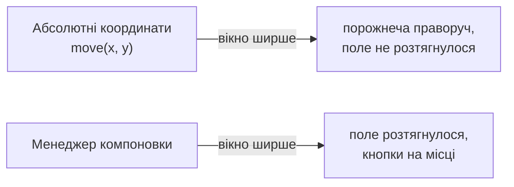
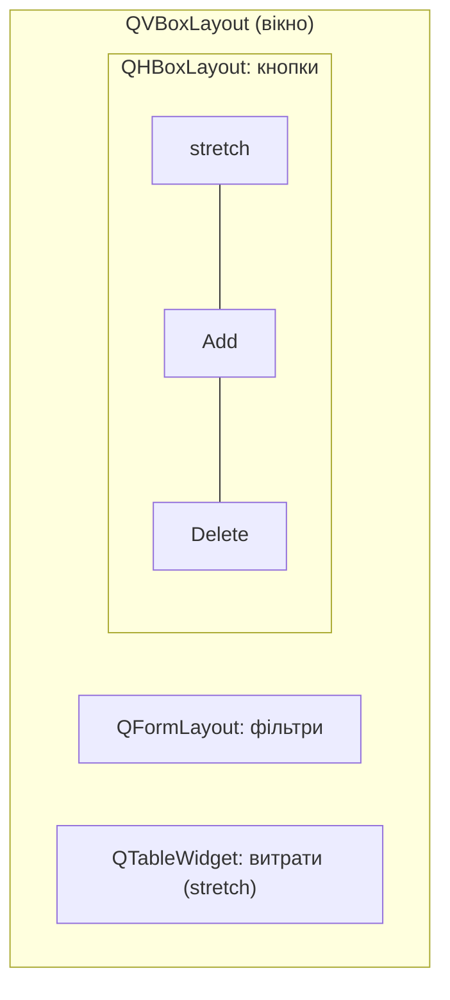

# 5. (Л) Менеджери компоновки (Layouts). QVBoxLayout, QHBoxLayout, QGridLayout

## Зміст лекції

1. Чому не можна розставляти віджети координатами
2. Менеджер компоновки
3. `QVBoxLayout` і `QHBoxLayout`
4. Розтягування: `stretch` і `addStretch`
5. Відступи: `margins` і `spacing`
6. `QGridLayout`: сітка
7. `QFormLayout`: форма «підпис — поле»
8. Вкладені компоновки
9. Політики розміру (size policy)
10. Групування: `QGroupBox`
11. Адаптивний інтерфейс: `QSplitter`, `QScrollArea`, `QTabWidget`
12. Показ і приховування частин інтерфейсу
13. Типові помилки

## Чому не можна розставляти віджети координатами

У лекції 1 ми розмістили кнопку методом `move(0, 30)`. Так робити погано:

- при зміні розміру вікна віджети не рухаються і не розтягуються;
- на іншій ОС, з іншим шрифтом чи масштабом екрана текст обрізається;
- переклад інтерфейсу іншою мовою змінює довжину написів;
- додати новий віджет — означає перераховувати координати всіх.



## Менеджер компоновки

**Менеджер компоновки** (layout) автоматично обчислює розмір і положення дочірніх віджетів і перераховує їх при кожній зміні розміру вікна. Він враховує бажаний (`sizeHint`), мінімальний і максимальний розміри кожного віджета.

| Клас | Як розміщує |
|---|---|
| `QVBoxLayout` | вертикально, зверху вниз |
| `QHBoxLayout` | горизонтально, зліва направо |
| `QGridLayout` | у клітинках сітки (рядок, стовпець) |
| `QFormLayout` | два стовпці: підпис і поле |
| `QStackedLayout` | один віджет з кількох у кожен момент |

Компоновку призначають віджету: `QVBoxLayout(widget)` або `widget.setLayout(layout)`. Віджети, додані в компоновку, автоматично стають дітьми цього віджета.

## `QVBoxLayout` і `QHBoxLayout`

```python
# Program: vertical layout with a horizontal row of buttons
import sys

from PySide6.QtWidgets import QApplication, QHBoxLayout, QLabel, QLineEdit, QPushButton, QVBoxLayout, QWidget

app = QApplication(sys.argv)
window = QWidget()
column = QVBoxLayout(window)
column.addWidget(QLabel("Search expenses:"))
column.addWidget(QLineEdit())

buttons = QHBoxLayout()
buttons.addWidget(QPushButton("Find"))
buttons.addWidget(QPushButton("Clear"))
column.addLayout(buttons)

window.resize(300, 120)
window.show()
app.processEvents()
print("items in column:", column.count())
print("buttons are children of window:", all(b.parent() is window for b in window.findChildren(QPushButton)))
print("buttons in one row:", len({b.y() for b in window.findChildren(QPushButton)}) == 1)
```

```text
items in column: 3
buttons are children of window: True
buttons in one row: True
```

`addLayout` вкладає одну компоновку в іншу. `app.processEvents()` змушує Qt виконати розрахунок розмірів одразу — у звичайній програмі це робить цикл `app.exec()`.

## Розтягування: `stretch` і `addStretch`

Коли у вікні більше місця, ніж потрібно віджетам, компоновка розподіляє його. Керувати розподілом можна двома способами:

- `addStretch()` — додати «пружину», що забирає вільне місце;
- `addWidget(widget, stretch)` — коефіцієнт: віджет з `stretch=2` отримує вдвічі більше вільного місця, ніж зі `stretch=1`.

```python
# Program: stretch pushes buttons to the right and splits space 1:2
import sys

from PySide6.QtWidgets import QApplication, QHBoxLayout, QPushButton, QTextEdit, QWidget

app = QApplication(sys.argv)

bar = QWidget()
row = QHBoxLayout(bar)
row.addStretch()  # уся зайва ширина — тут, кнопки праворуч
ok, cancel = QPushButton("OK"), QPushButton("Cancel")
row.addWidget(ok)
row.addWidget(cancel)
bar.resize(500, 50)
bar.show()

panes = QWidget()
split = QHBoxLayout(panes)
left, right = QTextEdit(), QTextEdit()
split.addWidget(left, 1)
split.addWidget(right, 2)
panes.resize(600, 200)
panes.show()
app.processEvents()

print("buttons at the right edge:", cancel.geometry().right() > 450 and ok.x() > 250)
print("right pane is about twice as wide:", round(right.width() / left.width(), 1))
```

```text
buttons at the right edge: True
right pane is about twice as wide: 2.0
```

Типовий рядок кнопок діалогу: `addStretch()` перед кнопками — кнопки праворуч, як у більшості програм.

## Відступи: `margins` і `spacing`

| Метод | Що задає |
|---|---|
| `setContentsMargins(left, top, right, bottom)` | відступ від країв батьківського віджета |
| `setSpacing(px)` | відстань між сусідніми елементами |
| `addSpacing(px)` | одноразовий проміжок у конкретному місці |

```python
# Program: margins and spacing
import sys

from PySide6.QtWidgets import QApplication, QPushButton, QVBoxLayout, QWidget

app = QApplication(sys.argv)
window = QWidget()
layout = QVBoxLayout(window)
layout.setContentsMargins(20, 10, 20, 10)
layout.setSpacing(4)
first, second = QPushButton("First"), QPushButton("Second")
layout.addWidget(first)
layout.addWidget(second)
window.show()
app.processEvents()
print("left margin:", first.x(), "| top margin:", first.y())
print("gap between buttons:", second.y() - first.geometry().bottom() - 1)
```

```text
left margin: 20 | top margin: 10
gap between buttons: 4
```

Компоновка, вкладена в іншу, зазвичай має нульові відступи (`setContentsMargins(0, 0, 0, 0)`), щоб не «подвоювати» поля.

## `QGridLayout`: сітка

`addWidget(widget, row, column, rowSpan=1, columnSpan=1)` розміщує віджет у клітинці. Віджет може займати кілька рядків чи стовпців:

```python
# Program: a calculator keypad in a grid
import sys

from PySide6.QtWidgets import QApplication, QGridLayout, QLineEdit, QPushButton, QWidget

app = QApplication(sys.argv)
window = QWidget()
grid = QGridLayout(window)
display = QLineEdit(readOnly=True)
grid.addWidget(display, 0, 0, 1, 4)  # дисплей на всю ширину — 4 стовпці

keys = ["7", "8", "9", "/", "4", "5", "6", "*", "1", "2", "3", "-", "0", ".", "=", "+"]
for index, key in enumerate(keys):
    button = QPushButton(key)
    button.clicked.connect(lambda checked=False, k=key: display.setText(display.text() + k))
    grid.addWidget(button, 1 + index // 4, index % 4)

for key in ("1", "2", "+", "3"):
    next(b for b in window.findChildren(QPushButton) if b.text() == key).click()
print("display:", display.text())
print("rows x columns:", grid.rowCount(), "x", grid.columnCount())
```

```text
display: 12+3
rows x columns: 5 x 4
```

Зверніть увагу на `lambda checked=False, k=key: ...`. Сигнал `clicked` передає аргумент `checked`, а `k=key` «запамʼятовує» поточне значення `key` для кожної кнопки. Без `k=key` усі кнопки дописували б останню клавішу `+` — значення змінної береться в момент виклику, а не створення `lambda`.

## `QFormLayout`: форма «підпис — поле»

`QFormLayout` створено саме для форм введення (лекція 3): підписи вирівнюються за правилами конкретної ОС.

```python
# Program: a form layout and how it stores rows
import sys

from PySide6.QtWidgets import QApplication, QDoubleSpinBox, QFormLayout, QLineEdit, QWidget

app = QApplication(sys.argv)
window = QWidget()
form = QFormLayout(window)
name = QLineEdit()
limit = QDoubleSpinBox(maximum=100000, suffix=" UAH")
form.addRow("Category &name:", name)  # Alt+N переводить фокус у поле
form.addRow("Monthly limit:", limit)
print("rows:", form.rowCount())
print("label of the second row:", form.labelForField(limit).text())
```

```text
rows: 2
label of the second row: Monthly limit:
```

## Вкладені компоновки

Реальні вікна поєднують компоновки. Типова структура: вертикальна колонка, в якій є форма, область вмісту й рядок кнопок:



```python
# File: expenses_layout.py
import sys

from PySide6.QtWidgets import (QApplication, QComboBox, QDateEdit, QFormLayout, QHBoxLayout, QPushButton,
                               QTableWidget, QVBoxLayout, QWidget)


class ExpensesWindow(QWidget):
    def __init__(self) -> None:
        super().__init__()
        self.setWindowTitle("Expenses")

        filters = QFormLayout()
        self.category = QComboBox()
        self.category.addItems(["all", "food", "transport", "fun"])
        self.since = QDateEdit(calendarPopup=True, displayFormat="yyyy-MM-dd")
        filters.addRow("Category:", self.category)
        filters.addRow("Since:", self.since)

        self.table = QTableWidget(0, 3)
        self.table.setHorizontalHeaderLabels(["Date", "Category", "Amount"])

        buttons = QHBoxLayout()
        buttons.addStretch()
        self.add_button = QPushButton("Add")
        self.delete_button = QPushButton("Delete")
        buttons.addWidget(self.add_button)
        buttons.addWidget(self.delete_button)

        layout = QVBoxLayout(self)
        layout.addLayout(filters)
        layout.addWidget(self.table, 1)  # таблиця забирає вільну висоту
        layout.addLayout(buttons)


if __name__ == "__main__":
    app = QApplication(sys.argv)
    window = ExpensesWindow()
    window.resize(520, 360)
    window.show()
    sys.exit(app.exec())
```

```python
# Program: the table grows with the window, the filters do not
import sys

from PySide6.QtWidgets import QApplication

from expenses_layout import ExpensesWindow

app = QApplication(sys.argv)
window = ExpensesWindow()
window.resize(520, 360)
window.show()
app.processEvents()
small_table, small_combo = window.table.height(), window.category.height()
window.resize(520, 700)
app.processEvents()
print("table grew:", window.table.height() > small_table + 300)
print("combo kept its height:", window.category.height() == small_combo)
```

```text
table grew: True
combo kept its height: True
```

## Політики розміру (size policy)

Кожен віджет повідомляє компоновці, як він «хоче» змінювати розмір по горизонталі й вертикалі — **політику розміру** `QSizePolicy`:

| Політика | Поведінка | Типово у |
|---|---|---|
| `Fixed` | лише `sizeHint` | — |
| `Preferred` | бажаний розмір, може стискатися й розширюватися | `QPushButton` (по горизонталі), `QLabel` |
| `Expanding` | хоче якомога більше місця | `QTextEdit`, `QTableWidget` |
| `Minimum` | не менше `sizeHint`, може рости | — |
| `Maximum` | не більше `sizeHint` | — |

```python
# Program: size policies decide who takes extra space
import sys

from PySide6.QtWidgets import QApplication, QHBoxLayout, QPushButton, QSizePolicy, QWidget

app = QApplication(sys.argv)
window = QWidget()
row = QHBoxLayout(window)
normal, wide = QPushButton("Normal"), QPushButton("Wide")
wide.setSizePolicy(QSizePolicy.Policy.Expanding, QSizePolicy.Policy.Fixed)
row.addWidget(normal)
row.addWidget(wide)
window.resize(600, 60)
window.show()
app.processEvents()
print("policy of normal:", normal.sizePolicy().horizontalPolicy().name)
print("wide button takes the extra space:", wide.width() > 3 * normal.width())
```

```text
policy of normal: Minimum
wide button takes the extra space: True
```

Горизонтальна політика `QPushButton` — `Minimum`: кнопка не стискається менше за свій текст і готова рости, але не «просить» місця. Кнопка з `Expanding` забирає собі все зайве.

## Групування: `QGroupBox`

`QGroupBox` — рамка із заголовком навколо логічно повʼязаних віджетів. Якщо зробити її `checkable`, прапорець у заголовку вмикає й вимикає весь вміст:

```python
# Program: a checkable group box enables its children
import sys

from PySide6.QtWidgets import QApplication, QDoubleSpinBox, QGroupBox, QVBoxLayout

app = QApplication(sys.argv)
limits = QGroupBox("Monthly limit")
limits.setCheckable(True)
limits.setChecked(False)
spin = QDoubleSpinBox(maximum=100000)
QVBoxLayout(limits).addWidget(spin)
print("spin enabled:", spin.isEnabled())
limits.setChecked(True)
print("spin enabled:", spin.isEnabled())
```

```text
spin enabled: False
spin enabled: True
```

## Адаптивний інтерфейс: `QSplitter`, `QScrollArea`, `QTabWidget`

Компоновки самі підлаштовують розміри. Для складніших випадків є спеціальні контейнери:

| Контейнер | Розвʼязує |
|---|---|
| `QSplitter` | користувач сам перетягує межу між панелями |
| `QScrollArea` | вміст більший за вікно — зʼявляються смуги прокрутки |
| `QTabWidget` | багато вмісту — розділити на вкладки |
| `QStackedWidget` | кілька «сторінок», видно одну (майстри, налаштування) |

```python
# Program: splitter, tabs and a scroll area
import sys

from PySide6.QtWidgets import (QApplication, QLabel, QListWidget, QScrollArea, QSplitter, QTabWidget,
                               QTextEdit, QVBoxLayout, QWidget)

app = QApplication(sys.argv)
splitter = QSplitter()
splitter.addWidget(QListWidget())
splitter.addWidget(QTextEdit())
splitter.setSizes([150, 450])
splitter.setStretchFactor(1, 1)  # права панель росте разом з вікном

long_page = QWidget()
column = QVBoxLayout(long_page)
for number in range(50):
    column.addWidget(QLabel(f"Setting {number}"))
scroll = QScrollArea()
scroll.setWidget(long_page)
scroll.setWidgetResizable(True)

tabs = QTabWidget()
tabs.addTab(splitter, "Expenses")
tabs.addTab(scroll, "Settings")
tabs.resize(600, 300)
tabs.show()
app.processEvents()
print("tabs:", [tabs.tabText(i) for i in range(tabs.count())])
left, right = splitter.sizes()
print("left pane:", left, "| right pane is about three times wider:", 2.5 < right / left < 3.1)
tabs.setCurrentIndex(1)
app.processEvents()
print("settings need scrolling:", scroll.verticalScrollBar().maximum() > 0)
```

```text
tabs: ['Expenses', 'Settings']
left pane: 150 | right pane is about three times wider: True
settings need scrolling: True
```

Права панель трохи вужча за 450 пікселів: сплітер «підганяє» розміри під доступну ширину вкладки з урахуванням ручки між панелями. Точне число залежить від стилю ОС.

## Показ і приховування частин інтерфейсу

Компоновка автоматично прибирає місце від прихованих віджетів. Це основа «адаптивних» форм: додаткові поля зʼявляються, лише коли вони потрібні:

```python
# Program: hide optional fields and the layout closes the gap
import sys

from PySide6.QtWidgets import QApplication, QCheckBox, QLineEdit, QVBoxLayout, QWidget

app = QApplication(sys.argv)
window = QWidget()
layout = QVBoxLayout(window)
advanced = QCheckBox("Show advanced options")
extra = QLineEdit(placeholderText="Tags, comma separated")
layout.addWidget(advanced)
layout.addWidget(extra)
layout.addStretch()
extra.setVisible(False)
advanced.toggled.connect(extra.setVisible)  # слот — метод самого віджета
window.show()
app.processEvents()
print("extra visible:", extra.isVisible())
advanced.setChecked(True)
print("extra visible:", extra.isVisible())
```

```text
extra visible: False
extra visible: True
```

Сигнал `toggled(bool)` напряму підʼєднано до методу `setVisible(bool)`: типи аргументів збігаються, і додаткова функція не потрібна.

## Типові помилки

| Помилка | Чому погано | Як правильно |
|---|---|---|
| `move()` і `resize()` для дочірніх віджетів | інтерфейс не адаптується | менеджери компоновки |
| Компоновку створено, але не призначено віджету | віджети не видно | `QVBoxLayout(widget)` або `setLayout` |
| Одну компоновку призначено двом віджетам | `QLayout: Attempting to add QLayout ... which already has a layout` | окрема компоновка для кожного |
| Немає `stretch` | елементи «розповзаються» по всьому вікну | `addStretch()`, коефіцієнти |
| `lambda: f(key)` у циклі | усі кнопки використовують останнє значення | `lambda checked=False, k=key: f(k)` |
| Фіксовані розміри скрізь | текст обрізається на інших системах | політики розміру, мінімальні розміри |
| Усе в одному вікні без вкладок і прокрутки | вікно не вміщується на маленькому екрані | `QTabWidget`, `QScrollArea`, `QSplitter` |

## Підсумок

- **Менеджери компоновки** самі розміщують віджети й перераховують розміри при зміні вікна; координати вручну не задають.
- `QVBoxLayout` і `QHBoxLayout` — колонка й рядок; `QGridLayout` — сітка з обʼєднанням клітинок; `QFormLayout` — форма «підпис — поле».
- `addStretch()` і коефіцієнти `stretch` розподіляють вільне місце; `setContentsMargins` і `setSpacing` задають відступи.
- Складні вікна будують із вкладених компоновок; політики розміру визначають, хто забирає зайве місце.
- `QGroupBox`, `QSplitter`, `QScrollArea`, `QTabWidget`, `QStackedWidget` і приховування віджетів роблять інтерфейс адаптивним.

## Корисні посилання

- [Qt for Python — Layout Management](https://doc.qt.io/qtforpython-6/overviews/qtwidgets-layout.html)
- [QGridLayout — документація](https://doc.qt.io/qtforpython-6/PySide6/QtWidgets/QGridLayout.html)
- [QSizePolicy — документація](https://doc.qt.io/qtforpython-6/PySide6/QtWidgets/QSizePolicy.html)
- [Python GUIs — PySide6 Layouts](https://www.pythonguis.com/tutorials/pyside6-layouts/)
- Fitzpatrick M. Create GUI Applications with Python & Qt6 (PySide6 Edition). — 2023. — Розділ «Layouts».
