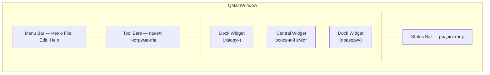

# 7. (Л) Головне вікно застосунку (QMainWindow). Структура головного вікна

## Зміст лекції

1. `QWidget` чи `QMainWindow`
2. Області головного вікна
3. Центральний віджет
4. Рядок стану
5. Меню й панелі інструментів: короткий огляд
6. Док-панелі (`QDockWidget`)
7. Заголовок, розмір, значок вікна
8. Закриття вікна: `closeEvent`
9. Незбережені зміни: `windowModified`
10. Збереження геометрії вікна
11. Каркас застосунку «Облік витрат»
12. Типові помилки

## `QWidget` чи `QMainWindow`

У лекціях 1–5 вікнами були звичайні `QWidget`. Для простих форм цього досить. Але справжні десктопні застосунки — текстовий редактор, браузер, VS Code — мають однакову структуру: меню вгорі, панелі інструментів, рядок стану внизу, бічні панелі. Для такої структури Qt має готовий клас **`QMainWindow`**.

| | `QWidget` | `QMainWindow` |
|---|---|---|
| меню, панелі інструментів, рядок стану | вручну | вбудовані |
| бічні панелі, що відкріплюються | ні | `QDockWidget` |
| компоновка | своя | центральний віджет зі своєю компоновкою |
| коли використовувати | діалоги, прості форми | головне вікно застосунку |

## Області головного вікна



`QMainWindow` вже має власну компоновку для цих областей. Тому **не можна** викликати `setLayout` для самого `QMainWindow`: власну компоновку отримує центральний віджет.

## Центральний віджет

**Центральний віджет** — основна область вікна. Це може бути один віджет (`QTextEdit` для редактора, `QTableView` для таблиці) або контейнер `QWidget` зі своєю компоновкою:

```python
# Program: a main window with a central widget made of a layout
import sys

from PySide6.QtWidgets import (QApplication, QLabel, QMainWindow, QTableWidget, QVBoxLayout, QWidget)

app = QApplication(sys.argv)
window = QMainWindow()
window.setWindowTitle("Expenses")

central = QWidget()
layout = QVBoxLayout(central)
layout.addWidget(QLabel("September 2026"))
layout.addWidget(QTableWidget(0, 3))
window.setCentralWidget(central)

print("central widget:", type(window.centralWidget()).__name__)
print("central widget parent is the window:", central.parent() is window)
print("main window has its own layout:", window.layout() is not None)
```

```text
central widget: QWidget
central widget parent is the window: True
main window has its own layout: True
```

`setCentralWidget` робить вікно батьком віджета і бере його у «володіння»: при заміні центрального віджета старий буде знищено.

## Рядок стану

**Рядок стану** (`QStatusBar`) показує короткі повідомлення й постійну інформацію: кількість записів, режим, підказки до дій меню.

```python
# Program: temporary and permanent status bar messages
import sys

from PySide6.QtWidgets import QApplication, QLabel, QMainWindow

app = QApplication(sys.argv)
window = QMainWindow()
status = window.statusBar()  # створюється при першому зверненні

count = QLabel("Records: 0")
status.addPermanentWidget(count)  # завжди праворуч
status.showMessage("File loaded", 3000)  # зникне через 3 секунди

print("message:", status.currentMessage())
count.setText("Records: 12")
print("permanent:", count.text())
status.clearMessage()
print("after clear:", repr(status.currentMessage()))
```

```text
message: File loaded
permanent: Records: 12
after clear: ''
```

| Метод | Значення |
|---|---|
| `showMessage(text, msecs)` | тимчасове повідомлення; `0` — доки не замінять |
| `addWidget(w)` | віджет ліворуч (ховається під тимчасовим повідомленням) |
| `addPermanentWidget(w)` | віджет праворуч, видно завжди |

## Меню й панелі інструментів: короткий огляд

Меню і панелі інструментів будуються з **дій** (`QAction`) — обʼєктів «команда»: «Відкрити», «Зберегти», «Вийти». Одна дія може бути одночасно пунктом меню, кнопкою на панелі й клавіатурним скороченням. Детально — у лекції 9, а тут мінімум для каркаса:

```python
# Program: one action in a menu and on a toolbar
import sys

from PySide6.QtGui import QAction, QKeySequence
from PySide6.QtWidgets import QApplication, QMainWindow

app = QApplication(sys.argv)
window = QMainWindow()
quit_action = QAction("&Quit", window)
quit_action.setShortcut(QKeySequence("Ctrl+Q"))
quit_action.triggered.connect(window.close)

file_menu = window.menuBar().addMenu("&File")
file_menu.addAction(quit_action)
toolbar = window.addToolBar("Main")
toolbar.addAction(quit_action)

print("menus:", [a.text() for a in window.menuBar().actions()])
print("same action in the menu and on the toolbar:", file_menu.actions()[0] is toolbar.actions()[0])
```

```text
menus: ['&File']
same action in the menu and on the toolbar: True
```

## Док-панелі (`QDockWidget`)

**Док-панель** — бічна панель, яку користувач може перетягнути до іншого краю, відкріпити в окреме плаваюче вікно або закрити. Так влаштовані панелі в VS Code, Qt Creator, графічних редакторах.

```python
# Program: a dock widget with filters next to the central table
import sys

from PySide6.QtCore import Qt
from PySide6.QtWidgets import QApplication, QDockWidget, QListWidget, QMainWindow, QTableWidget

app = QApplication(sys.argv)
window = QMainWindow()
window.setCentralWidget(QTableWidget(5, 3))

categories = QListWidget()
categories.addItems(["all", "food", "transport", "fun"])
dock = QDockWidget("Categories", window)
dock.setWidget(categories)
dock.setAllowedAreas(Qt.DockWidgetArea.LeftDockWidgetArea | Qt.DockWidgetArea.RightDockWidgetArea)
window.addDockWidget(Qt.DockWidgetArea.LeftDockWidgetArea, dock)

toggle = dock.toggleViewAction()  # готова дія «показати / сховати панель»
print("dock area:", window.dockWidgetArea(dock).name)
print("toggle action:", toggle.text(), "| checkable:", toggle.isCheckable())
```

```text
dock area: LeftDockWidgetArea
toggle action: Categories | checkable: True
```

`toggleViewAction()` зручно додати в меню *View*: користувач зможе повернути закриту панель.

## Заголовок, розмір, значок вікна

| Метод | Значення |
|---|---|
| `setWindowTitle("Expenses")` | заголовок |
| `resize(900, 600)` | початковий розмір |
| `setMinimumSize(640, 400)` | мінімальний розмір |
| `setWindowIcon(QIcon("icon.png"))` | значок вікна (і застосунку на панелі завдань) |
| `showMaximized()` / `showFullScreen()` | показати розгорнутим / на весь екран |

Значок можна взяти зі стандартного набору стилю — так не потрібні файли зображень:

```python
# Program: a standard icon from the current style
import sys

from PySide6.QtWidgets import QApplication, QMainWindow, QStyle

app = QApplication(sys.argv)
window = QMainWindow()
icon = app.style().standardIcon(QStyle.StandardPixmap.SP_DialogSaveButton)
window.setWindowIcon(icon)
print("icon is set:", not window.windowIcon().isNull())
```

```text
icon is set: True
```

## Закриття вікна: `closeEvent`

Коли користувач натискає хрестик, Qt викликає метод **`closeEvent(event)`** вікна. Перевизначивши його (лекція 43, 5 семестр), можна, наприклад, зберегти дані або спитати підтвердження. `event.accept()` дозволяє закриття, `event.ignore()` — скасовує:

```python
# Program: closeEvent can refuse to close the window
import sys

from PySide6.QtWidgets import QApplication, QMainWindow


class Window(QMainWindow):
    def __init__(self) -> None:
        super().__init__()
        self.locked = True

    def closeEvent(self, event) -> None:
        if self.locked:
            print("close refused: window is locked")
            event.ignore()
        else:
            print("closing")
            event.accept()


app = QApplication(sys.argv)
window = Window()
window.show()
print("closed:", window.close())
window.locked = False
print("closed:", window.close())
```

```text
close refused: window is locked
closed: False
closing
closed: True
```

Метод `close()` повертає `True`, якщо вікно справді закрилося. У лекції 11 замість прапорця `locked` зʼявиться діалог «Зберегти зміни?».

## Незбережені зміни: `windowModified`

Qt має вбудовану підтримку позначки «є незбережені зміни». Якщо в заголовку є заповнювач `[*]`, а властивість `windowModified` дорівнює `True`, Qt покаже зірочку (на macOS — крапку на кнопці закриття):

```python
# Program: the [*] placeholder shows unsaved changes in the title
import sys

from PySide6.QtWidgets import QApplication, QMainWindow

app = QApplication(sys.argv)
window = QMainWindow()
window.setWindowTitle("expenses.csv[*] - Expenses")
print("modified:", window.isWindowModified())
window.setWindowModified(True)
print("modified:", window.isWindowModified())
```

```text
modified: False
modified: True
```

Типова схема: будь-яка зміна даних → `setWindowModified(True)`; збереження у файл → `setWindowModified(False)`; `closeEvent` перевіряє `isWindowModified()`.

## Збереження геометрії вікна

Користувачі очікують, що застосунок відкриється з тим самим розміром і розташуванням панелей, що й минулого разу. `saveGeometry()` і `saveState()` повертають байти, які зберігають у налаштуваннях (`QSettings`, лекція 22) і відновлюють при запуску:

```python
# Program: save and restore the window geometry and dock layout
import sys

from PySide6.QtCore import QSettings
from PySide6.QtWidgets import QApplication, QMainWindow

app = QApplication(sys.argv)
settings = QSettings("demo-college", "expenses-demo")

window = QMainWindow()
window.resize(800, 500)
settings.setValue("geometry", window.saveGeometry())
settings.setValue("state", window.saveState())

restored = QMainWindow()
restored.restoreGeometry(settings.value("geometry"))
restored.restoreState(settings.value("state"))
width, height = restored.size().toTuple()
print("restored size is about 800 x 500:", abs(width - 800) <= 4 and abs(height - 500) <= 4)
settings.clear()
```

```text
restored size is about 800 x 500: True
```

Розмір може відрізнятися на кілька пікселів через рамку вікна конкретної ОС, тому порівнюємо приблизно.

## Каркас застосунку «Облік витрат»

Зберемо все в один каркас, який розвиватимемо в наступних лекціях:

```python
# File: main_window.py
import sys

from PySide6.QtCore import Qt
from PySide6.QtGui import QAction, QKeySequence
from PySide6.QtWidgets import (QApplication, QDockWidget, QLabel, QListWidget, QMainWindow, QTableWidget,
                               QTableWidgetItem)


class MainWindow(QMainWindow):
    def __init__(self) -> None:
        super().__init__()
        self.setWindowTitle("untitled[*] - Expenses")
        self.resize(900, 560)
        self.setMinimumSize(640, 400)

        self.table = QTableWidget(0, 3)
        self.table.setHorizontalHeaderLabels(["Date", "Category", "Amount"])
        self.setCentralWidget(self.table)

        self.categories = QListWidget()
        self.categories.addItems(["all", "food", "transport", "fun"])
        dock = QDockWidget("Categories", self)
        dock.setWidget(self.categories)
        self.addDockWidget(Qt.DockWidgetArea.LeftDockWidgetArea, dock)

        self.count_label = QLabel()
        self.statusBar().addPermanentWidget(self.count_label)

        self.add_action = QAction("&Add expense", self, shortcut=QKeySequence("Ctrl+N"))
        self.add_action.triggered.connect(self.add_demo_row)
        quit_action = QAction("&Quit", self, shortcut=QKeySequence("Ctrl+Q"))
        quit_action.triggered.connect(self.close)

        file_menu = self.menuBar().addMenu("&File")
        file_menu.addAction(self.add_action)
        file_menu.addSeparator()
        file_menu.addAction(quit_action)
        view_menu = self.menuBar().addMenu("&View")
        view_menu.addAction(dock.toggleViewAction())
        self.addToolBar("Main").addAction(self.add_action)

        self.update_count()
        self.statusBar().showMessage("Ready", 2000)

    def add_demo_row(self) -> None:
        row = self.table.rowCount()
        self.table.insertRow(row)
        for column, value in enumerate(("2026-09-21", "food", "85.50")):
            self.table.setItem(row, column, QTableWidgetItem(value))
        self.setWindowModified(True)
        self.update_count()
        self.statusBar().showMessage("Expense added", 2000)

    def update_count(self) -> None:
        self.count_label.setText(f"Records: {self.table.rowCount()}")


if __name__ == "__main__":
    app = QApplication(sys.argv)
    window = MainWindow()
    window.show()
    sys.exit(app.exec())
```

```python
# Program: drive the main window skeleton
import sys

from PySide6.QtWidgets import QApplication

from main_window import MainWindow

app = QApplication(sys.argv)
window = MainWindow()
print("menus:", [a.text().replace("&", "") for a in window.menuBar().actions()])
window.add_action.trigger()
window.add_action.trigger()
print(window.count_label.text(), "|", window.statusBar().currentMessage())
print("unsaved changes:", window.isWindowModified())
```

```text
menus: ['File', 'View']
Records: 2 | Expense added
unsaved changes: True
```

## Типові помилки

| Помилка | Чому погано | Як правильно |
|---|---|---|
| `window.setLayout(...)` для `QMainWindow` | `QWidget::setLayout: Attempting to set QLayout ... which already has a layout` | компоновка центрального віджета |
| Немає центрального віджета | порожнє вікно з дивними розмірами | `setCentralWidget` |
| Повідомлення в `print`, а не в рядку стану | користувач їх не бачить | `statusBar().showMessage` |
| Окремі обробники для меню й кнопки панелі | дублювання коду | одна `QAction` в обох місцях |
| Закриття без перевірки незбережених змін | втрата даних | `closeEvent` + `isWindowModified()` |
| Не можна повернути закриту док-панель | користувач «загубив» панель | `toggleViewAction()` у меню View |
| Розмір вікна щоразу стандартний | незручно користувачу | `saveGeometry` / `restoreGeometry` |

## Підсумок

- **`QMainWindow`** — готова структура головного вікна: меню, панелі інструментів, док-панелі, центральний віджет, рядок стану.
- Центральний віджет задають `setCentralWidget`; компоновку отримує він, а не саме вікно.
- Рядок стану показує тимчасові (`showMessage`) і постійні (`addPermanentWidget`) повідомлення.
- Меню й панелі будуються з дій `QAction`; одна дія може бути і пунктом меню, і кнопкою.
- `QDockWidget` — бічні панелі, які можна перетягувати, відкріплювати й ховати.
- `closeEvent` дозволяє перевірити незбережені зміни (`windowModified`, `[*]` у заголовку); `saveGeometry`/`saveState` зберігають вигляд вікна.

## Корисні посилання

- [QMainWindow — документація](https://doc.qt.io/qtforpython-6/PySide6/QtWidgets/QMainWindow.html)
- [QStatusBar — документація](https://doc.qt.io/qtforpython-6/PySide6/QtWidgets/QStatusBar.html)
- [QDockWidget — документація](https://doc.qt.io/qtforpython-6/PySide6/QtWidgets/QDockWidget.html)
- [Qt for Python — Application Example](https://doc.qt.io/qtforpython-6/examples/example_widgets_mainwindows_application.html)
- [Python GUIs — QMainWindow, Actions, Toolbars & Menus](https://www.pythonguis.com/tutorials/pyside6-actions-toolbars-menus/)
