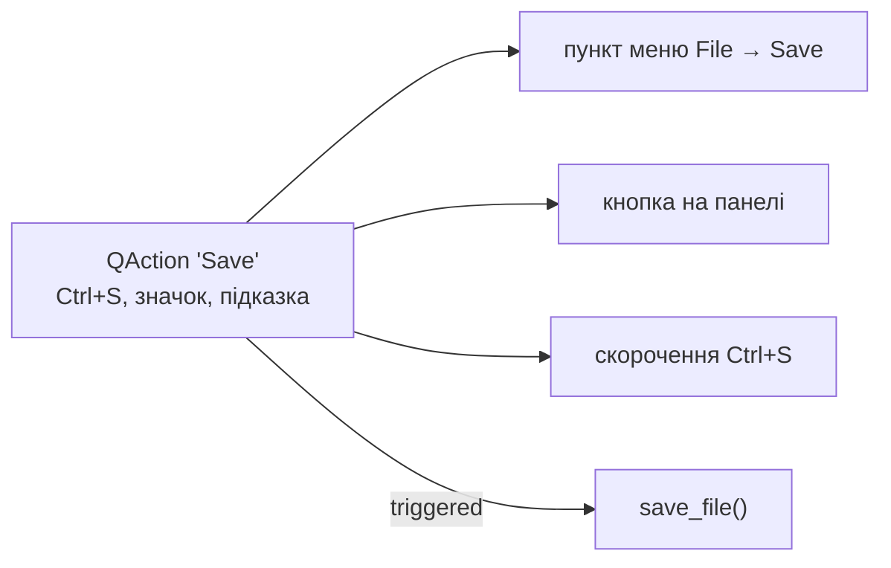

# 9. (Л) Меню, панелі інструментів і дії (QAction, MenuBar, ToolBar, StatusBar)

## Зміст лекції

1. Команда як обʼєкт: `QAction`
2. Властивості дії
3. Клавіатурні скорочення
4. Значки
5. Рядок меню і меню
6. Підменю й роздільники
7. Панелі інструментів
8. Дії-перемикачі й групи дій
9. Увімкнення й вимкнення дій за станом
10. Підказки в рядку стану
11. Контекстне меню
12. Меню «Нещодавні файли»
13. Повний приклад: меню редактора нотаток
14. Типові помилки

## Команда як обʼєкт: `QAction`

Команда «Зберегти» в типовому застосунку доступна трьома способами: пункт меню *File → Save*, кнопка на панелі інструментів і скорочення `Ctrl+S`. Якщо написати три окремі обробники, їх доведеться синхронізувати: вимкнути всі три, коли зберігати нічого, змінити текст в усіх трьох місцях.

**`QAction`** (модуль `QtGui`) — обʼєкт, що описує **одну команду**: текст, значок, скорочення, підказку, стан. Ту саму дію додають і в меню, і на панель; її сигнал **`triggered`** підʼєднують до обробника один раз.



## Властивості дії

| Властивість | Метод | Значення |
|---|---|---|
| текст | `setText("&Save")` | `&` — клавіша `Alt` у меню |
| значок | `setIcon(icon)` | показується в меню й на панелі |
| скорочення | `setShortcut(QKeySequence.StandardKey.Save)` | клавіші |
| підказка | `setToolTip`, `setStatusTip` | спливна підказка, текст у рядку стану |
| доступність | `setEnabled(False)` | сіра, не реагує |
| перемикач | `setCheckable(True)` | має стан «увімкнено» |

```python
# Program: one action with all its properties
import sys

from PySide6.QtGui import QAction, QKeySequence
from PySide6.QtWidgets import QApplication, QMainWindow

app = QApplication(sys.argv)
window = QMainWindow()
save = QAction("&Save", window)
save.setShortcut(QKeySequence.StandardKey.Save)
save.setStatusTip("Save expenses to the current file")
save.triggered.connect(lambda: print("save_file() called"))

save.trigger()
save.setEnabled(False)
save.trigger()  # вимкнена дія нічого не робить
print("shortcut:", save.shortcut().toString(), "| enabled:", save.isEnabled())
```

```text
save_file() called
shortcut: Ctrl+S | enabled: False
```

`trigger()` виконує дію програмно — так само, як клік у меню. Це зручно для тестів.

## Клавіатурні скорочення

| Спосіб | Приклад | Перевага |
|---|---|---|
| стандартне | `QKeySequence.StandardKey.Open` | правильні клавіші на кожній ОС (`Ctrl+O` на Linux, `⌘O` на macOS) |
| рядок | `QKeySequence("Ctrl+Shift+E")` | будь-яке поєднання |
| кілька | `setShortcuts([...])` | альтернативи |

```python
# Program: standard shortcuts are translated for the platform
import sys

from PySide6.QtGui import QKeySequence
from PySide6.QtWidgets import QApplication

app = QApplication(sys.argv)
for key in ("New", "Open", "Save", "Find", "Undo"):
    sequence = QKeySequence(getattr(QKeySequence.StandardKey, key))
    print(f"{key:<5} {sequence.toString()}")
```

```text
New   Ctrl+N
Open  Ctrl+O
Save  Ctrl+S
Find  Ctrl+F
Undo  Ctrl+Z
```

На macOS цей самий код покаже `Ctrl` як `⌘`, бо Qt сам підставить клавіші платформи. Частина стандартних клавіш залежить від робочого середовища: наприклад, `StandardKey.Quit` у деяких середовищах Linux порожня. Якщо `shortcut().isEmpty()`, задайте скорочення явно: `QKeySequence("Ctrl+Q")`.

## Значки

Значок (`QIcon`) робить кнопки панелі впізнаваними. Джерела значків:

| Джерело | Приклад |
|---|---|
| стандартні значки стилю | `style().standardIcon(QStyle.StandardPixmap.SP_DialogSaveButton)` |
| тема значків ОС (Linux) | `QIcon.fromTheme("document-save")` |
| власні файли | `QIcon("icons/save.svg")` |

```python
# Program: standard icons that exist on every platform
import sys

from PySide6.QtWidgets import QApplication, QStyle

app = QApplication(sys.argv)
names = ["SP_DialogOpenButton", "SP_DialogSaveButton", "SP_TrashIcon", "SP_MessageBoxInformation"]
for name in names:
    icon = app.style().standardIcon(getattr(QStyle.StandardPixmap, name))
    print(f"{name:<26} available: {not icon.isNull()}")
```

```text
SP_DialogOpenButton        available: True
SP_DialogSaveButton        available: True
SP_TrashIcon               available: True
SP_MessageBoxInformation   available: True
```

Власні значки зберігають поруч з кодом у каталозі `icons/` і завантажують за шляхом відносно файлу програми: `Path(__file__).parent / "icons" / "save.svg"`. Формат SVG масштабується без втрати якості.

## Рядок меню і меню

`window.menuBar()` повертає рядок меню головного вікна, `addMenu("&File")` — створює меню (`QMenu`). У меню додають дії:

```python
# Program: build a menu bar and inspect it
import sys

from PySide6.QtGui import QAction
from PySide6.QtWidgets import QApplication, QMainWindow

app = QApplication(sys.argv)
window = QMainWindow()
bar = window.menuBar()
file_menu = bar.addMenu("&File")
edit_menu = bar.addMenu("&Edit")
help_menu = bar.addMenu("&Help")

for text in ("&New", "&Open...", "&Save"):
    file_menu.addAction(QAction(text, window))
file_menu.addSeparator()
file_menu.addAction(QAction("&Quit", window))
help_menu.addAction("&About", lambda: print("about dialog"))  # скорочена форма

print([m.text() for m in bar.actions()])
print([a.text() or "---" for a in file_menu.actions()])
help_menu.actions()[0].trigger()
```

```text
['&File', '&Edit', '&Help']
['&New', '&Open...', '&Save', '---', '&Quit']
about dialog
```

Домовленості: стандартний порядок меню — *File, Edit, View, …, Help*; три крапки (`Open...`) означають, що команда відкриє діалог і потребує додаткових даних.

## Підменю й роздільники

```python
# Program: a submenu and separators
import sys

from PySide6.QtWidgets import QApplication, QMainWindow

app = QApplication(sys.argv)
window = QMainWindow()
file_menu = window.menuBar().addMenu("&File")
file_menu.addAction("&New")
export_menu = file_menu.addMenu("&Export")
export_menu.addAction("as &CSV")
export_menu.addAction("as &JSON")
file_menu.addSeparator()
file_menu.addAction("&Quit")

print([a.text() if not a.isSeparator() else "---" for a in file_menu.actions()])
print("export items:", [a.text() for a in export_menu.actions()])
```

```text
['&New', '&Export', '---', '&Quit']
export items: ['as &CSV', 'as &JSON']
```

Підменю — теж дія (`menuAction()`), тому воно присутнє у списку пунктів батьківського меню.

## Панелі інструментів

`window.addToolBar("Main")` повертає `QToolBar`. На панель додають ті самі дії, а також будь-які віджети (поле пошуку, вибір категорії):

```python
# Program: a toolbar with actions, a separator and a widget
import sys

from PySide6.QtCore import Qt
from PySide6.QtGui import QAction
from PySide6.QtWidgets import QApplication, QComboBox, QMainWindow, QStyle

app = QApplication(sys.argv)
window = QMainWindow()
style = app.style()
open_action = QAction(style.standardIcon(QStyle.StandardPixmap.SP_DialogOpenButton), "Open", window)
save_action = QAction(style.standardIcon(QStyle.StandardPixmap.SP_DialogSaveButton), "Save", window)

toolbar = window.addToolBar("Main")
toolbar.setObjectName("main_toolbar")  # потрібне для saveState (лекція 7)
toolbar.setToolButtonStyle(Qt.ToolButtonStyle.ToolButtonTextBesideIcon)
toolbar.setMovable(False)
toolbar.addAction(open_action)
toolbar.addAction(save_action)
toolbar.addSeparator()
month = QComboBox()
month.addItems(["2026-09", "2026-10"])
toolbar.addWidget(month)

print("toolbar items:", len(toolbar.actions()), "| button style:", toolbar.toolButtonStyle().name)
```

```text
toolbar items: 4 | button style: ToolButtonTextBesideIcon
```

| Стиль кнопок | Вигляд |
|---|---|
| `ToolButtonIconOnly` | лише значок (типово) |
| `ToolButtonTextOnly` | лише текст |
| `ToolButtonTextBesideIcon` | значок і текст поруч |
| `ToolButtonTextUnderIcon` | текст під значком |

## Дії-перемикачі й групи дій

Дія з `setCheckable(True)` має стан: так роблять *View → Show status bar* або «Жирний шрифт». **`QActionGroup`** робить кілька дій взаємовиключними — як радіокнопки (лекція 3):

```python
# Program: checkable actions and an exclusive action group
import sys

from PySide6.QtGui import QAction, QActionGroup
from PySide6.QtWidgets import QApplication, QMainWindow

app = QApplication(sys.argv)
window = QMainWindow()
view = window.menuBar().addMenu("&View")

status_action = QAction("Show &status bar", window, checkable=True, checked=True)
status_action.toggled.connect(window.statusBar().setVisible)
view.addAction(status_action)
view.addSeparator()

period_group = QActionGroup(window)
period_group.setExclusive(True)
for text in ("Day", "Week", "Month"):
    action = QAction(text, window, checkable=True)
    period_group.addAction(action)
    view.addAction(action)
period_group.actions()[2].setChecked(True)
period_group.triggered.connect(lambda action: print("period:", action.text()))

window.show()
status_action.trigger()
print("status bar visible:", window.statusBar().isVisible())
period_group.actions()[1].trigger()
print("checked:", [a.text() for a in period_group.actions() if a.isChecked()])
```

```text
status bar visible: False
period: Week
checked: ['Week']
```

Сигнал групи `triggered(QAction)` передає дію, яку обрали, — один обробник замість трьох.

## Увімкнення й вимкнення дій за станом

Дія, яку зараз виконати неможливо, має бути **вимкнена**: «Delete» без виділеного рядка, «Save» без змін. Користувач одразу бачить, що доступно. Стан дій зручно оновлювати в одному методі:

```python
# Program: actions follow the selection and the modified flag
import sys

from PySide6.QtGui import QAction
from PySide6.QtWidgets import QApplication, QListWidget, QMainWindow


class Window(QMainWindow):
    def __init__(self) -> None:
        super().__init__()
        self.list = QListWidget()
        self.list.addItems(["food 85.50", "bus 30.00"])
        self.setCentralWidget(self.list)
        self.delete_action = QAction("&Delete", self)
        self.save_action = QAction("&Save", self)
        self.delete_action.triggered.connect(self.delete_selected)
        self.list.itemSelectionChanged.connect(self.update_actions)
        self.update_actions()

    def delete_selected(self) -> None:
        self.list.takeItem(self.list.currentRow())
        self.setWindowModified(True)
        self.update_actions()

    def update_actions(self) -> None:
        self.delete_action.setEnabled(bool(self.list.selectedItems()))
        self.save_action.setEnabled(self.isWindowModified())


app = QApplication(sys.argv)
window = Window()
print("delete:", window.delete_action.isEnabled(), "| save:", window.save_action.isEnabled())
window.list.setCurrentRow(0)
print("delete:", window.delete_action.isEnabled(), "| save:", window.save_action.isEnabled())
window.delete_action.trigger()
print("items:", window.list.count(), "| save:", window.save_action.isEnabled())
```

```text
delete: False | save: False
delete: True | save: False
items: 1 | save: True
```

## Підказки в рядку стану

`setStatusTip` задає текст, що зʼявляється в рядку стану, коли користувач наводить мишу на пункт меню або кнопку панелі. Qt показує його автоматично, якщо в головного вікна вже створено рядок стану (`statusBar()`):

```python
# Program: status tips appear in the status bar on hover
import sys

from PySide6.QtGui import QAction, QStatusTipEvent
from PySide6.QtWidgets import QApplication, QMainWindow

app = QApplication(sys.argv)
window = QMainWindow()
window.statusBar()  # рядок стану має існувати, інакше підказку нікуди показати
export = QAction("&Export...", window, statusTip="Export expenses of the month to CSV")
window.menuBar().addMenu("&File").addAction(export)
window.show()
export.showStatusText(window)  # те, що Qt робить, коли мишу наводять на пункт меню
print(window.statusBar().currentMessage())
QApplication.sendEvent(window, QStatusTipEvent(""))
print(repr(window.statusBar().currentMessage()))
```

```text
Export expenses of the month to CSV
''
```

## Контекстне меню

**Контекстне меню** відкривається правою кнопкою миші над віджетом і містить дії саме для цього місця. Найпростіший спосіб — додати дії до віджета і встановити політику `ActionsContextMenu`:

```python
# Program: a context menu made of the widget actions
import sys

from PySide6.QtCore import Qt
from PySide6.QtGui import QAction
from PySide6.QtWidgets import QApplication, QListWidget

app = QApplication(sys.argv)
items = QListWidget()
items.addItems(["food 85.50", "bus 30.00"])
items.setContextMenuPolicy(Qt.ContextMenuPolicy.ActionsContextMenu)
copy_action = QAction("Copy", items)
delete_action = QAction("Delete", items)
items.addActions([copy_action, delete_action])
delete_action.triggered.connect(lambda: items.takeItem(items.currentRow()))

items.setCurrentRow(1)
delete_action.trigger()
print("context menu:", [a.text() for a in items.actions()], "| left:", items.count())
```

```text
context menu: ['Copy', 'Delete'] | left: 1
```

Для меню, що залежить від місця кліку, використовують політику `CustomContextMenu` і сигнал `customContextMenuRequested(QPoint)`, а меню показують методом `QMenu.exec(globalPos)`.

## Меню «Нещодавні файли»

Меню можна змінювати під час роботи: очищати й заповнювати знову. Типовий приклад — список нещодавніх файлів:

```python
# Program: a dynamic "Open recent" menu
import sys
from functools import partial

from PySide6.QtWidgets import QApplication, QMainWindow

app = QApplication(sys.argv)
window = QMainWindow()
recent_menu = window.menuBar().addMenu("&File").addMenu("Open &recent")
recent_files: list[str] = []


def open_file(path: str) -> None:
    print("open", path)


def remember(path: str) -> None:
    if path in recent_files:
        recent_files.remove(path)
    recent_files.insert(0, path)
    del recent_files[5:]
    recent_menu.clear()
    for number, item in enumerate(recent_files, 1):
        recent_menu.addAction(f"&{number} {item}", partial(open_file, item))
    recent_menu.setEnabled(bool(recent_files))


for path in ("september.csv", "october.csv", "september.csv"):
    remember(path)
print([a.text() for a in recent_menu.actions()])
recent_menu.actions()[1].trigger()
```

```text
['&1 september.csv', '&2 october.csv']
open october.csv
```

`functools.partial(open_file, item)` «запамʼятовує» аргумент для кожного пункту — альтернатива `lambda` з аргументом за замовчуванням (лекція 5).

## Повний приклад: меню редактора нотаток

```python
# File: notes_editor.py
import sys

from PySide6.QtGui import QAction, QKeySequence
from PySide6.QtWidgets import QApplication, QMainWindow, QPlainTextEdit, QStyle


class NotesEditor(QMainWindow):
    def __init__(self) -> None:
        super().__init__()
        self.setWindowTitle("notes[*] - Editor")
        self.editor = QPlainTextEdit()
        self.setCentralWidget(self.editor)
        self.create_actions()
        self.create_menus()
        self.create_toolbar()
        self.editor.textChanged.connect(lambda: self.setWindowModified(True))
        self.editor.copyAvailable.connect(self.copy_action.setEnabled)
        self.copy_action.setEnabled(False)
        self.statusBar().showMessage("Ready")

    def create_actions(self) -> None:
        icon = self.style().standardIcon
        self.new_action = QAction(icon(QStyle.StandardPixmap.SP_FileIcon), "&New", self,
                                  shortcut=QKeySequence.StandardKey.New, statusTip="Start a new note",
                                  triggered=self.new_note)
        self.save_action = QAction(icon(QStyle.StandardPixmap.SP_DialogSaveButton), "&Save", self,
                                   shortcut=QKeySequence.StandardKey.Save, statusTip="Save the note",
                                   triggered=self.save_note)
        self.quit_action = QAction("&Quit", self, shortcut=QKeySequence("Ctrl+Q"), triggered=self.close)
        self.copy_action = QAction("&Copy", self, shortcut=QKeySequence.StandardKey.Copy,
                                   triggered=self.editor.copy)
        self.wrap_action = QAction("&Wrap lines", self, checkable=True, checked=True,
                                   toggled=self.set_wrap)
        self.about_action = QAction("&About", self, triggered=lambda: self.statusBar().showMessage("Notes 1.0"))

    def create_menus(self) -> None:
        file_menu = self.menuBar().addMenu("&File")
        file_menu.addActions([self.new_action, self.save_action])
        file_menu.addSeparator()
        file_menu.addAction(self.quit_action)
        edit_menu = self.menuBar().addMenu("&Edit")
        edit_menu.addAction(self.copy_action)
        view_menu = self.menuBar().addMenu("&View")
        view_menu.addAction(self.wrap_action)
        self.menuBar().addMenu("&Help").addAction(self.about_action)

    def create_toolbar(self) -> None:
        toolbar = self.addToolBar("File")
        toolbar.setObjectName("file_toolbar")
        toolbar.addActions([self.new_action, self.save_action])

    def new_note(self) -> None:
        self.editor.clear()
        self.setWindowModified(False)
        self.statusBar().showMessage("New note", 2000)

    def save_note(self) -> None:
        # запис у файл — у лекції 11 (QFileDialog)
        self.setWindowModified(False)
        self.statusBar().showMessage(f"Saved {len(self.editor.toPlainText())} characters", 2000)

    def set_wrap(self, on: bool) -> None:
        mode = QPlainTextEdit.LineWrapMode.WidgetWidth if on else QPlainTextEdit.LineWrapMode.NoWrap
        self.editor.setLineWrapMode(mode)


if __name__ == "__main__":
    app = QApplication(sys.argv)
    window = NotesEditor()
    window.resize(700, 450)
    window.show()
    sys.exit(app.exec())
```

```python
# Program: use the editor through its actions
import sys

from PySide6.QtWidgets import QApplication

from notes_editor import NotesEditor

app = QApplication(sys.argv)
window = NotesEditor()
print("menus:", [a.text().replace("&", "") for a in window.menuBar().actions()])
window.editor.setPlainText("Buy groceries for 185 UAH")
print("modified:", window.isWindowModified())
window.save_action.trigger()
print(window.statusBar().currentMessage(), "| modified:", window.isWindowModified())
window.wrap_action.trigger()
print("wrap mode:", window.editor.lineWrapMode().name)
```

```text
menus: ['File', 'Edit', 'View', 'Help']
modified: True
Saved 25 characters | modified: False
wrap mode: NoWrap
```

Іменовані аргументи в конструкторі `QAction(..., shortcut=..., statusTip=..., triggered=...)` — скорочення PySide6: властивості встановлюються, а сигнал `triggered` одразу підʼєднується до слота.

## Типові помилки

| Помилка | Чому погано | Як правильно |
|---|---|---|
| Окремі обробники для меню, кнопки й скорочення | дублювання, розсинхронізація | одна `QAction` |
| Дія без батька (`QAction("Save")`) у локальній змінній | дію знищено, пункт меню зникає | батько — вікно: `QAction("Save", self)` |
| Скорочення рядками `"Ctrl+S"` для стандартних команд | неправильні клавіші на macOS | `QKeySequence.StandardKey` |
| Недоступні дії активні | клік нічого не робить або дає помилку | `setEnabled` за станом |
| Значки з абсолютних шляхів | не працює на іншому компʼютері | шлях відносно `__file__` або стандартні значки |
| Панель без `objectName` | попередження при `saveState` | `setObjectName` |
| `lambda: open_file(path)` у циклі | усі пункти відкривають останній файл | `partial(open_file, path)` |

## Підсумок

- **`QAction`** описує команду один раз: текст, значок, скорочення, підказки, стан; сигнал `triggered` підʼєднують до обробника.
- Стандартні скорочення беруть з `QKeySequence.StandardKey` — вони правильні на кожній ОС.
- Меню будують `menuBar().addMenu(...)`, `addAction`, `addSeparator`, `addMenu` (підменю).
- Панелі інструментів (`addToolBar`) містять ті самі дії і будь-які віджети.
- Дії-перемикачі (`checkable`) і групи `QActionGroup` замінюють прапорці й радіокнопки в меню.
- Стан дій оновлюють за станом застосунку; `statusTip` показується в рядку стану; контекстне меню — політика `ActionsContextMenu`.

## Корисні посилання

- [QAction — документація](https://doc.qt.io/qtforpython-6/PySide6/QtGui/QAction.html)
- [QMenu — документація](https://doc.qt.io/qtforpython-6/PySide6/QtWidgets/QMenu.html)
- [QToolBar — документація](https://doc.qt.io/qtforpython-6/PySide6/QtWidgets/QToolBar.html)
- [QKeySequence — StandardKey](https://doc.qt.io/qtforpython-6/PySide6/QtGui/QKeySequence.html)
- [Python GUIs — Actions, Toolbars & Menus](https://www.pythonguis.com/tutorials/pyside6-actions-toolbars-menus/)
