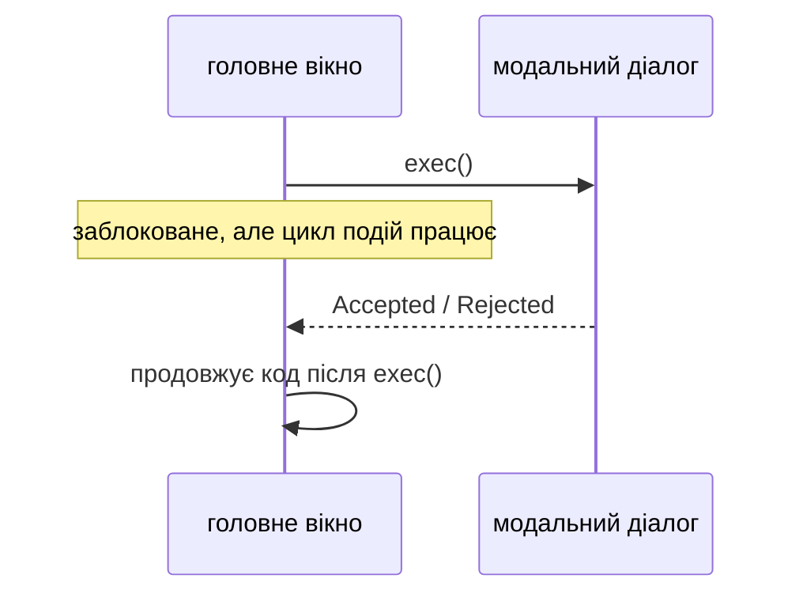
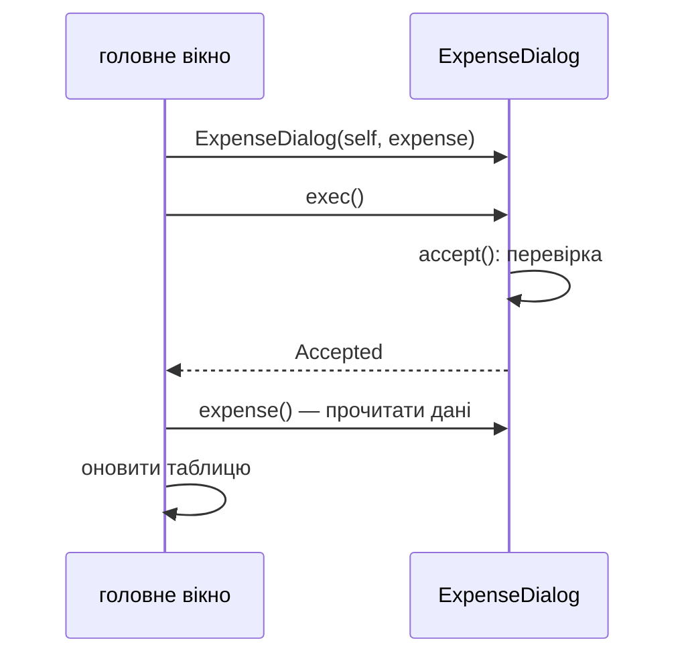

# 11. (Л) Діалогові вікна (QMessageBox, QFileDialog, QDialog)

## Зміст лекції

1. Що таке діалог
2. Модальні й немодальні діалоги
3. `QMessageBox`: стандартні повідомлення
4. Питання з кількома кнопками
5. Власний `QMessageBox`
6. `QFileDialog`: відкрити й зберегти файл
7. Фільтри файлів і робота з шляхами
8. `QInputDialog`: швидко запитати одне значення
9. Власний діалог: клас `QDialog`
10. `QDialogButtonBox`: стандартні кнопки
11. Перевірка даних перед `accept`
12. Результат діалогу і передавання даних
13. Немодальний діалог: `open()` і `show()`
14. «Зберегти зміни?» перед закриттям
15. Як тестувати діалоги
16. Типові помилки

## Що таке діалог

**Діалог** — допоміжне вікно для короткої взаємодії: повідомити про помилку, спитати підтвердження, обрати файл, ввести кілька значень. Після відповіді користувача діалог закривається, а головне вікно продовжує роботу з отриманими даними.

| Задача | Клас |
|---|---|
| повідомлення, попередження, помилка, питання «так / ні» | `QMessageBox` |
| вибір файлу для відкриття чи збереження, вибір каталогу | `QFileDialog` |
| одне значення: текст, число, вибір зі списку | `QInputDialog` |
| колір, шрифт | `QColorDialog`, `QFontDialog` |
| форма з кількома полями | власний клас — нащадок `QDialog` |

## Модальні й немодальні діалоги

| | Модальний | Немодальний |
|---|---|---|
| головне вікно | заблоковане, доки діалог відкритий | доступне |
| як показати | `dialog.exec()` — чекає відповіді | `dialog.show()` або `dialog.open()` |
| приклад | «Видалити 3 записи?», «Зберегти як» | «Знайти й замінити», панель налаштувань |



`exec()` запускає **вкладений цикл обробки подій**: інтерфейс перемальовується, але виконання коду після `exec()` чекає, доки користувач не закриє діалог. Тому з `exec()` код читається послідовно: «спитати → отримати відповідь → діяти».

## `QMessageBox`: стандартні повідомлення

Статичні методи `QMessageBox` створюють і показують модальне повідомлення одним рядком:

| Метод | Значок | Коли |
|---|---|---|
| `QMessageBox.information(parent, title, text)` | (i) | результат операції |
| `QMessageBox.warning(...)` | (!) | можлива проблема |
| `QMessageBox.critical(...)` | (x) | помилка |
| `QMessageBox.question(...)` | (?) | питання з кнопками |
| `QMessageBox.about(parent, title, text)` | значок застосунку | «Про програму» |

```python
# File: messages_demo.py
import sys

from PySide6.QtWidgets import QApplication, QMainWindow, QMessageBox, QPushButton


class Window(QMainWindow):
    def __init__(self) -> None:
        super().__init__()
        button = QPushButton("Import file")
        button.clicked.connect(self.import_file)
        self.setCentralWidget(button)

    def import_file(self) -> None:
        try:
            raise FileNotFoundError("expenses.csv")
        except FileNotFoundError as error:
            QMessageBox.critical(self, "Import failed", f"File not found: {error}")


if __name__ == "__main__":
    app = QApplication(sys.argv)
    window = Window()
    window.show()
    sys.exit(app.exec())
```

Перший аргумент — **батьківське вікно**: діалог зʼявляється по центру над ним і блокує саме його. Без батька діалог може відкритися будь-де на екрані.

## Питання з кількома кнопками

`QMessageBox.question` повертає **кнопку**, яку натиснув користувач:

```python
# File: delete_demo.py
import sys

from PySide6.QtWidgets import QAbstractItemView, QApplication, QListWidget, QMainWindow, QMessageBox


class Window(QMainWindow):
    def __init__(self) -> None:
        super().__init__()
        self.list = QListWidget()
        self.list.addItems(["food 85.50", "bus 30.00", "cinema 315.00"])
        self.list.setSelectionMode(QAbstractItemView.SelectionMode.ExtendedSelection)
        self.setCentralWidget(self.list)
        self.menuBar().addMenu("&Edit").addAction("&Delete selected", self.delete_selected)

    def delete_selected(self) -> None:
        rows = sorted({index.row() for index in self.list.selectedIndexes()}, reverse=True)
        if not rows:
            return
        answer = QMessageBox.question(
            self, "Delete expenses", f"Delete {len(rows)} selected expenses?",
            QMessageBox.StandardButton.Yes | QMessageBox.StandardButton.No,
            QMessageBox.StandardButton.No,  # кнопка за замовчуванням: безпечний варіант
        )
        if answer == QMessageBox.StandardButton.Yes:
            for row in rows:
                self.list.takeItem(row)


if __name__ == "__main__":
    app = QApplication(sys.argv)
    window = Window()
    window.show()
    sys.exit(app.exec())
```

Для небезпечних дій кнопкою за замовчуванням роблять **безпечний** варіант («No», «Cancel»): випадкове натискання Enter не видалить дані.

| Кнопка | Роль |
|---|---|
| `Ok`, `Yes`, `Save`, `Open` | підтвердити (accept) |
| `Cancel`, `No`, `Close` | відмовитися (reject) |
| `Discard` | відкинути зміни (destructive) |
| `Retry`, `Ignore`, `Abort` | для помилок |

## Власний `QMessageBox`

Коли потрібен додатковий текст, кнопки з власними назвами чи подробиці помилки, створюють обʼєкт `QMessageBox` і налаштовують його:

```python
# Program: a custom message box answered automatically
import sys

from PySide6.QtCore import QTimer
from PySide6.QtWidgets import QApplication, QMessageBox

app = QApplication(sys.argv)
box = QMessageBox()
box.setIcon(QMessageBox.Icon.Warning)
box.setWindowTitle("Budget")
box.setText("Food expenses exceed the monthly limit.")
box.setInformativeText("Spent 3275.50 of 3000.00 UAH. Continue adding?")
box.setDetailedText("2026-09-05 groceries 1250.00\n2026-09-20 groceries 1940.00")
add_anyway = box.addButton("Add anyway", QMessageBox.ButtonRole.AcceptRole)
box.addButton(QMessageBox.StandardButton.Cancel)
box.setDefaultButton(QMessageBox.StandardButton.Cancel)

QTimer.singleShot(0, add_anyway.click)  # у тесті «натискаємо» кнопку замість користувача
box.exec()
print("clicked:", box.clickedButton().text())
print("informative:", box.informativeText())
```

```text
clicked: Add anyway
informative: Spent 3275.50 of 3000.00 UAH. Continue adding?
```

`setDetailedText` додає кнопку *Show Details...* з розгорнутим текстом — зручно для технічних подробиць помилки, які звичайному користувачу не потрібні. `clickedButton()` повертає натиснуту кнопку, зокрема власну.

`QTimer.singleShot(0, add_anyway.click)` — прийом для автоматичної перевірки: таймер спрацює вже всередині циклу `exec()` і натисне кнопку. У справжньому застосунку натискає користувач.

## `QFileDialog`: відкрити й зберегти файл

| Метод | Повертає |
|---|---|
| `QFileDialog.getOpenFileName(parent, caption, dir, filter)` | `(path, selected_filter)` |
| `QFileDialog.getOpenFileNames(...)` | `(list_of_paths, selected_filter)` |
| `QFileDialog.getSaveFileName(...)` | `(path, selected_filter)` |
| `QFileDialog.getExistingDirectory(parent, caption, dir)` | `path` |

Якщо користувач натиснув *Cancel*, шлях — **порожній рядок**. Цей випадок обробляють завжди:

```python
# File: csv_viewer.py
import csv
import sys
from pathlib import Path

from PySide6.QtWidgets import QApplication, QFileDialog, QMainWindow, QMessageBox, QPlainTextEdit


class CsvViewer(QMainWindow):
    def __init__(self) -> None:
        super().__init__()
        self.viewer = QPlainTextEdit(readOnly=True)
        self.setCentralWidget(self.viewer)
        self.menuBar().addMenu("&File").addAction("&Open...", self.open_file)

    def open_file(self) -> None:
        path, _ = QFileDialog.getOpenFileName(
            self, "Open expenses", str(Path.home()), "CSV files (*.csv);;All files (*)")
        if not path:
            return  # користувач натиснув Cancel
        self.load(Path(path))

    def load(self, path: Path) -> None:
        try:
            with path.open(encoding="utf-8", newline="") as file:
                rows = list(csv.reader(file))
        except (OSError, UnicodeDecodeError, csv.Error) as error:
            QMessageBox.critical(self, "Open failed", f"Can not read {path.name}:\n{error}")
            return
        self.viewer.setPlainText("\n".join(" | ".join(row) for row in rows))
        self.setWindowTitle(f"{path.name} - CSV viewer")
        self.statusBar().showMessage(f"{len(rows)} rows loaded", 3000)


if __name__ == "__main__":
    app = QApplication(sys.argv)
    window = CsvViewer()
    window.resize(600, 400)
    window.show()
    sys.exit(app.exec())
```

```python
# Program: load a file without the dialog
import sys
import tempfile
from pathlib import Path

from PySide6.QtWidgets import QApplication

from csv_viewer import CsvViewer

app = QApplication(sys.argv)
window = CsvViewer()
path = Path(tempfile.mkdtemp()) / "september.csv"
path.write_text("date,category,amount\n2026-09-21,food,85.50\n", encoding="utf-8")
window.load(path)
print(window.windowTitle())
print(window.viewer.toPlainText())
print(window.statusBar().currentMessage())
```

```text
september.csv - CSV viewer
date | category | amount
2026-09-21 | food | 85.50
2 rows loaded
```

Логіку читання файлу винесено в окремий метод `load(path)`: його можна викликати й перевірити без діалогу. Діалог лише отримує шлях від користувача.

## Фільтри файлів і робота з шляхами

Фільтр — рядок `"Опис (*.ext1 *.ext2)"`; кілька фільтрів розділяють `;;`, наприклад: `"CSV files (*.csv);;JSON files (*.json);;All files (*)"`. Другий елемент результату `getOpenFileName` — фільтр, який обрав користувач.

| Порада | Чому |
|---|---|
| перетворюйте результат на `Path(path)` | зручні `suffix`, `name`, `with_suffix` (лекція 21, 5 семестр) |
| при збереженні додавайте розширення, якщо його немає | користувач міг ввести `report` без `.csv` |
| запамʼятовуйте останній каталог | наступного разу діалог відкриється там само (`QSettings`, лекція 22) |
| обробляйте помилки читання і запису | файл може бути зайнятий, без прав доступу, в іншому кодуванні |

```python
# Program: add a default extension to a chosen save path
from pathlib import Path


def ensure_suffix(path: str, suffix: str = ".csv") -> Path:
    result = Path(path)
    return result if result.suffix else result.with_suffix(suffix)


print(ensure_suffix("/home/student/report"))
print(ensure_suffix("/home/student/report.json"))
```

```text
/home/student/report.csv
/home/student/report.json
```

## `QInputDialog`: швидко запитати одне значення

| Метод | Повертає |
|---|---|
| `QInputDialog.getText(parent, title, label)` | `(text, ok)` |
| `QInputDialog.getInt(parent, title, label, value, min, max)` | `(int, ok)` |
| `QInputDialog.getDouble(parent, title, label, value, min, max, decimals)` | `(float, ok)` |
| `QInputDialog.getItem(parent, title, label, items, current, editable)` | `(item, ok)` |

```python
# File: limit_demo.py
import sys

from PySide6.QtWidgets import QApplication, QInputDialog, QLabel, QMainWindow


class Window(QMainWindow):
    def __init__(self) -> None:
        super().__init__()
        self.limit = 3000.0
        self.label = QLabel(f"Food limit: {self.limit:.2f} UAH")
        self.setCentralWidget(self.label)
        self.menuBar().addMenu("&Settings").addAction("Food &limit...", self.ask_limit)

    def ask_limit(self) -> None:
        limit, ok = QInputDialog.getDouble(self, "Monthly limit", "Limit for food, UAH:", self.limit, 0, 100000, 2)
        if ok:
            self.limit = limit
            self.label.setText(f"Food limit: {self.limit:.2f} UAH")


if __name__ == "__main__":
    app = QApplication(sys.argv)
    window = Window()
    window.show()
    sys.exit(app.exec())
```

`ok` дорівнює `False`, якщо користувач натиснув *Cancel*: тоді значення не використовують.

## Власний діалог: клас `QDialog`

Для форми з кількома полями створюють нащадка `QDialog`. Діалог закривається методами:

- `accept()` — користувач підтвердив, `exec()` поверне `QDialog.DialogCode.Accepted`;
- `reject()` — скасував (також Esc і хрестик), `exec()` поверне `Rejected`.

## `QDialogButtonBox`: стандартні кнопки

`QDialogButtonBox` розміщує стандартні кнопки в порядку, звичному для ОС (на Linux і Windows *OK* ліворуч від *Cancel*, на macOS — навпаки), і випромінює сигнали `accepted` і `rejected`:

```python
# File: expense_dialog.py
from datetime import date

from PySide6.QtCore import QDate
from PySide6.QtWidgets import (QComboBox, QDateEdit, QDialog, QDialogButtonBox, QDoubleSpinBox, QFormLayout,
                               QLabel, QLineEdit)

CATEGORIES = ["food", "transport", "fun", "health"]


class ExpenseDialog(QDialog):
    def __init__(self, parent=None, expense: dict | None = None) -> None:
        super().__init__(parent)
        self.setWindowTitle("Edit expense" if expense else "New expense")

        self.date_edit = QDateEdit(QDate.currentDate(), calendarPopup=True, displayFormat="yyyy-MM-dd")
        self.category_combo = QComboBox()
        self.category_combo.addItems(CATEGORIES)
        self.amount_spin = QDoubleSpinBox(maximum=100000, decimals=2, suffix=" UAH")
        self.comment_edit = QLineEdit(maxLength=50)
        self.error_label = QLabel(styleSheet="color: #c0392b")

        self.buttons = QDialogButtonBox(QDialogButtonBox.StandardButton.Ok | QDialogButtonBox.StandardButton.Cancel)
        self.buttons.accepted.connect(self.accept)
        self.buttons.rejected.connect(self.reject)

        form = QFormLayout(self)
        form.addRow("Date:", self.date_edit)
        form.addRow("Category:", self.category_combo)
        form.addRow("Amount:", self.amount_spin)
        form.addRow("Comment:", self.comment_edit)
        form.addRow(self.error_label)
        form.addRow(self.buttons)

        if expense:
            self.set_expense(expense)

    def set_expense(self, expense: dict) -> None:
        self.date_edit.setDate(QDate.fromString(expense["date"], "yyyy-MM-dd"))
        self.category_combo.setCurrentText(expense["category"])
        self.amount_spin.setValue(expense["amount"])
        self.comment_edit.setText(expense.get("comment", ""))

    def expense(self) -> dict:
        return {
            "date": self.date_edit.date().toString("yyyy-MM-dd"),
            "category": self.category_combo.currentText(),
            "amount": round(self.amount_spin.value(), 2),
            "comment": self.comment_edit.text().strip(),
        }

    def accept(self) -> None:
        if self.amount_spin.value() <= 0:
            self.error_label.setText("Amount must be greater than zero")
            self.amount_spin.setFocus()
            return  # діалог лишається відкритим
        if self.date_edit.date().toPython() > date.today():
            self.error_label.setText("The date can not be in the future")
            return
        super().accept()
```

## Перевірка даних перед `accept`

Метод `accept` перевизначено: якщо дані неправильні, діалог **не закривається**, а показує помилку і переводить фокус на проблемне поле. Користувач виправляє помилку, не втрачаючи введене. Лише коли все правильно, викликається `super().accept()`.

## Результат діалогу і передавання даних



Дані передають **у** діалог параметром конструктора (редагування існуючої витрати), а **з** діалогу — методом `expense()` після `exec()`. Діалог не змінює дані головного вікна напряму: так його легко повторно використати.

```python
# Program: run the expense dialog with simulated user input
import sys

from PySide6.QtCore import QTimer
from PySide6.QtWidgets import QApplication, QDialog

from expense_dialog import ExpenseDialog

app = QApplication(sys.argv)


def user_presses_ok_twice(dialog: ExpenseDialog) -> None:
    dialog.buttons.accepted.emit()  # перша спроба: сума 0
    print("error shown:", dialog.error_label.text())
    dialog.amount_spin.setValue(64.5)
    dialog.buttons.accepted.emit()  # друга спроба: усе правильно


dialog = ExpenseDialog(expense={"date": "2026-09-21", "category": "fun", "amount": 0, "comment": "coffee"})
QTimer.singleShot(0, lambda: user_presses_ok_twice(dialog))
result = dialog.exec()
print("accepted:", result == QDialog.DialogCode.Accepted)
print(dialog.expense())

cancelled = ExpenseDialog()
QTimer.singleShot(0, cancelled.reject)
print("cancelled:", cancelled.exec() == QDialog.DialogCode.Rejected)
```

```text
error shown: Amount must be greater than zero
accepted: True
{'date': '2026-09-21', 'category': 'fun', 'amount': 64.5, 'comment': 'coffee'}
cancelled: True
```

У головному вікні діалог використовують так: створити, викликати `exec()` і лише при `Accepted` прочитати дані. Повний застосунок з цим діалогом — у розділі «Зберегти зміни?» нижче.

## Немодальний діалог: `open()` і `show()`

| Метод | Модальність | Повертає керування |
|---|---|---|
| `exec()` | модальний для застосунку | після закриття діалогу |
| `open()` | модальний для батьківського вікна | **одразу**; результат — сигнал `finished(int)` |
| `show()` | немодальний | одразу |

`open()` рекомендує документація Qt: він не запускає вкладений цикл подій, тому безпечніший у складних застосунках. Результат обробляють у слоті:

```python
# Program: open() returns immediately, the result comes with a signal
import sys

from PySide6.QtCore import QTimer
from PySide6.QtWidgets import QApplication, QDialog, QMainWindow

app = QApplication(sys.argv)
window = QMainWindow()
dialog = QDialog(window)
dialog.finished.connect(lambda code: (print("finished, accepted:", code == QDialog.DialogCode.Accepted.value),
                                      app.quit()))
window.show()
dialog.open()
print("open() returned, the window keeps working")
QTimer.singleShot(50, dialog.accept)
app.exec()
```

```text
open() returned, the window keeps working
finished, accepted: True
```

Немодальний діалог (`show()`), наприклад «Знайти», лишається відкритим поруч з головним вікном; дані він передає сигналами (лекції 13, 16).

## «Зберегти зміни?» перед закриттям

Поєднаємо `closeEvent` (лекція 7), `ExpenseDialog`, `QFileDialog` і `QMessageBox` з трьома варіантами в один застосунок:

```python
# File: expenses_app.py
import json
import sys
from pathlib import Path

from PySide6.QtWidgets import QApplication, QDialog, QFileDialog, QListWidget, QMainWindow, QMessageBox

from expense_dialog import ExpenseDialog


class ExpensesApp(QMainWindow):
    def __init__(self) -> None:
        super().__init__()
        self.setWindowTitle("untitled[*] - Expenses")
        self.expenses: list[dict] = []
        self.list = QListWidget()
        self.setCentralWidget(self.list)
        menu = self.menuBar().addMenu("&File")
        menu.addAction("&Add expense...", self.add_expense)
        menu.addAction("&Save as...", self.save)
        menu.addAction("&Quit", self.close)

    def add_expense(self) -> None:
        dialog = ExpenseDialog(self)
        if dialog.exec() == QDialog.DialogCode.Accepted:
            expense = dialog.expense()
            self.expenses.append(expense)
            self.list.addItem(f"{expense['date']} {expense['category']} {expense['amount']:.2f}")
            self.setWindowModified(True)

    def save(self) -> bool:
        path, _ = QFileDialog.getSaveFileName(self, "Save expenses", "expenses.json", "JSON files (*.json)")
        if not path:
            return False
        try:
            Path(path).write_text(json.dumps(self.expenses, indent=2), encoding="utf-8")
        except OSError as error:
            QMessageBox.critical(self, "Save failed", str(error))
            return False
        self.setWindowModified(False)
        return True

    def closeEvent(self, event) -> None:
        if not self.isWindowModified():
            event.accept()
            return
        answer = QMessageBox.warning(
            self, "Unsaved changes", "Save changes before closing?",
            QMessageBox.StandardButton.Save | QMessageBox.StandardButton.Discard | QMessageBox.StandardButton.Cancel,
            QMessageBox.StandardButton.Save,
        )
        if answer == QMessageBox.StandardButton.Save:
            event.accept() if self.save() else event.ignore()  # не закривати, якщо збереження скасовано
        elif answer == QMessageBox.StandardButton.Discard:
            event.accept()
        else:
            event.ignore()


if __name__ == "__main__":
    app = QApplication(sys.argv)
    window = ExpensesApp()
    window.resize(500, 350)
    window.show()
    sys.exit(app.exec())
```

| Відповідь | Дія |
|---|---|
| *Save* | зберегти; закрити, лише якщо збереження вдалося |
| *Discard* | закрити без збереження |
| *Cancel* або Esc | не закривати |

## Як тестувати діалоги

Модальний діалог чекає користувача, тому в автоматичних перевірках його відповідь імітують:

| Прийом | Приклад |
|---|---|
| винести логіку з обробника діалогу | `load(path)` замість роботи всередині `open_file` |
| «натиснути» кнопку таймером | `QTimer.singleShot(0, button.click)` перед `exec()` |
| викликати `accept()` / `reject()` | `QTimer.singleShot(0, dialog.reject)` |
| підмінити статичний метод | `monkeypatch.setattr(QFileDialog, "getOpenFileName", lambda *a: (path, ""))` (лекція 9, 6 семестр) |

Для повноцінних тестів GUI існує плагін **pytest-qt**: фікстура `qtbot` імітує клавіші й кліки миші.

## Типові помилки

| Помилка | Чому погано | Як правильно |
|---|---|---|
| Діалог без батька | відкривається не над вікном, не блокує його | передати `self` |
| Не перевіряють порожній шлях від `QFileDialog` | `FileNotFoundError` після *Cancel* | `if not path: return` |
| Ігнорують `ok` з `QInputDialog` | значення використано після *Cancel* | `if ok:` |
| Перевірка після закриття діалогу | введені дані втрачено, треба вводити знову | перевірка в `accept()` |
| Небезпечна кнопка за замовчуванням | Enter видаляє дані | безпечна кнопка за замовчуванням |
| Діалог змінює дані головного вікна напряму | важко використати повторно й тестувати | метод `expense()` після `exec()` |
| Помилки файлів не обробляються | застосунок падає | `try/except OSError` + `QMessageBox.critical` |
| Технічний текст винятку для користувача | незрозуміло | зрозуміле повідомлення + `setDetailedText` |

## Підсумок

- **Діалог** — допоміжне вікно для короткої взаємодії; модальний (`exec()`) блокує вікно й повертає результат, немодальний (`show()`, `open()`) — ні.
- `QMessageBox` — повідомлення й питання; статичні методи повертають натиснуту кнопку; власний `QMessageBox` дозволяє власні кнопки й подробиці.
- `QFileDialog.getOpenFileName` / `getSaveFileName` повертають шлях або порожній рядок при скасуванні.
- `QInputDialog` запитує одне значення й прапорець `ok`.
- Власний діалог — нащадок `QDialog` з `QDialogButtonBox`; перевірку роблять у перевизначеному `accept()`, дані повертають методом.
- Перед закриттям вікна з незбереженими змінами пропонують *Save / Discard / Cancel*.

## Корисні посилання

- [QDialog — документація](https://doc.qt.io/qtforpython-6/PySide6/QtWidgets/QDialog.html)
- [QMessageBox — документація](https://doc.qt.io/qtforpython-6/PySide6/QtWidgets/QMessageBox.html)
- [QFileDialog — документація](https://doc.qt.io/qtforpython-6/PySide6/QtWidgets/QFileDialog.html)
- [Python GUIs — PySide6 Dialogs](https://www.pythonguis.com/tutorials/pyside6-dialogs/)
- [pytest-qt — документація](https://pytest-qt.readthedocs.io/)
