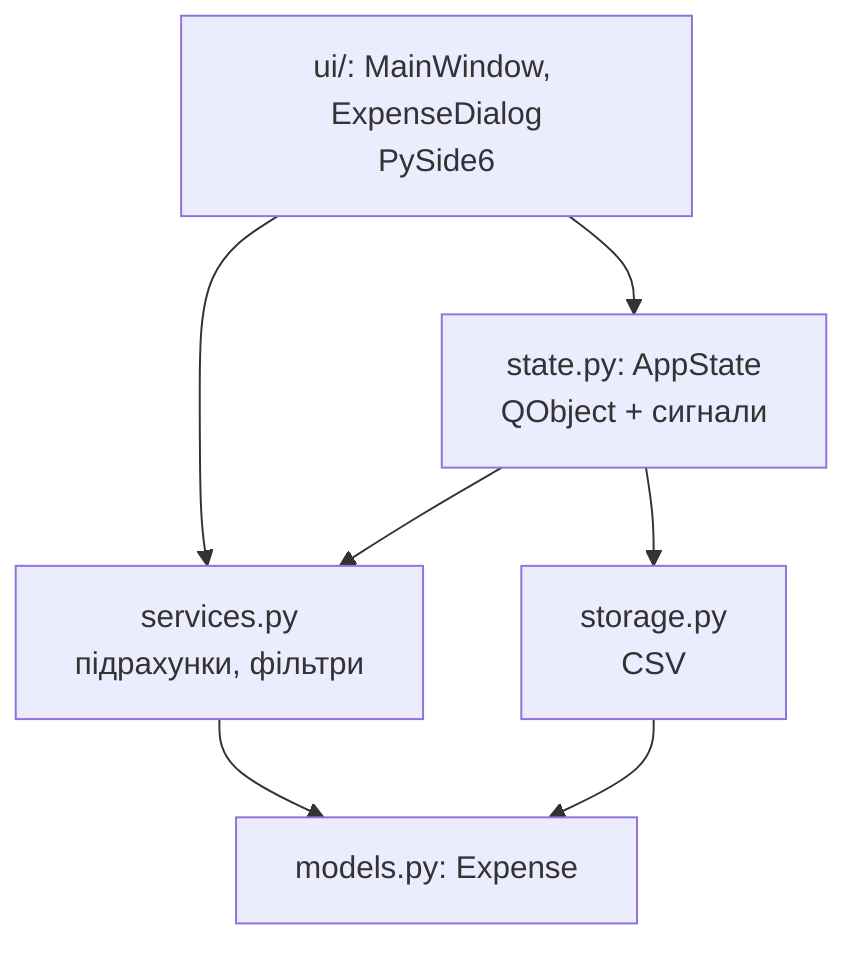
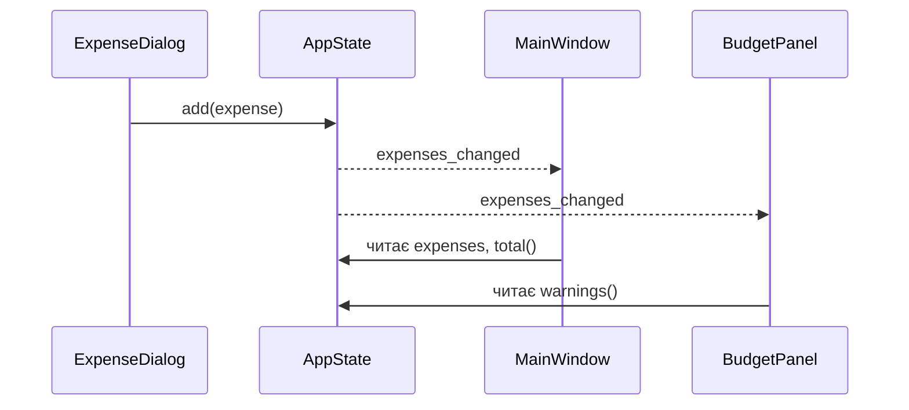

# 14. (Л) Керування станом та структура проєкту

## Зміст лекції

1. Проблема «все в одному вікні»
2. Відокремлення інтерфейсу від логіки
3. Шари застосунку
4. Структура каталогів
5. Модель даних без Qt: `Expense`
6. Збереження: модуль `storage`
7. Бізнес-логіка: модуль `services`
8. Центральний стан застосунку
9. Сигнали стану: вікна не знають одне про одне
10. Інтерфейс: вікно читає стан і реагує на сигнали
11. Точка входу `main.py`
12. Тести логіки без інтерфейсу
13. Типові помилки

## Проблема «все в одному вікні»

У модулі 1 весь код жив у класі вікна: віджети, читання CSV, підрахунок сум, перевірка бюджету. Для навчального прикладу на 100 рядків це нормально. Але застосунок росте, і через кілька тижнів клас `MainWindow` має 800 рядків:

| Симптом | Наслідок |
|---|---|
| підрахунок суми написано в обробнику кнопки | ту саму суму в іншому вікні рахують ще раз, по-іншому |
| дані зберігаються у віджетах (`QTableWidget`) | щоб дізнатися суму, треба читати текст комірок |
| логіку неможливо перевірити без вікна | тести не пишуть, помилки знаходять користувачі |
| вікно налаштувань напряму змінює віджети головного | кожна зміна в одному вікні ламає інше |

Розвʼязання — розділити застосунок на частини з чіткими обовʼязками (принцип єдиної відповідальності, лекція 51, 5 семестр).

## Відокремлення інтерфейсу від логіки

Головне правило: **інтерфейс лише показує дані й передає дії користувача; дані й правила живуть окремо**.

| Питання | Де відповідь |
|---|---|
| Що таке витрата? | модель даних (`models.py`) |
| Як прочитати й записати файл? | сховище (`storage.py`) |
| Скільки витрачено на їжу у вересні? Чи перевищено ліміт? | сервіси (`services.py`) |
| Які зараз витрати і який файл відкрито? | центральний стан (`state.py`) |
| Як це показати й що робити при кліку? | інтерфейс (`ui/`) |

Логіка без інтерфейсу — це звичайний Python з 5 семестру: класи, функції, файли. Її можна перевірити pytest, використати в консольній програмі чи вебсервісі.

## Шари застосунку



Залежності йдуть **згори вниз**: інтерфейс знає про стан і сервіси, але сервіси й моделі нічого не знають про інтерфейс і навіть не імпортують `PySide6`. Тому заміна інтерфейсу (наприклад, на вебсторінку з модуля 2 6 семестру) не зачіпає логіку.

## Структура каталогів

```text
expense_tracker/
  main.py                # створення QApplication, стану і вікна
  expenses/
    __init__.py
    models.py            # Expense — дані без Qt
    storage.py           # читання і запис CSV
    services.py          # суми, фільтри, бюджет
    state.py             # AppState: центральний стан і сигнали
    ui/
      __init__.py
      main_window.py
  tests/
    test_services.py
```

Пакети й імпорти — лекція 27 (5 семестр). Запускають застосунок з кореневого каталогу: `python main.py`.

## Модель даних без Qt: `Expense`

```python
# File: expenses/models.py
from dataclasses import dataclass
from datetime import date


@dataclass(frozen=True)
class Expense:
    day: date
    category: str
    amount: float
    comment: str = ""

    def __post_init__(self) -> None:
        if self.amount <= 0:
            raise ValueError(f"amount must be positive, got {self.amount}")
        if not self.category.strip():
            raise ValueError("category is required")
```

- `@dataclass` створює `__init__`, `__repr__`, `__eq__` автоматично;
- `frozen=True` робить обʼєкт незмінним (лекція 20, 5 семестр): витрату не можна випадково змінити «на місці», лише замінити новою;
- `__post_init__` перевіряє правила, які мають виконуватися **завжди**, незалежно від того, звідки прийшли дані — з форми, файлу чи тесту.

## Збереження: модуль `storage`

```python
# File: expenses/storage.py
import csv
from datetime import date
from pathlib import Path

from expenses.models import Expense

FIELDS = ["date", "category", "amount", "comment"]


def load(path: Path) -> list[Expense]:
    with path.open(encoding="utf-8", newline="") as file:
        return [
            Expense(date.fromisoformat(row["date"]), row["category"], float(row["amount"]), row.get("comment", ""))
            for row in csv.DictReader(file)
        ]


def save(path: Path, expenses: list[Expense]) -> None:
    with path.open("w", encoding="utf-8", newline="") as file:
        writer = csv.DictWriter(file, fieldnames=FIELDS)
        writer.writeheader()
        for expense in expenses:
            writer.writerow({"date": expense.day.isoformat(), "category": expense.category,
                             "amount": f"{expense.amount:.2f}", "comment": expense.comment})
```

Модуль знає лише про файли й `Expense`. Якщо згодом дані переїдуть у SQLite (лекція 1, 6 семестр), зміниться тільки цей модуль.

## Бізнес-логіка: модуль `services`

```python
# File: expenses/services.py
from collections import defaultdict
from datetime import date

from expenses.models import Expense


def in_month(expenses: list[Expense], year: int, month: int) -> list[Expense]:
    return [e for e in expenses if e.day.year == year and e.day.month == month]


def totals_by_category(expenses: list[Expense]) -> dict[str, float]:
    totals: dict[str, float] = defaultdict(float)
    for expense in expenses:
        totals[expense.category] += expense.amount
    return {category: round(total, 2) for category, total in sorted(totals.items())}


def over_limit(expenses: list[Expense], limits: dict[str, float]) -> dict[str, float]:
    """Categories where the total is above the limit, with the overspent amount."""
    return {category: round(total - limits[category], 2)
            for category, total in totals_by_category(expenses).items()
            if category in limits and total > limits[category]}


def month_of(day: date) -> tuple[int, int]:
    return day.year, day.month
```

Функції **чисті**: отримують дані параметрами, повертають результат, нічого не змінюють і не читають файлів. Їх найпростіше тестувати (лекція 33, 5 семестр).

## Центральний стан застосунку

Хто зберігає список витрат, поточний файл, ліміти? Якщо кожне вікно тримає свою копію, вони розходяться. Тому вводять **один обʼєкт стану** — єдине джерело правди. Вікна читають з нього дані й просять його змінити дані; самі дані не дублюють.

Стан успадковує `QObject`, щоб мати **сигнали**: після кожної зміни він повідомляє всіх зацікавлених.

```python
# File: expenses/state.py
from pathlib import Path

from PySide6.QtCore import QObject, Signal

from expenses import services, storage
from expenses.models import Expense


class AppState(QObject):
    expenses_changed = Signal()
    file_changed = Signal(str)
    limits_changed = Signal(dict)
    error = Signal(str)

    def __init__(self) -> None:
        super().__init__()
        self.expenses: list[Expense] = []
        self.limits: dict[str, float] = {"food": 3000.0, "fun": 1000.0}
        self.path: Path | None = None
        self.modified = False

    def open(self, path: Path) -> None:
        try:
            self.expenses = storage.load(path)
        except (OSError, ValueError, KeyError) as exc:
            self.error.emit(f"Can not open {path.name}: {exc}")
            return
        self.path = path
        self.modified = False
        self.file_changed.emit(str(path))
        self.expenses_changed.emit()

    def add(self, expense: Expense) -> None:
        self.expenses.append(expense)
        self.modified = True
        self.expenses_changed.emit()

    def remove(self, index: int) -> None:
        del self.expenses[index]
        self.modified = True
        self.expenses_changed.emit()

    def set_limits(self, limits: dict[str, float]) -> None:
        self.limits = dict(limits)
        self.limits_changed.emit(self.limits)

    def save(self) -> bool:
        if self.path is None:
            return False
        storage.save(self.path, self.expenses)
        self.modified = False
        self.file_changed.emit(str(self.path))
        return True

    def total(self) -> float:
        return round(float(sum(e.amount for e in self.expenses)), 2)

    def warnings(self) -> dict[str, float]:
        return services.over_limit(self.expenses, self.limits)
```

**Власні сигнали** оголошують атрибутами класу: `Signal()` — без даних, `Signal(str)` — з рядком, `Signal(dict)` — зі словником. Метод `emit(...)` випромінює сигнал.

## Сигнали стану: вікна не знають одне про одне



Діалог додавання не знає, які вікна показують витрати. Він лише змінює стан. Стан випромінює сигнал, і **кожне** підписане вікно оновлюється саме. Додати нове вікно (графік витрат) — означає підписати його на `expenses_changed`, не змінюючи решти коду. Це шаблон **«Спостерігач»** (Observer).

```python
# Program: two independent listeners react to one state change
import sys
from datetime import date

from PySide6.QtCore import QCoreApplication

from expenses.models import Expense
from expenses.state import AppState

app = QCoreApplication(sys.argv)  # для QObject і сигналів вікна не потрібні
state = AppState()
state.expenses_changed.connect(lambda: print("table: show", len(state.expenses), "rows"))
state.expenses_changed.connect(lambda: print("budget panel: warnings", state.warnings()))
state.error.connect(lambda message: print("error:", message))

state.add(Expense(date(2026, 9, 5), "food", 1250))
state.add(Expense(date(2026, 9, 20), "food", 1940))
print("total:", state.total(), "| modified:", state.modified)
try:
    state.add(Expense(date(2026, 9, 21), "fun", -5))
except ValueError as exc:
    print("rejected:", exc)
```

```text
table: show 1 rows
budget panel: warnings {}
table: show 2 rows
budget panel: warnings {'food': 190.0}
total: 3190.0 | modified: True
rejected: amount must be positive, got -5
```

`QCoreApplication` — цикл подій без графічного інтерфейсу. Його достатньо, щоб перевірити стан і сигнали в консолі чи тестах.

## Інтерфейс: вікно читає стан і реагує на сигнали

```python
# File: expenses/ui/main_window.py
from PySide6.QtWidgets import QLabel, QListWidget, QMainWindow, QMessageBox, QVBoxLayout, QWidget

from expenses.state import AppState


class MainWindow(QMainWindow):
    def __init__(self, state: AppState) -> None:
        super().__init__()
        self.state = state
        self.setWindowTitle("Expenses")
        self.list = QListWidget()
        self.total_label = QLabel()
        self.warning_label = QLabel(styleSheet="color: #c0392b")

        central = QWidget()
        layout = QVBoxLayout(central)
        layout.addWidget(self.list)
        layout.addWidget(self.total_label)
        layout.addWidget(self.warning_label)
        self.setCentralWidget(central)

        state.expenses_changed.connect(self.refresh)
        state.limits_changed.connect(lambda _limits: self.refresh())
        state.file_changed.connect(lambda path: self.setWindowTitle(f"{path} - Expenses"))
        state.error.connect(lambda message: QMessageBox.warning(self, "Expenses", message))
        self.refresh()

    def refresh(self) -> None:
        self.list.clear()
        for e in self.state.expenses:
            self.list.addItem(f"{e.day.isoformat()}  {e.category:<10} {e.amount:>9.2f}  {e.comment}")
        self.total_label.setText(f"Total: {self.state.total():.2f} UAH")
        warnings = self.state.warnings()
        self.warning_label.setText(
            ", ".join(f"{c} over limit by {v:.2f}" for c, v in warnings.items()) if warnings else "")
```

```python
# File: expenses/__init__.py
```

```python
# File: expenses/ui/__init__.py
```

Вікно не рахує сум і не читає файлів: усе бере зі стану і сервісів. Метод `refresh` перемальовує все за поточним станом — простий і надійний підхід для невеликих даних.

## Точка входу `main.py`

```python
# File: main.py
import sys
from pathlib import Path

from PySide6.QtWidgets import QApplication

from expenses.state import AppState
from expenses.ui.main_window import MainWindow


def main() -> int:
    app = QApplication(sys.argv)
    state = AppState()
    window = MainWindow(state)
    if len(sys.argv) > 1:
        state.open(Path(sys.argv[1]))
    window.resize(560, 380)
    window.show()
    return app.exec()


if __name__ == "__main__":
    sys.exit(main())
```

```python
# Program: open a file through the state and look at the window
import sys
import tempfile
from pathlib import Path

from PySide6.QtWidgets import QApplication

from expenses.state import AppState
from expenses.ui.main_window import MainWindow

app = QApplication(sys.argv)
path = Path(tempfile.mkdtemp()) / "september.csv"
path.write_text("date,category,amount,comment\n2026-09-05,food,1250.00,groceries\n"
                "2026-09-20,food,1940.00,groceries\n2026-09-25,fun,315.00,cinema\n", encoding="utf-8")
state = AppState()
window = MainWindow(state)
state.open(path)
print(window.windowTitle().endswith("september.csv - Expenses"))
print(window.list.count(), "rows |", window.total_label.text(), "|", window.warning_label.text())
state.set_limits({"food": 4000.0})
print("after new limits:", repr(window.warning_label.text()))
```

```text
True
3 rows | Total: 3505.00 UAH | food over limit by 190.00
after new limits: ''
```

`main.py` лише «збирає» застосунок: створює стан, вікно і запускає цикл. Стан передається у вікно параметром — **впровадження залежності** (dependency injection): у тесті можна передати стан з тестовими даними.

## Тести логіки без інтерфейсу

```python
# File: tests/test_services.py
from datetime import date

import pytest

from expenses import services
from expenses.models import Expense

DATA = [
    Expense(date(2026, 9, 5), "food", 1250),
    Expense(date(2026, 9, 20), "food", 1940),
    Expense(date(2026, 9, 25), "fun", 315),
    Expense(date(2026, 10, 2), "fun", 780),
]


def test_in_month():
    assert len(services.in_month(DATA, 2026, 9)) == 3


def test_totals_by_category():
    assert services.totals_by_category(DATA) == {"food": 3190.0, "fun": 1095.0}


def test_over_limit_only_for_categories_with_limits():
    assert services.over_limit(DATA, {"food": 3000, "health": 100}) == {"food": 190.0}


@pytest.mark.parametrize("amount", [0, -1])
def test_expense_rejects_non_positive_amount(amount):
    with pytest.raises(ValueError):
        Expense(date(2026, 9, 1), "food", amount)
```

```bash
python3 -m pytest -q
```

```text
.....                                                                    [100%]
5 passed in 0.03s
```

Тести не імпортують PySide6, не відкривають вікон і виконуються за мілісекунди.

## Типові помилки

| Помилка | Чому погано | Як правильно |
|---|---|---|
| Дані зберігаються лише у віджетах | важко рахувати, неможливо тестувати | модель і стан окремо від віджетів |
| Обчислення в обробниках кнопок | дублювання й розбіжності | функції в `services.py` |
| `models.py` імпортує PySide6 | логіку не використати без GUI | моделі й сервіси на чистому Python |
| Кожне вікно має свою копію списку витрат | вікна показують різне | один `AppState` |
| Вікно A напряму змінює віджети вікна B | сильна звʼязаність, зміни ламають інші вікна | зміна стану + сигнал |
| Стан створюється всередині вікна | неможливо підставити тестовий | передати параметром (`MainWindow(state)`) |
| Перевірки лише у формі | дані з файлу обходять перевірки | правила в моделі (`__post_init__`) |

## Підсумок

- Інтерфейс **показує** дані й передає дії; дані й правила живуть в окремих модулях.
- Шари: моделі (`models.py`), збереження (`storage.py`), бізнес-логіка (`services.py`), центральний стан (`state.py`), інтерфейс (`ui/`); залежності йдуть згори вниз.
- Моделі й сервіси не імпортують PySide6 і тестуються pytest без вікон.
- **Центральний стан** — єдине джерело правди; він успадковує `QObject` і повідомляє про зміни **власними сигналами** (`Signal`, `emit`).
- Вікна підписуються на сигнали стану і не знають одне про одне (шаблон «Спостерігач»).
- `main.py` збирає застосунок і передає стан у вікна параметрами.

## Корисні посилання

- [Qt for Python — Signals and Slots (власні сигнали)](https://doc.qt.io/qtforpython-6/tutorials/basictutorial/signals_and_slots.html)
- [Модуль `dataclasses` — довідник](https://docs.python.org/3/library/dataclasses.html)
- [Refactoring.Guru — Observer](https://refactoring.guru/design-patterns/observer)
- [Python GUIs — Model View Controller architecture](https://www.pythonguis.com/tutorials/pyside6-modelview-architecture/)
- Martin R. Clean Architecture. — Prentice Hall, 2017.
