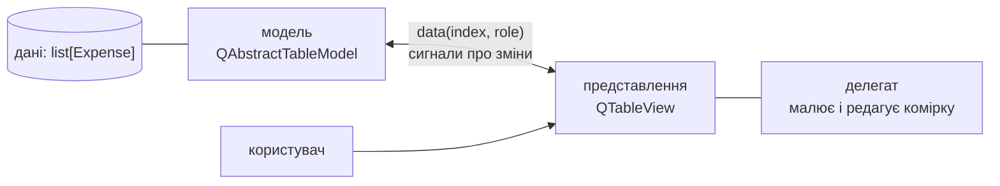
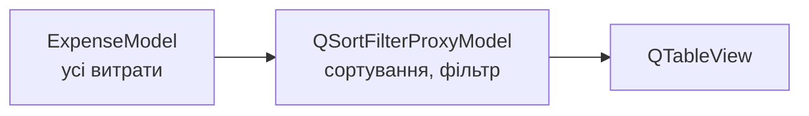

# 18. (Л) Модель–представлення (Model/View). Основи MVC. Представлення табличних даних

## Зміст лекції

1. Проблема: дані всередині віджета
2. MVC і Model/View у Qt
3. Віджети-елементи і представлення
4. Перша модель: `QStringListModel`
5. Індекс моделі: `QModelIndex`
6. Власна таблична модель: `QAbstractTableModel`
7. Ролі даних
8. Заголовки
9. Повідомлення про зміни
10. Одна модель — кілька представлень
11. Сортування і фільтр: `QSortFilterProxyModel`
12. Редагування: `flags` і `setData`
13. Налаштування `QTableView`
14. Виділення рядків
15. Типові помилки

## Проблема: дані всередині віджета

У лекціях 7–11 витрати показував `QTableWidget` або `QListWidget`: ми самі створювали `QTableWidgetItem` для кожної комірки. Дані при цьому **копіюються у віджет**:

- щоб порахувати суму, треба читати текст комірок і перетворювати на числа;
- щоб показати ті самі дані у двох таблицях, треба синхронізувати дві копії;
- 100 000 рядків — 300 000 обʼєктів-комірок у памʼяті;
- сортування сум як тексту: `"100.00"` < `"85.50"`.

## MVC і Model/View у Qt

**MVC** (Model–View–Controller) — класичний архітектурний шаблон:

| Частина | Відповідальність |
|---|---|
| **модель** (Model) | дані й доступ до них |
| **представлення** (View) | показ даних користувачу |
| **контролер** (Controller) | обробка дій користувача |

У Qt контролер обʼєднано з представленням, а замість нього є **делегат** — обʼєкт, що малює і редагує окрему комірку. Цей підхід Qt називає **Model/View**:



Представлення **не зберігає даних**: щоразу, коли треба намалювати видиму комірку, воно питає модель `data(index, role)`. Тому таблиця на мільйон рядків працює швидко: запитуються лише видимі на екрані комірки.

## Віджети-елементи і представлення

| Віджет-елемент (дані всередині) | Представлення (дані в моделі) |
|---|---|
| `QListWidget` | `QListView` |
| `QTableWidget` | `QTableView` |
| `QTreeWidget` | `QTreeView` |

Віджети-елементи зручні для кількох десятків рядків, що не повʼязані з іншими даними. Для даних застосунку — модель і представлення.

## Перша модель: `QStringListModel`

Qt має готові моделі. Найпростіша — список рядків:

```python
# Program: a ready-made model shown by two views
import sys

from PySide6.QtCore import QStringListModel
from PySide6.QtWidgets import QApplication, QListView

app = QApplication(sys.argv)
model = QStringListModel(["food", "transport", "fun"])
first, second = QListView(), QListView()
first.setModel(model)
second.setModel(model)  # те саме джерело даних

model.insertRows(model.rowCount(), 1)
model.setData(model.index(model.rowCount() - 1), "health")
print("model:", model.stringList())
print("both views see", second.model().rowCount(), "rows, same model:", first.model() is second.model())
```

```text
model: ['food', 'transport', 'fun', 'health']
both views see 4 rows, same model: True
```

Ми змінили модель — і обидва представлення автоматично показують новий рядок.

## Індекс моделі: `QModelIndex`

Представлення звертається до даних через **індекс** — `QModelIndex`: «комірка в рядку `row`, стовпці `column` цієї моделі».

| Метод | Значення |
|---|---|
| `model.index(row, column)` | отримати індекс |
| `index.row()`, `index.column()` | координати |
| `index.isValid()` | чи вказує на реальну комірку |
| `index.data(role)` | те саме, що `model.data(index, role)` |

`QModelIndex()` без аргументів — **невалідний** індекс; у табличних моделях він позначає «корінь» (батько всіх рядків).

## Власна таблична модель: `QAbstractTableModel`

Для власних даних успадковують `QAbstractTableModel` і реалізують мінімум три методи:

| Метод | Повертає |
|---|---|
| `rowCount(parent)` | кількість рядків |
| `columnCount(parent)` | кількість стовпців |
| `data(index, role)` | значення комірки для ролі або `None` |

```python
# File: expense_model.py
from dataclasses import dataclass
from datetime import date

from PySide6.QtCore import QAbstractTableModel, QModelIndex, Qt
from PySide6.QtGui import QColor


@dataclass
class Expense:
    day: date
    category: str
    amount: float
    comment: str = ""


class ExpenseModel(QAbstractTableModel):
    HEADERS = ["Date", "Category", "Amount", "Comment"]
    BIG = 1000.0

    def __init__(self, expenses: list[Expense] | None = None) -> None:
        super().__init__()
        self.expenses = list(expenses or [])

    def rowCount(self, parent=QModelIndex()) -> int:
        return 0 if parent.isValid() else len(self.expenses)

    def columnCount(self, parent=QModelIndex()) -> int:
        return 0 if parent.isValid() else len(self.HEADERS)

    def data(self, index: QModelIndex, role=Qt.ItemDataRole.DisplayRole):
        if not index.isValid():
            return None
        expense = self.expenses[index.row()]
        column = index.column()
        if role == Qt.ItemDataRole.DisplayRole:
            return [expense.day.isoformat(), expense.category, f"{expense.amount:.2f}", expense.comment][column]
        if role == Qt.ItemDataRole.EditRole:
            return [expense.day.isoformat(), expense.category, expense.amount, expense.comment][column]
        if role == Qt.ItemDataRole.TextAlignmentRole and column == 2:
            return Qt.AlignmentFlag.AlignRight | Qt.AlignmentFlag.AlignVCenter
        if role == Qt.ItemDataRole.BackgroundRole and expense.amount >= self.BIG:
            return QColor("#fdecea")
        if role == Qt.ItemDataRole.ToolTipRole and expense.amount >= self.BIG:
            return f"Big expense: {expense.amount:.2f} UAH"
        if role == Qt.ItemDataRole.UserRole:
            return [expense.day, expense.category, expense.amount, expense.comment][column]  # для сортування
        return None

    def headerData(self, section: int, orientation, role=Qt.ItemDataRole.DisplayRole):
        if role != Qt.ItemDataRole.DisplayRole:
            return None
        if orientation == Qt.Orientation.Horizontal:
            return self.HEADERS[section]
        return str(section + 1)

    def add(self, expense: Expense) -> None:
        row = len(self.expenses)
        self.beginInsertRows(QModelIndex(), row, row)
        self.expenses.append(expense)
        self.endInsertRows()

    def remove(self, row: int) -> None:
        self.beginRemoveRows(QModelIndex(), row, row)
        del self.expenses[row]
        self.endRemoveRows()

    def flags(self, index: QModelIndex):
        base = super().flags(index)
        return base | Qt.ItemFlag.ItemIsEditable if index.column() in (2, 3) else base

    def setData(self, index: QModelIndex, value, role=Qt.ItemDataRole.EditRole) -> bool:
        if role != Qt.ItemDataRole.EditRole or not index.isValid():
            return False
        expense = self.expenses[index.row()]
        if index.column() == 2:
            try:
                amount = float(str(value).replace(",", "."))
            except ValueError:
                return False
            if amount <= 0:
                return False
            expense.amount = round(amount, 2)
        elif index.column() == 3:
            expense.comment = str(value).strip()
        else:
            return False
        self.dataChanged.emit(index, index, [role])
        return True

    def total(self) -> float:
        return round(sum(e.amount for e in self.expenses), 2)
```

Модель зберігає список обʼєктів `Expense` (у застосунку — з модуля `models.py`, лекція 14) і лише **перекладає** їх мовою Qt: рядок → витрата, стовпець → поле.

```python
# Program: ask the model what a view would ask
import sys
from datetime import date

from PySide6.QtCore import Qt
from PySide6.QtWidgets import QApplication

from expense_model import Expense, ExpenseModel

app = QApplication(sys.argv)
model = ExpenseModel([Expense(date(2026, 9, 21), "food", 85.5, "lunch"),
                      Expense(date(2026, 9, 20), "food", 1940, "groceries")])
print("size:", model.rowCount(), "x", model.columnCount())
cell = model.index(1, 2)
print("display:", cell.data(), "| edit:", cell.data(Qt.ItemDataRole.EditRole))
print("tooltip:", cell.data(Qt.ItemDataRole.ToolTipRole))
print("small expense tooltip:", model.index(0, 2).data(Qt.ItemDataRole.ToolTipRole))
print("headers:", [model.headerData(c, Qt.Orientation.Horizontal) for c in range(4)])
```

```text
size: 2 x 4
display: 1940.00 | edit: 1940
tooltip: Big expense: 1940.00 UAH
small expense tooltip: None
headers: ['Date', 'Category', 'Amount', 'Comment']
```

## Ролі даних

Одна комірка має **кілька значень для різних ролей**. Представлення питає модель окремо: що показати текстом, якого кольору фон, яку підказку, яке значення для редагування.

| Роль | Що повертає модель |
|---|---|
| `DisplayRole` | текст для показу |
| `EditRole` | значення для редактора (число, а не форматований текст) |
| `ToolTipRole` | підказка при наведенні |
| `BackgroundRole`, `ForegroundRole` | `QColor` фону й тексту |
| `TextAlignmentRole` | вирівнювання |
| `FontRole` | `QFont` |
| `DecorationRole` | значок |
| `UserRole` (і далі) | будь-які власні дані, наприклад для сортування |

Для ролей, які модель не підтримує, `data` повертає `None` — представлення використає типове значення.

## Заголовки

`headerData(section, orientation, role)` повертає підписи стовпців (`Horizontal`) і рядків (`Vertical`). Тут теж можна використовувати ролі — наприклад, підказку до заголовка стовпця.

## Повідомлення про зміни

Представлення дізнається про зміни моделі лише із **сигналів**. Тому зміна списку `self.expenses` має бути загорнута у відповідні виклики:

| Зміна | Виклики |
|---|---|
| додати рядки | `beginInsertRows(parent, first, last)` → змінити дані → `endInsertRows()` |
| видалити рядки | `beginRemoveRows(...)` → змінити → `endRemoveRows()` |
| змінити значення комірок | змінити → `dataChanged.emit(top_left, bottom_right, roles)` |
| замінити все (новий файл) | `beginResetModel()` → змінити → `endResetModel()` |

```python
# Program: views update only when the model sends signals
import sys
from datetime import date

from PySide6.QtWidgets import QApplication, QTableView

from expense_model import Expense, ExpenseModel

app = QApplication(sys.argv)
model = ExpenseModel()
model.rowsInserted.connect(lambda parent, first, last: print(f"rows inserted: {first}..{last}"))
model.dataChanged.connect(lambda tl, br, roles: print(f"data changed at row {tl.row()}, column {tl.column()}"))
view = QTableView()
view.setModel(model)

model.add(Expense(date(2026, 9, 21), "food", 85.5))
model.add(Expense(date(2026, 9, 25), "fun", 315))
model.setData(model.index(0, 2), "90,25")
print("rows in the view:", view.model().rowCount(), "| total:", model.total())
```

```text
rows inserted: 0..0
rows inserted: 1..1
data changed at row 0, column 2
rows in the view: 2 | total: 405.25
```

!!! warning "Не змінюйте дані моделі «потай»"
    `model.expenses.append(...)` без `beginInsertRows`/`endInsertRows` змінить дані, але таблиця цього не побачить, а виділення й прокрутка можуть зламатися. Усі зміни — лише через методи моделі.

## Одна модель — кілька представлень

Модель може бути підʼєднана до будь-якої кількості представлень: таблиця витрат, список останніх витрат, графік. Зміна через модель одразу видна в усіх. Це та сама ідея «єдиного джерела правди», що й центральний стан (лекція 14).

## Сортування і фільтр: `QSortFilterProxyModel`

**Проксі-модель** стоїть між моделлю і представленням: вона не змінює даних, а лише показує їх у іншому порядку чи частково:



```python
# Program: sort numbers as numbers and filter by category
import sys
from datetime import date

from PySide6.QtCore import QSortFilterProxyModel, Qt
from PySide6.QtWidgets import QApplication

from expense_model import Expense, ExpenseModel

app = QApplication(sys.argv)
model = ExpenseModel([Expense(date(2026, 9, 21), "food", 85.5), Expense(date(2026, 9, 22), "transport", 100),
                      Expense(date(2026, 9, 25), "fun", 315), Expense(date(2026, 9, 20), "food", 1940)])
proxy = QSortFilterProxyModel()
proxy.setSourceModel(model)


def column(c: int) -> list[str]:
    return [proxy.index(r, c).data() for r in range(proxy.rowCount())]


proxy.sort(2, Qt.SortOrder.AscendingOrder)
print("sorted as text:  ", column(2))
proxy.setSortRole(Qt.ItemDataRole.UserRole)
proxy.sort(2, Qt.SortOrder.AscendingOrder)
print("sorted as number:", column(2))

proxy.setFilterKeyColumn(1)
proxy.setFilterCaseSensitivity(Qt.CaseSensitivity.CaseInsensitive)
proxy.setFilterFixedString("FOO")
print("filtered:", column(1), column(2))
source_row = proxy.mapToSource(proxy.index(0, 0)).row()
print("first visible row is row", source_row, "of the model")
```

```text
sorted as text:   ['100.00', '1940.00', '315.00', '85.50']
sorted as number: ['85.50', '100.00', '315.00', '1940.00']
filtered: ['food', 'food'] ['85.50', '1940.00']
first visible row is row 0 of the model
```

- за замовчуванням проксі сортує за `DisplayRole` — тобто як **текст**; `setSortRole(UserRole)` змушує сортувати за справжніми значеннями, які модель повертає для `UserRole`;
- `setFilterFixedString` показує рядки, у яких стовпець `filterKeyColumn` містить рядок; є також `setFilterRegularExpression`;
- **індекси проксі не збігаються з індексами моделі**: щоб видалити виділений рядок, його спершу перетворюють `proxy.mapToSource(index)`.

## Редагування: `flags` і `setData`

Щоб комірку можна було редагувати (подвійний клік або F2):

1. `flags(index)` має містити `Qt.ItemFlag.ItemIsEditable`;
2. `data` повертає значення для `EditRole` — його побачить редактор;
3. `setData(index, value, role)` перевіряє і зберігає значення, випромінює `dataChanged` і повертає `True`; при неправильному значенні — `False`, і представлення залишить старе.

```python
# Program: the model refuses invalid edits
import sys
from datetime import date

from PySide6.QtCore import Qt
from PySide6.QtWidgets import QApplication

from expense_model import Expense, ExpenseModel

app = QApplication(sys.argv)
model = ExpenseModel([Expense(date(2026, 9, 21), "food", 85.5, "lunch")])
amount, comment, category = model.index(0, 2), model.index(0, 3), model.index(0, 1)
for index, value in ((amount, "abc"), (amount, "-5"), (amount, "64,50"), (comment, " coffee "), (category, "x")):
    print(f"{value!r:<10} accepted: {model.setData(index, value)}")
print(model.expenses[0])
print("category editable:", bool(model.flags(category) & Qt.ItemFlag.ItemIsEditable))
```

```text
'abc'      accepted: False
'-5'       accepted: False
'64,50'    accepted: True
' coffee ' accepted: True
'x'        accepted: False
Expense(day=datetime.date(2026, 9, 21), category='food', amount=64.5, comment='coffee')
category editable: False
```

## Налаштування `QTableView`

```python
# File: table_window.py
import sys
from datetime import date

from PySide6.QtCore import QSortFilterProxyModel, Qt
from PySide6.QtWidgets import (QAbstractItemView, QApplication, QHeaderView, QLabel, QLineEdit, QTableView,
                               QVBoxLayout, QWidget)

from expense_model import Expense, ExpenseModel


class TableWindow(QWidget):
    def __init__(self, model: ExpenseModel) -> None:
        super().__init__()
        self.setWindowTitle("Expenses table")
        self.model = model
        self.proxy = QSortFilterProxyModel(self)
        self.proxy.setSourceModel(model)
        self.proxy.setSortRole(Qt.ItemDataRole.UserRole)
        self.proxy.setFilterKeyColumn(-1)  # шукати в усіх стовпцях
        self.proxy.setFilterCaseSensitivity(Qt.CaseSensitivity.CaseInsensitive)

        self.search = QLineEdit(placeholderText="Filter...", clearButtonEnabled=True)
        self.search.textChanged.connect(self.proxy.setFilterFixedString)

        self.table = QTableView()
        self.table.setModel(self.proxy)
        self.table.setSortingEnabled(True)
        self.table.setSelectionBehavior(QAbstractItemView.SelectionBehavior.SelectRows)
        self.table.setAlternatingRowColors(True)
        self.table.horizontalHeader().setSectionResizeMode(3, QHeaderView.ResizeMode.Stretch)
        self.table.verticalHeader().setVisible(False)

        self.total_label = QLabel()
        for signal in (model.rowsInserted, model.rowsRemoved, model.dataChanged, model.modelReset):
            signal.connect(self.update_total)

        layout = QVBoxLayout(self)
        layout.addWidget(self.search)
        layout.addWidget(self.table)
        layout.addWidget(self.total_label)
        self.update_total()

    def update_total(self, *args) -> None:
        self.total_label.setText(f"Total: {self.model.total():.2f} UAH, rows: {self.model.rowCount()}")

    def selected_source_rows(self) -> list[int]:
        return sorted({self.proxy.mapToSource(i).row() for i in self.table.selectionModel().selectedRows()})


if __name__ == "__main__":
    app = QApplication(sys.argv)
    model = ExpenseModel([Expense(date(2026, 9, 21), "food", 85.5, "lunch"),
                          Expense(date(2026, 9, 20), "food", 1940, "groceries"),
                          Expense(date(2026, 9, 25), "fun", 315, "cinema")])
    window = TableWindow(model)
    window.resize(560, 320)
    window.show()
    sys.exit(app.exec())
```

| Налаштування | Ефект |
|---|---|
| `setSortingEnabled(True)` | клік по заголовку сортує |
| `setSelectionBehavior(SelectRows)` | клік виділяє весь рядок |
| `setAlternatingRowColors(True)` | «смугасті» рядки |
| `horizontalHeader().setSectionResizeMode(...)` | `Stretch` — стовпець забирає вільну ширину, `ResizeToContents` — за вмістом |
| `verticalHeader().setVisible(False)` | сховати номери рядків |
| `setEditTriggers(NoEditTriggers)` | заборонити редагування в представленні |

## Виділення рядків

Виділенням керує **модель виділення** представлення — `table.selectionModel()`. Її сигнал `selectionChanged` зручно використати для увімкнення дії «Delete» (лекція 9):

```python
# Program: selection in a filtered table maps back to the source model
import sys
from datetime import date

from PySide6.QtCore import QItemSelectionModel
from PySide6.QtWidgets import QApplication

import table_window
from expense_model import Expense, ExpenseModel

app = QApplication(sys.argv)
model = ExpenseModel([Expense(date(2026, 9, 21), "food", 85.5, "lunch"),
                      Expense(date(2026, 9, 20), "food", 1940, "groceries"),
                      Expense(date(2026, 9, 25), "fun", 315, "cinema")])
window = table_window.TableWindow(model)
window.search.setText("cinema")
print("visible rows:", window.proxy.rowCount())
window.table.selectionModel().select(window.proxy.index(0, 0),
                                     QItemSelectionModel.SelectionFlag.Select | QItemSelectionModel.SelectionFlag.Rows)
rows = window.selected_source_rows()
print("selected source rows:", rows)
model.remove(rows[0])
print(window.total_label.text())
```

```text
visible rows: 1
selected source rows: [2]
Total: 2025.50 UAH, rows: 2
```

У відфільтрованій таблиці видно лише один рядок — з індексом 0 у проксі. У моделі він третій (`2`). Без `mapToSource` видалився б не той рядок.

## Типові помилки

| Помилка | Чому погано | Як правильно |
|---|---|---|
| Зміна списку даних без `begin...`/`end...` | таблиця не оновлюється або ламається | методи моделі з повідомленнями |
| `data` повертає значення для всіх ролей | текст зʼявляється як колір, значок тощо | перевіряти `role` |
| Форматований текст у `EditRole` | редактор отримує `"1940.00 UAH"` | число для `EditRole` |
| Сортування за `DisplayRole` | `"100.00"` < `"85.50"` | `setSortRole(UserRole)` |
| Індекс проксі використано в моделі | видаляється не той рядок | `proxy.mapToSource(index)` |
| `setData` без перевірки | у даних зʼявляються неправильні значення | перевірка і `return False` |
| `setData` без `dataChanged` | інші представлення не оновлюються | `dataChanged.emit(...)` |
| `QTableWidget` для тисяч рядків | повільно, багато памʼяті | модель + `QTableView` |

## Підсумок

- **Model/View** відокремлює дані (модель) від показу (представлення); делегат малює й редагує комірки.
- Представлення не зберігає даних: воно питає модель `data(index, role)` лише для видимих комірок.
- Власна таблична модель успадковує `QAbstractTableModel` і реалізує `rowCount`, `columnCount`, `data`, `headerData`.
- **Ролі** дають комірці різні значення: текст, значення для редагування, колір, підказку, дані для сортування.
- Зміни даних супроводжують `beginInsertRows`/`endInsertRows`, `dataChanged`, `beginResetModel`/`endResetModel`.
- `QSortFilterProxyModel` сортує й фільтрує без зміни моделі; індекси перетворюють `mapToSource`.
- Редагування: `flags` з `ItemIsEditable` і `setData` з перевіркою.

## Корисні посилання

- [Qt — Model/View Programming](https://doc.qt.io/qt-6/model-view-programming.html)
- [QAbstractTableModel — документація](https://doc.qt.io/qtforpython-6/PySide6/QtCore/QAbstractTableModel.html)
- [QSortFilterProxyModel — документація](https://doc.qt.io/qtforpython-6/PySide6/QtCore/QSortFilterProxyModel.html)
- [Qt — Model/View Tutorial](https://doc.qt.io/qt-6/modelview.html)
- [Python GUIs — QTableView with ModelViews](https://www.pythonguis.com/tutorials/pyside6-qtableview-modelviews-numpy-pandas/)
