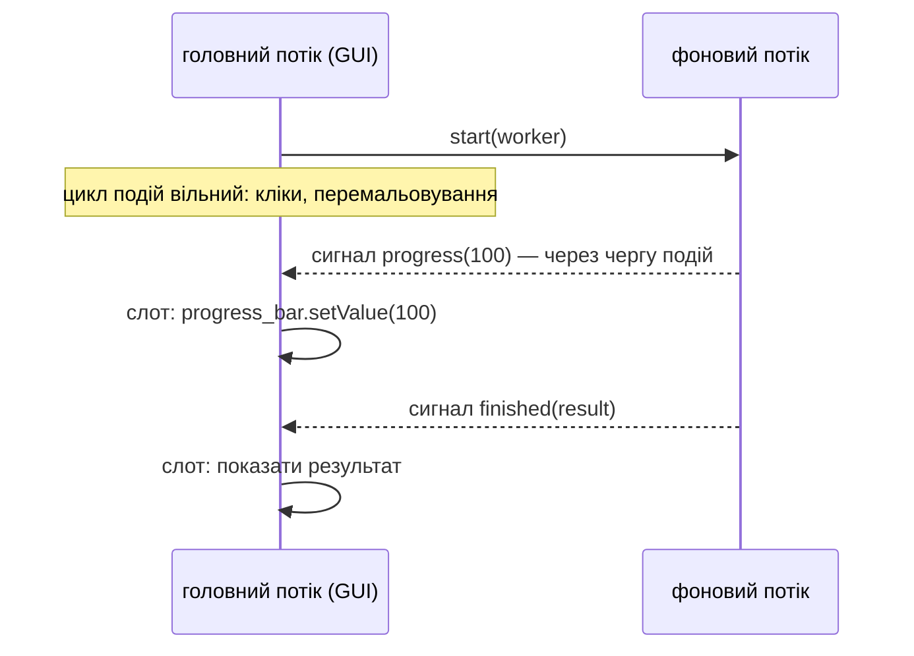

# 20. (Л) Багатопоточність у PySide6

## Зміст лекції

1. «Застосунок не відповідає»
2. Головний потік і цикл подій
3. Розбити роботу на частини: `QTimer`
4. Чому не `processEvents()`
5. Головне правило: віджети — лише з головного потоку
6. `QRunnable` і `QThreadPool`
7. Сигнали робітника
8. Прогрес і результат
9. Скасування
10. Помилки у фоновій задачі
11. `QThread` з обʼєктом-робітником
12. Як сигнали перетинають межу потоків
13. Мережеві запити у фоні
14. Що обрати
15. Типові помилки

## «Застосунок не відповідає»

Натисніть кнопку «Порахувати розмір каталогу» — і вікно завмирає: не перемальовується, не реагує на кліки, а ОС пропонує «завершити програму, що не відповідає». Причина знайома з лекції 34 6 семестру: **обробник блокує цикл подій**.

```python
# Program: a long handler blocks the event loop
import sys
import time

from PySide6.QtCore import QTimer
from PySide6.QtWidgets import QApplication, QPushButton

app = QApplication(sys.argv)
ticks = []
timer = QTimer(interval=50, timeout=lambda: ticks.append(time.perf_counter()))
timer.start()

button = QPushButton("Scan")
button.clicked.connect(lambda: time.sleep(0.5))  # «довга робота» в обробнику

QTimer.singleShot(100, button.click)
QTimer.singleShot(800, app.quit)
app.exec()
gaps = [round(b - a, 1) for a, b in zip(ticks, ticks[1:])]
print("longest pause between timer ticks:", max(gaps), "s")
```

```text
longest pause between timer ticks: 0.5 s
```

Таймер мав спрацьовувати кожні 50 мс, але пів секунди не спрацьовував жодного разу: увесь цей час цикл подій стояв. Так само не оброблялися б кліки, перемальовування і зміна розміру вікна.

## Головний потік і цикл подій

У GUI-застосунку цикл подій працює в **головному потоці** (GUI-потоці). У ньому ж виконуються всі обробники сигналів від віджетів.

| Тривалість обробника | Що бачить користувач |
|---|---|
| до ≈ 50 мс | миттєва реакція |
| 100–300 мс | помітна затримка |
| понад 1 с | «зависання», ОС вважає програму такою, що не відповідає |

Довгі операції — читання великих файлів, мережеві запити (лекція 37, 5 семестр), запити до бази, обчислення — виносять із головного потоку.

## Розбити роботу на частини: `QTimer`

Якщо роботу можна поділити на маленькі шматки, її можна виконувати **в головному потоці** частинами: таймер з інтервалом `0` викликає наступний шматок, щойно цикл подій оброблить інші події:

```python
# Program: process a big list in chunks without blocking the window
import sys

from PySide6.QtCore import QTimer
from PySide6.QtWidgets import QApplication

app = QApplication(sys.argv)
items = list(range(100_000))
state = {"position": 0, "total": 0, "chunks": 0}


def process_chunk() -> None:
    start = state["position"]
    chunk = items[start:start + 10_000]
    state["total"] += sum(chunk)
    state["position"] += len(chunk)
    state["chunks"] += 1
    if state["position"] >= len(items):
        timer.stop()
        print("done in", state["chunks"], "chunks, total", state["total"])
        app.quit()


timer = QTimer(interval=0, timeout=process_chunk)
timer.start()
app.exec()
```

```text
done in 10 chunks, total 4999950000
```

Між шматками цикл подій встигає обробити кліки й перемалювати вікно. Підхід простий, але підходить лише для робіт, які легко ділити, і не допоможе з блокуючими викликами (`requests.get` чекає відповіді цілком).

## Чому не `processEvents()`

Іноді в довгий цикл вставляють `QApplication.processEvents()`, щоб вікно «оживало». Це небезпечний прийом: під час `processEvents()` користувач може знову натиснути ту саму кнопку, закрити вікно чи змінити дані, з якими працює цикл. Обробник стає **повторно вхідним**, і помилки важко відтворити. Краще — таймер або фоновий потік.

## Головне правило: віджети — лише з головного потоку

Фонову роботу виконують в **іншому потоці**. Але віджети Qt **не потокобезпечні**:

!!! danger "Не чіпайте віджети з фонового потоку"
    Будь-які виклики віджетів (`label.setText`, `table.insertRow`, `progress.setValue`) — лише з головного потоку. Виклик з фонового потоку може спрацювати сто разів і впасти на сто першому — з пошкодженням памʼяті й аварійним завершенням програми.

Фоновий потік повідомляє головний про прогрес і результат **сигналами**. Qt доставить сигнал у головний потік через чергу подій, і слот виконається там, де можна працювати з віджетами.



## `QRunnable` і `QThreadPool`

Найпростіший спосіб запустити задачу у фоні — **пул потоків Qt** `QThreadPool` (той самий принцип, що `ThreadPoolExecutor`, лекція 32 6 семестру). Задачу описують класом-нащадком `QRunnable` з методом `run()`:

```python
# Program: run a task in the global thread pool
import sys
import threading
import time

from PySide6.QtCore import QRunnable, QThreadPool
from PySide6.QtWidgets import QApplication


class SleepTask(QRunnable):
    def run(self) -> None:
        print("task runs in the main thread:", threading.current_thread() is threading.main_thread())
        time.sleep(0.2)


app = QApplication(sys.argv)
pool = QThreadPool.globalInstance()
print("max threads in the pool:", pool.maxThreadCount() > 0)
pool.start(SleepTask())
pool.waitForDone()
print("all tasks finished")
```

```text
max threads in the pool: True
task runs in the main thread: False
all tasks finished
```

`QRunnable` не є `QObject`, тому **не може мати сигналів**. Сигнали оголошують в окремому класі-нащадку `QObject`.

## Сигнали робітника

```python
# File: scan_worker.py
import os
from pathlib import Path

from PySide6.QtCore import QObject, QRunnable, Signal


class ScanSignals(QObject):
    progress = Signal(int)            # кількість переглянутих файлів
    finished = Signal(int, int, bool) # файлів, байтів, чи скасовано
    error = Signal(str)


class ScanWorker(QRunnable):
    def __init__(self, folder: Path, report_every: int = 100) -> None:
        super().__init__()
        self.folder = folder
        self.report_every = report_every
        self.signals = ScanSignals()
        self.cancelled = False

    def cancel(self) -> None:
        self.cancelled = True  # прапорець читає фоновий потік

    def run(self) -> None:
        files = size = 0
        try:
            for root, _dirs, names in os.walk(self.folder):
                for name in names:
                    if self.cancelled:
                        self.signals.finished.emit(files, size, True)
                        return
                    try:
                        size += (Path(root) / name).stat().st_size
                    except OSError:
                        continue  # файл зник або немає доступу
                    files += 1
                    if files % self.report_every == 0:
                        self.signals.progress.emit(files)
        except Exception as exc:  # будь-яка неочікувана помилка — у головний потік сигналом
            self.signals.error.emit(f"{type(exc).__name__}: {exc}")
            return
        self.signals.finished.emit(files, size, False)
```

Робітник **не імпортує віджетів** і нічого не знає про вікно: він лише рахує й випромінює сигнали.

## Прогрес і результат

```python
# File: scan_window.py
import sys
from pathlib import Path

from PySide6.QtCore import QThreadPool
from PySide6.QtWidgets import QApplication, QLabel, QPushButton, QVBoxLayout, QWidget

from scan_worker import ScanWorker


class ScanWindow(QWidget):
    def __init__(self, folder: Path) -> None:
        super().__init__()
        self.folder = folder
        self.worker: ScanWorker | None = None
        self.start_button = QPushButton("Scan")
        self.cancel_button = QPushButton("Cancel", enabled=False)
        self.status = QLabel("Press Scan")
        layout = QVBoxLayout(self)
        for widget in (self.start_button, self.cancel_button, self.status):
            layout.addWidget(widget)
        self.start_button.clicked.connect(self.start)
        self.cancel_button.clicked.connect(self.cancel)

    def start(self) -> None:
        self.worker = ScanWorker(self.folder)
        self.worker.signals.progress.connect(lambda n: self.status.setText(f"Scanned {n} files..."))
        self.worker.signals.finished.connect(self.on_finished)
        self.worker.signals.error.connect(lambda message: self.status.setText(f"Error: {message}"))
        self.start_button.setEnabled(False)
        self.cancel_button.setEnabled(True)
        QThreadPool.globalInstance().start(self.worker)

    def cancel(self) -> None:
        if self.worker is not None:
            self.worker.cancel()

    def on_finished(self, files: int, size: int, cancelled: bool) -> None:
        prefix = "Cancelled after" if cancelled else "Done:"
        self.status.setText(f"{prefix} {files} files, {size / 1024 / 1024:.1f} MB")
        self.start_button.setEnabled(True)
        self.cancel_button.setEnabled(False)
        self.worker = None


if __name__ == "__main__":
    app = QApplication(sys.argv)
    window = ScanWindow(Path.home())
    window.show()
    sys.exit(app.exec())
```

```python
# Program: the window keeps working while the worker scans
import sys
import tempfile
from pathlib import Path

from PySide6.QtCore import QEventLoop, QTimer
from PySide6.QtWidgets import QApplication

from scan_window import ScanWindow

app = QApplication(sys.argv)
folder = Path(tempfile.mkdtemp())
for number in range(250):
    (folder / f"file{number}.txt").write_bytes(b"x" * 1000)

window = ScanWindow(folder)
loop = QEventLoop()
watcher = QTimer(interval=10, timeout=lambda: loop.quit() if window.worker is None else None)
window.start_button.click()
print("while scanning, buttons:", window.start_button.isEnabled(), window.cancel_button.isEnabled())
watcher.start()
loop.exec()
print(window.status.text())
print("after scanning, buttons:", window.start_button.isEnabled(), window.cancel_button.isEnabled())
```

```text
while scanning, buttons: False True
Done: 250 files, 0.2 MB
after scanning, buttons: True False
```

`QEventLoop` — локальний цикл подій: у прикладі він працює, доки вікно не обробить сигнал `finished` (атрибут `worker` знову стане `None`). У застосунку цю роль виконує `app.exec()`. Поки робітник рахує, головний потік вільний: кнопка `Scan` вимкнена, щоб не запустити друге сканування, а `Cancel` — увімкнена.

## Скасування

Потік не можна безпечно «вбити» ззовні: він міг тримати відкритий файл чи половину записаних даних. Скасування роблять **кооперативним**: головний потік встановлює прапорець, а робітник регулярно перевіряє його й завершується сам (як `CancelledError` в asyncio, лекція 38 6 семестру):

```python
# Program: cooperative cancellation of a running worker
import sys
import tempfile
from pathlib import Path

from PySide6.QtCore import QEventLoop, QThreadPool, QTimer
from PySide6.QtWidgets import QApplication

from scan_worker import ScanWorker

app = QApplication(sys.argv)
folder = Path(tempfile.mkdtemp())
for number in range(3000):
    (folder / f"f{number}").write_bytes(b"")

worker = ScanWorker(folder, report_every=10)
loop = QEventLoop()
result = {}
worker.signals.progress.connect(lambda n: worker.cancel() if n >= 50 else None)
worker.signals.finished.connect(lambda files, size, cancelled: (result.update(files=files, cancelled=cancelled),
                                                                QTimer.singleShot(0, loop.quit)))
QThreadPool.globalInstance().start(worker)
loop.exec()
print("cancelled:", result["cancelled"], "| partial count is small:", result["files"] < 3000)
```

```text
cancelled: True | partial count is small: True
```

Сигнал `progress` доставляється в головний потік із затримкою, тому робітник встигає переглянути ще кілька файлів після 50 — результат «частковий», але точне число змінюється від запуску до запуску.

## Помилки у фоновій задачі

Виняток у методі `run()` **не потрапить** у головний потік: потік пулу просто завершиться, а користувач не дізнається, чому нічого не сталося. Тому `run()` обгортають у `try/except` і передають помилку сигналом `error` (як у `ScanWorker`). У головному потоці слот показує повідомлення (`QMessageBox`) і записує подробиці в журнал (лекція 22).

## `QThread` з обʼєктом-робітником

`QThreadPool` зручний для коротких задач «запустив — отримав результат». Для **довгоживучого** фонового обʼєкта (постійне зʼєднання, черга завдань) використовують `QThread`: створюють обʼєкт-робітник (`QObject`) і **переміщують** його в потік методом `moveToThread`. Тоді всі його слоти виконуватимуться в тому потоці:

```python
# Program: a worker object living in its own QThread
import sys
import threading

from PySide6.QtCore import QCoreApplication, QObject, QThread, QTimer, Signal, Slot


class Worker(QObject):
    result = Signal(str)

    @Slot(int)
    def square(self, number: int) -> None:
        in_main = threading.current_thread() is threading.main_thread()
        self.result.emit(f"{number}^2 = {number * number} (main thread: {in_main})")


class Controller(QObject):
    request = Signal(int)


app = QCoreApplication(sys.argv)
thread = QThread()
worker = Worker()
worker.moveToThread(thread)
controller = Controller()
controller.request.connect(worker.square)  # слот виконується в потоці thread
answers = []
worker.result.connect(answers.append)      # а цей — у головному
thread.start()

for n in (3, 4):
    controller.request.emit(n)
QTimer.singleShot(300, app.quit)
app.exec()
thread.quit()
thread.wait()
print("\n".join(answers))
```

```text
3^2 = 9 (main thread: False)
4^2 = 16 (main thread: False)
```

Порядок завершення: `thread.quit()` зупиняє цикл подій потоку, `thread.wait()` чекає, доки він завершиться. Знищений обʼєкт `QThread`, що ще працює, — причина аварійного завершення з повідомленням `QThread: Destroyed while thread is still running`.

## Як сигнали перетинають межу потоків

Коли сигнал і слот належать обʼєктам у **різних** потоках, Qt використовує **чергове зʼєднання** (queued connection): аргументи сигналу копіюються, у потік отримувача надсилається подія, і слот виконується в його циклі подій. В одному потоці слот викликається одразу (direct connection). Тип обирається автоматично (`Qt.ConnectionType.AutoConnection`).

| Звідки → куди | Як виконується слот |
|---|---|
| той самий потік | одразу, як звичайний виклик функції |
| фоновий потік → обʼєкт головного потоку | через чергу подій головного потоку |
| головний → обʼєкт у `QThread` | через чергу подій цього потоку |

Тому і з `QRunnable` (сигнали `ScanSignals` належать головному потоку, бо там створені), і з `QThread` слоти, що змінюють віджети, виконуються в головному потоці.

## Мережеві запити у фоні

Курси НБУ (лекція 37, 5 семестр) завантажують бібліотекою `requests`. Запит блокує потік, тому — у робітнику:

```python
# File: rates_worker.py
from datetime import date

import requests
from PySide6.QtCore import QObject, QRunnable, Signal

URL = "https://bank.gov.ua/NBUStatService/v1/statdirectory/exchange"


class RatesSignals(QObject):
    loaded = Signal(dict)
    failed = Signal(str)


class RatesWorker(QRunnable):
    def __init__(self, day: date, currencies: list[str]) -> None:
        super().__init__()
        self.day = day
        self.currencies = currencies
        self.signals = RatesSignals()

    def run(self) -> None:
        try:
            rates = {}
            with requests.Session() as session:
                for code in self.currencies:
                    params = {"valcode": code, "date": self.day.strftime("%Y%m%d"), "json": ""}
                    response = session.get(URL, params=params, timeout=10)
                    response.raise_for_status()
                    rates[code] = response.json()[0]["rate"]
        except (requests.RequestException, IndexError, KeyError, ValueError) as exc:
            self.signals.failed.emit(f"Can not load rates: {exc}")
            return
        self.signals.loaded.emit(rates)
```

```python
# Program: load NBU rates in the background
import sys
from datetime import date

from PySide6.QtCore import QEventLoop, QThreadPool, QTimer
from PySide6.QtWidgets import QApplication

from rates_worker import RatesWorker

app = QApplication(sys.argv)
worker = RatesWorker(date(2026, 9, 1), ["USD", "EUR"])
loop = QEventLoop()
worker.signals.loaded.connect(lambda rates: print("loaded:", rates))
worker.signals.failed.connect(print)
for signal in (worker.signals.loaded, worker.signals.failed):
    signal.connect(lambda *args: QTimer.singleShot(0, loop.quit))
QThreadPool.globalInstance().start(worker)
loop.exec()
```

```text
loaded: {'EUR': 51.6369, 'USD': 44.5249}
```

Ключі словника у виводі впорядковані за алфавітом: сигнал `Signal(dict)` передає словник через тип Qt `QVariantMap`, який сортує ключі. Таймаут `timeout=10` обовʼязковий: без нього фоновий потік може «висіти» вічно, а при закритті програми пул чекатиме його завершення.

## Що обрати

| Задача | Інструмент |
|---|---|
| роботу легко ділити на короткі шматки | `QTimer` з інтервалом `0` |
| коротка фонова задача з результатом: файл, запит, обчислення | `QRunnable` + `QThreadPool` + сигнали |
| довгоживучий фоновий обʼєкт, черга запитів | `QObject` + `moveToThread` + `QThread` |
| важкі обчислення на всіх ядрах | процеси (`ProcessPoolExecutor`, лекція 32 6 семестру), результат — сигналом |
| багато асинхронних мережевих операцій | asyncio в окремому потоці або модуль `QtAsyncio` |

## Типові помилки

| Помилка | Чому погано | Як правильно |
|---|---|---|
| Довга операція в обробнику | вікно «не відповідає» | фоновий потік |
| Зміна віджета з фонового потоку | випадкові аварії | сигнал → слот у головному потоці |
| `processEvents()` у довгому циклі | повторні кліки, важкі помилки | таймер або потік |
| Виняток у `run()` без обробки | задача мовчки зникає | `try/except` + сигнал `error` |
| Немає скасування | користувач не може зупинити довгу операцію | прапорець, який перевіряє робітник |
| Кнопку «Start» не вимкнено | дві однакові задачі паралельно | `setEnabled(False)` до завершення |
| `QThread` знищено, поки працює | `QThread: Destroyed while thread is still running` | `quit()` + `wait()` |
| Мережевий запит без таймауту | потік «висить», програма не закривається | `timeout=` |
| Потоки для обчислень | GIL — немає прискорення (лекція 34 6 семестру) | процеси |

## Підсумок

- Обробник, що виконується довше кількох десятків мілісекунд, **блокує цикл подій**, і вікно «зависає».
- Роботу, яку легко ділити, виконують шматками через `QTimer(interval=0)`; блокуючі операції — у фоновому потоці.
- **Віджети — лише з головного потоку**; фоновий потік повідомляє про прогрес і результат **сигналами**, які Qt доставляє через чергу подій.
- `QRunnable` + `QThreadPool` — для коротких задач; сигнали оголошують в окремому `QObject`.
- Скасування кооперативне: прапорець, який перевіряє робітник; помилки передають сигналом.
- `QThread` + `moveToThread` — для довгоживучих фонових обʼєктів; завершення — `quit()` і `wait()`.

## Корисні посилання

- [Qt — Threading Basics](https://doc.qt.io/qt-6/thread-basics.html)
- [QThreadPool — документація](https://doc.qt.io/qtforpython-6/PySide6/QtCore/QThreadPool.html)
- [QThread — документація](https://doc.qt.io/qtforpython-6/PySide6/QtCore/QThread.html)
- [Qt — Threads and QObjects](https://doc.qt.io/qt-6/threads-qobject.html)
- [Python GUIs — Multithreading PySide6 applications with QThreadPool](https://www.pythonguis.com/tutorials/multithreading-pyside6-applications-qthreadpool/)
