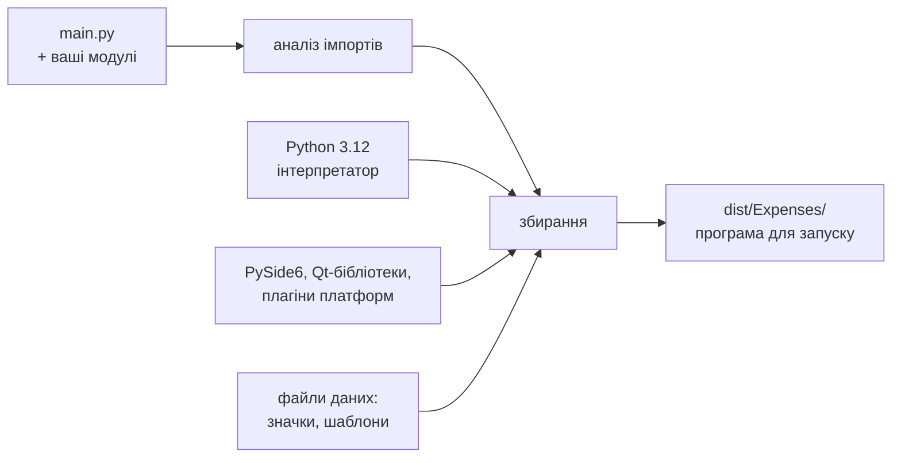

# 24. (Л) Пакування та розгортання застосунків за допомогою PyInstaller

## Зміст лекції

1. Проблема: як віддати застосунок користувачу
2. Що робить PyInstaller
3. Підготовка проєкту
4. Встановлення і перше збирання
5. `--onedir` чи `--onefile`
6. Застосунок без консолі: `--windowed`
7. Файли даних: `--add-data` і шлях до ресурсів
8. Де застосунок зберігає дані після встановлення
9. Значок і назва
10. Файл `.spec`
11. Приховані імпорти й зайві модулі
12. Розмір збірки
13. Перевірка збірки
14. Збирання для різних ОС
15. Версія застосунку
16. Контрольний список випуску
17. Типові помилки

## Проблема: як віддати застосунок користувачу

Застосунок «Облік витрат» працює на компʼютері розробника. Щоб запустити його в іншої людини, потрібні: Python потрібної версії, віртуальне середовище, `pip install PySide6` і команда `python main.py` у терміналі. Звичайний користувач цього робити не буде — він очікує **програму**, яку можна запустити подвійним кліком.

| Спосіб поширення | Для кого |
|---|---|
| вихідний код + `requirements.txt` | розробники |
| пакет на PyPI (`pip install`) | Python-програмісти, бібліотеки й консольні утиліти |
| Docker-образ (лекції 11–14, 6 семестр) | сервери й сервіси |
| **самодостатній застосунок** (PyInstaller) | звичайні користувачі десктопних програм |

## Що робить PyInstaller

**PyInstaller** аналізує програму, знаходить усі імпортовані модулі й бібліотеки і збирає їх **разом з інтерпретатором Python** в один каталог або файл. Користувачу не потрібен встановлений Python.



PyInstaller **не компілює** Python у машинний код і не захищає код від перегляду: байт-код лише упаковано поруч з інтерпретатором.

## Підготовка проєкту

Перед збиранням:

1. Застосунок запускається з чистого віртуального середовища: `python main.py`.
2. Усі залежності — у `requirements.txt` (лекція 31, 5 семестр).
3. Шляхи до файлів **не абсолютні** і не залежать від поточного каталогу.
4. Застосунок пише дані не поруч з програмою, а в стандартні каталоги (`QStandardPaths`, лекція 22).
5. Немає залежностей від файлів розробника (`/home/ivan/...`).

## Встановлення і перше збирання

```bash
source .venv/bin/activate
python3 -m pip install pyinstaller
pyinstaller --version
pyinstaller --noconfirm --windowed --name Expenses main.py
```

```text
6.22.3
...
INFO: Building COLLECT COLLECT-00.toc completed successfully.
INFO: Build complete! The results are available in: /home/student/expense_tracker/dist
```

PyInstaller встановлюють у **те саме** віртуальне середовище, що й застосунок: він збирає саме ті бібліотеки, що там встановлені.

Після збирання зʼявляються:

| Шлях | Що це |
|---|---|
| `build/` | тимчасові файли збирання (можна видаляти) |
| `dist/Expenses/` | готовий застосунок |
| `Expenses.spec` | опис збирання (див. нижче) |

Каталоги `build/` і `dist/` додають у `.gitignore`, а `Expenses.spec` — зберігають у репозиторії.

## `--onedir` чи `--onefile`

| | `--onedir` (типово) | `--onefile` |
|---|---|---|
| результат | каталог з програмою і бібліотеками | один файл |
| запуск | швидкий | повільніший: при кожному запуску файл розпаковується в тимчасовий каталог |
| розмір (порожній PySide6-застосунок, Linux) | ≈ 176 МБ на диску | ≈ 70 МБ (стиснено) |
| оновлення, перевірка вмісту | зручно | важче |
| поширення | архів каталогу | один файл |

```text
dist/Expenses/
  Expenses              # виконуваний файл
  _internal/            # Python, PySide6, Qt-бібліотеки, ваші модулі
    assets/
    PySide6/
    libQt6Core.so.6
    ...
```

Для десктопних застосунків частіше обирають `--onedir`: вони стартують швидше, а користувачу однаково віддають архів або інсталятор.

## Застосунок без консолі: `--windowed`

Без `--windowed` разом з вікном застосунку відкривається вікно терміналу (на macOS) — для GUI-застосунку це зайве. `--windowed` (`-w`) збирає застосунок без консолі, а на macOS створює пакет `Expenses.app`.

!!! warning "Без консолі не видно трасувань"
    У збірці з `--windowed` трасування винятків нікуди не виводяться. Тому до збирання налаштовують журнал у файл і глобальний перехоплювач (лекція 22). Під час налагодження збірки тимчасово збирайте **без** `--windowed`, щоб бачити помилки в терміналі.

## Файли даних: `--add-data` і шлях до ресурсів

PyInstaller автоматично знаходить лише **модулі**. Файли даних (значки, шаблони, файл прикладу) додають явно:

```bash
pyinstaller --noconfirm --windowed --name Expenses --add-data "assets:assets" main.py
```

`"assets:assets"` — «скопіювати каталог `assets` проєкту в каталог `assets` збірки». Роздільник — двокрапка.

У зібраному застосунку файли лежать не поруч з `main.py`, а в каталозі збірки (для `--onefile` — у тимчасовому каталозі розпакування). PyInstaller повідомляє цей каталог атрибутом `sys._MEIPASS` і встановлює `sys.frozen = True`. Функція пошуку ресурсів працює і зі збіркою, і без неї:

```python
# File: resources.py
import sys
from pathlib import Path


def is_frozen() -> bool:
    return bool(getattr(sys, "frozen", False))


def resource_path(relative: str) -> Path:
    """Path to a bundled file: next to this module in development, inside the bundle after PyInstaller."""
    base = Path(getattr(sys, "_MEIPASS", Path(__file__).resolve().parent))
    return base / relative
```

```python
# Program: find a resource file without PyInstaller
import tempfile
from pathlib import Path

import resources

folder = Path(resources.__file__).parent
(folder / "assets").mkdir(exist_ok=True)
(folder / "assets" / "welcome.txt").write_text("Welcome to Expenses 1.0\n", encoding="utf-8")

print("frozen:", resources.is_frozen())
path = resources.resource_path("assets/welcome.txt")
print("relative to the module:", path.parent.parent == folder)
print(path.read_text(encoding="utf-8").strip())
```

```text
frozen: False
relative to the module: True
Welcome to Expenses 1.0
```

Той самий код у збірці (перевірено на Linux):

```bash
./dist/Expenses/Expenses
```

```text
frozen: True | Welcome to Expenses 1.0
```

!!! danger "Не використовуйте поточний каталог"
    `open("assets/icon.png")` працює, лише коли програму запущено з каталогу проєкту. Подвійний клік по програмі запускає її з іншим поточним каталогом — і файл «не знайдено». Шлях будують від `resource_path`.

## Де застосунок зберігає дані після встановлення

Каталог збірки може бути **лише для читання** (наприклад, `/Applications` на macOS чи `/opt` на Linux), а файли з тимчасового каталогу `--onefile` зникають після завершення програми. Тому:

| Тип файлу | Де |
|---|---|
| ресурси, що постачаються з програмою (значки, шаблони) | `resource_path(...)` — лише читання |
| дані користувача (CSV витрат) | там, де обрав користувач (`QFileDialog`) |
| журнал, кеш, внутрішня база | `QStandardPaths.AppDataLocation` |
| налаштування | `QSettings` |

## Значок і назва

| Параметр | Значення |
|---|---|
| `--name Expenses` | назва програми й каталогу |
| `--icon assets/icon.icns` | значок програми (macOS — формат `.icns`) |
| у коді: `app.setWindowIcon(QIcon(str(resource_path("assets/icon.png"))))` | значок вікон на Linux |

На Linux значок програми в меню задає `.desktop`-файл, а не сам виконуваний файл:

```ini
[Desktop Entry]
Type=Application
Name=Expenses
Exec=/opt/expenses/Expenses
Icon=/opt/expenses/_internal/assets/icon.png
Categories=Office;Finance;
```

Файл зберігають як `~/.local/share/applications/expenses.desktop`.

## Файл `.spec`

Після першого збирання PyInstaller створює `Expenses.spec` — Python-файл з описом збирання. Довгий рядок параметрів зручніше один раз записати в `.spec` і далі збирати командою `pyinstaller Expenses.spec`:

```text
# File: Expenses.spec
a = Analysis(
    ["main.py"],
    pathex=[],
    binaries=[],
    datas=[("assets", "assets")],
    hiddenimports=[],
    excludes=["tkinter", "PySide6.QtWebEngineCore", "PySide6.QtQuick"],
    noarchive=False,
)
pyz = PYZ(a.pure)
exe = EXE(
    pyz,
    a.scripts,
    [],
    exclude_binaries=True,
    name="Expenses",
    console=False,
    upx=True,
)
coll = COLLECT(exe, a.binaries, a.datas, upx=True, name="Expenses")
```

| Частина | Що задає |
|---|---|
| `Analysis` | точка входу, файли даних (`datas`), додаткові й виключені модулі |
| `PYZ` | архів байт-коду Python-модулів |
| `EXE` | виконуваний файл: назва, консоль, значок |
| `COLLECT` | каталог `dist/Expenses` (режим `--onedir`) |

Імена `Analysis`, `PYZ`, `EXE`, `COLLECT` PyInstaller надає сам, коли виконує `.spec`-файл, тому цей файл не запускають командою `python`.

## Приховані імпорти й зайві модулі

PyInstaller шукає імпорти статично — читаючи `import` у коді. Він **не бачить** модулів, що імпортуються динамічно (`importlib.import_module(name)`, плагіни). Тоді збірка падає з `ModuleNotFoundError`, хоча з вихідного коду все працює. Рішення — вказати модуль явно:

```bash
pyinstaller --hidden-import expenses.exporters.csv_exporter main.py
```

І навпаки: зайві модулі збільшують збірку. `--exclude-module tkinter` прибирає непотрібне.

## Розмір збірки

Порожній застосунок PySide6 займає сотні мегабайтів: у збірку потрапляє весь Python і чимало бібліотек Qt.

| Прийом | Ефект |
|---|---|
| збирати в чистому віртуальному середовищі | не потрапляють бібліотеки, що не використовуються |
| `excludes` для модулів Qt, які не потрібні (QtWebEngine, QtQuick, Qt3D) | мінус десятки–сотні МБ |
| `--onefile` | стиснення (але повільніший запуск) |
| архів для поширення (`tar.gz`, `zip`) | стиснення під час завантаження |

```bash
du -sh dist/Expenses
du -sh dist/Expenses/_internal/PySide6
```

```text
176M    dist/Expenses
116M    dist/Expenses/_internal/PySide6
```

## Перевірка збірки

Збірку перевіряють **на чистій системі** — без Python і без віртуального середовища розробника, бо на компʼютері розробника програма може «випадково» знайти бібліотеку, якої немає в збірці. Зручно: окремий користувач ОС, віртуальна машина або Docker-контейнер (для Linux-збірок).

| Що перевірити | Як |
|---|---|
| програма запускається | подвійний клік / `./dist/Expenses/Expenses` |
| ресурси знайдено | значки, шаблони відображаються |
| відкриття й збереження файлів | діалоги, запис у вибраний каталог |
| налаштування зберігаються | перезапуск програми |
| журнал пишеться | файл у `AppDataLocation` |
| мережеві функції | завантаження курсів НБУ |

Для автоматичної перевірки в CI (лекція 28, 6 семестр) у програму додають режим «запуститися й одразу вийти», наприклад аргумент `--smoke-test`, і запускають збірку з `QT_QPA_PLATFORM=offscreen`.

## Збирання для різних ОС

PyInstaller **не вміє збирати для іншої ОС**: збірку для macOS роблять на macOS, для Linux — на Linux. Тому кросплатформні застосунки збирають у CI на кількох runner-ах GitHub Actions:

```yaml
# File: .github/workflows/build.yml
name: build
on:
  push:
    tags: ["v*"]
jobs:
  build:
    strategy:
      matrix:
        os: [ubuntu-latest, macos-latest]
    runs-on: ${{ matrix.os }}
    steps:
      - uses: actions/checkout@v4
      - uses: actions/setup-python@v5
        with:
          python-version: "3.12"
      - run: pip install -r requirements.txt pyinstaller
      - run: pyinstaller --noconfirm Expenses.spec
      - uses: actions/upload-artifact@v4
        with:
          name: expenses-${{ matrix.os }}
          path: dist/
```

Збирання запускається, коли в репозиторії створюють тег версії (`git tag v1.0.0 && git push --tags`), а готові збірки можна завантажити з вкладки Actions.

| ОС | Результат | Особливості |
|---|---|---|
| Linux | каталог з виконуваним файлом | збирати на найстарішій підтримуваній версії дистрибутива: бібліотеки системи сумісні «вперед», але не «назад» |
| macOS | `Expenses.app` | без підпису (`codesign`) Gatekeeper попереджає користувача; для поширення — підпис і нотаризація Apple |

## Версія застосунку

Версію задають в одному місці коду і показують у вікні «About», журналі та назві архіву:

```python
# File: version.py
__version__ = "1.0.0"
```

```python
# Program: one place for the application version
import sys

from PySide6.QtWidgets import QApplication

from version import __version__

app = QApplication(sys.argv)
app.setApplicationName("Expenses")
app.setApplicationVersion(__version__)
print(f"{app.applicationName()} {app.applicationVersion()}")
```

```text
Expenses 1.0.0
```

Версії записують за схемою **семантичного версіонування** `MAJOR.MINOR.PATCH`: `PATCH` — виправлення помилок, `MINOR` — нові можливості без порушення сумісності, `MAJOR` — несумісні зміни (наприклад, новий формат файлів).

## Контрольний список випуску

| Крок | Перевірка |
|---|---|
| тести проходять | `pytest`, зелений CI |
| версію збільшено | `version.py`, тег `v1.0.0` |
| збірка з чистого середовища | `pyinstaller Expenses.spec` |
| запуск на чистій системі | без Python розробника |
| ресурси, файли, налаштування, журнал | список з розділу «Перевірка збірки» |
| архів і опис змін | `Expenses-1.0.0-linux.tar.gz`, `CHANGELOG.md` |

## Типові помилки

| Помилка | Чому погано | Як правильно |
|---|---|---|
| Збирання в глобальному Python | у збірку потрапляють сторонні бібліотеки або бракує потрібних | віртуальне середовище застосунку |
| Шляхи відносно поточного каталогу | `FileNotFoundError` після подвійного кліку | `resource_path` |
| Файли даних не додано | збірка без значків і шаблонів | `--add-data` / `datas` у `.spec` |
| Запис у каталог програми | немає прав або дані зникають (`--onefile`) | `QStandardPaths`, `QSettings` |
| `--windowed` без журналу | помилки невидимі | журнал у файл і `sys.excepthook` |
| Перевірка лише на компʼютері розробника | «у мене працює» | чиста система |
| Очікування збірки для macOS на Linux | PyInstaller так не вміє | збирати на кожній ОС, CI-матриця |
| `build/` і `dist/` у git | сотні мегабайтів у репозиторії | `.gitignore` |

## Підсумок

- **PyInstaller** збирає програму разом з інтерпретатором Python і бібліотеками; користувачу не потрібен Python.
- `--onedir` (каталог, швидкий запуск) або `--onefile` (один файл, повільніший запуск); `--windowed` — без консолі.
- Файли даних додають `--add-data` і шукають через `sys._MEIPASS` (`resource_path`); дані користувача пишуть у стандартні каталоги.
- Налаштування збирання зберігають у файлі `.spec`; приховані імпорти вказують `hiddenimports`, зайві модулі — `excludes`.
- Збірку перевіряють на чистій системі; для кожної ОС збирають окремо, зручно — у GitHub Actions.
- Версію задають в одному місці й позначають за семантичним версіонуванням.

## Корисні посилання

- [PyInstaller Manual](https://pyinstaller.org/en/stable/)
- [PyInstaller — Using Spec Files](https://pyinstaller.org/en/stable/spec-files.html)
- [PyInstaller — Run-time Information (`sys._MEIPASS`)](https://pyinstaller.org/en/stable/runtime-information.html)
- [Python GUIs — Packaging PySide6 applications with PyInstaller](https://www.pythonguis.com/tutorials/packaging-pyside6-applications-pyinstaller-macos-dmg/)
- [Semantic Versioning 2.0.0](https://semver.org/)
